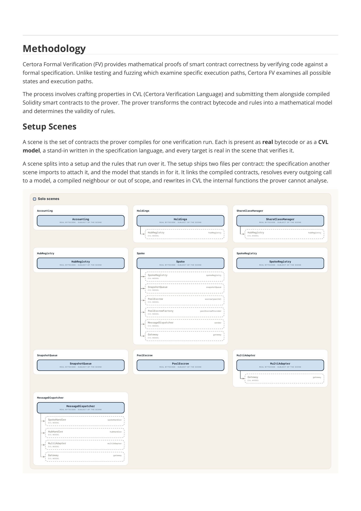
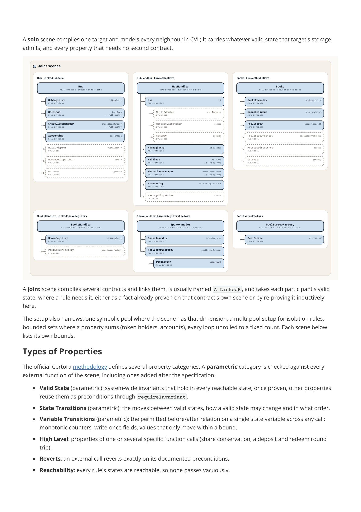

# 2026-08-FV

[Original PDF](../../../../../centrifuge__protocol-internal/docs/audits/2026-08-FV.pdf)

Page numbers below count PDF pages, including covers. Fixed-width text preserves table columns and code indentation.

## PDF page 1

```text
Formal Verification Report: Centrifuge Core
   Date: September 11th, 2026

   Audit Repo: https://github.com/alexzoid-eth/2026-08-centrifuge-fv-ex
   Client Repo: https://github.com/centrifuge/protocol-internal (3397d602)

   Author: AlexZoid
   Certora Prover version: 8.16.2


Table of Contents
 1. Verification Scope

 2. Methodology
          Setup Scenes

          Types of Properties

          Types of Assumptions

 3. Properties

          Accounting

          Holdings

          ShareClassManager

          HubRegistry

          Spoke

          SpokeRegistry
          SnapshotQueue

          PoolEscrow
          MultiAdapter

          Hub_LinkedHubCore
          HubHandler_LinkedHubCore

          Spoke_LinkedSpokeCore
          SpokeHandler_LinkedSpokeRegistry

          SpokeHandler_LinkedRegistryFactory

          MessageDispatcher

          PoolEscrowFactory

 4. Mutation Testing

 5. Reproducing the Results

          Prerequisites

          Remote Execution

          Local Execution

          Running the Suites

 6. Resources
```

## PDF page 2

```text
Verification Scope
Centrifuge is a real-world-asset tokenization protocol built as a hub and spoke: one hub chain carries each pool's
accounting and administration, spoke chains the custody and user-facing balance-sheet operations; a quorum-gated
messaging layer keeps them convergent. The contracts verified, all in src/core/ , fall into three groups.

Hub side

   1. Accounting ( hub/Accounting.sol ): the double-entry ledger of per-pool charts of accounts, mutable only inside a
      transient session that refuses to close unless debits equal credits.

   2. Holdings ( hub/Holdings.sol ): the hub's mirror of spoke asset positions per pool, share class and asset, with
      carrying value in pool currency against cumulative increase and decrease counters.

   3. ShareClassManager ( hub/ShareClassManager.sol ): the share class registry and hub-side conservation ledger,
      where per-network issuance and revocation counters must sum to the global total issuance.

   4. HubRegistry ( hub/HubRegistry.sol ): the registry of pools, assets, managers and policies, plus the timelocked
      authorization ledger the hub access-control model rests on.

   5. Hub ( hub/Hub.sol ): the pool-manager orchestrator over the four contracts above, which must post a paired debit
      and credit for every accounting mutation.

   6. HubHandler ( hub/HubHandler.sol ): the hub-side entry point for cross-chain messages, applying spoke deltas to
      Holdings and ShareClassManager, reconciling the burn-and-mint share bridge.

Spoke side

   7. Spoke ( spoke/Spoke.sol ): the balance-sheet orchestrator for users and managers, where every escrow operation
      must mirror into the snapshot queue.

   8. SpokeRegistry ( spoke/SpokeRegistry.sol ): the spoke's source of truth for pools, share classes, roles, policies,
      vaults and prices, over an asset-id bijection.

   9. SpokeHandler ( spoke/SpokeHandler.sol ): the spoke-side message applier, deploying escrows, tokens and vaults
      and routing mutations into the registry.

  10. SnapshotQueue ( spoke/SnapshotQueue.sol ): the accumulator of share and asset deltas pending submission to
      the hub, carrying the consistency flag the hub trusts.

  11. PoolEscrow ( spoke/PoolEscrow.sol ): the per-pool custody contract, with total and reserved bookkeeping where a
      withdrawal never pays the reserved part.

  12. PoolEscrowFactory ( spoke/factories/PoolEscrowFactory.sol ): the CREATE2 deployer and address oracle for
      those escrows, where a pool's escrow address is the same for every caller and unchanged by any call the factory
      takes.

Messaging

  13. MultiAdapter ( messaging/MultiAdapter.sol ): the quorum layer over bridge adapters, where an inbound payload
      becomes truth only at threshold votes per chain, pool and session.

  14. MessageDispatcher ( messaging/MessageDispatcher.sol ): the outbound end of the messaging layer, taking a local
      destination straight into its handler and a remote one into the gateway, where a caller without the ward bit moves
      no wiring and reaches no neighbour.
```

## PDF page 3

```text
Methodology
Certora Formal Verification (FV) provides mathematical proofs of smart contract correctness by verifying code against a
formal specification. Unlike testing and fuzzing which examine specific execution paths, Certora FV examines all possible
states and execution paths.

The process involves crafting properties in CVL (Certora Verification Language) and submitting them alongside compiled
Solidity smart contracts to the prover. The prover transforms the contract bytecode and rules into a mathematical model
and determines the validity of rules.

Setup Scenes
A scene is the set of contracts the prover compiles for one verification run. Each is present as real bytecode or as a CVL
model, a stand-in written in the specification language, and every target is real in the scene that verifies it.

A scene splits into a setup and the rules that run over it. The setup ships two files per contract: the specification another
scene imports to attach it, and the model that stands in for it. It links the compiled contracts, resolves every outgoing call
to a model, a compiled neighbour or out of scope, and rewrites in CVL the internal functions the prover cannot analyse.


      Solo scenes


     Accounting                                                               Holdings                                                                    ShareClassManager


                                  Accounting                                                                  Holdings                                                            ShareClassManager
                        REAL BYTECODE · SUBJECT OF THE SCENE                                      REAL BYTECODE · SUBJECT OF THE SCENE                                       REAL BYTECODE · SUBJECT OF THE SCENE


                                                                                      HubRegistry                                          hubRegistry           HubRegistry                                        hubRegistry
                                                                                      CVL MODEL                                                                  CVL MODEL


     HubRegistry                                                              Spoke                                                                       SpokeRegistry


                                  HubRegistry                                                                   Spoke                                                                SpokeRegistry
                        REAL BYTECODE · SUBJECT OF THE SCENE                                      REAL BYTECODE · SUBJECT OF THE SCENE                                       REAL BYTECODE · SUBJECT OF THE SCENE


                                                                                      SpokeRegistry                                      spokeRegistry
                                                                                      CVL MODEL


                                                                                      SnapshotQueue                                      snapshotQueue
                                                                                      CVL MODEL


                                                                                      PoolEscrow                                         escrow(poolId)
                                                                                      CVL MODEL


                                                                                      PoolEscrowFactory                              poolEscrowProvider
                                                                                      CVL MODEL


                                                                                      MessageDispatcher                                         sender
                                                                                      CVL MODEL


                                                                                      Gateway                                                  gateway
                                                                                      CVL MODEL


     SnapshotQueue                                                            PoolEscrow                                                                  MultiAdapter


                                SnapshotQueue                                                               PoolEscrow                                                                MultiAdapter
                        REAL BYTECODE · SUBJECT OF THE SCENE                                      REAL BYTECODE · SUBJECT OF THE SCENE                                       REAL BYTECODE · SUBJECT OF THE SCENE


                                                                                                                                                                 Gateway                                               gateway
                                                                                                                                                                 CVL MODEL


     MessageDispatcher


                             MessageDispatcher
                        REAL BYTECODE · SUBJECT OF THE SCENE


            SpokeHandler                                       spokeHandler
            CVL MODEL


            HubHandler                                          hubHandler
            CVL MODEL


            MultiAdapter                                       multiAdapter
            CVL MODEL


            Gateway                                                gateway
            CVL MODEL
```



## PDF page 4

```text
A solo scene compiles one target and models every neighbour in CVL; it carries whatever valid state that target's storage
admits, and every property that needs no second contract.


        Joint scenes


        Hub_LinkedHubCore                                                             HubHandler_LinkedHubCore                                                      Spoke_LinkedSpokeCore


                                          Hub                                                                      HubHandler                                                                        Spoke
                           REAL BYTECODE · SUBJECT OF THE SCENE                                          REAL BYTECODE · SUBJECT OF THE SCENE                                          REAL BYTECODE · SUBJECT OF THE SCENE


               HubRegistry                                             hubRegistry           Hub                                                             hub           SpokeRegistry                                      spokeRegistry
               REAL BYTECODE                                                                 REAL BYTECODE                                                                 REAL BYTECODE


               Holdings                                                   holdings                 MultiAdapter                                     multiAdapter           SnapshotQueue                                      snapshotQueue
               REAL BYTECODE                                        -> hubRegistry                 CVL MODEL                                                               REAL BYTECODE


               ShareClassManager                                  shareClassManager                MessageDispatcher                                      sender           PoolEscrow                                         escrow(poolId)
               REAL BYTECODE                                        -> hubRegistry                 CVL MODEL                                                               REAL BYTECODE


               Accounting                                               accounting                 Gateway                                               gateway           PoolEscrowFactory                              poolEscrowProvider
               REAL BYTECODE                                                                       CVL MODEL                                                               CVL MODEL


               MultiAdapter                                           multiAdapter           HubRegistry                                             hubRegistry           MessageDispatcher                                         sender
               CVL MODEL                                                                     REAL BYTECODE                                                                 CVL MODEL


               MessageDispatcher                                            sender           Holdings                                                   holdings           Gateway                                                  gateway
               CVL MODEL                                                                     REAL BYTECODE                                        -> hubRegistry           CVL MODEL


               Gateway                                                     gateway           ShareClassManager                                  shareClassManager
               CVL MODEL                                                                     REAL BYTECODE                                        -> hubRegistry


                                                                                             Accounting                                    accounting, via Hub
                                                                                             REAL BYTECODE


                                                                                             MessageDispatcher                                            sender
                                                                                             CVL MODEL


        SpokeHandler_LinkedSpokeRegistry                                              SpokeHandler_LinkedRegistryFactory                                            PoolEscrowFactory


                                    SpokeHandler                                                                  SpokeHandler                                                              PoolEscrowFactory
                           REAL BYTECODE · SUBJECT OF THE SCENE                                          REAL BYTECODE · SUBJECT OF THE SCENE                                          REAL BYTECODE · SUBJECT OF THE SCENE


               SpokeRegistry                                         spokeRegistry           SpokeRegistry                                         spokeRegistry           PoolEscrow                                            escrowLink
               REAL BYTECODE                                                                 REAL BYTECODE                                                                 REAL BYTECODE


               PoolEscrowFactory                                  poolEscrowFactory          PoolEscrowFactory                                  poolEscrowFactory
               CVL MODEL                                                                     REAL BYTECODE


                                                                                                   PoolEscrow                                         escrowLink
                                                                                                   REAL BYTECODE


A joint scene compiles several contracts and links them, is usually named A_LinkedB , and takes each participant's valid
state, where a rule needs it, either as a fact already proven on that contract's own scene or by re-proving it inductively
here.

The setup also narrows: one symbolic pool where the scene has that dimension, a multi-pool setup for isolation rules,
bounded sets where a property sums (token holders, accounts), every loop unrolled to a fixed count. Each scene below
lists its own bounds.

Types of Properties
The official Certora methodology defines several property categories. A parametric category is checked against every
external function of the scene, including ones added after the specification.

         Valid State (parametric): system-wide invariants that hold in every reachable state; once proven, other properties
         reuse them as preconditions through requireInvariant .

         State Transitions (parametric): the moves between valid states, how a valid state may change and in what order.

         Variable Transitions (parametric): the permitted before/after relation on a single state variable across any call:
         monotonic counters, write-once fields, values that only move within a bound.

         High Level: properties of one or several specific function calls (share conservation, a deposit and redeem round
         trip).

         Reverts: an external call reverts exactly on its documented preconditions.

         Reachability: every rule's states are reachable, so none passes vacuously.
```



## PDF page 5

```text
      Access Control (parametric): every privileged entry point enforces its ward or role gate.

Types of Assumptions
Each require limits which states the prover checks, and its tag says why.

      SAFE: excludes no reachable state ( msg.sender != 0 ).

      SCOPE: narrows a rule to the logic it checks ( receiver != escrowAddress ).
      UNSAFE: drops reachable states, for a prover limit or timeout (a loop unrolled to a fixed count).

      TRUSTED: guaranteed by a trusted party outside the scene (a valid setup left by the initializer logic).
      PROVED: not an assumption: a fact proven elsewhere, reused as a precondition (an invariant via
       requireInvariant ).

      ASSERT: used in models: a require reproducing a revert of the real code, a path the prover drops by default
      anyway ( InsufficientBalance in the token model).
```


## PDF page 6

```text
Properties
Every verdict below comes from the prover version named in the header.

      Properties: every invariant and rule the suite states

      Proved       : verified by the prover

      Timeout       : the prover ran the rule and did not decide it within the solver budget the confs carry

      Mutations       : rules with a mutant the prover killed, meaning the rule holds on the real code and breaks on a
      deliberately faulted one. An empty cell means no mutant is written for that rule, which is where an undecided rule
      stands: a kill is a change of verdict, and a rule the prover never decided has none to change

      Violations      : rules that fail


                                                              Proved        Timeout          Mutations         Violations
  Contract                                    Properties


  Accounting                                  72              72            0                72                0

  Holdings                                    87              87            0                87                0

  ShareClassManager                           85              85            0                85                0

  HubRegistry                                 105             105           0                105               0

  Spoke                                       94              94            0                94                0

  SpokeRegistry                               141             141           0                141               0

  SnapshotQueue                               75              75            0                75                0

  PoolEscrow                                  52              52            0                52                0

  MultiAdapter                                97              96            1                96                0

  Hub_LinkedHubCore                           97              97            0                97                0

  HubHandler_LinkedHubCore                    101             101           0                101               0

  Spoke_LinkedSpokeCore                       39              39            0                39                0

  SpokeHandler_LinkedSpokeRegistry            91              91            0                91                0

  SpokeHandler_LinkedRegistryFactory          1               1             0                1                 0

  MessageDispatcher                           3               3             0                3                 0

  PoolEscrowFactory                           4               4             0                4                 0

  Total                                       1144            1143          1                1143              0


Accounting
      Every configuration
             The chart of accounts bounded to 3 symbolic accounts

             Loops running up to 3 iterations
      Single pool
```

## PDF page 7

```text
            One symbolic pool

     Multi pool

            Two symbolic pools

Valid State

 Properties                                                                                   Status    Mutations

 AC-VS-01 absentAccountIsEmpty
 An account that was never created is empty, so one opened later cannot carry a history.

 AC-VS-02 nullAccountNeverCreated
 The null account id never exists, so it absorbs no entries and no holding wires to it.

 AC-VS-03 lastUpdatedBetweenEnvFloorAndBlock
 An existing account's stamp sits above the scene's minimum block time and no later than
 the current block.

 AC-VS-04 postedHistoryImpliesAnIssuedJournalId
 An account carrying posting history proves a session was opened and took an id.


State Transitions

 Properties                                                                                Status      Mutations

 AC-ST-01 stAcAccountOrientationIsPermanent
 An account keeps the orientation it was opened under.

 AC-ST-02 stAcAccountRowsArePerPool
 A call moving one pool's account row leaves the other pool's rows untouched.

 AC-ST-03 stAcJournalNumberingIsPerPool
 A call touching one pool's journal leaves the other pool's journal alone.


Variable Transitions

 Properties                                                                                   Status    Mutations

 AC-VT-01 vtAcAccountDebitNeverDecreases
 Debit history is permanent: no call writes down what a pool has recorded.

 AC-VT-02 vtAcAccountCreditNeverDecreases
 Credit history is permanent: no call writes down what a pool has recorded.

 AC-VT-03 vtAcAccountStampNeverRegresses
 An account's stamp only moves forward, so a row can never be backdated.

 AC-VT-04 vtAcJournalCounterNeverRewinds
 A pool's journal numbering never rewinds, so a number once spent is never handed out
 again.


High Level

 Properties                                                                                  Status     Mutations
```

## PDF page 8

```text
 AC-HL-01 hlAcSessionClosesOnlyOnEqualPostedValues
 A session closes only when the values it posted balance on both sides.

 AC-HL-02 hlAcJournalPairDebitsExactlyItsNamedRow
 A journal pair debits exactly the row and the value it names, and no other row.

 AC-HL-03 hlAcJournalPairCreditsExactlyItsNamedRow
 A journal pair credits exactly the row and the value it names, and no other row.

 AC-HL-04 hlAcLedgerMovesOnlyThroughAJournal
 The recorded books move only through a journal; every other call leaves them standing.

 AC-HL-05 hlAcSecondJournalOfAPoolReusesItsJournalId
 A second journal of the same pool in one transaction is filed under the first journal's id.

 AC-HL-06 hlAcAccountValueReportsTheRowsNetMagnitude
 The balance reported for an account is its net position, never a gross total.

 AC-HL-07 hlAcAccountValueSignsByTheRowsOrientation
 An account's reported sign follows the orientation it was opened under.

 AC-HL-08 hlAcReopenedJournalStartsFromEmptyPostedSides
 A journal reopened after an earlier one starts from empty totals.


Reverts

 Properties                                                                                    Status   Mutations

 AC-RV-01 rvAcUnlockRefusesANonWard
 A journal opens only for the pool's own ledger authority, and never on the null pool.

 AC-RV-02 rvAcUnlockRefusesASecondOpenWhileAJournalStands
 A journal already open is never opened a second time.

 AC-RV-03 rvAcCreateAccountRefusesAPaidCallANonWardTheNullIdOrARowThatStands
 A live account's history cannot be wiped by opening the same account again.

 AC-RV-04 rvAcAddDebitRefusesARowTheLedgerNeverOpened
 A debit needs a row the ledger opened.

 AC-RV-05 rvAcAddCreditRefusesARowTheLedgerNeverOpened
 A credit needs a row the ledger opened.

 AC-RV-06 rvAcLockRevertsIffThePostedSidesDiffer
 A journal closes only when the two sides it posted match.

 AC-RV-07 rvAcAddJournalOffSessionRefusesANonWardOrAnyEntry
 Nothing can be posted to a pool's books outside an open journal.

 AC-RV-08 rvAcAccountValueRefusesARowTheLedgerNeverOpened
 The value of an account the ledger never opened is refused, not reported as zero.

 AC-RV-09 rvAcPassingExistsIsReachable
 Witnesses a read taken in the transaction that opened an account answering and reporting
 that account.

 AC-RV-10 rvAcJournalPairRefusesUnbalancedLegs
 An unbalanced pair never reaches the books.
```

## PDF page 9

```text
 AC-RV-11 rvAcPassingJournalPairOnABalancedPairIsReachable
 Witnesses a nonzero balanced pair going through end to end on two rows the ledger
 already holds.

 AC-RV-12 rvAcAddDebitRefusesAnOutsiderInsideAnOpenJournal
 An open journal is not an open door: an outsider still cannot charge the books.

 AC-RV-13 rvAcAddCreditRefusesAnOutsiderInsideAnOpenJournal
 An open journal is not an open door: an outsider still cannot credit the books.

 AC-RV-14 rvAcLockRefusesAnOutsiderOnAnOpenJournal
 Only the ledger's own authority may close a journal.

 AC-RV-15 rvAcAccountValueAlwaysAnswersForARowThatStands
 The value of an account the ledger holds always reads back, on either side of its normal
 balance.


Reachability

 Properties                                                                                     Status   Mutations

 AC-RC-01 rcAcUnlockOpensAJournalIsReachable
 Witnesses a ward opening a journal on a pool, minting it a fresh id.

 AC-RC-02 rcAcSecondSessionOfAPoolIsReachable
 Witnesses a pool's journal closed and reopened inside one transaction.

 AC-RC-03 rcAcLastJournalIdOfTheSequenceIsReachable
 Witnesses a pool one id short of exhaustion opening one more journal.

 AC-RC-04 rcAcEmptyJournalOverAnUntouchedLedgerIsReachable
 Witnesses an empty journal opening and closing, and still spending one id.

 AC-RC-05 rcAcBalancedPairPostsAndClosesIsReachable
 Witnesses the ordinary journal end to end: open, a matching debit and credit, close.

 AC-RC-06 rcAcDebitHeavySessionRecoversIsReachable
 Witnesses that a debit-heavy session is not wedged: the compensating credit still closes it.

 AC-RC-07 rcAcTwoDebitsCloseAgainstOneCreditIsReachable
 Witnesses a journal of several entries closing on the summed condition.

 AC-RC-08 rcAcZeroValueDebitRestampsTheRowIsReachable
 Witnesses a zero-value debit restamping the row without moving a total.

 AC-RC-09 rcAcZeroValueCreditRestampsTheRowIsReachable
 Witnesses a zero-value credit restamping the row without moving a total.

 AC-RC-10 rcAcDebitFillsARowToTheCeilingIsReachable
 Witnesses one posting carrying a row's debit side from empty to the widest value it holds.

 AC-RC-11 rcAcCreditFillsARowToTheCeilingIsReachable
 Witnesses one credit carrying a row's credit side from empty to the widest value it holds.

 AC-RC-12 rcAcCeilingPairPostsAndClosesIsReachable
 Witnesses a journal whose two legs each carry the widest value being settled, not merely
 opened.
```

## PDF page 10

```text
 AC-RC-13 rcAcSaturatedDebitRowStillTakesACreditIsReachable
 Witnesses a row already at its debit ceiling still accepting a credit.

 AC-RC-14 rcAcDebitOvertakesACreditHeavyRowIsReachable
 Witnesses a debit carrying a credit-heavy row back across its own sign.

 AC-RC-15 rcAcCreateDebitNormalAccountIsReachable
 Witnesses a debit-normal row being opened, absent before the call and present after.

 AC-RC-16 rcAcCreateCreditNormalAccountIsReachable
 Witnesses a credit-normal row being opened, stamped and empty on both sides.

 AC-RC-17 rcAcSecondRowOpensBesideALiveOneIsReachable
 Witnesses a row being opened beside a live one without disturbing it.

 AC-RC-18 rcAcFirstRowOfAnEmptyChartIsReachable
 Witnesses the pool's very first account row being opened on an empty chart.

 AC-RC-19 rcAcJournalBatchOfOneEntryASideIsReachable
 Witnesses one entry a side moving both rows the entries name and closing the journal.

 AC-RC-20 rcAcJournalBatchReachesTheWholeChartIsReachable
 Witnesses one batch reaching every row of the pool's chart and still closing.

 AC-RC-21 rcAcEmptyJournalBatchIsReachable
 Witnesses a journal carrying no entry being admitted and still spending one id.

 AC-RC-22 rcAcZeroValueJournalBatchIsReachable
 Witnesses a batch of zero-value entries closing, restamping without moving a total.

 AC-RC-23 rcAcRowsCreatedAndJournalledInOneTransactionIsReachable
 Witnesses a pool going from no chart at all to a closed journal in one transaction.

 AC-RC-24 rcAcFreshRowReadsBackThePostedValueIsReachable
 Witnesses a row opened, posted to and read back in one transaction reporting what was
 posted.

 AC-RC-25 rcAcDebitNormalRowReportsANegativeValueIsReachable
 Witnesses a debit-normal row credited beyond its debits reporting that magnitude as
 negative.

 AC-RC-26 rcAcRowDebitedAndCreditedAlikeReadsZeroIsReachable
 Witnesses a row debited and credited alike reading back at zero.

 AC-RC-27 rcAcOpenSessionReportsItsRunningSidesIsReachable
 Witnesses an open session reporting exactly what has been posted to each side so far.

 AC-RC-28 rcAcAuthorityGrantRoundTripIsReachable
 Witnesses an authority grant being real and reversible inside one transaction.

 AC-RC-29 rcAcWardRevokesItselfIsReachable
 Witnesses a ward revoking its own authority.

 AC-RC-30 rcAcFreshRowReadsBackZeroedAndStampedIsReachable
 Witnesses the account getter reporting a freshly opened row as zeroed, oriented and
 stamped.


Access Control
```

## PDF page 11

```text
 Properties                                                                                   Status   Mutations

 AC-AC-01 acAcDebitHistoryMovesOnlyForAWard
 No outsider can inflate or erase the charges a pool has booked, outside the direct debit
 call.

 AC-AC-02 acAcCreditHistoryMovesOnlyForAWard
 No outsider can inflate or erase the receipts a pool has booked, outside the direct credit
 call.

 AC-AC-03 acAcAccountStampMovesOnlyForAWard
 Only the ledger's own authority moves an account's audit stamp, outside the direct posting
 calls.

 AC-AC-04 acAcAccountOpensOnlyForAWard
 Only the pool's own ledger authority can open an account, outside the direct ledger calls.

 AC-AC-05 acAcAccountOrientationIsSetOnlyByAWard
 Only the ledger's own authority decides whether an account counts value up or down,
 outside the direct ledger calls.

 AC-AC-06 acAcPermissionsMoveOnlyForAWard
 Only someone already holding the ledger's authority can grant or revoke it, outside the
 direct ledger calls.

 AC-AC-07 acAcJournalNumberingAdvancesOnlyForAWard
 Only the ledger's own authority advances a pool's journal numbering, outside the direct
 ledger calls.

 AC-AC-08 acAcSessionIsLeftOpenOnlyForAWard
 Only the ledger's own authority can leave the ledger open for posting, outside the direct
 ledger calls.


Holdings
         Every configuration
               Holding rows bounded to 2 symbolic rows

               The deficit counter pinned to one symbolic network
               Loops running up to 4 iterations

         Single pool
               One symbolic pool

               One symbolic share class
         Multi pool

               Two symbolic pools

               One share class per pool

         Multi share class

               Two share classes in the pinned pool

Valid State

 Properties                                                                                   Status   Mutations
```

## PDF page 12

```text
 HO-VS-01 snapshotHookImpliesPoolExists
 A snapshot hook is attached only to a pool the hub registry knows.

 HO-VS-02 deficitCountMatchesTheShortRows
 The pool's deficit counter equals the number of holding rows with more withdrawn than
 deposited.

 HO-VS-03 uninitializedHoldingHasNoValue
 A holding row that was never initialized has no carrying value.

 HO-VS-04 emptyHoldingCarriesNoValue
 A holding row with nothing left in it (at least as much taken out as put in) has no carrying
 value.

 HO-VS-05 snapshotFlagImpliesAStartedNonce
 A snapshot row marked in sync has recorded at least one update.

 HO-VS-06 accountIdImpliesInitialized
 Journal account wiring exists only for holding rows that have been initialized.

 HO-VS-07 deficitCountSpansEveryShareClass
 The pool's deficit counter counts every short row of the pool, whichever class it sits on.


State Transitions

 Properties                                                                                     Status   Mutations

 HO-ST-01 stHoInflowAndOutflowNeverMoveTogether
 A holding's deposit and withdrawal histories never move in the same call.

 HO-ST-02 stHoOneCallTouchesOneHolding
 A single call touches a single holding.

 HO-ST-03 stHoInflowNeverLowersValue
 Money coming into a holding never writes its carrying value down.

 HO-ST-04 stHoOutflowNeverRaisesValue
 Money leaving a holding never writes its carrying value up.

 HO-ST-05 stHoOpeningAHoldingFundsNothing
 Opening a holding only gives it a price source, never a position or a carrying value no
 deposit funded.

 HO-ST-06 stHoSnapshotFlagMovesWithItsNonce
 A network's snapshot flag flips only together with a one-step advance of its nonce.

 HO-ST-07 stHoHoldingRowIsPerPool
 A call that moves one pool's holding row leaves every holding row of the other pool alone.

 HO-ST-08 stHoAccountWiringIsPerPool
 A call that wires one pool's ledger accounts leaves the other pool's wiring alone.

 HO-ST-09 stHoSnapshotRowIsPerPool
 A call moving one pool's snapshot row leaves the other pool's row for that network alone.

 HO-ST-10 stHoDeficitCountAndHookIgnoreASiblingsFlow
 Flow booked on one pool's holding row moves neither the sibling pool's deficit counter nor
 its snapshot hook.
```

## PDF page 13

```text
Variable Transitions

 Properties                                                                                      Status   Mutations

 HO-VT-01 vtHoDepositHistoryNeverShrinks
 A position's deposit history only ever accumulates.

 HO-VT-02 vtHoWithdrawalHistoryNeverShrinks
 A position's withdrawal history only ever accumulates, an over withdrawal included.

 HO-VT-03 vtHoOpenedHoldingIsNeverClosed
 A holding the pool has opened can never be closed again.

 HO-VT-04 vtHoSnapshotNonceStepsByAtMostOne
 A network's snapshot sequence advances one step at a time, never skipped or rewound.


High Level

 Properties                                                                                      Status   Mutations

 HO-HL-01 hlHoDepositHistoryRecordsTheInflowAndSurvivesTheOutflow
 An inflow is recorded at full size, and the outflow after it leaves that history readable.

 HO-HL-02 hlHoWithdrawalHistoryRecordsTheWholeOutflow
 An outflow is recorded at full size even beyond what the position carries, the excess staying
 a claim.

 HO-HL-03 hlHoIncreaseReturnsTheValueItBooked
 An increase journals exactly the value it adds to the position book.

 HO-HL-04 hlHoDecreaseReturnsTheValueItRemoved
 A decrease journals exactly the value it takes off the position book.

 HO-HL-05 hlHoUpdateReportsTheRevaluationItWrote
 A revaluation journals exactly the move it writes, sign included.

 HO-HL-06 hlHoAccountWiringMovesOnlyThroughItsTwoWriters
 A position's journal wiring moves only through initialize and setAccountId.

 HO-HL-07 hlHoSnapshotHookMovesOnlyThroughItsSetter
 A pool's NAV automation hook is rewired only by setSnapshotHook.

 HO-HL-08 hlHoPublishingASyncMarkerAlwaysAdvancesTheSequence
 Every sync marker consumes the sequence number that network was waiting on.

 HO-HL-09 hlHoSnapshotSequenceMovesOnlyThroughItsPublisher
 A network's snapshot sequence advances only where a marker is published.


Reverts

 Properties                                                                                      Status   Mutations

 HO-RV-01 rvHoInitializeRefusesANonWardANullSourceOrAnOpenRow
 A holding does not open for a stranger, without a price source, or on a row already open.

 HO-RV-02 rvHoSetAccountIdRefusesANonWardOrAnUnopenedHolding
```

## PDF page 14

```text
 A journal account does not wire for a stranger, nor onto a holding never opened.


 HO-RV-03 rvHoUpdateValuationRefusesANonWardANullSourceOrAnUnopenedHolding
 A holding is repointed only by the ledger's own authority, and only at a real price source.

 HO-RV-04 rvHoSetSnapshotHookRefusesANonWardOrAnUnknownPool
 A pool's NAV hook is attached only by the ledger's own authority, on a pool the registry
 knows.

 HO-RV-05 rvHoSetSnapshotRefusesANonWardOrAnOutOfOrderNonce
 A sync marker is published only under the sequence number the network waits for.

 HO-RV-06 rvHoCallOnSyncSnapshotIsNeverRefusedToAWard
 Replaying the sync notification is never refused to a ward, on any network.

 HO-RV-07 rvHoCallOnTransferSnapshotIsNeverRefusedToAWard
 With no automation hook installed, a ward notifying a cross network transfer is never
 refused, since the hook is called only where a pool has set one.

 HO-RV-08 rvHoIncreaseRefusesANonWard
 Nobody outside the pool's ward set can book an inflow onto a holding.

 HO-RV-09 rvHoIncreaseRefusesAnInflowPastTheDepositCounter
 An inflow past the width of the deposit counter is refused rather than wrapped.

 HO-RV-10 rvHoIncreaseBeforeTheRowIsOpenedIsNeverRefusedToAWard
 Custody arriving before a row is opened is never turned away.

 HO-RV-11 rvHoIncreaseOntoAnEmptyValueBookIsNeverRefusedToAWard
 Holdings itself turns away no first deposit onto a position a pool has just opened.

 HO-RV-12 rvHoDecreaseNeverStallsOnAnOversizedOutflow
 An outflow larger than the position never stalls the message stream.

 HO-RV-13 rvHoUpdateIsNeverRefusedToAWardOnAnOpenHolding
 Holdings itself turns away no ward revaluing an open holding.

 HO-RV-14 rvHoValuationRefusesAnUnopenedHolding
 An absent holding refuses its price source read rather than answering the zero address.

 HO-RV-15 rvHoAmountAlwaysAnswers
 A holding reports its amount in every state, a pool in deficit included.

 HO-RV-16 rvHoCallOnSyncSnapshotRefusesANonWard
 Replaying the sync notification is closed to anyone outside the ledger's own authority.

 HO-RV-17 rvHoCallOnTransferSnapshotRefusesANonWard
 Notifying the hook of a cross network transfer is closed to anyone outside that authority.


Reachability

 Properties                                                                                    Status   Mutations

 HO-RC-01 rcHoOpeningThePoolsFirstHoldingIsReachable
 Witnesses a pool opening the first holding of its share class.

 HO-RC-02 rcHoOpeningWiringAllFourLedgerAccountsIsReachable
```

## PDF page 15

```text
Witnesses one opening call wiring the whole ledger account set of a holding.

HO-RC-03 rcHoOpeningASecondHoldingIsReachable
Witnesses a second asset opened beside a holding the pool already runs.

HO-RC-04 rcHoBookingADepositIsReachable
Witnesses a deposit landing on a live holding and journaling a positive value.

HO-RC-05 rcHoFillingTheDepositCounterToItsCeilingIsReachable
Witnesses a deposit filling a holding's deposit history to the whole width of the field.

HO-RC-06 rcHoZeroDepositIsReachable
Witnesses a deposit of nothing being accepted on a live holding.

HO-RC-07 rcHoDepositPricedAtNothingIsReachable
Witnesses a deposit the price source values at nothing.

HO-RC-08 rcHoBookingADepositBeforeTheRowIsOpenedIsReachable
Witnesses a deposit booked for a row the pool has not opened yet.

HO-RC-09 rcHoClearingADeficitExactlyIsReachable
Witnesses a deposit netting off an earlier over withdrawal exactly.

HO-RC-10 rcHoBookingAWithdrawalIsReachable
Witnesses a withdrawal booked against a funded position.

HO-RC-11 rcHoWithdrawingPastThePositionIsReachable
Witnesses the documented over withdrawal: the position floors at nothing and counts as in
deficit.

HO-RC-12 rcHoClosingThePositionExactlyIsReachable
Witnesses a withdrawal sized to the position closing it exactly.

HO-RC-13 rcHoDeepeningADeficitIsReachable
Witnesses a second withdrawal on a row already short deepening the shortfall.

HO-RC-14 rcHoDeficitCountCarryingASecondShortRowIsReachable
Witnesses two rows of one class standing short at the same time.

HO-RC-15 rcHoBookingAWithdrawalBeforeTheRowIsOpenedIsReachable
Witnesses a withdrawal booked for a row the pool has not opened yet.

HO-RC-16 rcHoRevaluationUpwardIsReachable
Witnesses a revaluation marking a holding up.

HO-RC-17 rcHoRevaluationDownwardIsReachable
Witnesses a revaluation marking a holding down.

HO-RC-18 rcHoRevaluationLeavingThePositionUnmovedIsReachable
Witnesses a revaluation of a funded holding that moves nothing.

HO-RC-19 rcHoRevaluingAnEmptyHoldingIsReachable
Witnesses a revaluation of a live holding that carries no position.

HO-RC-20 rcHoMarkingANetworkInSyncIsReachable
Witnesses a network being marked in sync and its ordering sequence stepping.

HO-RC-21 rcHoMarkingANetworkOutOfSyncIsReachable
Witnesses a network that was in sync being marked out of sync again.
```

## PDF page 16

```text
 HO-RC-22 rcHoSyncAndDesyncRoundTripIsReachable
 Witnesses a network syncing and desyncing inside one transaction.

 HO-RC-23 rcHoSequenceReachingItsCeilingIsReachable
 Witnesses a network taking the last sync round its ordering sequence can carry.

 HO-RC-24 rcHoAttachingNavAutomationIsReachable
 Witnesses NAV automation being attached to a pool the hub registry knows.

 HO-RC-25 rcHoAutomationAttachAndDetachRoundTripIsReachable
 Witnesses automation being attached and taken off again through the same entry point.

 HO-RC-26 rcHoRewiringALedgerAccountIsReachable
 Witnesses one ledger account of a live holding being rewired.

 HO-RC-27 rcHoSwappingThePriceSourceIsReachable
 Witnesses a holding's price source being swapped while the position stays put.

 HO-RC-28 rcHoWardGrantAndRevokeRoundTripIsReachable
 Witnesses authority over the holdings book granted and taken back in one transaction.

 HO-RC-29 rcHoOpeningAndFullyClosingAPositionIsReachable
 Witnesses a holding opened, funded and closed in one transaction, both histories still on
 show.

 HO-RC-30 rcHoEnteringAndLeavingADeficitIsReachable
 Witnesses a row pushed short and lifted back out inside one transaction.


Access Control

 Properties                                                                                      Status   Mutations

 HO-AC-01 acHoWardRightsMoveOnlyForAWard
 Only an address already holding it can grant or take back the right to write the pool's book.

 HO-AC-02 acHoDepositHistoryMovesOnlyForAWard
 Only the ledger's own authority moves a position's record of what the pool received.

 HO-AC-03 acHoWithdrawalHistoryMovesOnlyForAWard
 Only the ledger's own authority moves a position's record of what the pool paid out.

 HO-AC-04 acHoCarryingValueMovesOnlyForAWard
 A position's carrying value moves only for the ledger's own authority.

 HO-AC-05 acHoPriceSourceMovesOnlyForAWard
 Only the ledger's own authority names or repoints the price source a position is valued at.

 HO-AC-06 acHoJournalWiringMovesOnlyForAWard
 Only the ledger's own authority wires the journal accounts a position posts to.

 HO-AC-07 acHoSnapshotHookMovesOnlyForAWard
 Only the ledger's own authority installs the pool's NAV automation hook.

 HO-AC-08 acHoSyncMarkerMovesOnlyForAWard
 Only the ledger's own authority flips the marker saying a network's assets and shares are in
 sync.
```

## PDF page 17

```text
 HO-AC-09 acHoSnapshotNonceMovesOnlyForAWard
 Only the ledger's own authority advances the sequence ordering a network's snapshot
 updates.

 HO-AC-10 acHoDeficitCountMovesOnlyForAWard
 Only the ledger's own authority moves the count of positions that are underwater.


ShareClassManager
        Every configuration
              Networks bounded to 3 symbolic networks

        Single pool
              One symbolic pool

              One symbolic share class
        Multi pool

              Two symbolic pools
              One share class per pool, its first

        Multi share class
              Two share classes in the pinned pool

Valid State

 Properties                                                                                      Status   Mutations

 SC-VS-01 shareClassExistsIffCounted
 The pool's first share class is on record exactly when the pool has ever created a class.

 SC-VS-02 shareClassExistsIffSaltSet
 Registration and salt are inseparable: a class is on record exactly when its metadata salt is
 set.

 SC-VS-03 uncreatedClassIssuanceZero
 Shares cannot be issued against a class that was never created.

 SC-VS-04 uncreatedClassNetworkIssuancesZero
 A never-created class has no issuance recorded on any network.

 SC-VS-05 uncreatedClassNetworkRevocationsZero
 A never-created class has no revocations recorded on any network.

 SC-VS-06 uncreatedClassPriceZero
 A never-created class carries no share price.

 SC-VS-07 uncreatedClassPriceStampZero
 A never-created class carries no price timestamp.

 SC-VS-08 existingClassPoolRegistered
 A share class only exists inside a pool the hub registry knows.

 SC-VS-09 totalIssuanceIsNetworkNetSum
 Total issuance is exactly the issued-minus-revoked net summed over the bounded network
 set.
```

## PDF page 18

```text
 SC-VS-10 priceStampNotFuture
 Price timestamps never run ahead of the chain clock.

 SC-VS-11 saltPrefixIsPool
 Every class salt is branded with its owning pool: the salt's leading bytes are the pool id.

 SC-VS-12 classSaltConsumed
 The salt stored on a class is marked consumed in the global registry, so it can never be
 reused.

 SC-VS-13 classSaltSetImpliesRegisteredPerClass
 A class carries a metadata salt only once it is on record, so no salt sits on a class that was
 never minted.

 SC-VS-14 registeredClassIndexWithinCount
 A class on record was minted at an index the counter has already reached.

 SC-VS-15 poolSaltPrefixIsOwnPool
 Each pool's class salt is branded with THAT pool, so no pool's salt carries a sibling's id.

 SC-VS-16 classSaltsDistinct
 Two classes of one pool never carry the same salt, so a salt names at most one class.

 SC-VS-17 classSaltConsumedPerClass
 The salt a class carries is marked consumed in the global registry, so it can never be reused.

 SC-VS-18 classWithinCountIsRegistered
 A counter reaching a class's index means that class was minted.

 SC-VS-19 registeredClassCarriesASalt
 A class on record always carries its salt, so no minted class is saltless.

 SC-VS-20 classTotalIssuanceIsNetworkNetSum
 Each class's total issuance is exactly its own issued-minus-revoked net.

 SC-VS-21 classUncreatedRowsZero
 A class that was never minted carries nothing at all.

 SC-VS-22 nullSaltNeverConsumed
 The null salt is never marked consumed, so the empty salt can never block a real one.


State Transitions

 Properties                                                                                        Status   Mutations

 SC-ST-01 stScNetworkIssuedAndRevokedTotalsNeverMoveTogether
 A network's issued and revoked totals never move in the same call.

 SC-ST-02 stScOneCallBooksOneNetwork
 A call books shares for a single network, so a cross-chain transfer stays auditable leg by leg.

 SC-ST-03 stScCreationClaimsAFreeIdentity
 A new class takes an unclaimed salt and marks it spent, so two classes never share an
 address.

 SC-ST-04 stScClassRowIsPerPool
 A call that moves one pool's class row leaves the other pool's row untouched.
```

## PDF page 19

```text
 SC-ST-05 stScNetworkLedgerIsPerPool
 A call that books shares for one pool's class on a network leaves the other pool's ledger for
 that network alone.

 SC-ST-06 stScClassRowIsPerClass
 A call that moves one class's row leaves the pool's other class untouched.

 SC-ST-07 stScNetworkLedgerIsPerClass
 A call that books shares for one class on a network leaves the pool's other class alone on
 that network.

 SC-ST-08 stScClassCountStepsByOne
 The class counter moves by at most one per call, with a second class within reach and not
 only on the pool's first.

 SC-ST-09 stScClassSaltIsWriteOnce
 A class's metadata salt never changes once set.


Variable Transitions

 Properties                                                                                      Status      Mutations

 SC-VT-01 vtScNetworkIssuedTotalNeverDecreases
 What a network has been sent is a running total no entry point may lower.

 SC-VT-02 vtScNetworkRevokedTotalNeverDecreases
 What a network has given up is a running total no entry point may lower.


High Level

 Properties                                                                                         Status     Mutations

 SC-HL-01 hlScCrossChainTransferConservesClassSupply
 Moving shares between chains cannot mint or burn them: the class supply ends where it
 started.

 SC-HL-02 hlScCrossChainTransferBooksTheRevokeLegOnTheOrigin
 The origin of a transfer is charged with exactly what left it.

 SC-HL-03 hlScCrossChainTransferBooksTheIssueLegOnTheTarget
 The target of a transfer is credited with exactly what arrived.

 SC-HL-04 hlScIssueRevokeRoundTripRestoresClassSupply
 Issuing and then revoking the same amount on one network is neutral for every holder.

 SC-HL-05 hlScIssueRevokeRoundTripKeepsTheIssueOnRecord
 A network's issued history is cumulative: a later revocation never walks it back.

 SC-HL-06 hlScIssueRevokeRoundTripKeepsTheRevocationOnRecord
 A revocation is booked as a revocation, never as a negative issuance.

 SC-HL-07 hlScRevocationNeverExceedsClassSupply
 The class supply is floored at zero, keeping a meaningful denominator under every price.

 SC-HL-08 hlScClassIdentityMovesOnlyOnCreation
 Only addShareClass moves the salt registry, the class count, the record and the class salt.
```

## PDF page 20

```text
 SC-HL-09 hlScCreationHandsOutThePreviewedId
 A pool's first class carries exactly the id the preview announced.

 SC-HL-10 hlScSharePriceMovesOnlyOnRepricing
 Only a repricing moves the published price and the stamp that dates it.

 SC-HL-11 hlScRepricingStoresTheGivenPriceAndStamp
 A repricing publishes exactly the price and the stamp it was handed.

 SC-HL-12 hlScCreationMatchesTheIndexedPreview
 A minted class carries exactly the id the index preview names for its position.


Reverts

 Properties                                                                                     Status   Mutations

 SC-RV-01 rvScAddShareClassRefusesACreationThatDoesNotCheckOut
 A share class is created once, by the manager's own authority, on a salt nobody had
 claimed.

 SC-RV-02 rvScUpdateSharePriceRefusesANonWardAnUnknownClassOrAFutureStamp
 A share price is recorded only for a known class, stamped no later than the current block.

 SC-RV-03 rvScUpdateSharesRefusesANonWardOrAnUnknownClass
 A supply update does not land for a stranger, nor on a class the book never recorded.

 SC-RV-04 rvScIssuanceRefusesANetworkInRevocationDeficit
 A network in revocation deficit reads as a refusal, never as a wrapped positive.

 SC-RV-05 rvScPreviewNextShareClassIdRefusesAPoolWhoseClassCounterIsFull
 A pool whose class counter is full is refused a preview rather than quoted a used id.

 SC-RV-06 rvScPassingExistsIsReachable
 A read taken in the transaction that created a class answers and reports that class.

 SC-RV-07 rvScRelyRefusesANonWard
 The roll of parties that may operate the pool's classes is extended by a sitting ward alone.

 SC-RV-08 rvScDenyRefusesANonWard
 The roll of parties that may operate the pool's classes is trimmed by a sitting ward alone.

 SC-RV-09 rvScIssuanceAlwaysAnswersANetworkThatIsNotInDeficit
 A network that is not in revocation deficit always reads back, a flat one included.


Reachability

 Properties                                                                                     Status   Mutations

 SC-RC-01 rcScFirstClassCreationIsReachable
 Witnesses a pool minting its very first share class and consuming the salt in the same call.

 SC-RC-02 rcScPreviewThenCreateHandsOutTheAnnouncedId
 Witnesses a pool's first class being handed the id the preview announced, the preview then
 moving on.

 SC-RC-03 rcScExistenceProbeFlipsOnCreation
 Witnesses the existence probe of a pool's first class flipping from false to true.
```

## PDF page 21

```text
SC-RC-04 rcScPricePublishedAtTheCurrentBlockIsReachable
Witnesses a freshly computed share price being published under the current block.

SC-RC-05 rcScBackdatedPriceKeepsItsOwnStamp
Witnesses a price computed earlier being published under its own stamp.

SC-RC-06 rcScOlderPriceReplacesTheStoredOne
Witnesses a stale price overwriting a fresher one.

SC-RC-07 rcScPriceCanBeWrittenDownToZero
Witnesses a class being written down to zero without being removed.

SC-RC-08 rcScIssuanceOnANetworkIsReachable
Witnesses shares issued on a network advancing that network's leg and the class supply.

SC-RC-09 rcScRevocationOnANetworkIsReachable
Witnesses shares revoked on a network advancing its revoked leg as the supply falls.

SC-RC-10 rcScOneNetworkRoundTripIsReachable
Witnesses a network round trip returning the class supply to where it started.

SC-RC-11 rcScCrossNetworkTransferLeavesTheThirdNetworkUntouched
Witnesses a cross network transfer leaving the class supply unchanged and a third network
untouched.

SC-RC-12 rcScEveryModelledNetworkCanCarrySupply
Witnesses every modelled network carrying supply at once, the total being the sum of the
legs.

SC-RC-13 rcScClassSupplyCanReachItsStoredCeiling
Witnesses an empty class being issued straight up to the ceiling its supply can hold.

SC-RC-14 rcScClassCanBeFullyRetired
Witnesses a class being retired in full by a single revocation.

SC-RC-15 rcScRetiredClassCanBeRefilled
Witnesses a fully retired class being issued into again.

SC-RC-16 rcScZeroMovementIsAdmittedAndBooksNothing
Witnesses a zero share movement being admitted and booking nothing.

SC-RC-17 rcScPerNetworkViewReportsTheNetAfterAnIssuance
Witnesses the per network view reporting what a network was sent minus what was taken
back.

SC-RC-18 rcScNetworkRevocationsCanExceedItsIssuances
Witnesses a network revoking past its own issuances while the class supply stays positive.

SC-RC-19 rcScRelyGrantsAuthority
Witnesses authority being granted: a party holding no seat is relied on and holds one
afterwards.

SC-RC-20 rcScDenyWithdrawsAuthority
Witnesses authority being withdrawn: a party that already held a seat is denied and holds
none afterwards.

SC-RC-21 rcScRelyThenDenyRoundTripIsReachable
Witnesses a seat granted and taken back in one transaction.
```

## PDF page 22

```text
Access Control

 Properties                                                                                  Status   Mutations

 SC-AC-01 acScOnlyAWardMovesTheWardSet
 Only an address already holding it can grant or withdraw the power to operate a pool's
 classes.

 SC-AC-02 acScOnlyAWardMovesTheClassCounter
 Only the manager's own authority moves the number of share classes a pool has issued.

 SC-AC-03 acScOnlyAWardMovesTheClassRoster
 Only the manager's own authority puts a share class on the pool's roster or takes it off.

 SC-AC-04 acScOnlyAWardMovesTheSaltRegistry
 Only the manager's own authority moves the registry of consumed salts.

 SC-AC-05 acScOnlyAWardMovesTheClassSalt
 Only the manager's own authority moves the salt recorded on a share class.

 SC-AC-06 acScOnlyAWardMovesTheClassSupply
 Only the manager's own authority moves the supply of a share class.

 SC-AC-07 acScOnlyAWardMovesANetworkIssuedTotal
 Only the manager's own authority moves the shares a network is on record as having
 issued.

 SC-AC-08 acScOnlyAWardMovesANetworkRevokedTotal
 Only the manager's own authority moves the shares a network is on record as having
 revoked.

 SC-AC-09 acScOnlyAWardMovesTheSharePrice
 Only the manager's own authority moves the price per share of a class.

 SC-AC-10 acScOnlyAWardMovesThePriceTimestamp
 Only the manager's own authority moves the timestamp saying how fresh a class price is.


HubRegistry
     Single pool

            One symbolic pool
     Multi pool

            Two symbolic pools

Valid State

 Properties                                                                                  Status   Mutations

 HR-VS-01 assetDecimalsCapped
 No asset carries more precision than the 18-decimal registration cap.

 HR-VS-02 unregisteredAssetHasZeroDecimals
 An unregistered asset row holds no leftover precision.

 HR-VS-03 nullAssetNeverRegistered
```

## PDF page 23

```text
 The null asset id never enters the registry.

 HR-VS-04 poolCurrencyRegistered
 The pool's denomination currency is always a registered asset.

 HR-VS-05 managerImpliesPoolExists
 Nobody holds manager rights on a pool before that pool is created.

 HR-VS-06 zeroAddressNeverManager
 The zero address is never a pool manager.

 HR-VS-07 policyImpliesPoolExists
 A policy is only ever installed on a created pool.

 HR-VS-08 nonceImpliesPoolExists
 The policy nonce only ever advances on a created pool.

 HR-VS-09 policyImpliesNonzeroNonce
 An installed policy sits at nonce one or higher.

 HR-VS-10 bridgingHookImpliesPoolExists
 A bridging hook is only ever wired to a created pool.

 HR-VS-11 requestManagerImpliesPoolExists
 A hub request manager, on any network, is only ever wired to a created pool.

 HR-VS-12 pendingAuthAboveEnvFloor
 A pending authorization always matures above the scene's minimum block time.

 HR-VS-13 pendingNeverUnderNullPolicy
 No authorization is ever scheduled in the namespace of an uninstalled policy.

 HR-VS-14 pendingNeverUnderZeroNonce
 The zero-nonce namespace never holds a pending authorization.

 HR-VS-15 pendingNeverAheadOfNonce
 Namespaces ahead of the pool's current policy nonce hold no pending entries.

 HR-VS-16 pendingUnderCurrentNonceMatchesPolicy
 Within the current nonce tenure only the installed policy's own namespace holds pending
 entries.

 HR-VS-17 nullAuthIdNeverPending
 The null authorization id never carries a pending entry: every grant is keyed by a derived id.


State Transitions

 Properties                                                                                       Status   Mutations

 HR-ST-01 stHrPolicySwapOpensANewTenure
 Swapping a pool's policy always opens a new tenure, inheriting no schedule.

 HR-ST-02 stHrNewTenureStartsWithNoSchedule
 A tenure starts with an empty schedule, so nothing waits already matured when a new
 policy takes over.

 HR-ST-03 stHrSchedulingMaturesAheadAndInTheLiveTenure
 A newly scheduled authorization matures strictly later than the moment it was scheduled.
```

## PDF page 24

```text
 HR-ST-04 stHrDischargeLeavesTheTenureStanding
 An authorization leaves the ledger only out of the sitting tenure, and discharging it leaves
 that tenure standing.

 HR-ST-05 stHrPendingMovesOnlyOffOrOntoZero
 A pending grant appears from nothing or clears to nothing, never restamped in place.

 HR-ST-06 stHrRegisteredAssetKeepsItsRow
 A registered asset stays registered and its decimals never move.

 HR-ST-07 stHrCurrencyDecimalsAreStable
 Re-denominating a pool never changes the precision of its unit of account.

 HR-ST-08 stHrCurrencyNeverClears
 A pool that holds a currency never has it cleared, so a created pool can never silently
 become uncreated.

 HR-ST-09 stHrPoolRowIsPerPool
 A call that moves one pool's registry row leaves the other pool's row untouched.

 HR-ST-10 stHrManagerRightsArePerPool
 A call that grants or revokes manager rights on one pool leaves the other pool's roster
 alone.

 HR-ST-11 stHrRequestManagerIsPerPool
 A call that wires one pool's request manager on a network leaves the other pool's wiring on
 that network alone.

 HR-ST-12 stHrPendingAuthIsPerPool
 Moving one pool's authorization namespace leaves every namespace of the other pool
 alone.

 HR-ST-13 stHrOperatorSeatNeedsItsOwnPoolsCurrency
 Nobody is handed the operator seat of a pool that never gains a currency of its own.


Variable Transitions

 Properties                                                                                     Status      Mutations

 HR-VT-01 vtHrManagerRosterMovesOneAccountAtATime
 One call moves the manager rights of at most one account.

 HR-VT-02 vtHrTenureCounterAdvancesByAtMostOne
 A pool's authorization tenure advances one step at a time and never rewinds.

 HR-VT-03 vtHrRequestManagerMovesOneNetworkAtATime
 Wiring a pool's request manager on one network never re-routes another.

 HR-VT-04 vtHrAuthLedgerMovesOneEntryAtATime
 One call moves the timelock entry of at most one privileged call.


High Level

 Properties                                                                                        Status    Mutations

 HR-HL-01 hlHrAuthorizationIsSpentOnlyOnce
```

## PDF page 25

```text
 One veto window buys at most one privileged call: a grant is spent by what it funds.


 HR-HL-02 hlHrConsumeSpendsOnlyALiveEntry
 A consumption that succeeds spent a grant that was really on the ledger.

 HR-HL-03 hlHrConsumeWaitsOutTheVetoDelay
 The veto window cannot be skipped: a consumption never fires before the grant it spends
 has matured.

 HR-HL-04 hlHrConsumeRefusesAStaleGrant
 A stale grant fails closed against the expiry window its consuming policy names.

 HR-HL-05 hlHrCanceledAuthorizationNeverFires
 A veto is final: an authorization that has been canceled can never fund a consumption
 afterwards.

 HR-HL-06 hlHrAuthLedgerMovesOnlyThroughItsThreeWriters
 The authorization ledger moves only through its own three entry points.

 HR-HL-07 hlHrManagerRightsMoveOnlyThroughTheirTwoWriters
 Pool manager rights move only through pool registration and the roster update.

 HR-HL-08 hlHrScheduledCallMaturesAfterExactlyThePolicyDelay
 A scheduled call waits exactly as long as the pool's own policy asks.

 HR-HL-09 hlHrPoolCreationSeatsTheAccountItNames
 Creating a pool hands the manager seat to the account the creation names.

 HR-HL-10 hlHrTokenPrecisionMatchesTheAssetRow
 The precision read answers with the precision the registry recorded for that asset.

 HR-HL-11 hlHrSetPolicyInstallsExactlyTheAddressItNames
 Installing a rule book leaves the pool running under the address the call named.


Reverts

 Properties                                                                                Status   Mutations

 HR-RV-01 rvHrRegisterAssetRefusesANonWardAnOversizedPrecisionOrARepeat
 An asset is registered once, by the registry's own authority.

 HR-RV-02 rvHrRegisterPoolRefusesAnUnusableOrRepeatedOpening
 A pool is created once, by the registry's own authority.

 HR-RV-03 rvHrUpdateManagerRefusesANonWardAnAbsentPoolOrANullSeat
 A manager seat moves only by the registry's own authority, on a pool that exists.

 HR-RV-04 rvHrUpdateCurrencyRefusesANonWardAnAbsentPoolOrARescaling
 A pool is re-denominated only into a registered currency at the precision it already
 accounts in.

 HR-RV-05 rvHrSetPolicyRefusesANonWardOrAnAbsentPool
 A policy is installed only by the registry's own authority, on a pool that exists.

 HR-RV-06 rvHrSetHubRequestManagerRefusesANonWardOrAnAbsentPool
 A request manager is wired only by the registry's own authority, on a pool that exists.
```

## PDF page 26

```text
 HR-RV-07 rvHrSetBridgingHookIsNeverRefusedToAWardOnALivePool
 A live pool's bridging hook can always be wired, and unwired, by the registry's authority.

 HR-RV-08 rvHrInitiateAuthorizationRefusesANonWardAnInPolicyCallOrATakenSlot
 A call goes on the timelock only where the pool's policy rates it out of policy.

 HR-RV-09 rvHrCancelAuthorizationRefusesANonWardOrAnEmptySlot
 A cancel of nothing writes no audit entry, and only the registry's authority vetoes.

 HR-RV-10 rvHrConsumeAuthorizationIsNeverRefusedToThePolicyInsideItsWindow
 A matured grant is spendable by the pool's policy for the whole of its window, first instant
 included.

 HR-RV-11 rvHrTokenDecimalsRefusesAnAssetTheRegistryDoesNotCarry
 An unknown asset never reads back as zero decimals; the read refuses instead.

 HR-RV-12 rvHrAuthIdAlwaysAnswers
 The identifier naming a pending authorization is computable in every state.

 HR-RV-13 rvHrRetiredGrantIsNeverConsumed
 Installing a policy retires the grants the outgoing tenure scheduled, re-installs included.

 HR-RV-14 rvHrRelyRefusesANonWard
 The registry's ward roll is extended by a sitting ward alone.

 HR-RV-15 rvHrDenyRefusesANonWard
 The registry's ward roll is trimmed by a sitting ward alone.

 HR-RV-16 rvHrRegisterAssetIsNeverRefusedToAWardOnAFreshAssetWithinTheCap
 An asset at any precision the cap admits can always be brought onto the registry.


Reachability

 Properties                                                                                     Status   Mutations

 HR-RC-01 rcHrRegisterAssetIsReachable
 Witnesses an unknown asset joining the registry and carrying its own precision into the
 asset row.

 HR-RC-02 rcHrRegisterAssetFromAnEmptyRegistryIsReachable
 Witnesses the first asset of a deployment being registered while the registry still holds
 nothing.

 HR-RC-03 rcHrRegisterAssetBesideAnExistingOneIsReachable
 Witnesses a second asset joining the registry while the asset already on it keeps its own
 row untouched.

 HR-RC-04 rcHrRegisterAssetAtThePrecisionCapIsReachable
 Witnesses the documented 18 decimal cap being inclusive, an asset registering at exactly
 the cap.

 HR-RC-05 rcHrRegisterAssetWithZeroPrecisionIsReachable
 Witnesses a zero precision asset being legal, registering with a decimals of zero.

 HR-RC-06 rcHrRegisterPoolIsReachable
 Witnesses a pool being created on a registered currency with its first manager seated in the
 same call.
```

## PDF page 27

```text
HR-RC-07 rcHrRegisterPoolOnAZeroPrecisionCurrencyIsReachable
Witnesses a pool being denominated in an asset that carries no precision at all.

HR-RC-08 rcHrRegisterAssetThenRegisterPoolIsReachable
Witnesses a deployment brought up from nothing: an asset registered and a pool
denominated in it.

HR-RC-09 rcHrUpdateManagerSeatsAManagerIsReachable
Witnesses a vacant manager seat being filled on a live pool.

HR-RC-10 rcHrUpdateManagerRevokesASeatIsReachable
Witnesses a held manager seat being taken back.

HR-RC-11 rcHrManagerSeatRoundTripIsReachable
Witnesses a manager seat being granted and taken back again inside one transaction.

HR-RC-12 rcHrUpdateCurrencyRedenominatesThePoolIsReachable
Witnesses a live pool being re-denominated onto another asset of the same precision.

HR-RC-13 rcHrSetBridgingHookAttachesIsReachable
Witnesses a bridging hook being attached to a pool that had none.

HR-RC-14 rcHrSetBridgingHookDetachesIsReachable
Witnesses an attached bridging hook being taken off again.

HR-RC-15 rcHrBridgingHookRoundTripIsReachable
Witnesses a bridging hook being attached and taken off again inside one transaction.

HR-RC-16 rcHrSetHubRequestManagerWiresANetworkIsReachable
Witnesses a request manager being wired for a network the pool had not wired yet.

HR-RC-17 rcHrSetPolicyInstallsTheFirstPolicyIsReachable
Witnesses a pool that never carried a policy having its first one installed.

HR-RC-18 rcHrSetPolicyUninstallsWithTheZeroAddressIsReachable
Witnesses a policy being uninstalled with the zero address, the tenure advancing all the
same.

HR-RC-19 rcHrSetPolicyAtTheLastNamespaceIsReachable
Witnesses a pool's very last namespace still being installable, one tenure below the nonce
ceiling.

HR-RC-20 rcHrOrphanedScheduleCanBeRemadeAfterAPolicySwapIsReachable
Witnesses a policy swap orphaning a grant, so the same call can be put on the clock again.

HR-RC-21 rcHrInitiateAuthorizationIsReachable
Witnesses an out of policy call being put on the clock, maturing strictly later than the
moment it was scheduled.

HR-RC-22 rcHrInitiateAuthorizationWithTheEmptyPayloadIsReachable
Witnesses the shortest schedulable payload, an empty calldata blob, going onto the clock.

HR-RC-23 rcHrInitiateAuthorizationAtTheMaturityCeilingIsReachable
Witnesses a maturity stamp reaching the ceiling its stored width allows.

HR-RC-24 rcHrCancelAuthorizationIsReachable
Witnesses a pending grant being withdrawn before it ever matures, which is what the veto
window is for.
```

## PDF page 28

```text
 HR-RC-25 rcHrConsumeAuthorizationIsReachable
 Witnesses a matured grant being fired by the pool's own installed policy, which clears it off
 the ledger.

 HR-RC-26 rcHrConsumeAuthorizationLateInsideTheWindowIsReachable
 Witnesses a late consumption still firing while it is inside the window its policy named.

 HR-RC-27 rcHrConsumeAuthorizationAtTheMaturityInstantIsReachable
 Witnesses the lower edge of the veto window being inclusive, a consumption firing at the
 exact maturity instant.

 HR-RC-28 rcHrConsumeAuthorizationAtTheExpiryEdgeIsReachable
 Witnesses the upper edge of the window being inclusive, a consumption firing exactly
 expiry seconds past maturity.

 HR-RC-29 rcHrRelyIsReachable
 Witnesses authority being granted to an account that held none.

 HR-RC-30 rcHrDenyIsReachable
 Witnesses authority being revoked from an account that held it.

 HR-RC-31 rcHrAuthorityRoundTripIsReachable
 Witnesses a grant of authority being fully reversible inside one transaction.

 HR-RC-32 rcHrAssetRegistrationViewFlipsIsReachable
 Witnesses the public registration view turning an unknown asset into a known one across a
 registration.

 HR-RC-33 rcHrPoolExistenceViewFlipsOnRegistrationIsReachable
 Witnesses the pool existence view turning from false to true across a registration.

 HR-RC-34 rcHrPolicyViewsReportTheInstallIsReachable
 Witnesses the policy views reporting the address just installed and the tenure that install
 opened.

 HR-RC-35 rcHrAuthIdChangesAcrossAPolicySwapIsReachable
 Witnesses one payload answering to two different authorization ids on either side of a
 policy change.


Access Control

 Properties                                                                                       Status   Mutations

 HR-AC-01 acHrWardRightsMoveOnlyForAWard
 Only an address already holding registry rights can hand them out or take them back.

 HR-AC-02 acHrAssetRowMovesOnlyForAWard
 Only the registry's own authority registers an asset and sets the precision every price reads.

 HR-AC-03 acHrPoolCurrencyMovesOnlyForAWard
 Only the registry's own authority creates a pool or points it at a currency.

 HR-AC-04 acHrManagerRightsMoveOnlyForAWard
 Only the registry's own authority grants or withdraws the right to manage a pool.

 HR-AC-05 acHrPolicyRowMovesOnlyForAWard
 Only the registry's own authority installs the contract that vets a pool's privileged calls.
```

## PDF page 29

```text
 HR-AC-06 acHrBridgingHookMovesOnlyForAWard
 Only the registry's own authority wires a pool's bridging hook.

 HR-AC-07 acHrRequestManagerMovesOnlyForAWard
 Only the registry's own authority points the request manager a pool answers to.

 HR-AC-08 acHrAuthorizationIsScheduledOnlyByAWard
 Only the registry's own authority can start the veto clock on a privileged call.

 HR-AC-09 acHrPendingAuthorizationMovesOnlyForAWardOrThePolicy
 A timelock entry moves only for the registry's authority or the pool's own installed policy.


Spoke
     One symbolic pool
     One symbolic share class

     One ERC20 asset row in the escrow
     ERC20 and ERC6909 tokens modeled in CVL (standard, up to 3 holders, uint128 balances, 6 to 18 decimals, no share
     token hooks)

State Transitions

 Properties                                                                                       Status    Mutations

 SP-ST-01 stSpQueuedMoveIsBackedByTheEscrow
 A move queued for the hub is backed by exactly one move of the escrow's spendable
 balance.


Variable Transitions

 Properties                                                                                     Status     Mutations

 SP-VT-01 vtSpBridgeNeverAnnouncesAnEmptyTransfer
 The spoke never announces a cross-chain share transfer of nothing.

 SP-VT-02 vtSpBridgeNeverAnnouncesBackToThisNetwork
 A cross-chain share transfer is never announced back to this same network.

 SP-VT-03 vtSpAssetRegistrationNeverAnnouncesTheNullId
 Every asset registration the spoke announces carries a real asset number.

 SP-VT-04 vtSpAssetRegistrationRespectsTheDecimalsCeiling
 An announced registration never claims a precision above the protocol ceiling.

 SP-VT-05 vtSpOneCallHandsOverAtMostOneMessage
 One call on the spoke costs the pool at most one outbound message.


High Level

 Properties                                                                                     Status     Mutations

 SP-HL-10 hlSpBridgeDebitsTheNamedOwner
 A bridge transfer takes the shares from the owner the caller named.
```

## PDF page 30

```text
 SP-HL-11 hlSpBridgeBurnsTheBridgedShares
 The shares a bridge transfer takes are destroyed on this network.

 SP-HL-12 hlSpBridgeParksNoSharesOnTheSpoke
 A bridge transfer parks no shares on the spoke.

 SP-HL-13 hlSpBridgeAnnouncesExactlyOneTransfer
 Every bridge transfer announces itself to the destination chain exactly once.

 SP-HL-14 hlSpBridgeAnnouncesTheBurnedAmount
 The outbound announcement carries the amount the spoke burned.

 SP-HL-15 hlSpBridgeAnnouncesTheNamedReceiver
 The outbound announcement carries the receiver the caller named.

 SP-HL-32 hlSpBridgeSpendsTheOwnersApproval
 A bridge transfer spends the approval the owner granted, not a forced transfer.

 SP-HL-33 hlSpBridgeReportsNoShareMovementToTheHub
 A bridge transfer tells the hub nothing about the share count.

 SP-HL-34 hlSpNoteDepositMovesNoTokens
 Counting assets that reached the escrow by another route moves no tokens.


Reverts

 Properties                                                                              Status   Mutations

 SP-RV-01 rvSpFileRefusesANonWardOrAnUnknownName
 The spoke is never rewired by an outsider, nor under a name it does not wire.

 SP-RV-02 rvSpDepositRefusesANonManager
 Paying assets into a pool's escrow is closed to anyone the pool has not seated as a
 manager.

 SP-RV-03 rvSpNoteDepositRefusesANonManager
 Crediting assets that arrived outside a deposit needs the manager seat.

 SP-RV-04 rvSpWithdrawRefusesANonManager
 Paying assets out of a pool's escrow is closed to anyone the pool has not seated as a
 manager.

 SP-RV-05 rvSpWithdrawReservedRefusesANonManager
 Releasing a hold and paying it out needs the manager seat.

 SP-RV-06 rvSpReserveRefusesANonManager
 Placing a hold on a pool's assets needs the manager seat.

 SP-RV-07 rvSpUnreserveRefusesANonManager
 Releasing a hold needs the manager seat.

 SP-RV-08 rvSpSubmitQueuedAssetsRefusesANonManager
 Reporting a pool's queued asset movements to the hub needs the manager seat.

 SP-RV-09 rvSpIssueRefusesANonManager
 Minting share tokens needs the manager seat.

 SP-RV-10 rvSpRevokeRefusesANonManager
```

## PDF page 31

```text
 Burning share tokens needs the manager seat.

 SP-RV-11 rvSpWithdrawSharesRefusesANonManager
 Moving share tokens parked in the pool escrow needs the manager seat.

 SP-RV-12 rvSpSubmitQueuedSharesRefusesANonManager
 Reporting a pool's queued share movements to the hub needs the manager seat.

 SP-RV-13 rvSpTransferSharesFromRefusesANonManager
 The forced transfer entry needs the manager seat.

 SP-RV-14 rvSpBridgeRefusesAStrangerToTheOwner
 A bridge transfer may be sent only by the named owner or by a ward acting for it.

 SP-RV-15 rvSpBridgeRefusesANonBridgerOwner
 Shares leave the chain only for an owner the pool has registered as a bridger.

 SP-RV-16 rvSpBridgeRefusesAZeroAmount
 A bridge transfer of nothing is refused.

 SP-RV-17 rvSpBridgeRefusesALocalDestination
 A bridge transfer addressed to this very network is refused.

 SP-RV-18 rvSpRequestRefusesAnyCallerButTheRegisteredManager
 Forwarding a request to the hub is open to the pool's registered request manager alone.

 SP-RV-19 rvSpRelyRefusesANonWard
 Spoke authority is handed on only by an account that already holds it.

 SP-RV-20 rvSpDenyRefusesANonWard
 Spoke authority is withdrawn only by an account that holds it.

 SP-RV-21 rvSpSubmitQueuedAssetsIsNeverRefusedToASeatedManager
 With no rule book installed, a seated manager attaching no value hands the pool's queued
 asset flows over without a ward seat.

 SP-RV-22 rvSpSubmitQueuedSharesIsNeverRefusedToASeatedManager
 With no rule book installed, a seated manager attaching no value hands the pool's queued
 share net over without a ward seat.

 SP-RV-23 rvSpManagerCallIsNeverRefusedToAnyCaller
 The manager call is open to every caller, as the interface says it is by choice.


Reachability

 Properties                                                                                 Status   Mutations

 SP-RC-01 rcSpRegisterAssetMintsAFreshIdForAnUnknownErc20
 Witnesses an ERC20 the network has never seen being announced and minting its first
 asset id.

 SP-RC-02 rcSpRegisterAssetReannouncesTheStoredIdIsReachable
 Witnesses a repeat announcement reaching the hub with the id minted the first time.

 SP-RC-03 rcSpRegisterAssetMintsAFreshIdForAnErc6909Tranche
 Witnesses an ERC6909 tranche being announced through the per id metadata branch.

 SP-RC-04 rcSpRegisterAssetAtTheDecimalsCeilingIsReachable
```

## PDF page 32

```text
Witnesses a token sitting exactly at the decimals ceiling still being announced.


SP-RC-05 rcSpFirstDepositIntoAnEmptyRowIsReachable
Witnesses the first deposit into a pool, every unit spendable and one increase queued.

SP-RC-06 rcSpDepositIntoAHoldingRowIsReachable
Witnesses a later deposit into a row that already holds custody.

SP-RC-07 rcSpDepositOfThePayersWholeBalanceIsReachable
Witnesses a payer emptied by a single deposit.

SP-RC-08 rcSpDepositOfAnErc6909TrancheIsReachable
Witnesses a deposit of an ERC6909 tranche, moving units by token id.

SP-RC-09 rcSpNoteDepositCreditsCustodyWithoutMovingTokens
Witnesses the accounting only credit: custody is booked while the token balance never
moves.

SP-RC-10 rcSpZeroAmountDepositIsReachable
Witnesses a zero amount deposit accepted and still reaching the queue.

SP-RC-11 rcSpWithdrawPaysTheReceiverIsReachable
Witnesses a normal payout: custody falls, the receiver is paid the tokens and one decrease
is queued for the hub.

SP-RC-12 rcSpWithdrawEmptiesTheFreeBalanceExactlyIsReachable
Witnesses a pool taking out everything it may spend in one call.

SP-RC-13 rcSpWithdrawLeavesTheHeldPartBehindIsReachable
Witnesses a payout of exactly the unheld part while the hold stays where it was.

SP-RC-14 rcSpWithdrawToTheCallerThemselvesIsReachable
Witnesses a manager paying a withdrawal out to their own account.

SP-RC-15 rcSpFirstHoldOnARowIsReachable
Witnesses the first hold on a row, custody untouched and a decrease queued.

SP-RC-16 rcSpHoldOnTheWholeFreeBalanceIsReachable
Witnesses a row being held in full, leaving the pool nothing to spend on that asset.

SP-RC-17 rcSpReleaseOfTheWholeHoldIsReachable
Witnesses a hold released in full and the increase queued for the hub.

SP-RC-18 rcSpWithdrawReservedPaysHeldFundsOutIsReachable
Witnesses held funds paid out, the hold consumed and nothing reported twice.

SP-RC-19 rcSpIssueMintsSharesIsReachable
Witnesses shares minted for an investor and one issuance queued.

SP-RC-20 rcSpZeroShareIssuanceIsReachable
Witnesses a zero share issuance accepted and still queued.

SP-RC-21 rcSpRevokeBurnsTheCallersSharesIsReachable
Witnesses shares revoked, destroyed, and one revocation queued.

SP-RC-22 rcSpRevokeDownToAnEmptyClassIsReachable
Witnesses a share class wound down to nothing in one call.
```

## PDF page 33

```text
SP-RC-23 rcSpWithdrawSharesHandsCustodyOutIsReachable
Witnesses shares leaving the pool escrow for an investor, supply and report unmoved.

SP-RC-24 rcSpTransferSharesFromMovesAHoldingIsReachable
Witnesses a manager moving shares between two holders.

SP-RC-25 rcSpSubmitQueuedAssetsReportsToTheHubIsReachable
Witnesses the asset side of a pool's report reaching the hub.

SP-RC-26 rcSpSubmitQueuedSharesWithNoExtraGasIsReachable
Witnesses the share side of a pool's report reaching the hub with no extra gas budget.

SP-RC-27 rcSpBridgeDrivenByTheOwnerIsReachable
Witnesses the origin leg of a bridge driven by the share owner themselves.

SP-RC-28 rcSpBridgeDrivenByAWardForTheOwnerIsReachable
Witnesses a ward bridging shares on a named owner's behalf, the owner's own balance
paying for it.

SP-RC-29 rcSpBridgeOfTheWholeHoldingIsReachable
Witnesses an account bridging out entirely in one call.

SP-RC-30 rcSpBridgeThroughTheShortEntryPointIsReachable
Witnesses the short bridging entry point working with no remote gas budget.

SP-RC-31 rcSpPaidRequestIsRelayedIsReachable
Witnesses an investor request relayed to the hub in paid mode.

SP-RC-32 rcSpUnpaidRequestIsRelayedIsReachable
Witnesses an investor request relayed to the hub under the deferred payment flag, so the
request entry point is live in both of its payment modes.

SP-RC-33 rcSpManagerCallFromAnUnseatedCallerIsReachable
Witnesses a caller holding no seat relaying a manager call to the hub side.

SP-RC-34 rcSpRelyGrantsAFreshWardIsReachable
Witnesses a ward extending spoke authority to an account that held none, the grant half of
the permission pair.

SP-RC-35 rcSpRelyThenDenyRoundTripIsReachable
Witnesses the full authority round trip: a seat granted here can be taken back again in the
same transaction.

SP-RC-36 rcSpDepositThenWithdrawRoundTripIsReachable
Witnesses a complete custody round trip, both legs reported to the hub.

SP-RC-37 rcSpHoldThenPayOutIsReachable
Witnesses funds held and then paid to a third party, the hub told once.

SP-RC-38 rcSpIssueThenWithdrawSharesIsReachable
Witnesses the claim path end to end, only the mint reported to the hub.

SP-RC-39 rcSpDepositThenSubmitQueuedAssetsIsReachable
Witnesses a pool filling its asset queue and reporting it in the same transaction, the pairing
the queue exists for.

SP-RC-40 rcSpHoldThenReleaseRoundTripIsReachable
Witnesses a hold placed and lifted in one transaction, both legs reported.
```

## PDF page 34

```text
 SP-RC-41 rcSpWithdrawOfAnErc6909TrancheIsReachable
 Witnesses a payout of an ERC6909 tranche, handing units back by token id.

 SP-RC-42 rcSpFileRepointsTheGatewayIsReachable
 Witnesses a ward repointing the route every outbound message and its payment travel.

 SP-RC-43 rcSpFileRepointsTheMessageSenderIsReachable
 Witnesses a ward repointing the contract that composes outbound messages.

 SP-RC-44 rcSpHoldBeyondTheRowsCustodyIsReachable
 Witnesses a hold larger than everything the row carries, a forward booking.


Access Control

 Properties                                                                                   Status   Mutations

 SP-AC-01 acSpWardListMovesOnlyForAWard
 The list of privileged accounts changes only at the direction of an account already on it.

 SP-AC-02 acSpGatewayIsRepointedOnlyByAWard
 Only a ward repoints the route every outbound message and its payment travels.

 SP-AC-03 acSpMessageSenderIsRepointedOnlyByAWard
 Only a ward repoints the contract that composes the spoke's outbound messages.

 SP-AC-04 acSpQueuedAssetDeltasComeOnlyFromAManager
 Asset movements the hub will later settle are queued through the spoke only by a pool
 manager.

 SP-AC-05 acSpQueuedShareDeltasComeOnlyFromAManager
 Share movements the hub will later settle are queued through the spoke only by a pool
 manager.

 SP-AC-06 acSpEscrowCustodyMovesOnlyForAManager
 Custody of the pool's escrowed assets moves through the spoke only for a pool manager.

 SP-AC-07 acSpQueueSubmissionsLeaveOnlyForAManager
 Through the spoke, only a pool manager submits the pool's queued position to the hub.

 SP-AC-08 acSpShareSupplyGrowsThroughTheSpokeOnlyForAManager
 Through the spoke, only a pool manager brings new shares into existence.

 SP-AC-09 acSpUnauthorizedCannotReduceAHoldersBalance
 Through the spoke, a third party who is neither the holder, their approver nor a manager
 takes no tokens.

 SP-AC-10 acSpApprovalToTheSpokeIsSpentOnlyByItsOwnerOrAWard
 The approval a holder grants the spoke is spent only by that holder or by a ward.

 SP-AC-11 acSpBridgeStartsOnlyForABridgerOrAWard
 Shares leave this network only for a listed bridger or a ward.

 SP-AC-12 acSpInvestorRequestsLeaveOnlyForTheRequestManager
 Through the spoke, an investor request reaches the hub only for the pool's own request
 manager.


SpokeRegistry
```

## PDF page 35

```text
     One symbolic pool

     One symbolic share class

Valid State

 Properties                                                                                     Status   Mutations

 SR-VS-01 poolCreatedAtNotFuture
 The pool's creation record always points at a block that has already happened.

 SR-VS-02 poolCreatedAboveEnvFloor
 A created pool's stamp sits above the scene's minimum block time.

 SR-VS-03 shareTokenIffRegistrar
 A share class comes online with its token and registrar together, neither half alone.

 SR-VS-04 shareClassImpliesActivePool
 A share class only lives inside a pool that was actually created.

 SR-VS-05 tokenRowScIdImpliesPoolId
 The token lookup row is written whole: a class half never appears without its pool
 reference.

 SR-VS-06 shareTokenHasCanonicalReverseRow
 The registered share token resolves back to its pool and class, so token lookups agree with
 the class registry.

 SR-VS-07 onlyCurrentShareTokenHoldsALookupRow
 On the pinned class, the only live token lookup row is that class's own share token.

 SR-VS-08 nullTokenRowPoolIdZero
 The zero address never owns a token lookup row.

 SR-VS-09 nullTokenRowScIdZero
 The token lookup row the zero address would own names no share class.

 SR-VS-10 requestManagerImpliesActivePool
 A request manager can only be installed on a created pool.

 SR-VS-11 managerImpliesActivePool
 Manager rights exist only on a created pool.

 SR-VS-12 bridgerImpliesActivePool
 Bridger rights exist only on a created pool.

 SR-VS-13 policyImpliesNonzeroNonce
 An installed policy always carries a nonzero policy nonce.

 SR-VS-14 policyNonceImpliesActivePool
 The policy nonce only starts moving on a created pool.

 SR-VS-15 nullAuthIdRowEmpty
 The null authorization id never carries a count: every grant is keyed by a derived id.

 SR-VS-16 noPolicyEverMeansNoAuthorizations
 While the pinned pool has never installed a policy, no authorization is recorded against it.

 SR-VS-17 assetForwardResolvesBack
```

## PDF page 36

```text
Every registered asset id resolves through the reverse map back to itself.

SR-VS-18 assetReverseResolvesBack
Every asset id filed under an asset and token id pair records exactly that pair.

SR-VS-19 registeredAssetIdWellFormed
Registered asset ids carry a real origin chain and a counter value the issuer has already
reached.

SR-VS-20 unregisteredAssetRowEmpty
An unregistered asset id holds no leftover token id.

SR-VS-21 nullAssetNeverRegistered
The zero asset address is never registered under any token id.

SR-VS-22 sharePriceStampImpliesShareClass
A share price timestamp can only exist once the share class does.

SR-VS-23 sharePriceValueImpliesShareClass
A share price value can only exist once the share class does.

SR-VS-24 assetPriceStampImpliesShareClass
An asset price timestamp can only exist once the share class does.

SR-VS-25 assetPriceValueImpliesShareClass
An asset price value can only exist once the share class does.

SR-VS-26 assetPriceStampImpliesRegisteredAsset
An asset price timestamp can only exist for an asset the registry knows.

SR-VS-27 assetPriceValueImpliesRegisteredAsset
An asset price value can only exist for an asset the registry knows.

SR-VS-28 linkedVaultIsRegistered
A vault can only be linked after it was registered.

SR-VS-29 unregisteredVaultPoolIdZero
An unregistered vault carries no pool reference.

SR-VS-30 unregisteredVaultScIdZero
An unregistered vault carries no share class reference.

SR-VS-31 unregisteredVaultAssetIdZero
An unregistered vault carries no asset id.

SR-VS-32 unregisteredVaultTokenIdZero
An unregistered vault carries no token id.

SR-VS-33 registeredVaultMatchesAssetRegistry
A registered vault's asset identity always agrees with the asset registry row it was checked
against.

SR-VS-34 registeredVaultSitsOnALiveShareClass
Every vault this scene registers sits on the pinned pool's live share class.

SR-VS-35 nullVaultNeverRegistered
The zero address is never a registered vault.

SR-VS-36 noAuthorizationsUnderZeroNonce
```

## PDF page 37

```text
 The zero-nonce namespace never holds a grant.

 SR-VS-37 noAuthorizationsAheadOfTenure
 Namespaces of tenures the pool has not opened yet are empty.

 SR-VS-38 currentTenureAuthorizationsCarryTheInstalledPolicy
 Inside the sitting tenure only the installed policy's own namespace holds grants.

 SR-VS-39 onlyADeployedContractOwnsATokenRow
 An address carrying no code never owns a live token lookup row.


State Transitions

 Properties                                                                                          Status    Mutations

 SR-ST-01 stSrRegisteredVaultStartsUnlinked
 A vault enters the registry unlinked, so registering one never by itself starts routing investor
 flows through it.

 SR-ST-02 stSrPolicySwapAdvancesTheInstallCounter
 Changing a pool's policy always advances its install counter, retiring the outgoing grants.

 SR-ST-03 stSrGrantsLandOnlyOnTheInstalledPolicy
 An authorization is only ever granted under the policy and counter in force at the call.

 SR-ST-04 stSrPriceStampsNeverRewind
 Price stamps only ever move forward, so a stale cross-chain price can never overwrite a
 fresher one.

 SR-ST-05 stSrAuthorizationLedgerStepsByOneInTheStandingNamespace
 The authorization ledger moves by exactly one, and only on the tenure in force.

 SR-ST-06 stSrRegisteredVaultKeepsItsIdentity
 A registered vault's identity is never rewritten.

 SR-ST-07 stSrPoolEntryStampIsWrittenOnce
 A pool's entry stamp, once written, never moves (the PoolAlreadyAdded latch).


Variable Transitions

 Properties                                                                                         Status    Mutations

 SR-VT-01 vtSrShareTokenNeverClears
 A share class that has come online never goes dark: it always keeps a share token.

 SR-VT-02 vtSrPolicyTenureCounterStepsForwardByOne
 The pool's policy tenure counter stands still or advances by one, never rewinding.

 SR-VT-03 vtSrAssetCounterStepsForwardByOne
 The asset numbering counter advances one number at a time and never rewinds.

 SR-VT-04 vtSrIssuedAssetNumberKeepsItsBinding
 An asset number, once issued, always names the same token and token id.

 SR-VT-05 vtSrRegisteredAssetKeepsItsNumber
 A token that already carries an asset number keeps that number.
```

## PDF page 38

```text
 SR-VT-06 vtSrPoolRolesMoveOneAccountAtATime
 One call moves the pool standing of at most one account.


High Level

 Properties                                                                                  Status   Mutations

 SR-HL-01 hlSrConsumptionSpendsExactlyOneGrant
 One grant funds one consumption and nothing more.

 SR-HL-02 hlSrPolicySwapOrphansOutstandingGrants
 Swapping the pool's policy orphans every outstanding grant.

 SR-HL-03 hlSrAuthorizationLedgerCountsGrants
 The authorization ledger is a counter, not a flag: grants accumulate and revoke one at a
 time.

 SR-HL-04 hlSrCreatedAssetPairResolvesToIssuedId
 The asset number handed back at registration is the number the pair is filed under.

 SR-HL-05 hlSrCreatedAssetIdResolvesToItsAsset
 The number handed back at registration resolves to the asset it was issued for.

 SR-HL-06 hlSrCreatedAssetIdResolvesToItsTokenId
 The number handed back at registration resolves to the token id it was issued for.

 SR-HL-07 hlSrAuthorizationLedgerMovesOnlyThroughItsThreeWriters
 Grants are minted and spent only through the three authorization entries.

 SR-HL-08 hlSrAssetQuoteIsStoredExactlyAsSent
 An accepted asset quote leaves the class holding exactly what the hub sent, value and
 stamp.


Reverts

 Properties                                                                                  Status   Mutations

 SR-RV-01 rvSrAddPoolRefusesANonWardOrAPoolAlreadyOpen
 A pool does not open for a stranger, nor twice on one the registry already carries.

 SR-RV-02 rvSrAddShareClassRefusesARepeatOrAnUnusableRegistration
 A share class is created once, by a ward, against a deployed token with a real registrar.

 SR-RV-03 rvSrLinkTokenRefusesANonWardADeadPoolOrAnUnusableToken
 A class is relinked only by a ward, and only to a deployed token with a real registrar.

 SR-RV-04 rvSrSetRequestManagerRefusesANonWardOrAPoolNeverOpened
 A request manager is installed only by a ward, on a pool that was opened.

 SR-RV-05 rvSrUpdateManagerRefusesANonWardOrAPoolNeverOpened
 The pool manager role moves only by a ward, on a pool that was opened.

 SR-RV-06 rvSrUpdateBridgerRefusesANonWardOrAPoolNeverOpened
 The bridger role moves only by a ward, on a pool that was opened.

 SR-RV-07 rvSrSetPolicyRefusesANonWardOrAPoolNeverOpened
 A policy is installed only by a ward, on a pool that was opened.
```

## PDF page 39

```text
 SR-RV-08 rvSrAuthorizeRefusesANonWardOrAPoolWithNoPolicy
 An authorization is recorded only by a ward, on a pool with a policy installed.

 SR-RV-09 rvSrUnauthorizeRefusesANonWardOrAGrantThatDoesNotStand
 An authorization is revoked only by a ward, and only where the standing tenure holds one.

 SR-RV-10 rvSrConsumeAuthorizationRefusesAnyCallerButThePolicyOrAnEmptySlot
 An authorization is consumed only by the pool's installed policy, so no grant is spent twice.

 SR-RV-11 rvSrRegisterVaultRefusesARepeatOrAMismatchedRegistration
 A vault is recorded once, by a ward, on a live class and for the asset its id resolves to.

 SR-RV-12 rvSrLinkVaultRefusesAnUnknownOrAlreadyLinkedVault
 A vault is linked only by a ward, and only where its recorded identity matches.

 SR-RV-13 rvSrUnlinkVaultRefusesAnUnroutedOrMismatchedVault
 A vault is unlinked only by a ward, and only where its recorded identity matches.

 SR-RV-14 rvSrCreateAssetIdRefusesANonWardANullAssetOrAPairAlreadyNumbered
 An asset is numbered once, by a ward, and never the null address.

 SR-RV-15 rvSrUpdatePricePoolPerShareRefusesANonWardADeadClassOrAnOlderStamp
 A share price is written only by a ward, with a stamp at least as fresh as the one on file.

 SR-RV-16 rvSrUpdatePricePoolPerAssetRefusesANonWardAnUnknownAssetOrAnOlderStamp
 An asset price is written only by a ward, with a stamp at least as fresh as the one on file.

 SR-RV-17 rvSrIdToAssetFailClosedRefusesAnUnregisteredId
 The fail closed asset lookup never serves a null asset.

 SR-RV-18 rvSrIdToAssetLookupAlwaysAnswers
 The plain asset lookup answers for every id, registered or not.

 SR-RV-19 rvSrAssetToIdFailClosedRefusesAnUnregisteredPair
 The fail closed reverse lookup never serves a null id.

 SR-RV-20 rvSrAssetToIdLookupAlwaysAnswers
 The plain reverse lookup answers for every asset and token id pair.

 SR-RV-21 rvSrPricePoolPerShareCheckedRefusesANeverComputedPrice
 A checked share read refuses a never computed price rather than serving a blank slot.

 SR-RV-22 rvSrPricePoolPerAssetCheckedRefusesANeverComputedPrice
 A checked asset read refuses a never computed price rather than serving a blank slot.

 SR-RV-23 rvSrRelyRefusesANonWard
 Registry authority is handed on only by an account that already holds it.

 SR-RV-24 rvSrDenyRefusesANonWard
 Registry authority is withdrawn only by an account that holds it.


Reachability

 Properties                                                                                      Status   Mutations

 SR-RC-01 rcSrAddPoolIsReachable
 Witnesses a pool being opened and taking the current block time as its entry stamp.
```

## PDF page 40

```text
SR-RC-02 rcSrAddPoolAtTheClockFloorIsReachable
Witnesses a pool opened at the earliest block time the scene admits.

SR-RC-03 rcSrPoolReadsActiveRightAfterAddIsReachable
Witnesses the pool reading back as active through its own getter in the transaction that
opened it.

SR-RC-04 rcSrAddShareClassIsReachable
Witnesses a share class coming online with its token and the reverse lookup written.

SR-RC-05 rcSrTokenSwapRetiringTheOutgoingTokenIsReachable
Witnesses a class moved onto a second token, the outgoing one retired in the same call.

SR-RC-06 rcSrRegistrarSwapKeepingTheIncumbentTokenIsReachable
Witnesses a registrar swapped while the class keeps the token it already serves.

SR-RC-07 rcSrSetRequestManagerIsReachable
Witnesses a request manager being installed on a live pool, so investor requests get an
address to route to.

SR-RC-08 rcSrClearingTheRequestManagerIsReachable
Witnesses the request manager row being cleared, so a pool can switch requests off again.

SR-RC-09 rcSrGrantingOneManagerSeatIsReachable
Witnesses the manager seat being granted to one account while a second account is left
without it.

SR-RC-10 rcSrRevokingOneOfTwoManagerSeatsIsReachable
Witnesses one of two manager seats being revoked while the other holder keeps its own.

SR-RC-11 rcSrGrantingTheBridgerSeatAloneIsReachable
Witnesses the bridger seat granted to an account that holds no manager seat.

SR-RC-12 rcSrFirstPolicyInstallIsReachable
Witnesses the first policy being installed on a pool, opening the pool's first authorization
tenure.

SR-RC-13 rcSrPolicyReplacementIsReachable
Witnesses one policy being replaced by another, with the tenure counter advancing on the
swap.

SR-RC-14 rcSrClearingThePolicyIsReachable
Witnesses the policy being cleared to the zero address, which still advances the tenure
counter.

SR-RC-15 rcSrInstallThenClearPolicyIsReachable
Witnesses a policy installed and cleared inside one transaction, the counter advancing
twice.

SR-RC-16 rcSrAuthorizeIsReachable
Witnesses a matured Hub authorization recorded against the sitting policy.

SR-RC-17 rcSrTwoOutstandingGrantsAreReachable
Witnesses the same call authorized twice and the ledger counting both.

SR-RC-18 rcSrUnauthorizeEmptyingTheRowIsReachable
Witnesses a grant being revoked before anyone spends it, taking the ledger row back to
empty.
```

## PDF page 41

```text
SR-RC-19 rcSrPolicyConsumingAGrantIsReachable
Witnesses the installed policy spending a grant made for it, taking the ledger row back to
empty.

SR-RC-20 rcSrConsumingOneOfTwoGrantsIsReachable
Witnesses one of two outstanding grants being spent, leaving the second standing for a
later call.

SR-RC-21 rcSrPolicySwapPuttingGrantsBeyondRevocationIsReachable
Witnesses a revocation after a policy swap landing on the standing tenure's row.

SR-RC-22 rcSrFirstAssetNumberIsReachable
Witnesses the very first asset number being minted, with both lookup legs resolving to the
pair it was issued for.

SR-RC-23 rcSrSecondAssetPairTakingItsOwnNumberIsReachable
Witnesses a second asset pair taking a number of its own.

SR-RC-24 rcSrNumberingAMultiTokenAssetPairIsReachable
Witnesses one token of a multi token asset contract being numbered, so an ERC6909
holding can take an id of its own.

SR-RC-25 rcSrAssetNumberOnTheSmallestOriginChainIsReachable
Witnesses a number issued on the smallest legal origin chain namespace.

SR-RC-26 rcSrCheckedAssetLookupsAfterNumberingAreReachable
Witnesses both checked lookups answering the moment a pair is numbered.

SR-RC-27 rcSrRegisterVaultIsReachable
Witnesses a vault registered against a live class and a known ERC20 asset, out of service.

SR-RC-28 rcSrRegisterMultiTokenVaultIsReachable
Witnesses a vault registered against one token of a multi token asset contract.

SR-RC-29 rcSrLinkVaultIsReachable
Witnesses a registered vault being put into service, so investor flows start routing through
it.

SR-RC-30 rcSrUnlinkVaultIsReachable
Witnesses a live vault being taken out of service while it stays registered, so its identity is
kept for a later relink.

SR-RC-31 rcSrWithdrawingAndRestoringVaultServiceIsReachable
Witnesses service withdrawn from a vault and restored again in one transaction.

SR-RC-32 rcSrLinkedVaultReadingBackThroughItsViewsIsReachable
Witnesses a freshly linked vault reading back as linked and registered through its own
getters.

SR-RC-33 rcSrFirstSharePriceIsReachable
Witnesses a class taking its first share price, stored together with the stamp it was
computed at.

SR-RC-34 rcSrSharePriceMovingToALaterStampIsReachable
Witnesses a stored share quote moved forward to a later stamp.

SR-RC-35 rcSrSharePriceCorrectionAtTheSameStampIsReachable
Witnesses a share quote corrected at the stamp it already carries.
```

## PDF page 42

```text
 SR-RC-36 rcSrFirstAssetPriceIsReachable
 Witnesses the first quote for one registered asset of a live class being stored with its stamp.

 SR-RC-37 rcSrCheckedSharePriceReadAfterAWriteIsReachable
 Witnesses the checked share read answering with the quote just written.

 SR-RC-38 rcSrCheckedAssetPriceReadAfterAWriteIsReachable
 Witnesses the checked asset read answering with the quote just written.

 SR-RC-39 rcSrFreshWardOpeningAPoolIsReachable
 Witnesses an account gaining registry authority and using it at once.

 SR-RC-40 rcSrDenyLeavingTheCallersOwnSeatIsReachable
 Witnesses one holder's registry authority withdrawn while the caller keeps its own.

 SR-RC-41 rcSrWholePoolBringUpIsReachable
 Witnesses a pool brought from unopened all the way up to a vault in service.

 SR-RC-42 rcSrRevokingOneOfTwoBridgerSeatsIsReachable
 Witnesses one of two bridger seats withdrawn while the other holder keeps its own.


Access Control

 Properties                                                                                        Status   Mutations

 SR-AC-01 acSrWardSetMovesOnlyForAWard
 Control of the registry is handed out or taken away only by an address that already holds it.

 SR-AC-02 acSrPoolEntryStampMovesOnlyForAWard
 Only a ward brings a pool onto this spoke.

 SR-AC-03 acSrShareClassBindingMovesOnlyForAWard
 Only a ward points a share class at its token and registrar.

 SR-AC-04 acSrTokenLookupRowMovesOnlyForAWard
 Only a ward writes or clears a token's lookup row.

 SR-AC-05 acSrRequestManagerMovesOnlyForAWard
 Only a ward installs a pool's request manager.

 SR-AC-06 acSrManagerRightsMoveOnlyForAWard
 Only a ward grants or withdraws pool manager rights.

 SR-AC-07 acSrBridgerRightsMoveOnlyForAWard
 Only a ward grants or withdraws bridger rights.

 SR-AC-08 acSrPolicyInstallMovesOnlyForAWard
 Only a ward seats a pool's policy or advances its install counter.

 SR-AC-09 acSrAuthorizationGrantedOnlyByAWard
 An authorization is granted only by a ward.

 SR-AC-10 acSrAuthorizationSpentOrRevokedOnlyByAWardOrTheInstalledPolicy
 An outstanding authorization is spent or revoked only by a ward or the installed policy.

 SR-AC-11 acSrAssetRegistryMovesOnlyForAWard
 Only a ward mints an asset number or moves the asset bijection.
```

## PDF page 43

```text
 SR-AC-12 acSrVaultRegistrationMovesOnlyForAWard
 Only a ward enters a vault in the registry.

 SR-AC-13 acSrVaultLinkFlagMovesOnlyForAWard
 Only a ward links or unlinks a vault.

 SR-AC-14 acSrSharePriceMovesOnlyForAWard
 Only a ward moves a share class price.

 SR-AC-15 acSrAssetPriceMovesOnlyForAWard
 Only a ward moves an asset price.


SnapshotQueue
      Every configuration

               Queue rows bounded to 3 symbolic rows on 3 distinct assets

      Single pool

               One symbolic pool

               One symbolic share class

      Multi pool
               Two symbolic pools

               One share class per pool

Valid State

 Properties                                                                                   Status    Mutations

 SQ-VS-01 zeroDeltaIsNonPositive
 A fully netted share queue reads as a plain zero, so a flush never reports a positive zero
 share update to the hub.

 SQ-VS-02 queuedAssetCounterMatchesOutstandingRows
 The queued asset counter counts exactly the asset rows still waiting to flush.


State Transitions

 Properties                                                                                    Status    Mutations

 SQ-ST-01 stSqAssetFlushEmptiesTheRowAndSpendsOneOrdinal
 Handing an asset queue to the hub empties it, strikes it off the count and advances the
 nonce.

 SQ-ST-02 stSqShareFlushHandsOverTheWholeNet
 Spending a nonce on the share queue always hands over the whole outstanding net, never
 part of it.

 SQ-ST-03 stSqOpeningAnAssetRowSpendsNoOrdinalAndMovesNoShareNet
 Opening an asset queue neither advances the nonce nor touches the share net.

 SQ-ST-04 stSqAssetFlowTakesOneSideOnly
 A queued flow is recorded in one direction only, so a deposit is never also reported as a
 withdrawal of the same asset.
```

## PDF page 44

```text
 SQ-ST-05 stSqNonceAdvancesByAtMostOne
 The flush nonce advances by at most one per call, so the hub is never made to skip a report
 number.

 SQ-ST-06 stSqShareRowIsPerPool
 A call that moves one pool's share row leaves the other pool's share row alone.

 SQ-ST-07 stSqAssetRowIsPerPool
 A call that moves one pool's asset row leaves every asset row of the other pool alone.

 SQ-ST-08 stSqQueueSidesDoNotCrossPools
 The share side of one pool and the asset side of another never move together.


Variable Transitions

 Properties                                                                                     Status     Mutations

 SQ-VT-01 vtSqAssetRowsMoveOneAtATime
 A call touches the queue of a single asset, never another asset's waiting amounts.


High Level

 Properties                                                                                       Status    Mutations

 SQ-HL-01 hlSqShareFlushReportsATruthfulSnapshot
 The share report tells the hub the class is in sync exactly when every asset queue is handed
 over.

 SQ-HL-02 hlSqAssetFlushReportsATruthfulSnapshot
 The asset report claims a snapshot only when nothing else is still waiting.

 SQ-HL-03 hlSqAssetPayloadCarriesTheNetMagnitude
 The hub is handed the net of everything queued for the asset, not the gross.

 SQ-HL-04 hlSqAssetPayloadPointsTowardTheLargerSide
 The flushed asset payload points in the direction of the larger gross side.

 SQ-HL-05 hlSqSharePayloadCarriesTheNetMagnitude
 A share flush hands the hub the magnitude of the signed sum, never the gross traffic.

 SQ-HL-06 hlSqSharePayloadCarriesTheNetSign
 The flushed share payload reads as an issuance exactly when the queued net is positive.

 SQ-HL-07 hlSqSecondAssetFlushReportsNothing
 Flushing consumes the asset queue, so no asset flow is ever submitted to the hub twice.

 SQ-HL-08 hlSqSecondShareFlushReportsNothing
 Flushing consumes the share queue, so no share delta is ever applied by the hub twice.

 SQ-HL-09 hlSqConsecutiveAssetFlushesSpendConsecutiveOrdinals
 Back-to-back asset flushes file under consecutive ordinals, with no gap and no repeat.

 SQ-HL-10 hlSqConsecutiveShareFlushesSpendConsecutiveOrdinals
 Back-to-back share flushes file under consecutive ordinals, with no gap and no repeat.

 SQ-HL-11 hlSqZeroAmountQueueingCannotStallTheSnapshot
 A zero amount call queues nothing and can never wedge the class out of sync.
```

## PDF page 45

```text
 SQ-HL-12 hlSqOnlyAFlushSpendsAnOrdinal
 Only the two flush entries spend a flush ordinal.


Reverts

 Properties                                                                              Status   Mutations

 SQ-RV-01 rvSqQueueAssetsRefusesANonWard
 An asset flow is queued by the queue's own authority alone.

 SQ-RV-02 rvSqQueueSharesRefusesANonWard
 A share delta is queued by the queue's own authority alone.

 SQ-RV-03 rvSqFlushAssetsRefusesANonWard
 An asset queue is handed to the hub by the queue's own authority alone.

 SQ-RV-04 rvSqFlushSharesRefusesANonWard
 The share queue is handed to the hub by the queue's own authority alone.

 SQ-RV-05 rvSqRelyRefusesANonWard
 A seat over the queue is granted by a sitting ward alone.

 SQ-RV-06 rvSqDenyRefusesANonWard
 A seat over the queue is revoked by a sitting ward alone.

 SQ-RV-07 rvSqFlushAssetsAlwaysAdmitsAWardWhileOrdinalsRemain
 A pool's queued asset flows always reach the hub while the ordinal stream has numbers
 left.

 SQ-RV-08 rvSqFlushSharesAlwaysAdmitsAWardWhileOrdinalsRemain
 A pool's queued share net always reaches the hub while the ordinal stream has numbers
 left.


Reachability

 Properties                                                                              Status   Mutations

 SQ-RC-01 rcSqQueueAssetsCanOpenADepositRow
 Witnesses a ward opening a fresh deposit queue for an asset.

 SQ-RC-02 rcSqQueueAssetsCanOpenAWithdrawalRow
 Witnesses a ward opening a fresh withdrawal queue for an asset.

 SQ-RC-03 rcSqQueueAssetsCanAccumulateASecondDeposit
 Witnesses a second deposit accumulating gross without counting the asset outstanding
 twice.

 SQ-RC-04 rcSqQueueAssetsCanHoldBothSidesOfOneRow
 Witnesses one asset row carrying a deposit and a withdrawal at the same time.

 SQ-RC-05 rcSqQueueAssetsCanLeaveThreeAssetsOutstandingAtOnce
 Witnesses three assets of one class outstanding at the same time.

 SQ-RC-06 rcSqQueueAssetsCanAbsorbTheFullAccumulatorWidth
 Witnesses a single queued flow as large as the accumulator itself.
```

## PDF page 46

```text
SQ-RC-07 rcSqQueueAssetsCanMakeAClassOutstandingWithOneUnit
Witnesses a single unit of an asset making a class outstanding.

SQ-RC-08 rcSqZeroAmountQueueLeavesTheSnapshotAvailable
Witnesses a zero amount call being a complete no-op.

SQ-RC-09 rcSqQueueSharesCanOpenAnIssuanceNet
Witnesses a ward opening a net issuance on a drained share queue.

SQ-RC-10 rcSqQueueSharesCanOpenARevocationNet
Witnesses a ward opening a net revocation on a drained share queue.

SQ-RC-11 rcSqQueueSharesCanGrowAnIssuanceNet
Witnesses issuances in one direction piling up into a single queued net.

SQ-RC-12 rcSqQueueSharesCanShrinkAnIssuanceNet
Witnesses a smaller revocation shrinking a waiting issuance and leaving it an issuance.

SQ-RC-13 rcSqQueueSharesCanCancelAnIssuanceNetExactly
Witnesses a matching revocation draining the queue to a plain zero.

SQ-RC-14 rcSqQueueSharesCanAbsorbTheFullNetWidth
Witnesses a single queued share delta as large as the net cell itself.

SQ-RC-15 rcSqZeroShareQueueLeavesTheNetPayloadIntact
Witnesses a zero share call disturbing nothing.

SQ-RC-16 rcSqALargerRevocationCanFlipTheQueuedNet
Witnesses one large revocation flipping the queued net to the other side.

SQ-RC-17 rcSqAssetFlushCanHandOverAndReportASnapshot
Witnesses the last outstanding asset row handed over with the snapshot flag set.

SQ-RC-18 rcSqAssetFlushWithASiblingRowOutstandingCanReportNoSnapshot
Witnesses a partial hand over reporting the class as not in sync.

SQ-RC-19 rcSqAssetFlushWithSharesOutstandingCanReportNoSnapshot
Witnesses the asset side refusing to claim sync while the share net still waits.

SQ-RC-20 rcSqAssetFlushCanNetTowardTheDepositSide
Witnesses a two-sided row handed over as a single deposit surplus.

SQ-RC-21 rcSqAssetFlushCanNetTowardTheWithdrawalSide
Witnesses a two-sided row handed over as a single withdrawal surplus.

SQ-RC-22 rcSqEmptyAssetFlushStillSpendsAnOrdinal
Witnesses a flush of an empty asset row still spending a flush ordinal.

SQ-RC-23 rcSqSecondAssetFlushCanReportNothingUnderTheNextOrdinal
Witnesses a second flush of the same row reporting nothing under the next ordinal.

SQ-RC-24 rcSqAssetFlushCanCarryTheFullAccumulatorWidth
Witnesses the whole width of a queued deposit leaving in a single payload.

SQ-RC-25 rcSqOffsettingRowCanFlushZeroYetClearTheCount
Witnesses a row whose two sides cancel handed over as a zero payload and struck off.

SQ-RC-26 rcSqShareFlushCanHandOverAnIssuanceAndReportASnapshot
Witnesses a waiting issuance handed to the hub with the snapshot flag set.
```

## PDF page 47

```text
 SQ-RC-27 rcSqShareFlushCanHandOverARevocationAndReportASnapshot
 Witnesses a waiting revocation handed over as a snapshot, leaving the share queue
 drained.

 SQ-RC-28 rcSqShareFlushWithAnAssetRowOutstandingCanReportNoSnapshot
 Witnesses the share side refusing to claim sync while an asset row still waits.

 SQ-RC-29 rcSqEmptyShareFlushStillSpendsAnOrdinal
 Witnesses a flush of a drained share queue still spending a flush ordinal.

 SQ-RC-30 rcSqShareFlushCanCarryTheFullNetWidth
 Witnesses the whole width of a queued share net leaving in a single payload.

 SQ-RC-31 rcSqAnOutOfSyncClassCanBeBroughtBackIntoSync
 Witnesses a class with both queues loaded brought back into sync in one sequence.

 SQ-RC-32 rcSqAnAssetRowCanBeReusedAfterAFlush
 Witnesses an asset row being reusable after being handed over.

 SQ-RC-33 rcSqRelyCanGrantTheQueueSeat
 Witnesses that a ward can hand a seat over the queue to an account that held none.

 SQ-RC-34 rcSqDenyCanRemoveAnotherAccountsQueueSeat
 Witnesses that a ward can take the seat back from another account, so a granted authority
 over the queue is revocable.

 SQ-RC-35 rcSqAFreshlyReliedAccountCanMoveTheQueue
 Witnesses a freshly granted seat being usable at once.

 SQ-RC-36 rcSqAWardCanDenyItself
 Witnesses a ward handing in its own seat.

 SQ-RC-37 rcSqQueuedSharesViewCanReadBackAFreshNet
 Witnesses the public share queue view reporting the net a queue call just wrote.

 SQ-RC-38 rcSqQueuedAssetsViewCanReadBackAFreshFlow
 Witnesses the public asset queue view reporting the gross side a queue call just wrote.

 SQ-RC-39 rcSqSecondShareFlushCanReportNothingUnderTheNextOrdinal
 Witnesses a second share flush reporting nothing under the next ordinal.


Access Control

 Properties                                                                                  Status   Mutations

 SQ-AC-01 acSqOnlyAWardMovesTheShareNet
 Only the queue's own authority moves the netted share position reported to the hub.

 SQ-AC-02 acSqOnlyAWardMovesAnAssetRow
 Only the queue's own authority moves an asset's queued deposit and withdrawal totals.

 SQ-AC-03 acSqOnlyAWardMovesTheOutstandingAssetCount
 Only the queue's own authority moves the count of asset queues still waiting.

 SQ-AC-04 acSqOnlyAWardSpendsAFlushOrdinal
 A flush ordinal is spent only by a ward, so an outsider cannot put the hub's ordering of
 queue updates out of step.
```

## PDF page 48

```text
 SQ-AC-05 acSqOnlyAWardMovesTheWardBit
 Only a sitting ward grants or revokes authority over the queue.


PoolEscrow
     Every configuration
            One symbolic share class

            Two symbolic reservers

            Two symbolic reasons

     Multi row

            Two asset rows; the other confs pin one

Valid State

 Properties                                                                                 Status   Mutations

 PE-VS-01 reservedMatchesBucketSum
 A row's stored earmark is exactly the sum of the holds booked against it.

 PE-VS-02 everyAssetRowMatchesItsBucketSum
 Every asset row's stored earmark is exactly the sum of its own per-reserver holds.


State Transitions

 Properties                                                                                      Status   Mutations

 PE-ST-01 stPePayoutBoundedByFreeBalance
 A single call pays out at most what was free of earmarks when it started, so a fully
 earmarked holding pays out nothing.

 PE-ST-02 stPeOneCallTouchesOneBucket
 One entry touches one reservation bucket, so a hold under one reason never moves what
 another reserver holds.

 PE-ST-03 stPeDepositNeverLowersTheCustodyTotal
 Booking custody in never lowers what the row says the escrow holds.


High Level

 Properties                                                                                      Status   Mutations

 PE-HL-01 hlPeAvailableBalanceIsTheUnreservedCustody
 The payout view reports custody minus the aggregate hold, floored at zero.

 PE-HL-02 hlPeSweepingTheFreeBalanceLeavesTheEarmarks
 Paying out everything the view calls free drains custody to exactly the earmarked amount.

 PE-HL-03 hlPeReserveThenReleaseRestoresTheBucket
 Reserving and releasing the same amount under one key hands the bucket back exactly.

 PE-HL-04 hlPeTakeInThenPayOutRestoresTheCustody
 Booking custody in and paying the same amount out returns the total to where it started.

 PE-HL-05 hlPeCustodyRoundTripTouchesNoHold
```

## PDF page 49

```text
 Custody traffic moves no earmark: a booking and a payout leave the aggregate hold alone.

 PE-HL-06 hlPeAnyHoldCapsEveryPayout
 A hold under any key immediately caps what anyone can pay out, down to nothing.


Reverts

 Properties                                                                                      Status   Mutations

 PE-RV-01 rvPeDepositRefusesANonWard
 Custody is booked in only by the escrow's own authority.

 PE-RV-02 rvPeWithdrawRefusesANonWardOrAPayoutBeyondTheFreeBalance
 A payout is taken by the escrow's own authority alone, and only out of the balance left free.

 PE-RV-03 rvPePassingWithdrawAtTheAdvertisedFreeBalanceIsReachable
 Witnesses a ward attaching no value paying out exactly the nonzero amount the free
 balance view advertises.

 PE-RV-04 rvPeReserveRefusesANonWard
 A hold is placed only by the escrow's own authority.

 PE-RV-05 rvPeUnreserveRefusesANonWardOrAShortBucket
 A release is taken only up to what the named bucket holds, so one key never drains
 another.

 PE-RV-06 rvPeRelyRefusesANonWard
 The ward roll is extended by a sitting ward alone.

 PE-RV-07 rvPeDenyRefusesANonWard
 The ward roll is trimmed by a sitting ward alone.

 PE-RV-08 rvPeAvailableBalanceOfAlwaysAnswers
 The free balance view answers in every state the books can reach.

 PE-RV-09 rvPeAuthTransferToRefusesANonWard
 Assets leave custody on the escrow's own authority alone, whatever token standard they
 follow.

 PE-RV-10 rvPeRecoverTokensRefusesANonWard
 The recovery path for ether and plain tokens answers to the escrow's own authority alone.

 PE-RV-11 rvPeRecoverTokensByTokenIdRefusesANonWard
 The recovery path naming a token id answers to the escrow's own authority alone.

 PE-RV-12 rvPeUnreserveAlwaysAdmitsAKeyReleasingItsWholeBucket
 A key always gets back the whole of what it placed on hold, so nothing is earmarked
 forever.

 PE-RV-13 rvPeDenyAlwaysAdmitsAWardStandingItselfDown
 A ward always stands its own seat down, the step every escrow takes when it is handed
 over.


Reachability

 Properties                                                                                      Status   Mutations
```

## PDF page 50

```text
PE-RC-01 rcPeDepositBooksCustodyOnAnErc20Row
Witnesses a booking going through on an ERC20 row and widening the row's tracked total.

PE-RC-02 rcPeDepositBooksTheFullBookWidth
Witnesses one booking crediting an empty row with the entire width of the custody book.

PE-RC-03 rcPeDepositBooksAnErc6909Row
Witnesses a booking going through on an ERC6909 row, the token id carried by the row
key.

PE-RC-04 rcPeDepositReopensAFullyEncumberedRow
Witnesses a booking onto a row earmarked to its last unit, making the advertised free
balance positive again.

PE-RC-05 rcPeWithdrawEmptiesAnUnencumberedRow
Witnesses a payout taking a row that carries no earmark down to an empty book in one
call.

PE-RC-06 rcPeWithdrawSweepsTheAdvertisedFreeBalance
Witnesses every free unit leaving in one payout while an earmark stands.

PE-RC-07 rcPeWithdrawLeavesTheRowStillPaying
Witnesses a partial payout from an earmarked row that leaves the row still advertising a
positive free balance.

PE-RC-08 rcPeWithdrawBooksAPayoutToANullReceiver
Witnesses a payout booked to the null address, the entry being accounting only.

PE-RC-09 rcPeReserveOpensABucket
Witnesses a hold opening a fresh bucket and raising the row's aggregate earmark with it.

PE-RC-10 rcPeReserveBooksABucketForAnUnauthorizedKey
Witnesses a ward opening a hold under a key belonging to neither the caller nor any ward.

PE-RC-11 rcPeUnreserveEmptiesAForeignBucket
Witnesses a ward emptying a hold booked under another party's key.

PE-RC-12 rcPeTwoReserversHoldOneRowAtOnce
Witnesses two parties holding the same row at once under one reason, the aggregate
earmark carrying both buckets.

PE-RC-13 rcPeOneReserverHoldsTwoReasons
Witnesses one party holding two buckets on the same row, one per reason code.

PE-RC-14 rcPeReserveBeyondCustodyFreezesTheRow
Witnesses a row that paid out past its own custody reporting nothing free rather than
wrapping.

PE-RC-15 rcPeReserveEncumbersTheWholeFreeBalance
Witnesses a hold of exactly the advertised free balance, which earmarks the row to its last
unit.

PE-RC-16 rcPeUnreserveClearsTheRowsEarmark
Witnesses a party's whole hold being released, leaving the row carrying no earmark at all.

PE-RC-17 rcPeUnreserveLeavesTheBucketStillHolding
Witnesses a partial release, the bucket and the row's aggregate both falling while the key
keeps a standing hold.
```

## PDF page 51

```text
 PE-RC-18 rcPeReleasingOneBucketLeavesTheOtherHeld
 Witnesses one party's hold being released in full while another party's hold on the same
 row stands untouched.

 PE-RC-19 rcPeReleaseLetsAnOverEncumberedRowPayOutAgain
 Witnesses a row wedged by holds beyond its custody being released back into a state that
 pays out.

 PE-RC-20 rcPeHoldPayoutReleaseWidensTheFreeBalance
 Witnesses a hold narrowing a payout and then handing the same amount back to the free
 balance once it is released.

 PE-RC-21 rcPeRelyGrantsTheWardSeat
 Witnesses a ward handing the seat to an account that held none.

 PE-RC-22 rcPeDenyRevokesAnotherWard
 Witnesses a ward stripping another account's seat while keeping its own.

 PE-RC-23 rcPeFreshlyReliedAccountBooksADeposit
 Witnesses an account relied in one call moving the books in the next call of the same block.

 PE-RC-24 rcPeBucketReadsBackTheHold
 Witnesses the public bucket book reporting back exactly the hold that was just placed.


Access Control

 Properties                                                                                     Status   Mutations

 PE-AC-01 acPeOnlyWardMovesTheCustodyTotal
 Only the escrow's own authority moves the accounted custody total, outside the ward-
 gated movers.

 PE-AC-02 acPeOnlyWardMovesTheAggregateHold
 Only the escrow's own authority moves the aggregate hold, outside the ward-gated
 movers.

 PE-AC-03 acPeOnlyWardMovesAReservationBucket
 Only the escrow's own authority moves a reservation bucket, outside the ward-gated
 movers.

 PE-AC-04 acPeOnlyWardMovesAWardSeat
 Only an account already on the roll can extend or trim it, outside the ward-gated movers.


MultiAdapter
     One symbolic pool
     One symbolic share class

     Adapters bounded to 8 symbolic adapters
     One symbolic remote chain

     Loops running up to 8 iterations

Valid State

 Properties                                                                                     Status   Mutations
```

## PDF page 52

```text
MA-VS-01 activeSetSessionCurrentOrCleared
The outbound route carries the current session id or is cleared.

MA-VS-02 clearedActiveSetEmpty
A cleared route holds no adapter roster.

MA-VS-03 activeSetMirrorsSessionList
The roster a send fans out to is a verbatim copy of the session's own roster.

MA-VS-04 sessionsAboveCounterEmpty
Sessions past the current session id hold no roster, so no adapter set can be staged ahead
of the live one.

MA-VS-05 blockedAboveCounterEmpty
Sessions past the current session id hold no stash; only a session that once existed can be
blocked.

MA-VS-06 sessionZeroNeverConfigured
Session zero is the unconfigured sentinel: it never holds a roster and is never blocked.

MA-VS-07 registeredAdapterWellFormed
Every registered adapter row is well formed, threshold within quorum and quorum within
the cap.

MA-VS-08 adapterQuorumEqualsListLength
Every registered adapter records the session's roster size as its quorum.

MA-VS-09 sessionThresholdUniform
One threshold per session, so the quorum gate never depends on which adapter's row
happens to be read.

MA-VS-10 listedAdapterHoldsItsIndex
Each listed adapter holds its own one-based roster position, so every adapter votes into its
own lane.

MA-VS-11 adapterIdPointsAtItsOwnSlot
A registered adapter's id points back at its own roster slot, so the ids form a permutation of
the roster positions.

MA-VS-12 blockedExcludesLive
A session is live or blocked, never both, so an unblock can never double-deliver a roster.

MA-VS-13 blockedThresholdWithinList
A stash keeps a workable threshold within its roster size.

MA-VS-14 blockedAtCounterWasActive
A stash held at the current session id is always flagged as previously active.

MA-VS-15 blockedCounterClearsActiveSet
Blocking the current session leaves no outbound route, so sends reject while it sits in the
stash.

MA-VS-16 blockedListDistinct
Stashed rosters are duplicate free, so an unblock can always reinstall without wedging the
session in blocked state.

MA-VS-17 stampedSessionNeverStashed
A stamped route means the session it names is not sitting in the stash.
```

## PDF page 53

```text
State Transitions

 Properties                                                                                    Status   Mutations

 MA-ST-01 stMaSessionAdvanceRestampsTheRoute
 Rotating a pool's adapter set changes the session id and re-stamps the route in the same
 call.

 MA-ST-02 stMaBlockStashesTheLiveRosterWhole
 Taking a session out of service preserves everything needed to put it back.

 MA-ST-03 stMaBlockingASupersededSessionKeepsTheRoute
 Retiring a superseded session leaves the route carrying traffic untouched.

 MA-ST-04 stMaUnblockRestoresExactlyWhatWasStashed
 Putting a session back reinstates exactly the roster and the threshold that were taken out.

 MA-ST-05 stMaUnblockReopensTheRouteOnlyForTheSessionInService
 A restored session takes over outbound traffic only if it was the one in service.


Variable Transitions

 Properties                                                                                    Status   Mutations

 MA-VT-01 vtMaSessionIdNeverRegresses
 The session counter of a route only ever moves forward.

 MA-VT-02 vtMaSessionIdAdvancesByOneAtMost
 No call carries the session counter past the id quoted for the next configuration.

 MA-VT-03 vtMaRosterMoveSparesOtherSessions
 Installing or retiring one session's adapter set leaves every other session's roster alone.


High Level

 Properties                                                                                    Status   Mutations

 MA-HL-01 hlMaExecuteSpendsATallyOnlyAtTheThreshold
 A tally is spent only when its confirmations meet the session's threshold.

 MA-HL-02 hlMaExecuteSparesTheSecondLaneOutsideTheQuorum
 An execution leaves the second vote lane where it stood when the quorum stops short of
 it.

 MA-HL-03 hlMaExecuteSparesTheThirdLaneOutsideTheQuorum
 An execution leaves the third vote lane where it stood when the quorum stops short of it.

 MA-HL-04 hlMaExecuteForwardsExactlyOneMessage
 An approved execution hands the gateway exactly one message.

 MA-HL-05 hlMaExecuteForwardsOnTheArrivalChain
 The gateway hears an executed message on the chain lane it arrived from.

 MA-HL-06 hlMaHandleForwardsAtMostOnce
 One adapter delivery triggers at most one forwarding.
```

## PDF page 54

```text
 MA-HL-07 hlMaVoteNeverReachesTheGateway
 The proof path records and never executes.

 MA-HL-08 hlMaSessionIdMovesOnlyByRotation
 The session id scoping every roster, stash and vote row moves only through a rotation.

 MA-HL-09 hlMaRotationKeepsEarlierSessionAdapterIds
 A rotation leaves the adapter id of a session already minted where it stood.

 MA-HL-10 hlMaRotationKeepsEarlierSessionQuorums
 A rotation leaves the quorum of a session already minted where it stood.

 MA-HL-11 hlMaRotationKeepsEarlierSessionThresholds
 A rotation leaves the threshold of a session already minted where it stood.

 MA-HL-12 hlMaBlockThenUnblockKeepsTheThreshold
 A block and restore can never lower the bar a message must clear.

 MA-HL-13 hlMaSendFansOutOncePerRosterMember
 One send performs exactly one adapter dispatch per member of the live roster.

 MA-HL-14 hlMaSendCarriesTheRequestedChain
 An outbound dispatch leaves for the chain the send names.

 MA-HL-15 hlMaSendCarriesTheRefundAddressItWasGiven
 An outbound dispatch names the refund address the send was given.

 MA-HL-16 hlMaSendWrapsThePayloadWithTheLiveSessionId
 An outbound payload is wrapped with the session id the route serves.

 MA-HL-17 hlMaSendLeavesTheLiveRouteWhereItStands
 An outbound dispatch leaves the roster it fanned out over exactly where it stood.


Reverts

 Properties                                                                               Status   Mutations

 MA-RV-01 rvMaFileRefusesANonWardOrAnUnknownName
 The route is never rewired by an outsider, nor under a name it does not wire.

 MA-RV-02 rvMaUpdateManagerRefusesANonWard
 Only a ward enrols or removes a pool transport manager.

 MA-RV-03 rvMaSetAdaptersRefusesWithoutTransportAuthority
 An outsider can never swap the bridges that carry a pool's traffic.

 MA-RV-04 rvMaSetAdaptersRefusesAnUnreachableThreshold
 A consensus bar its own roster can never reach is rejected.

 MA-RV-05 rvMaSetAdaptersRefusesAZeroThresholdOverALiveRoster
 A live roster asking for no consensus at all is rejected.

 MA-RV-06 rvMaSetAdaptersRefusesARepeatedAdapter
 A roster naming one adapter twice is rejected.

 MA-RV-07 rvMaSetAdaptersRefusesAnUnexpectedSessionId
 An install must name the route's next session id, so the two endpoints cannot desync.
```

## PDF page 55

```text
 MA-RV-08 rvMaSetAdaptersOnAFreshRosterAlwaysGoesThroughForAWard
 The documented recovery rotation is always available to a ward attaching no value.

 MA-RV-09 rvMaBlockSessionRefusesAnOutsiderOrASessionWithNoRoster
 No outsider can black out a route, and a session holding no roster cannot be blacked out.

 MA-RV-10 rvMaUnblockSessionRefusesWithoutTransportAuthority
 A set governance retired stays retired against an outsider.

 MA-RV-11 rvMaUnblockSessionRefusesWithoutAStashedSession
 Only a session actually held out of service can be restored.

 MA-RV-12 rvMaUnblockSessionOfASingleStashAlwaysGoesThroughForAWard
 A route retired by mistake can always be put back in service by a ward.

 MA-RV-13 rvMaHandleRefusesAStrangerSubmission
 A delivery is refused unless the caller is that adapter or a manager of the payload's pool.

 MA-RV-14 rvMaVoteRefusesAStrangerSubmission
 A vote is refused unless the caller is that adapter or a manager of the payload's pool.

 MA-RV-15 rvMaExecuteRefusesAStrangerSubmission
 An execution is refused unless the caller is that adapter or a manager of the payload's pool.

 MA-RV-16 rvMaExecuteRefusesAnUnregisteredAdapter
 An execution is never attributed to an address no session of the route ever registered.

 MA-RV-17 rvMaHandleRefusesAnUnregisteredSender
 An unregistered address cannot deliver a message on its own behalf.

 MA-RV-18 rvMaVoteRefusesAnUnregisteredSender
 An unregistered address cannot cast a confirmation on its own behalf.

 MA-RV-19 rvMaExecuteRefusesAnUnregisteredSender
 An unregistered address cannot spend a tally on its own behalf.

 MA-RV-20 rvMaSendRefusesANonWard
 Only a ward hands the route an outbound message.

 MA-RV-21 rvMaSendRefusesWithoutALiveRoster
 A route with no adapters refuses outbound traffic instead of dropping it.

 MA-RV-22 rvMaEstimateRefusesWithoutALiveRoster
 A route with no adapters refuses to quote a message rather than quoting zero.

 MA-RV-23 rvMaQuorumAlwaysAnswers
 The roster size a route votes against is readable for every route.

 MA-RV-24 rvMaThresholdAlwaysAnswers
 The consensus bar of a route is readable for every route.

 MA-RV-25 rvMaNextActiveSessionIdRefusesARouteWhoseCounterIsSpent
 The id an install must name is readable until the route's counter is spent, then refused.


Reachability

 Properties                                                                                      Status   Mutations
```

## PDF page 56

```text
MA-RC-01 rcMaFirstRosterInstallIsReachable
Witnesses a pool transport route configured for the first time, one adapter at the lowest
bar.

MA-RC-02 rcMaRosterCapInstallIsReachable
Witnesses a roster installed at the protocol cap of eight adapters under unanimity.

MA-RC-03 rcMaIntermediateThresholdInstallIsReachable
Witnesses a roster installed at a bar strictly between one adapter and unanimity.

MA-RC-04 rcMaManagerHaltsARouteWithTheEmptySetIsReachable
Witnesses a transport manager halting its own pool's route by installing the empty adapter
set.

MA-RC-05 rcMaBlockingTheSessionInServiceIsReachable
Witnesses the session in service being taken out, its roster moved into the stash and the
outbound route left cleared.

MA-RC-06 rcMaBlockThenUnblockRestoresTheRouteIsReachable
Witnesses a session taken out of service and put back, roster and route returning intact.

MA-RC-07 rcMaBlockingASupersededSessionKeepsTheRouteIsReachable
Witnesses a superseded session retired while the route carrying traffic stays where it
stands.

MA-RC-08 rcMaUnblockingASupersededSessionKeepsTheRouteIsReachable
Witnesses a superseded session coming back without taking the live route off its session.

MA-RC-09 rcMaSendFansOutOverTheLiveRosterIsReachable
Witnesses an outbound payload handed to the adapter in service, badged and with its
refund address.

MA-RC-10 rcMaSendResumesAfterABlockAndUnblockIsReachable
Witnesses outbound traffic resuming on a route taken out of service and put back.

MA-RC-11 rcMaSecondDeliveryCompletesTheQuorumIsReachable
Witnesses a first delivery recording a proof and a second completing a two of two quorum.

MA-RC-12 rcMaExecuteReleasesThePayloadAfterTwoProofsIsReachable
Witnesses a tally built by two proofs and then spent by an explicit execution.

MA-RC-13 rcMaThresholdOneLetsOneAdapterForwardAloneIsReachable
Witnesses one adapter of a two adapter roster releasing a payload alone.

MA-RC-14 rcMaExecuteDrivesASilentLaneNegativeIsReachable
Witnesses a vote lane driven below zero, the lanes being a running ledger and not a count.

MA-RC-15 rcMaSupersededSessionStillDeliversIsReachable
Witnesses an in flight message of a superseded session still resolving after a rotation.

MA-RC-16 rcMaManagerSeatGrantAndRevokeIsReachable
Witnesses a pool transport manager seat granted to a fresh account and taken back.

MA-RC-17 rcMaFileRepointsBothWiringTargetsIsReachable
Witnesses both wiring targets being repointed.

MA-RC-18 rcMaWardSeatGrantAndRevokeIsReachable
Witnesses a ward seat granted to an account outside the ledger and revoked again.
```

## PDF page 57

```text
Access Control

 Properties                                                                                     Status   Mutations

 MA-AC-01 acMaOnlyWardMovesTheWardSet
 Only an existing ward can grant or revoke the ward bit.

 MA-AC-02 acMaOnlyWardModifiesManagerRights
 Only a ward can enrol or remove a pool's transport manager.

 MA-AC-03 acMaOnlyWardRepointsTheGateway
 Only a ward can repoint the gateway, so no outsider can redirect executed messages to a
 destination of its own.

 MA-AC-04 acMaOnlyWardRepointsTheMessageProperties
 Only a ward can repoint the message model that says which pool a message belongs to.

 MA-AC-05 acMaOnlyWardFansOutASend
 Only a ward can make the protocol dispatch outbound traffic.

 MA-AC-06 acMaOnlyWardOrManagerAdvancesTheSession
 Only a ward or the pool's transport manager can advance the session.

 MA-AC-07 acMaOnlyWardOrManagerMovesTheLiveRoute
 Only a ward or the pool's transport manager can move the roster a send fans out to.

 MA-AC-08 acMaOnlyWardOrManagerMovesASessionRoster
 Only a ward or the pool's transport manager can rewrite a session's roster.

 MA-AC-09 acMaOnlyWardOrManagerMovesAnAdapterRegistration
 Only a ward or the pool's transport manager can move an adapter's registration.

 MA-AC-10 acMaOnlyWardOrManagerMovesTheBlockedStash
 Only a ward or the pool's transport manager can take a session out of service or restore it.

 MA-AC-11 acMaOnlyAdapterOrManagerMovesAVoteTally
 Consensus cannot be forged from outside the adapter set; the ward bit alone buys nothing
 here.

 MA-AC-12 acMaOnlyAdapterOrManagerReachesTheGateway
 A caller outside the adapter set and the pool's managership hands the gateway nothing.


Hub_LinkedHubCore
     The chart of accounts bounded to 3 symbolic accounts

     One symbolic pool

     One symbolic share class

     Networks bounded to 3 symbolic networks

     Holding rows bounded to 2 symbolic rows

     The deficit counter pinned to one symbolic network
     Loops running up to 4 iterations

Valid State
```

## PDF page 58

```text
 Properties                                                                                        Status    Mutations

 HU-VS-01 journalDebitsEqualCredits
 Double-entry bookkeeping holds at rest over the pool's bounded account set.

 HU-VS-02 holdingAccountIdsExist
 Every accounting account a holding references exists in the ledger.

 HU-VS-03 initializedHoldingHasAccounts
 An initialized holding carries all four of its journal accounts, so both legs of every update
 have a home.

 HU-VS-04 initializedHoldingAssetRegistered
 A holding is only ever initialized for an asset the registry knows.

 HU-VS-05 registeredPoolIsLocal
 Once the pool holds a currency it was created on this hub's own network.

 HU-VS-06 initializedHoldingImpliesShareClassExists
 A holding is only ever initialized on a share class the pool has actually minted.

 HU-VS-07 ledgerAccountImpliesRegisteredPool
 A ledger row exists only on a pool the registry has created.


State Transitions

 Properties                                                                                        Status    Mutations

 HU-ST-01 stHuPolicySwapAdvancesTheAuthorizationNamespace
 Changing the rule book a pool runs under advances the namespace its pending
 authorizations are filed in.

 HU-ST-02 stHuLedgerMoveIsFiledUnderAFreshJournal
 Every hub posting is filed under a journal identity minted for it.

 HU-ST-03 stHuValueMoveIsBookedExactly
 Revaluing a holding books the whole difference and nothing beyond it.

 HU-ST-04 stHuPriceSourceSwapNeverRewiresTheAccounts
 Switching the price source of a live holding never rewires the accounts its entries are
 posted to.


Variable Transitions

 Properties                                                                                      Status     Mutations

 HU-VT-01 vtHuAuthorizationTenureStepsByAtMostOne
 A pool's authorization tenure stands still or advances by one, never rewinding.

 HU-VT-02 vtHuJournalSequenceStepsByAtMostOne
 A pool's journal numbering stands still or advances by one, never rewinding.

 HU-VT-03 vtHuShareClassSequenceStepsByAtMostOne
 A pool's share class numbering stands still or advances by one, never rewinding.


High Level
```

## PDF page 59

```text
 Properties                                                                                       Status   Mutations

 HU-HL-01 hlHuAmountRoundTripKeepsEveryAccountNet
 A deposit posting and an equal withdrawal posting cancel on every account's net balance.

 HU-HL-02 hlHuValueRoundTripKeepsTheHoldingAccountNetWhenGainAndLossAreOtherAccounts
 An equal revaluation up and down returns the holding's own account to its starting net.

 HU-HL-03 hlHuAccountWiringMovesOnlyThroughWiringEntries
 A holding's posting slots are rewired only by the two wiring entries.

 HU-HL-04 hlHuValuationMovesOnlyThroughItsInstallers
 The valuation quoting every revaluation of a holding is installed only by its two entries.

 HU-HL-05 hlHuSnapshotHookMovesOnlyThroughItsSetter
 The pool's snapshot hook is repointed only by its dedicated setter.

 HU-HL-06 hlHuLedgerTotalsMoveOnlyThroughJournalling
 The pool's ledger totals move only through the five journalling entries.


Reverts

 Properties                                                                                       Status   Mutations

 HU-RV-01 rvHuFileRefusesANonWardOrAnUnknownName
 The hub is never rewired by an outsider, nor under a name it does not wire.

 HU-RV-02 rvHuCreatePoolRefusesARepeatOrAnUnusableOpening
 A pool is never opened twice, by an outsider, on a foreign network, or without an operator
 and a known currency.

 HU-RV-03 rvHuSetPolicyRefusesAnUnauthorisedInstall
 A rule book is never installed on a live pool by a caller holding neither seat.

 HU-RV-04 rvHuInitiateAuthorizationRefusesAnUnauthorisedOrDuplicateSchedule
 An out of policy call is never put on the clock by an outsider, without a rule book, without a
 delay, or over a slot already taken.

 HU-RV-05 rvHuCancelAuthorizationRefusesANonManagerOrAnEmptySlot
 A pending authorization is never withdrawn by an outsider, nor invented where none
 stands.

 HU-RV-06 rvHuUpdateHubManagerRefusesANonManagerOrANullSeat
 An operator seat is never moved by an outsider, on an absent pool, or onto the null
 address.

 HU-RV-07 rvHuUpdateCurrencyRefusesARescalingRedenomination
 A pool's unit of account is never swapped for an unknown currency or one that would
 rescale its books.

 HU-RV-08 rvHuCreateAccountRefusesARepeatOrAnUnusableOpening
 A live row's debit and credit history can never be zeroed by re-creating the row.

 HU-RV-09 rvHuSetHoldingAccountIdRefusesAnAbsentRowOrHolding
 A holding's postings are never pointed at an absent account or onto a holding never
 opened.

 HU-RV-10 rvHuUpdateHoldingValuationRefusesANullSourceOrClosedHolding
```

## PDF page 60

```text
 A live holding is never left without a way to value it, and a closed one is never given one.

 HU-RV-11 rvHuManagerCallRefusesAMisdeclaredValue
 A manager call carrying the wrong native value is refused.

 HU-RV-12 rvHuRequestCallbackRefusesAnyCallerButTheRegisteredManager
 A request result never goes back to the spoke for anyone but the pool's own registered
 request manager.

 HU-RV-13 rvHuPassingPolicyReadIsReachable
 A pool's rule book stays readable the moment it is installed.

 HU-RV-14 rvHuPricePoolPerAssetAlwaysAnswers
 Asking a pool what an asset is worth always answers, a holding never opened included.

 HU-RV-15 rvHuInitializeHoldingRefusesARepeatOrAnUnusableOpening
 A holding opens once, for a manager, on a live class with a price source and four accounts.


Reachability

 Properties                                                                                      Status   Mutations

 HU-RC-01 rcHuCreatePoolSeatsADelegateIsReachable
 Witnesses governance opening a pool and handing the operator seat to a third party at
 once.

 HU-RC-02 rcHuCreatePoolSeatsTheOpeningWardIsReachable
 Witnesses the ward that opens a pool naming itself its operator.

 HU-RC-03 rcHuCreatePoolAtTheSmallestCurrencyIsReachable
 Witnesses a pool opened in the smallest usable currency id.

 HU-RC-04 rcHuPoolBirthThenDelegationIsReachable
 Witnesses a pool opened and a second operator appointed in one transaction.

 HU-RC-05 rcHuSecondOperatorAppointmentIsReachable
 Witnesses a sitting operator appointing a second one alongside itself, so the operator set of
 a live pool can grow.

 HU-RC-06 rcHuOperatorSeatRoundTripIsReachable
 Witnesses an operator seat being granted and withdrawn again in one transaction, so
 appointment is not a one way door.

 HU-RC-07 rcHuOperatorCanStandItselfDownIsReachable
 Witnesses an operator withdrawing its own seat.

 HU-RC-08 rcHuGovernanceInstallsTheFirstRuleBookIsReachable
 Witnesses governance installing a pool's first rule book without holding an operator seat.

 HU-RC-09 rcHuOperatorSwapsTheRuleBookIsReachable
 Witnesses an operator swapping a standing rule book, the tenure advancing with it.

 HU-RC-10 rcHuRuleBookCanBeRemovedIsReachable
 Witnesses a pool's rule book cleared with the null address, the tenure advancing all the
 same.

 HU-RC-11 rcHuPrivilegedCallSchedulingIsReachable
 Witnesses an operator putting a privileged call on the schedule under the standing rule
```

## PDF page 61

```text
book.


HU-RC-12 rcHuScheduledCallWithdrawalIsReachable
Witnesses a scheduled call withdrawn in the transaction that scheduled it.

HU-RC-13 rcHuScheduledCallAtTheMaturityCeilingIsReachable
Witnesses the longest maturity the schedule field can hold being reached.

HU-RC-14 rcHuFirstShareClassIsReachable
Witnesses a pool's very first share class added through the hub, the salt consumed with it.

HU-RC-15 rcHuDebitNormalRowCanBeOpenedIsReachable
Witnesses an asset or expense row opened debit normal and stamped with its opening
block.

HU-RC-16 rcHuCreditNormalRowCanBeOpenedIsReachable
Witnesses an equity or liability row opened credit normal.

HU-RC-17 rcHuAccountsThenHoldingIsReachable
Witnesses the whole opening walk of a holding in one transaction, wired to four posting
slots.

HU-RC-18 rcHuHoldingOpeningValueBookedAsPrincipalIsReachable
Witnesses a holding's whole opening value booked as principal under one journal identity.

HU-RC-19 rcHuHoldingOpeningWithNothingToBookIsReachable
Witnesses a holding opened on an empty row, costing the ledger no journal identity.

HU-RC-20 rcHuHoldingWithARepeatedSlotIsReachable
Witnesses one ledger row shared between two of a holding's four posting slots.

HU-RC-21 rcHuHoldingMarkUpIsBookedIsReachable
Witnesses the first mark up of a live holding, booked on both sides under one identity.

HU-RC-22 rcHuHoldingMarkDownToZeroIsReachable
Witnesses a holding written all the way down to zero on the price source's word alone.

HU-RC-23 rcHuRevaluationLeavingTheBooksUntouchedIsReachable
Witnesses a revaluation that lands on the value already carried, spending nothing.

HU-RC-24 rcHuDepositPostingIsReachable
Witnesses a deposit booked, the holding's row debited and its counterpart credited.

HU-RC-25 rcHuWithdrawalPostingIsReachable
Witnesses a withdrawal booked as the exact mirror of a deposit.

HU-RC-26 rcHuAmountRoundTripIsReachable
Witnesses a deposit and an equal withdrawal filed under one journal identity.

HU-RC-27 rcHuZeroAmountPostingIsAcceptedIsReachable
Witnesses a zero amount posting being accepted and moving nothing.

HU-RC-28 rcHuLargestAmountPostingIsReachable
Witnesses the largest amount the posting field can carry booked in a single call.

HU-RC-29 rcHuValueGainPostingIsReachable
Witnesses a revaluation gain booked under one fresh journal identity.

HU-RC-30 rcHuValueLossPostingIsReachable
```

## PDF page 62

```text
 Witnesses a revaluation loss booked the other way about.

 HU-RC-31 rcHuZeroValuePostingIsAcceptedIsReachable
 Witnesses a zero revaluation being accepted and moving nothing.

 HU-RC-32 rcHuMinimalBalancedJournalIsReachable
 Witnesses the smallest committing batch: one debit and one credit of equal value.

 HU-RC-33 rcHuWiderBalancedJournalIsReachable
 Witnesses a wider batch committing, two entries a side with the sums meeting.

 HU-RC-34 rcHuEmptyJournalIsReachable
 Witnesses an empty journal opening and closing, spending an identity while posting
 nothing.

 HU-RC-35 rcHuZeroValuedJournalPairIsReachable
 Witnesses a zero valued pair committing and re-stamping live rows without moving them.

 HU-RC-36 rcHuSnapshotHookRoundTripIsReachable
 Witnesses NAV automation switched on and then off again in one transaction.

 HU-RC-37 rcHuShareClassAnnouncementIsReachable
 Witnesses a share class announced to a spoke in exactly one outbound message.

 HU-RC-38 rcHuPaidRequestCallbackIsReachable
 Witnesses the pool's request manager pushing a paid callback out to its spoke.

 HU-RC-39 rcHuUnpaidRequestCallbackIsReachable
 Witnesses a pool's registered request manager pushing a callback to its spoke in unpaid
 mode.

 HU-RC-40 rcHuWardAuthorityRoundTripIsReachable
 Witnesses hub authority extended to a new party and withdrawn again in one transaction.

 HU-RC-41 rcHuWardCanStandItselfDownIsReachable
 Witnesses a ward removing its own authority.

 HU-RC-42 rcHuUnopenedHoldingPricesAtParIsReachable
 Witnesses the asset price view answering at par for a holding that was never opened.


Access Control

 Properties                                                                                Status   Mutations

 HU-AC-01 acHuWardSetMovesOnlyForAWard
 The hub's trusted set is widened and narrowed only by an address it already trusts.

 HU-AC-02 acHuWiringMovesOnlyForAWard
 The hub's messaging wiring and its fee hook are repointed only by a ward.

 HU-AC-03 acHuPoolCurrencyMovesOnlyForAWardOrManager
 The currency a pool keeps its books in is set and changed only by a hub ward or a pool
 manager.

 HU-AC-04 acHuManagerSeatMovesOnlyForAWardOrManager
 A pool's manager seat is granted and revoked only by a hub ward or a manager the pool
 trusts.
```

## PDF page 63

```text
 HU-AC-05 acHuPoolPolicyMovesOnlyForAWardOrManager
 A pool's rule book and its authorization namespace move only for a hub ward or a pool
 manager.

 HU-AC-06 acHuAuthorizationLedgerMovesThroughTheHubOnlyForAPoolManager
 A pool's timelocked authorization ledger is written only by a manager of that pool.

 HU-AC-07 acHuBridgingHookMovesOnlyForAPoolManager
 A pool's bridging hook is repointed only by a manager of that pool.

 HU-AC-08 acHuRequestManagerSeatMovesOnlyForAPoolManager
 The contract a pool accepts investment requests from is set only by a manager of that pool.

 HU-AC-09 acHuSnapshotHookMovesOnlyForAPoolManager
 The hook a pool drives its NAV automation from is repointed only by a manager of that
 pool.

 HU-AC-10 acHuHoldingValuationMovesOnlyForAPoolManager
 The price source a holding is marked at is installed and swapped only by a pool manager.

 HU-AC-11 acHuHoldingAccountWiringMovesOnlyForAPoolManager
 The ledger accounts a holding posts into are wired only by a manager of the pool.

 HU-AC-12 acHuHoldingValueMovesThroughTheHubOnlyForAPoolManager
 The carried value a pool reports for a holding moves only for a manager of that pool.

 HU-AC-13 acHuShareClassRegisterMovesOnlyForAPoolManager
 A pool's share class register and consumed salts move only for a manager of that pool.

 HU-AC-14 acHuSharePriceMovesOnlyForAPoolManager
 A share class price and the moment it was computed move only for a manager of the pool.

 HU-AC-15 acHuAccountCreationNeedsAPoolManager
 A ledger account comes into existence only for a manager of the pool.

 HU-AC-16 acHuAccountDebitMovesThroughTheHubOnlyForAWardOrManager
 The charges booked against a pool's account move only for a hub ward or a pool manager.

 HU-AC-17 acHuAccountCreditMovesThroughTheHubOnlyForAWardOrManager
 The receipts booked against a pool's account move only for a hub ward or a pool manager.

 HU-AC-18 acHuJournalCounterMovesThroughTheHubOnlyForAWardOrManager
 The counter naming each of a pool's journals advances only for a hub ward or a pool
 manager.

 HU-AC-19 acHuRequestCallbackNeedsTheRegisteredRequestManager
 A request fulfilment is sent only for the request manager the pool registered on that
 network.

 HU-AC-20 acHuOutboundInstructionNeedsAPoolManagerOrARequestFulfilment
 An instruction leaves for another network only for a pool manager or on a request
 fulfilment.


HubHandler_LinkedHubCore
     The chart of accounts bounded to 3 symbolic accounts

     One symbolic pool
```

## PDF page 64

```text
     One symbolic share class

     Networks bounded to 3 symbolic networks

     Holding rows bounded to 2 symbolic rows

     The deficit counter pinned to one symbolic network
     Loops running up to 4 iterations

Valid State

 Properties                                                                                   Status   Mutations

 HH-VS-01 postedDebitsCoverCarriedValue
 The value carried on any two of a pool's holdings never exceeds what the ledger has posted
 to the debit side of any three of its accounts.


State Transitions

 Properties                                                                                   Status   Mutations

 HH-ST-01 stHhReportedAssetMoveIsBookedExactly
 An asset movement reported from a network is booked at the value the holding actually
 moved by.

 HH-ST-02 stHhShareLedgerMovesWithItsNetworkLegs
 The class total moves by exactly the net change of its per-network legs.

 HH-ST-03 stHhSnapshotFlagCostsANonce
 A network's snapshot flag is never set without spending that network's nonce.

 HH-ST-04 stHhDeficitCountFollowsTheShortRows
 The deficit count moves by exactly the change in the number of holdings in shortfall.


Variable Transitions

 Properties                                                                                   Status   Mutations

 HH-VT-01 vtHhSnapshotSequenceStepsByAtMostOne
 A network's snapshot sequence advances one step at a time and never rewinds.

 HH-VT-02 vtHhJournalSequenceStepsByAtMostOne
 A pool's journal numbering advances one step at a time and never rewinds.

 HH-VT-03 vtHhAccountStampRecordsTheCurrentBlock
 A ledger row's activity stamp, when it moves, records the block the posting happened in.

 HH-VT-04 vtHhHoldingFlowHistoryNeverShrinks
 What a pool has received and paid out of an asset only ever grow.

 HH-VT-05 vtHhNetworkShareHistoryNeverShrinks
 What a network has minted and burned of a share class only ever grow.

 HH-VT-06 vtHhLedgerRowTotalsNeverShrink
 A ledger row's running debit and credit totals only ever grow.


High Level
```

## PDF page 65

```text
Properties                                                                                       Status   Mutations

HH-HL-01 hlHhTransferConservesTheClassTotal
Moving shares between networks never changes the pool's total share supply.

HH-HL-02 hlHhTransferDebitsOriginByTheSentAmount
The burn leg lands on the origin network at exactly the size the outbound message
announces.

HH-HL-03 hlHhTransferSendsTheAmountItMints
The amount announced to the destination chain is the amount actually minted on its
ledger.

HH-HL-04 hlHhTransferKeepsTheOriginNetwork
The outbound execute message names the network the shares were burned on.

HH-HL-05 hlHhTransferKeepsTheTargetNetwork
The outbound execute message is addressed to the network the caller asked for.

HH-HL-06 hlHhHooklessTransferKeepsTheReceiver
With no bridging hook, the transfer names the destination party the caller asked for.

HH-HL-07 hlHhHooklessTransferKeepsTheAmount
With no bridging hook, the transfer sends the size the caller asked for.

HH-HL-08 hlHhHooklessTransferKeepsTheRefund
With no bridging hook, the transfer keeps the caller's refund address.

HH-HL-09 hlHhTransferSendsExactlyOneMessage
One transfer emits exactly one outbound message.

HH-HL-10 hlHhTransferSendsAnExecuteTransfer
The message a transfer emits is the execute transfer for the destination network.

HH-HL-11 hlHhAssetReportLandsGrossOnItsSide
An asset flow reported by a spoke lands on the side it was reported on at its full gross size.

HH-HL-12 hlHhAssetReportLeavesTheOppositeSideAlone
The holding counters stay gross: a reported flow never moves the opposite counter.

HH-HL-13 hlHhAssetReportLeavesOtherIncreasesAlone
One asset's report cannot raise another asset's incoming counter.

HH-HL-14 hlHhAssetReportLeavesOtherDecreasesAlone
One asset's report cannot raise another asset's outgoing counter.

HH-HL-15 hlHhAssetReportLeavesOtherValuesAlone
One asset's report cannot revalue another asset's holding.

HH-HL-16 hlHhShareReportLandsOnItsCounter
A network's share report lands on the counter it names at its full size.

HH-HL-17 hlHhShareReportMovesTheClassTotalInStep
A share report moves the class total by the reported amount in the reported direction.

HH-HL-18 hlHhRequestForwardsExactlyOnce
An investor request is forwarded once and only once.

HH-HL-19 hlHhRequestReachesTheRegisteredManager
```

## PDF page 66

```text
 The forwarding call goes to the request manager registered for the asset's network, never
 to anyone else.

 HH-HL-20 hlHhRequestForwardsThePool
 An investor request arrives at the manager under the pool it was sent for.

 HH-HL-21 hlHhRequestForwardsTheShareClass
 An investor request arrives at the manager under the share class it was sent for.

 HH-HL-22 hlHhRequestForwardsTheAsset
 An investor request arrives at the manager under the asset it was sent for.

 HH-HL-23 hlHhRequestForwardsThePayload
 The request body reaches the manager byte for byte, so the order the manager executes is
 the order the spoke sent.


Reverts

 Properties                                                                                    Status   Mutations

 HH-RV-01 rvHhFileRefusesANonWardOrAnUnknownName
 The handler is never rewired by an outsider, nor under a name it does not wire.

 HH-RV-02 rvHhRegisterAssetRefusesANonWardAnOversizedPrecisionOrARepeat
 An asset is registered on the hub at most once, by a ward, at a precision the arithmetic
 carries.

 HH-RV-03 rvHhRequestRefusesANonWardOrANetworkWithNoManager
 A request whose network has no manager registered is refused rather than silently
 dropped.

 HH-RV-04 rvHhUpdateSharesRefusesANonWardAnUnknownClassOrAMissedNonce
 A share report does not land for a stranger, for a class the hub does not know, or under
 any nonce but that network's next.

 HH-RV-05 rvHhUpdateAssetsRefusesANonWardAMissedNonceOrAFullCounter
 An asset report reaches the books only under that network's next nonce, so a replay is
 refused.

 HH-RV-06 rvHhUninitializedAssetReportIsNeverStrandedByTheShortfallTally
 On an uninitialized holding a report moves quantities only, and neither the handler nor the
 hub core strands it on the shortfall tally.

 HH-RV-07 rvHhTransferRefusesANonWardOrAnUnknownShareClass
 A transfer naming a share class the hub does not know is refused, hook or no hook.

 HH-RV-08 rvHhHooklessTransferIsNeverStrandedWhileTheCountersHaveRoom
 With no bridging hook, neither the handler nor the hub core stops a ward's transfer while
 the counters have room.

 HH-RV-09 rvHhRelyRefusesANonWard
 The roll of parties that may feed the hub is extended by a sitting ward alone.

 HH-RV-10 rvHhDenyRefusesANonWard
 The roll of parties that may feed the hub is trimmed by a sitting ward alone.

 HH-RV-11 rvHhRequestIsNeverRefusedOnANetworkThatHasAManager
```

## PDF page 67

```text
 A request reaches the manager the network registered, and the core itself never turns it
 away.


Reachability

 Properties                                                                                       Status   Mutations

 HH-RC-01 rcHhRegisterAssetIsReachable
 Witnesses a spoke announcing an asset the hub has never seen, the row going live.

 HH-RC-02 rcHhRegisterAssetAtTheDecimalsCeilingIsReachable
 Witnesses an asset registering at eighteen decimals, the ceiling the hub still accepts.

 HH-RC-03 rcHhRegisterAssetAtZeroDecimalsIsReachable
 Witnesses an asset registering with zero decimals, the floor of the range the hub bounds
 only from above.

 HH-RC-04 rcHhRequestIsReachable
 Witnesses an investor request reaching a live request manager under the pool it names.

 HH-RC-05 rcHhRequestWithAnEmptyPayloadIsReachable
 Witnesses a bare notification, a request carrying no body at all, still being forwarded to the
 pool's request manager.

 HH-RC-06 rcHhAssetDepositOnALiveHoldingIsReachable
 Witnesses a spoke reported deposit on a live holding, the books taking a matched pair.

 HH-RC-07 rcHhAssetWithdrawalOnALiveHoldingIsReachable
 Witnesses a reported withdrawal on a live holding booked, devalued and journaled in one
 call.

 HH-RC-08 rcHhAssetReportOnAnUnopenedHoldingIsReachable
 Witnesses a report for a holding the hub never opened: counters take it, nothing is
 journaled.

 HH-RC-09 rcHhAssetReportClosingTheBatchIsReachable
 Witnesses a spoke closing its asset batch against a freshly spent nonce.

 HH-RC-10 rcHhEmptyAssetBatchClosingIsReachable
 Witnesses an empty batch still being closed: a report that moves nothing at all can leave
 the network marked in sync.

 HH-RC-11 rcHhLargestAssetReportIsReachable
 Witnesses the largest single asset report the message format can carry landing whole on an
 empty holding row.

 HH-RC-12 rcHhFirstAssetReportOfANetworkIsReachable
 Witnesses the very first report of a network, arriving at nonce zero and opening that
 network's snapshot history.

 HH-RC-13 rcHhAssetWithdrawalEnteringDeficitIsReachable
 Witnesses a reported withdrawal taking a holding past everything it ever received.

 HH-RC-14 rcHhAssetDepositLeavingDeficitIsReachable
 Witnesses a reported deposit covering the whole shortfall.

 HH-RC-15 rcHhShareIssuanceIsReachable
```

## PDF page 68

```text
Witnesses a spoke reporting shares minted on its network.

HH-RC-16 rcHhShareRevocationIsReachable
Witnesses a network reporting burned shares, raising its own revocations and lowering the
class total.

HH-RC-17 rcHhShareRevocationDrainingTheClassIsReachable
Witnesses a share class drained to zero supply by one report.

HH-RC-18 rcHhShareReportClosingTheBatchIsReachable
Witnesses a spoke closing its share batch against a freshly spent nonce.

HH-RC-19 rcHhMarkerOnlyShareReportIsReachable
Witnesses a marker only share report: a network can close its batch while reporting no
share movement at all.

HH-RC-20 rcHhHooklessBridgeIsReachable
Witnesses the plain cross network bridge, the class total standing still.

HH-RC-21 rcHhBridgeReachableWithAHookRewritingTheAmount
Witnesses a pool's own bridging hook rewriting the transfer it was handed.

HH-RC-22 rcHhBridgeLeavesAThirdNetworkAloneIsReachable
Witnesses a bridge landing on both legs while a third network keeps its own position.

HH-RC-23 rcHhEmptyBridgeLegIsReachable
Witnesses an empty bridge leg still paying for a cross chain message.

HH-RC-24 rcHhBridgeEmptyingTheOriginNetworkIsReachable
Witnesses a network emptied of a share class in one bridge.

HH-RC-25 rcHhBridgeDrivesTheOriginNetworkNegativeIsReachable
Witnesses a bridge sending more shares out of a network than it ever reported receiving.

HH-RC-26 rcHhFileRepointsTheHubIsReachable
Witnesses a ward repointing the handler at a new hub, the reference every asset report
journals through.

HH-RC-27 rcHhFileRepointsTheHoldingsLedgerIsReachable
Witnesses a ward repointing the handler at a new holdings ledger.

HH-RC-28 rcHhFileRepointsTheSenderIsReachable
Witnesses a ward repointing the handler at a new outbound message sender.

HH-RC-29 rcHhFileRepointsTheShareClassBookIsReachable
Witnesses a ward repointing the handler at a new share class book.

HH-RC-30 rcHhRelyGrantsAWardIsReachable
Witnesses a ward extending the handler's authority to an account that held none.

HH-RC-31 rcHhRelyThenDenyRoundTripIsReachable
Witnesses authority granted and taken back within one transaction.

HH-RC-32 rcHhRegisterThenReportOnTheAssetIsReachable
Witnesses an asset announced and then carrying reported flow in the same transaction.

HH-RC-33 rcHhIssueThenRevokeRestoresTheClassTotalIsReachable
Witnesses a network minting and then burning the same shares.
```

## PDF page 69

```text
 HH-RC-34 rcHhSnapshotSetThenClearedIsReachable
 Witnesses a network closing its batch and opening the next in the same transaction.

 HH-RC-35 rcHhBridgeAndReturnLegIsReachable
 Witnesses a bridge and its return leg, both positions ending where they started.


Access Control

 Properties                                                                                   Status   Mutations

 HH-AC-01 acHhOnlyAWardMovesTheWardSet
 Only an address already holding it can hand out or take back the right to feed the hub.

 HH-AC-02 acHhOnlyAWardMovesTheHubPointer
 Only a ward repoints the hub an inbound message is applied against.

 HH-AC-03 acHhOnlyAWardMovesTheHoldingsPointer
 Only a ward repoints the holdings ledger an inbound asset report is written to.

 HH-AC-04 acHhOnlyAWardMovesTheSenderPointer
 Only a ward repoints the channel the hub answers spokes on.

 HH-AC-05 acHhOnlyAWardMovesTheShareClassManagerPointer
 Only a ward repoints the share class book an inbound share report is written to.

 HH-AC-06 acHhOnlyAWardRegistersAnAsset
 An asset id enters the hub's registry through the handler only for a ward.

 HH-AC-07 acHhOnlyAWardMovesAnAssetDecimals
 The decimals an asset is measured in are set through the handler only for a ward.

 HH-AC-08 acHhOnlyAWardMovesADepositHistory
 What a pool has received of an asset moves through the handler only for a ward.

 HH-AC-09 acHhOnlyAWardMovesAWithdrawalHistory
 What a pool has paid out of an asset moves through the handler only for a ward.

 HH-AC-10 acHhOnlyAWardMovesACarriedValue
 The carried value of a pool's position moves through the handler only for a ward.

 HH-AC-11 acHhOnlyAWardMovesTheDeficitCount
 The count of a network's positions in shortfall moves through the handler only for a ward.

 HH-AC-12 acHhOnlyAWardMovesASyncMarker
 The marker saying a network is in sync flips through the handler only for a ward.

 HH-AC-13 acHhOnlyAWardMovesASnapshotNonce
 The sequence ordering a network's snapshot reports advances through the handler only
 for a ward.

 HH-AC-14 acHhOnlyAWardMovesANetworkIssuedTotal
 The shares a network has issued move through the handler only for a ward.

 HH-AC-15 acHhOnlyAWardMovesANetworkRevokedTotal
 The shares a network has burned move through the handler only for a ward.

 HH-AC-16 acHhOnlyAWardMovesTheClassSupply
 The supply of a share class moves through the handler only for a ward.
```

## PDF page 70

```text
 HH-AC-17 acHhOnlyAWardMovesALedgerDebit
 A debit reaches a pool's ledger account on a handler entry only for a ward.

 HH-AC-18 acHhOnlyAWardMovesALedgerCredit
 A credit reaches a pool's ledger account on a handler entry only for a ward.

 HH-AC-19 acHhOnlyAWardMovesTheJournalCounter
 The counter numbering a pool's journal entries advances through the handler only for a
 ward.

 HH-AC-20 acHhOnlyAWardForwardsAnInvestorRequest
 An investor order reaches the pool's request manager through the handler only for a ward.

 HH-AC-21 acHhOnlyAWardSendsAnOutboundMessage
 An instruction leaves the hub for another network through the handler only for a ward.


Spoke_LinkedSpokeCore
     One symbolic pool

     One symbolic share class

     Asset ids drawn from the queue's bounded set

     ERC20 and ERC6909 tokens modeled in CVL (standard, up to 3 holders, uint128 balances, 6 to 18 decimals, no share
     token hooks)

Valid State

 Properties                                                                                   Status     Mutations

 SP-VS-01 queuedAssetRowImpliesRegisteredAsset
 A queued asset row belongs to an asset the registry knows, so the flush can always resolve
 what it is reporting.

 SP-VS-02 escrowedRowImpliesRegisteredAsset
 Custody on a row means the registry knows that asset, so the escrow holds nothing it
 cannot name.

 SP-VS-03 escrowedCustodyImpliesCreatedPool
 Custody on a row means the pool was created, so no escrow carries funds for a pool the
 spoke never opened.

 SP-VS-04 queueActivityImpliesCreatedPool
 Queued work means the pool was created, so nothing waits to be reported for a pool the
 spoke never opened.

 SP-VS-05 registeredAssetIsLocal
 An asset id registered through the spoke carries this spoke's own chain, so it can never
 name a foreign network.

 SP-VS-06 escrowCustodyIsBackedOrNoted
 Custody the escrow books is covered by the tokens it holds, once what entered without a
 transfer is counted.


State Transitions
```

## PDF page 71

```text
 Properties                                                                                 Status   Mutations

 SP-ST-02 stSpSpendableBalanceMoveIsQueuedForTheHub
 Every move of the balance a pool can spend is queued for the hub at the same size and
 direction.

 SP-ST-03 stSpDrainingAQueueRowSpendsANonceAndItsSlot
 Emptying an asset's pending report consumes its ordering nonce and releases its slot.

 SP-ST-04 stSpShareSupplyMovesOnlyAsReported
 Outside a report flush and a bridge transfer, shares minted or burned on this network
 move the pending report by exactly the same net.

 SP-ST-05 stSpEscrowCustodyMovesWithItsTokens
 The escrow stays solvent step by step: the tokens it holds and the custody it books move
 together.

 SP-ST-06 stSpNoteDepositBooksExactlyWhatItWasHanded
 NoteDeposit books custody without a token, and books exactly the amount it was handed.

 SP-ST-07 stSpWithdrawMovesTokensAndBookTogether
 A withdrawal moves the escrow's tokens and its book by the same amount.

 SP-ST-08 stSpWithdrawReservedMovesTokensAndBookTogether
 A withdrawal against an earmark moves the escrow's tokens and its book by one amount,
 so releasing a hold does not let custody and tokens part company.

 SP-ST-09 rcSpWithdrawToAnotherAddressIsReachable
 A withdrawal to another address really moves the escrow's tokens, so the claim that its
 tokens and its book move together stands over a path where something happens.


High Level

 Properties                                                                                 Status   Mutations

 SP-HL-01 hlSpDepositThenWithdrawRestoresCustody
 A deposit and an equal withdrawal leave custody exactly where they found it.

 SP-HL-02 hlSpDepositThenWithdrawRestoresTheQueuedNet
 A deposit and an equal withdrawal leave the pending report to the hub where they found
 it.

 SP-HL-03 hlSpReserveThenUnreserveLeavesCustodyUntouched
 Taking a hold and releasing it never moves custody.

 SP-HL-04 hlSpReserveThenUnreserveRestoresTheAggregateHold
 Releasing a hold gives back the whole aggregate hold.

 SP-HL-05 hlSpReserveThenUnreserveRestoresTheReserversBucket
 Releasing a hold gives back the bucket it was taken from, never somebody else's.

 SP-HL-06 hlSpReserveThenUnreserveRestoresTheQueuedNet
 Releasing a hold gives back the pending report to the hub.

 SP-HL-07 hlSpWithdrawReservedPaysOutTheRequestedAmount
 Withdrawing reserved funds moves out exactly the payout the caller asked for.

 SP-HL-08 hlSpWithdrawReservedConsumesTheHold
```

## PDF page 72

```text
Withdrawing reserved funds consumes the hold that covered them.

SP-HL-09 hlSpWithdrawReservedLeavesTheQueueUntouched
Withdrawing reserved funds tells the hub nothing, the decrease having been queued at
reservation.

SP-HL-16 hlSpRevokePullsSharesFromTheCaller
A revoke takes the shares from the caller, never out of somebody else's balance.

SP-HL-17 hlSpRevokeBurnsThePulledShares
The shares a revoke takes in are destroyed, not made available to somebody else.

SP-HL-18 hlSpRevokeParksNoSharesOnTheSpoke
A revoke parks no shares on the spoke, so nothing on its way to being burned can be
picked up by a rescue path.

SP-HL-19 hlSpRevokeQueuesTheBurnAsADecrease
A revoke reports to the hub exactly the shares it burned.

SP-HL-20 hlSpRegisterAssetSendsOneRegistrationAnnouncement
Every registration tells the hub about the asset exactly once.

SP-HL-21 hlSpRegisterAssetAnnouncesTheStoredId
A registration announces the very id the registry keeps for the token.

SP-HL-22 hlSpAssetFlushAnnouncesAnUpdateForTheFlushedRow
An asset flush reports under the asset row it was asked to flush.

SP-HL-23 hlSpAssetFlushReportsTheRowsNetSize
An asset flush reports the size of the net flow the row accumulated.

SP-HL-24 hlSpAssetFlushReportsTheRowsNetDirection
An asset flush reports the direction of the net flow the row accumulated.

SP-HL-25 hlSpAssetFlushReportsTheStoredSequenceNumber
An asset flush reports under the sequence number the queue had stored.

SP-HL-26 hlSpAssetFlushEmptiesTheRow
An asset flush empties the row it reported, so the same flow is never handed to the hub a
second time.

SP-HL-27 hlSpShareFlushAnnouncesAShareUpdate
A share flush always hands the hub a share update, so no flush passes without the hub
hearing about it.

SP-HL-28 hlSpShareFlushReportsTheQueuedNetSize
A share flush reports the size of the net share movement the queue accumulated.

SP-HL-29 hlSpShareFlushReportsTheQueuedNetDirection
A share flush reports the direction of the net share movement.

SP-HL-30 hlSpShareFlushReportsTheStoredSequenceNumber
A share flush reports under the sequence number the queue had stored.

SP-HL-31 hlSpShareFlushClearsTheQueuedNet
A share flush clears the delta it reported, so the same share movement is never handed to
the hub a second time.
```

## PDF page 73

```text
SpokeHandler_LinkedSpokeRegistry
     One symbolic pool

     One symbolic share class

     ERC20 tokens modeled in CVL (standard, up to 3 holders, uint128 balances, 6 to 18 decimals, no share token hooks)

State Transitions

 Properties                                                                                    Status     Mutations

 SH-ST-02 stShVaultLinkNeverMovesItsIdentity
 A link flag moves only on a row that ends up registered, the vault keeping what it serves.

 SH-ST-03 stShShareClassBindsTheRegistrarsTokenAndItsLookupBack
 A share class that gains a token gains some registrar rather than none, and a lookup back
 to its own pool and class.

 SH-ST-04 stShPolicySwapAdvancesTheAuthorizationNamespace
 Changing the rule book a pool runs under advances the namespace its outstanding
 authorizations are filed in.

 SH-ST-05 stShAuthorizationsMoveOnlyWithinAStandingNamespace
 Authorizations are granted and revoked only against the rule book in force.

 SH-ST-06 stShPricesNeedTheRowsTheyPriceTo
 Prices are recorded only for things that exist, so no valuation is seeded onto a class that
 was never created.


Variable Transitions

 Properties                                                                                    Status    Mutations

 SH-VT-01 vtShLiveShareClassKeepsItsTokenAndRegistrar
 While a share class carries a token, no inbound message repoints it at another.

 SH-VT-02 vtShShareTokenKeepsThePoolItBacks
 A share token recorded as backing a pool keeps that record across any inbound message.


High Level

 Properties                                                                                    Status     Mutations

 SH-HL-01 hlShExecuteTransferSharesMintsExactlyTheBridgedAmount
 The destination leg of a bridge transfer creates exactly the amount the message names.

 SH-HL-02 hlShExecuteTransferSharesPaysTheReceiverInFull
 Every share the bridge leg creates reaches the receiver the message names, in full.

 SH-HL-03 hlShExecuteTransferSharesAddressedPastTheHandlerLeavesNoResidue
 For a transfer addressed past the handler, the handler forwards everything and keeps
 none.

 SH-HL-04 hlShShareSupplyMovesOnlyOnTheTransferExecutor
 No inbound message but the transfer executor can create or destroy token supply.
```

## PDF page 74

```text
 SH-HL-05 hlShDeployAndLinkLeavesTheNewVaultLinked
 A deploy and link message ends with the new vault linked.

 SH-HL-06 hlShDeployAndLinkRegistersTheVaultRowTheMessageNames
 A deploy and link message registers the vault against the pool, class and asset it names.

 SH-HL-07 hlShLinkThenUnlinkRestoresTheRoutingFlag
 A link and unlink cycle hands the routing flag back where it started.

 SH-HL-08 hlShLinkThenUnlinkLeavesTheVaultIdentityUntouched
 A link and unlink cycle leaves the vault's identity untouched.

 SH-HL-09 hlShManagerSeatMovesOnlyOnItsRoleMessage
 A manager seat changes only on the manager role message.

 SH-HL-10 hlShBridgerSeatMovesOnlyOnItsRoleMessage
 A bridger seat changes only on the bridger role message.

 SH-HL-11 hlShAddPoolAsksTheEscrowFactoryExactlyOnce
 Registering a pool asks the escrow factory for an escrow exactly once, in that same
 message.

 SH-HL-12 hlShAddPoolAsksTheEscrowFactoryForThatPool
 The escrow a pool registration asks for is that pool's own.

 SH-HL-13 hlShRequestCallbackIsDeliveredExactlyOnce
 A request callback is delivered exactly once.

 SH-HL-14 hlShRequestCallbackReachesTheRegisteredManager
 A request callback reaches the manager the registry holds for the pool.

 SH-HL-15 hlShGrantThenRevokeLeavesTheLedgerUntouched
 A grant and its revocation routed through the handler cancel each other exactly.


Reverts

 Properties                                                                                      Status   Mutations

 SH-RV-01 rvShFileRefusesANonWardOrAnUnknownName
 The handler's two dependencies are repointed only by a trusted caller, under a name it knows.

 SH-RV-02 rvShAddPoolRefusesAnUntrustedCallerOrAPoolAlreadyOpen
 A pool is opened on the spoke once, by a caller both the handler and the registry trust.

 SH-RV-03 rvShAddShareClassRefusesAnUntrustedCallerANullRegistrarOrATakenSlot
 A share class registration needs a trusted caller, an unclaimed slot and an unclaimed token.

 SH-RV-04 rvShUpdateManagerRefusesAnUntrustedCallerOrAPoolNeverOpened
 A manager seat moves only by a caller both the handler and the registry trust.

 SH-RV-05 rvShUpdateBridgerRefusesAnUntrustedCallerOrAPoolNeverOpened
 The right to burn shares for a transfer moves only by a caller both trust.

 SH-RV-06 rvShSetPolicyRefusesAnUntrustedCallerOrAPoolNeverOpened
 A rule book is installed only by a trusted caller, on a pool the spoke has opened.

 SH-RV-07 rvShAuthorizeRefusesAnUntrustedCallerOrAPoolWithNoRuleBook
 An authorization is recorded only by a trusted caller, and only for a pool with a rule book.

 SH-RV-08 rvShUnauthorizeRefusesAnUntrustedCallerOrAGrantThatDoesNotStand
```

## PDF page 75

```text
 A revocation is recorded only against a grant the pool's standing rule book actually holds.


 SH-RV-09 rvShUpdatePricePoolPerShareRefusesAnUntrustedCallerAnAbsentClassOrAnOlderStamp
 A share price is taken only from a trusted caller, and never older than the price on file.

 SH-RV-10 rvShUpdatePricePoolPerAssetRefusesAnUntrustedCallerAnUnknownRowOrAnOlderStamp
 An asset price is taken only from a trusted caller, and never older than the price on file.

 SH-RV-11 rvShSetRequestManagerRefusesAnUntrustedCallerOrAPoolNeverOpened
 The contract answering a pool's requests is installed only by a caller both trust.

 SH-RV-12 rvShRequestCallbackRefusesAnUntrustedCallerOrAPoolWithNoRequestManager
 A fulfilment from the hub is never dropped in silence: it needs a request manager on file.

 SH-RV-13 rvShUpdateRestrictionRefusesAnUntrustedCallerOrAClassTheSpokeDoesNotCarry
 A transfer restriction is pushed only at a class the spoke carries.

 SH-RV-14 rvShExecuteTransferSharesRefusesAnAbsentClassOrAMalformedReceiver
 The arrival leg mints only into a class the spoke carries, for a receiver that names an address.

 SH-RV-15 rvShUpdateVaultLinkRefusesAnUnknownOrMismatchedVault
 Routing is switched on only for a registered vault serving exactly what the message names.

 SH-RV-16 rvShUpdateVaultUnlinkRefusesAnUnroutedOrMismatchedVault
 Routing is switched off only for a vault serving exactly what the message names.

 SH-RV-17 rvShUpdateVaultDeployAndLinkRefusesAnUnknownAssetADeadClassOrATakenAddress
 A deploy and link message needs a numbered asset, a class with a token, and a fresh address.

 SH-RV-18 rvShAddShareClassAcceptsACleanRegistration
 A share class registration that clears every gate is carried through.

 SH-RV-19 rvShRelyRefusesANonWard
 Authority over the handler is handed on only by an account that already holds it.

 SH-RV-20 rvShDenyRefusesANonWard
 Authority over the handler is withdrawn only by an account that holds it.

 SH-RV-21 rvShUpdateManagerIsNeverRefusedOnAPoolTheHubOpened
 The pool the hub opened is live to the handler, so a seat move on it is never turned away.

 SH-RV-22 rvShUnauthorizeIsNeverRefusedOnAGrantThatStands
 The last grant a pool holds can still be revoked, so nothing stays authorised for good.

 SH-RV-23 rvShRequestCallbackIsNeverRefusedOnAPoolThatHasARequestManager
 A fulfilment reaches the pool's registered request manager, and the handler itself never turns it away.


Reachability

 Properties                                                                                                Status   Mutations

 SH-RC-01 rcShAddPoolOpensThePoolIsReachable
 Witnesses a pool opening on this spoke, its escrow raised in the same message.

 SH-RC-02 rcShAddShareClassBindsTheDeployedTokenIsReachable
 Witnesses a share class bound to its token, its registrar and the lookup back to the pool.

 SH-RC-03 rcShPoolThenItsFirstShareClassIsReachable
 Witnesses the two message onboarding of a pool and its first share class.

 SH-RC-04 rcShDeployAndLinkRegistersAndLinksIsReachable
```

## PDF page 76

```text
Witnesses the one message vault onboarding, registered and already routed to.


SH-RC-05 rcShLinkSwitchesOnARegisteredVaultIsReachable
Witnesses the routing switch being turned on for a vault left unrouted.

SH-RC-06 rcShUnlinkSwitchesOffALinkedVaultIsReachable
Witnesses the routing switch being turned off, the vault keeping the asset it serves.

SH-RC-07 rcShLinkThenUnlinkRoundTripIsReachable
Witnesses a whole routing cycle in one transaction, the vault genuinely in service between.

SH-RC-08 rcShTransferSharesPaysTheNamedReceiverIsReachable
Witnesses the destination leg paying out, the handler keeping none of it.

SH-RC-09 rcShTransferSharesMintsTheFirstSharesIsReachable
Witnesses the very first shares of a class being created on this spoke.

SH-RC-10 rcShTransferSharesAtTheLargestLegIsReachable
Witnesses the largest single bridge leg the message format can carry.

SH-RC-11 rcShTransferSharesForAnEmptyLegIsReachable
Witnesses an empty bridge leg being accepted and moving nothing.

SH-RC-12 rcShTransferSharesAddressedToTheHandlerIsReachable
Witnesses a bridge leg addressed to the handler itself, the shares staying on it.

SH-RC-13 rcShManagerSeatRoundTripIsReachable
Witnesses the balance sheet operator seat granted and withdrawn again.

SH-RC-14 rcShBridgerSeatRoundTripIsReachable
Witnesses the bridge seat granted and withdrawn again.

SH-RC-15 rcShPolicySwapAdvancesTheNamespaceIsReachable
Witnesses a pool moved onto a different rule book, its namespace advancing in the same
message.

SH-RC-16 rcShPolicyRemovalIsReachable
Witnesses a pool left with no rule book at all, the namespace still advancing.

SH-RC-17 rcShAuthorizeFilesTheGrantInTheLiveTenureIsReachable
Witnesses a hub grant landing on the row the live rule book and namespace decide.

SH-RC-18 rcShGrantsStackOnOneRowIsReachable
Witnesses two grants for one call standing outstanding at the same time.

SH-RC-19 rcShGrantThenRevokeRoundTripIsReachable
Witnesses a grant and its withdrawal inside one transaction.

SH-RC-20 rcShSharePriceMovingToALaterStampIsReachable
Witnesses a fresh share valuation arriving, both the mark and its moment landing.

SH-RC-21 rcShSharePriceCanBeMarkedToZeroIsReachable
Witnesses a live share valuation marked down to zero and still read as valid.

SH-RC-22 rcShSharePriceAheadOfTheLocalClockIsReachable
Witnesses a valuation stamped ahead of the spoke's own block still being recorded.

SH-RC-23 rcShAssetPriceMovingToALaterStampIsReachable
```

## PDF page 77

```text
 Witnesses a fresh asset valuation landing on the row of the asset it names.

 SH-RC-24 rcShRequestManagerAppointmentIsReachable
 Witnesses a pool being given the contract that answers its investment requests, where it
 had none.


 SH-RC-25 rcShRequestManagerWithdrawalIsReachable
 Witnesses the appointment being withdrawn by naming the zero address.

 SH-RC-26 rcShAppointedManagerReceivesTheCallbackIsReachable
 Witnesses an inbound request reaching the contract the pool was just given.

 SH-RC-27 rcShFileRepointsTheEscrowFactoryIsReachable
 Witnesses the handler being repointed at another live escrow factory.

 SH-RC-28 rcShFileRepointsTheSpokeRegistryIsReachable
 Witnesses the handler being repointed at another live registry.

 SH-RC-29 rcShWardRoundTripIsReachable
 Witnesses authority over the handler extended to another party and taken back.


Access Control

 Properties                                                                                    Status   Mutations

 SH-AC-01 acShWardRosterMovesOnlyForAWard
 Only an address already holding the ward bit extends or trims the handler's ward roster.

 SH-AC-02 acShRegistryPointerMovesOnlyForAWard
 Only a ward repoints the handler at another registry.

 SH-AC-03 acShEscrowFactoryPointerMovesOnlyForAWard
 Only a ward repoints the handler at another escrow factory.

 SH-AC-04 acShPoolRowMovesOnlyForAWard
 Through the handler, a pool is put on this spoke's books only when a ward asks for it.

 SH-AC-05 acShShareClassBindingMovesOnlyForAWard
 Through the handler, only a ward binds the token a share class runs on and its registrar.

 SH-AC-06 acShTokenLookupMovesOnlyForAWard
 Through the handler, only a ward moves the lookup naming the pool and class a share
 token belongs to.

 SH-AC-07 acShManagerSeatMovesOnlyForAWard
 Through the handler, only a ward hands out or withdraws a manager seat on the spoke
 side.

 SH-AC-08 acShBridgerSeatMovesOnlyForAWard
 Through the handler, only a ward hands out or withdraws a bridger seat on the spoke side.

 SH-AC-09 acShPolicyRowMovesOnlyForAWard
 Through the handler, only a ward moves the rule book a pool runs under and its
 namespace.

 SH-AC-10 acShAuthorizationLedgerMovesOnlyForAWard
 No inbound path grants or revokes an authorization entry for a caller without the ward bit.
```

## PDF page 78

```text
 SH-AC-11 acShSharePriceMovesOnlyForAWard
 Through the handler, only a ward moves a share class price and the moment it was
 computed.

 SH-AC-12 acShAssetPriceMovesOnlyForAWard
 Through the handler, only a ward moves an asset price and the moment it was computed.

 SH-AC-13 acShVaultRowMovesOnlyForAWard
 Through the handler, only a ward moves a vault's registry row, identity and routing flag
 alike.

 SH-AC-14 acShRequestManagerPointerMovesOnlyForAWard
 Through the handler, only a ward repoints the request manager a pool routes its requests
 to.

 SH-AC-15 acShShareSupplyMovesOnlyForAWard
 Share token supply moves through the handler only for a ward.

 SH-AC-16 acShHolderBalanceMovesOnlyForAWard
 No holder's share balance moves through the handler for an unauthorised caller.

 SH-AC-17 acShRequestCallbackGoesOutOnlyForAWard
 The handler hands a request to a pool's request manager only for a ward.


SpokeHandler_LinkedRegistryFactory
       One symbolic pool

       One symbolic share class

       ERC20 tokens modeled in CVL (standard, up to 3 holders, uint128 balances, 6 to 18 decimals, no share token hooks)

State Transitions

 Properties                                                                                      Status     Mutations

 SH-ST-01 stShPoolRowNeedsTheEscrowDeployBehindIt
 A pool row appears only where the handler held the factory seat that lets it deploy that
 pool's escrow.


MessageDispatcher
Access Control

 Properties                                                                                      Status     Mutations

 MD-AC-01 acMdWardSetMovesOnlyForAWard
 Control of the dispatcher is handed out or taken away only by an address that already
 holds it.

 MD-AC-02 acMdWiringMovesOnlyForAWard
 Only a ward can rewire the contracts the dispatcher routes through.

 MD-AC-03 acMdNoUnwardedCallerReachesANeighbour
 A caller without the ward bit reaches no neighbour at all.
```

## PDF page 79

```text
PoolEscrowFactory
High Level

  Properties                                                                                        Status      Mutations

  PEF-HL-01 hlPefEscrowAddressNeverMoves
  A pool's escrow address does not move, so consumers resolving it at different times agree.

  PEF-HL-02 hlPefEscrowAddressIsCallerIndependent
  A pool's escrow address does not depend on who asks.


Access Control

  Properties                                                                                      Status       Mutations

  PEF-AC-01 acPefFactoryStateMovesOnlyForAWard
  The factory's wiring and ward roll move only for a caller that already holds the bit.

  PEF-AC-02 acPefMintingAnEscrowRefusesANonWard
  A pool's escrow does not deploy for a stranger to the factory.


Mutation Testing
A mutant is a deliberate fault planted in the source under mutations/ ; a rule catches it by flipping to Violated on the
mutated source, and one mutant may be caught by several rules. ./certora/mutations/run_mutation.sh <target>
<id> plants it, runs the rule and restores the source. Each entry names its fault and shows the diff; the Mutations column
of the property tables links to it.


  Band                         Mutants      Rules that catch them          Entries

  Accounting                   56           73                              mutations/Accounting/README.md

  Holdings                     84           87                              mutations/Holdings/README.md

  Hub                          71           98                              mutations/Hub/README.md

  HubHandler                   72           101                             mutations/HubHandler/README.md

  HubRegistry                  80           104                             mutations/HubRegistry/README.md

  MessageDispatcher            4            3                               mutations/MessageDispatcher/README.md

  MultiAdapter                 69           96                              mutations/MultiAdapter/README.md

  PoolEscrow                   46           52                              mutations/PoolEscrow/README.md

  PoolEscrowFactory            4            4                               mutations/PoolEscrowFactory/README.md

  ShareClassManager            64           85                              mutations/ShareClassManager/README.md

  SnapshotQueue                61           75                              mutations/SnapshotQueue/README.md

  Spoke                        73           107                             mutations/Spoke/README.md

  SpokeHandler                 78           92                              mutations/SpokeHandler/README.md
```

## PDF page 80

```text
  SpokeLinked                 23             26                               mutations/SpokeLinked/README.md

  SpokeRegistry               106            141                              mutations/SpokeRegistry/README.md


Reproducing the Results
The Certora Prover runs either remotely on Certora's cloud or locally from a build. Both modes share
the setup below.


Prerequisites
For Ubuntu 24.04; a step-by-step walkthrough is in this setup
tutorial.

    1. Install Java (tested with JDK 21)


  sudo apt update
  sudo apt install default-jre
  java -version


    2. Install pipx, which keeps Python CLI tools in isolated environments


  sudo apt install pipx
  pipx ensurepath


    3. Install the Certora CLI, pinned to the prover version of this report


  pipx install certora-cli==8.16.2


    4. Install solc-select and the compiler this project builds with


  pipx install solc-select
  solc-select install 0.8.28
  solc-select use 0.8.28


    5. Create the versioned symlink the confs name. They reference the compiler as solc0.8.28 without
       the dash, while solc-select installs a generic solc :


  mkdir -p ~/.local/bin
  ln -sf ~/.solc-select/artifacts/solc-0.8.28/solc-0.8.28 ~/.local/bin/solc0.8.28


Check that ~/.local/bin is on your PATH , and add it if not:


  echo 'export PATH="$HOME/.local/bin:$PATH"' >> ~/.bashrc
  source ~/.bashrc


    6. From the repository root, fetch the library sources the contracts import. They are git submodules, and --recursive
       reaches the nested ones the confs name by path:


  git submodule update --init --recursive
```

## PDF page 81

```text
Remote Execution
Set up a Certora key, available free through Certora's Discord or their
website:


  echo "export CERTORAKEY=<your_certora_api_key>" >> ~/.bashrc


   Note: a local prover, if installed, takes priority. To force the cloud, add --server production :


     certoraRun certora/confs/Accounting/single_pool_valid_state.conf --server production


Local Execution
Follow the build instructions in the
CertoraProver repository (v8.16.2). Once built,
the local prover takes priority over the cloud by default.

Running the Suites
The flags below appear in the commands that follow, and each answers one question:


  Flag                      What it does                        When to reach for it

                            runs one property instead of        a property that did not decide, so it gets the budget rather
  --rule <name>
                            the conf                            than sharing it

  --exclude_rule            runs the conf without those         the rest of a conf whose one heavy property is being run
  <names>                   properties                          separately


Accounting

Every rule in these decided, so each runs whole:


  certoraRun certora/confs/Accounting/multi_pool_state_transitions.conf
  certoraRun certora/confs/Accounting/single_pool_access_control.conf
  certoraRun certora/confs/Accounting/single_pool_high_level.conf
  certoraRun certora/confs/Accounting/single_pool_reachability.conf
  certoraRun certora/confs/Accounting/single_pool_reverts.conf
  certoraRun certora/confs/Accounting/single_pool_state_transitions.conf
  certoraRun certora/confs/Accounting/single_pool_valid_state.conf
  certoraRun certora/confs/Accounting/single_pool_variable_transitions.conf


Holdings

Every rule in these decided, so each runs whole:
```

## PDF page 82

```text
  certoraRun certora/confs/Holdings/multi_pool_state_transitions.conf
  certoraRun certora/confs/Holdings/multi_share_class_valid_state.conf
  certoraRun certora/confs/Holdings/single_pool_access_control.conf
  certoraRun certora/confs/Holdings/single_pool_high_level.conf
  certoraRun certora/confs/Holdings/single_pool_reachability.conf
  certoraRun certora/confs/Holdings/single_pool_reverts.conf
  certoraRun certora/confs/Holdings/single_pool_state_transitions.conf
  certoraRun certora/confs/Holdings/single_pool_valid_state.conf
  certoraRun certora/confs/Holdings/single_pool_variable_transitions.conf


ShareClassManager

Every rule in these decided, so each runs whole:


  certoraRun certora/confs/ShareClassManager/multi_pool_state_transitions.conf
  certoraRun certora/confs/ShareClassManager/multi_pool_valid_state.conf
  certoraRun certora/confs/ShareClassManager/multi_share_class_state_transitions.conf
  certoraRun certora/confs/ShareClassManager/multi_share_class_valid_state.conf
  certoraRun certora/confs/ShareClassManager/single_pool_access_control.conf
  certoraRun certora/confs/ShareClassManager/single_pool_high_level.conf
  certoraRun certora/confs/ShareClassManager/single_pool_reachability.conf
  certoraRun certora/confs/ShareClassManager/single_pool_reverts.conf
  certoraRun certora/confs/ShareClassManager/single_pool_state_transitions.conf
  certoraRun certora/confs/ShareClassManager/single_pool_valid_state.conf
  certoraRun certora/confs/ShareClassManager/single_pool_variable_transitions.conf


HubRegistry

Every rule in these decided, so each runs whole:


  certoraRun certora/confs/HubRegistry/multi_pool_state_transitions.conf
  certoraRun certora/confs/HubRegistry/single_pool_access_control.conf
  certoraRun certora/confs/HubRegistry/single_pool_high_level.conf
  certoraRun certora/confs/HubRegistry/single_pool_reachability.conf
  certoraRun certora/confs/HubRegistry/single_pool_reverts.conf
  certoraRun certora/confs/HubRegistry/single_pool_state_transitions.conf
  certoraRun certora/confs/HubRegistry/single_pool_valid_state.conf
  certoraRun certora/confs/HubRegistry/single_pool_variable_transitions.conf


Spoke

Every rule in these decided, so each runs whole:


  certoraRun certora/confs/Spoke/access_control.conf
  certoraRun certora/confs/Spoke/high_level.conf
  certoraRun certora/confs/Spoke/reachability.conf
  certoraRun certora/confs/Spoke/reverts.conf
  certoraRun certora/confs/Spoke/state_transitions.conf
  certoraRun certora/confs/Spoke/variable_transitions.conf


SpokeRegistry

Every rule in these decided, so each runs whole:
```

## PDF page 83

```text
  certoraRun certora/confs/SpokeRegistry/access_control.conf
  certoraRun certora/confs/SpokeRegistry/high_level.conf
  certoraRun certora/confs/SpokeRegistry/reachability.conf
  certoraRun certora/confs/SpokeRegistry/reverts.conf
  certoraRun certora/confs/SpokeRegistry/state_transitions.conf
  certoraRun certora/confs/SpokeRegistry/valid_state.conf
  certoraRun certora/confs/SpokeRegistry/variable_transitions.conf


SnapshotQueue

Every rule in these decided, so each runs whole:


  certoraRun certora/confs/SnapshotQueue/multi_pool_state_transitions.conf
  certoraRun certora/confs/SnapshotQueue/single_pool_access_control.conf
  certoraRun certora/confs/SnapshotQueue/single_pool_high_level.conf
  certoraRun certora/confs/SnapshotQueue/single_pool_reachability.conf
  certoraRun certora/confs/SnapshotQueue/single_pool_reverts.conf
  certoraRun certora/confs/SnapshotQueue/single_pool_state_transitions.conf
  certoraRun certora/confs/SnapshotQueue/single_pool_valid_state.conf
  certoraRun certora/confs/SnapshotQueue/single_pool_variable_transitions.conf


PoolEscrow

Every rule in these decided, so each runs whole:


  certoraRun certora/confs/PoolEscrow/access_control.conf
  certoraRun certora/confs/PoolEscrow/high_level.conf
  certoraRun certora/confs/PoolEscrow/multi_row_valid_state.conf
  certoraRun certora/confs/PoolEscrow/reachability.conf
  certoraRun certora/confs/PoolEscrow/reverts.conf
  certoraRun certora/confs/PoolEscrow/state_transitions.conf
  certoraRun certora/confs/PoolEscrow/valid_state.conf


MultiAdapter

Every rule in these decided, so each runs whole:


  certoraRun certora/confs/MultiAdapter/access_control.conf
  certoraRun certora/confs/MultiAdapter/high_level.conf
  certoraRun certora/confs/MultiAdapter/reverts.conf
  certoraRun certora/confs/MultiAdapter/state_transitions.conf
  certoraRun certora/confs/MultiAdapter/valid_state.conf
  certoraRun certora/confs/MultiAdapter/variable_transitions.conf


reachability.conf holds 1 rules that did not decide, so the conf runs without them and they run one at a time:


  certoraRun certora/confs/MultiAdapter/reachability.conf \
    --exclude_rule rcMaExecuteReleasesThePayloadAfterTwoProofsIsReachable


  certoraRun certora/confs/MultiAdapter/reachability.conf --rule
  rcMaExecuteReleasesThePayloadAfterTwoProofsIsReachable


Hub_LinkedHubCore

Every rule in these decided, so each runs whole:
```

## PDF page 84

```text
  certoraRun certora/confs/Hub_LinkedHubCore/access_control.conf
  certoraRun certora/confs/Hub_LinkedHubCore/high_level.conf
  certoraRun certora/confs/Hub_LinkedHubCore/reachability.conf
  certoraRun certora/confs/Hub_LinkedHubCore/reverts.conf
  certoraRun certora/confs/Hub_LinkedHubCore/state_transitions.conf
  certoraRun certora/confs/Hub_LinkedHubCore/valid_state.conf
  certoraRun certora/confs/Hub_LinkedHubCore/variable_transitions.conf


HubHandler_LinkedHubCore

Every rule in these decided, so each runs whole:


  certoraRun certora/confs/HubHandler_LinkedHubCore/access_control.conf
  certoraRun certora/confs/HubHandler_LinkedHubCore/high_level.conf
  certoraRun certora/confs/HubHandler_LinkedHubCore/reachability.conf
  certoraRun certora/confs/HubHandler_LinkedHubCore/reverts.conf
  certoraRun certora/confs/HubHandler_LinkedHubCore/state_transitions.conf
  certoraRun certora/confs/HubHandler_LinkedHubCore/valid_state.conf
  certoraRun certora/confs/HubHandler_LinkedHubCore/variable_transitions.conf


Spoke_LinkedSpokeCore

Every rule in these decided, so each runs whole:


  certoraRun certora/confs/Spoke_LinkedSpokeCore/high_level.conf
  certoraRun certora/confs/Spoke_LinkedSpokeCore/state_transitions.conf
  certoraRun certora/confs/Spoke_LinkedSpokeCore/valid_state.conf


SpokeHandler_LinkedSpokeRegistry

Every rule in these decided, so each runs whole:


  certoraRun certora/confs/SpokeHandler_LinkedSpokeRegistry/access_control.conf
  certoraRun certora/confs/SpokeHandler_LinkedSpokeRegistry/high_level.conf
  certoraRun certora/confs/SpokeHandler_LinkedSpokeRegistry/reachability.conf
  certoraRun certora/confs/SpokeHandler_LinkedSpokeRegistry/reverts.conf
  certoraRun certora/confs/SpokeHandler_LinkedSpokeRegistry/state_transitions.conf
  certoraRun certora/confs/SpokeHandler_LinkedSpokeRegistry/variable_transitions.conf


SpokeHandler_LinkedRegistryFactory

Every rule in these decided, so each runs whole:


  certoraRun certora/confs/SpokeHandler_LinkedRegistryFactory/state_transitions.conf


MessageDispatcher

Every rule in these decided, so each runs whole:


  certoraRun certora/confs/MessageDispatcher/access_control.conf


PoolEscrowFactory

Every rule in these decided, so each runs whole:
```

## PDF page 85

```text
 certoraRun certora/confs/PoolEscrowFactory/access_control.conf
 certoraRun certora/confs/PoolEscrowFactory/high_level.conf


Resources
    Certora Tutorials: official Certora documentation and guided tutorials

    AlexZoid personal site and FV resources: write-ups on verifying real protocols, alongside a curated collection of
    specs, examples and references
    Updraft Assembly & Formal Verification Course: comprehensive video course covering assembly and formal
    verification from the ground up

    Find Highs Using Certora Formal Verification: practical guide with a companion repo of simplified examples based
    on real code and bugs from private audits

    RareSkills Certora Book: structured tutorial covering CVL syntax, patterns, and common pitfalls
```
