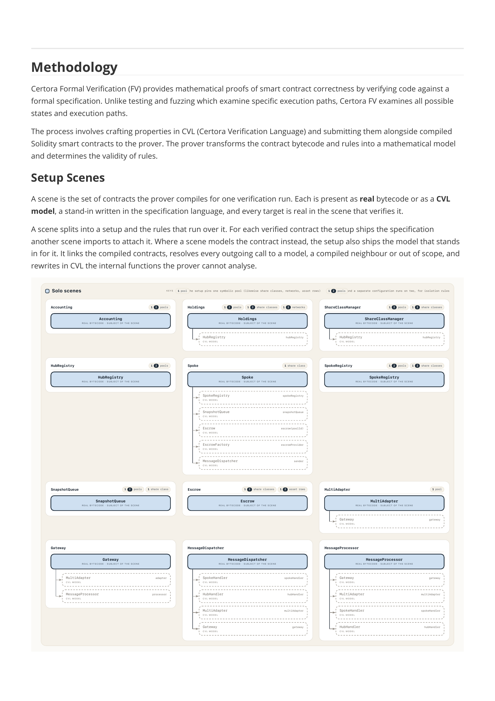
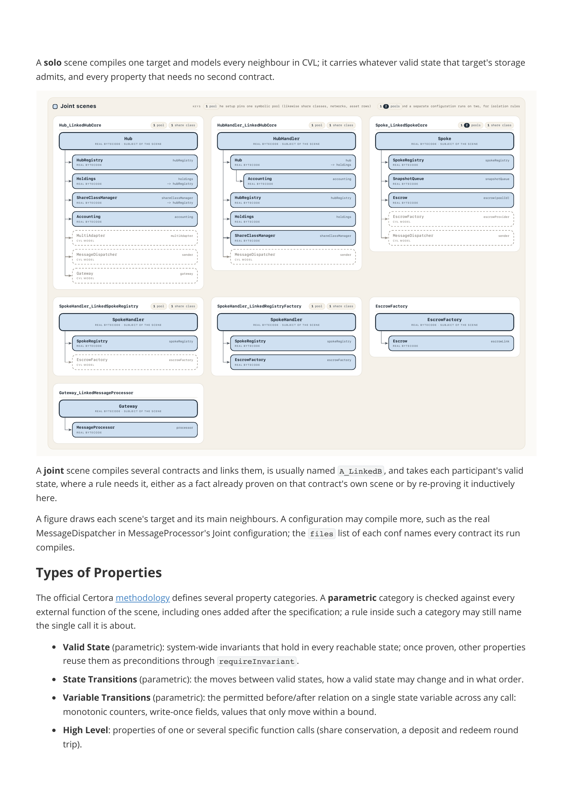
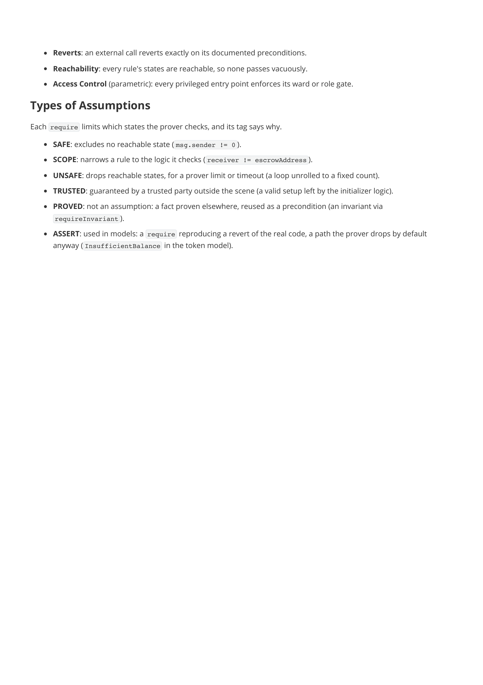

# 2026-09-FV

[Original PDF](../../../../../centrifuge__protocol-internal/docs/audits/2026-09-FV.pdf)

Page numbers below count PDF pages, including covers. Fixed-width text preserves table columns and code indentation.

## PDF page 1

```text
Formal Verification Report: Centrifuge Core
    Date: October 25th, 2026

    Audit Repo: https://github.com/alexzoid-eth/2026-08-centrifuge-fv-ex

    Client Repo: https://github.com/centrifuge/protocol-internal (051718ed)

    Author: AlexZoid

    Certora Prover version: 8.19.2


Table of Contents
  1. Verification Scope

  2. Methodology

           Setup Scenes

           Types of Properties

           Types of Assumptions

  3. Properties

           Hub side

                  Accounting

                  Holdings

                  ShareClassManager

                  HubRegistry

                  Hub_LinkedHubCore

                  HubHandler_LinkedHubCore

           Spoke side

                  Spoke

                  SpokeRegistry

                  SnapshotQueue

                  Escrow

                  Spoke_LinkedSpokeCore

                  SpokeHandler_LinkedSpokeRegistry

                  SpokeHandler_LinkedRegistryFactory

                  EscrowFactory

           Messaging

                  MultiAdapter

                  Gateway

                  MessageDispatcher

                  MessageProcessor

                  Gateway_LinkedMessageProcessor

  4. Mutation Testing
```

## PDF page 2

```text
    5. Reproducing the Results

             Prerequisites

             Remote Execution

             Local Execution

             Running the Suites

    6. Resources


Verification Scope
Centrifuge is a real-world-asset tokenization protocol built as a hub and spoke: one hub chain carries each pool's
accounting and administration, spoke chains the custody and user-facing balance-sheet operations; a quorum-gated
messaging layer keeps them convergent. The contracts verified, all in src/core/ , fall into three groups.

Hub side

    1. Accounting ( hub/Accounting.sol ): the double-entry ledger of per-pool charts of accounts, mutable only inside a
      transient session that refuses to close unless debits equal credits.

    2. Holdings ( hub/Holdings.sol ): the hub's mirror of spoke asset positions per pool, share class and asset, with
      carrying value in pool currency against cumulative increase and decrease counters.

    3. ShareClassManager ( hub/ShareClassManager.sol ): the share class registry and hub-side conservation ledger,
      where the per-network issuance and revocation counters must net to the class's total supply, a share transfer
      between networks moving only the network legs.

    4. HubRegistry ( hub/HubRegistry.sol ): the registry of pools, assets, managers and policies, plus the timelocked
      authorization ledger the hub access-control model rests on.

    5. Hub ( hub/Hub.sol ): the pool-manager orchestrator over the four contracts above, which must post a paired debit
      and credit for every accounting mutation.

    6. HubHandler ( hub/HubHandler.sol ): the hub-side entry point for cross-chain messages, applying spoke deltas to
      Holdings and ShareClassManager, reconciling the burn-and-mint share bridge.

Spoke side

    7. Spoke ( spoke/Spoke.sol ): the balance-sheet orchestrator for users and managers, where every escrow operation
      must mirror into the snapshot queue.

    8. SpokeRegistry ( spoke/SpokeRegistry.sol ): the spoke's source of truth for pools, share classes, roles, policies,
      vaults and prices, over an asset-id bijection.

    9. SpokeHandler ( spoke/SpokeHandler.sol ): the spoke-side message applier, deploying escrows, tokens and vaults
      and routing mutations into the registry.

   10. SnapshotQueue ( spoke/SnapshotQueue.sol ): the accumulator of share and asset deltas pending submission to
      the hub, carrying the consistency flag the hub trusts.

   11. Escrow ( spoke/Escrow.sol ): the per-pool custody contract, with total and reserved bookkeeping where a
      withdrawal never pays the reserved part.

   12. EscrowFactory ( spoke/factories/EscrowFactory.sol ): the CREATE2 deployer and address oracle for those
      escrows, where a pool's escrow address is the same for every caller and unchanged by any call the factory takes.

Messaging

   13. MultiAdapter ( messaging/MultiAdapter.sol ): the quorum layer over bridge adapters, where an inbound payload
      becomes truth only at threshold votes per chain, pool and session.
```

## PDF page 3

```text
14. MessageDispatcher ( messaging/MessageDispatcher.sol ): the outbound end of the messaging layer, taking a local
   destination straight into its handler and a remote one into the gateway, where a caller without the ward bit moves
   no wiring and reaches no neighbour.

15. Gateway ( messaging/Gateway.sol ): the transport between the messaging layer and its adapters, batching and
   paying for outbound messages and splitting an inbound batch into messages for the processor, where a batch
   carries one pool and a message that fails in processing is recorded for a retry.

16. MessageProcessor ( messaging/MessageProcessor.sol ): the inbound end of the messaging layer, decoding each
   message and routing it to the one handler its type names, where a message of no known type is refused.
```

## PDF page 4

```text
Methodology
Certora Formal Verification (FV) provides mathematical proofs of smart contract correctness by verifying code against a
formal specification. Unlike testing and fuzzing which examine specific execution paths, Certora FV examines all possible
states and execution paths.

The process involves crafting properties in CVL (Certora Verification Language) and submitting them alongside compiled
Solidity smart contracts to the prover. The prover transforms the contract bytecode and rules into a mathematical model
and determines the validity of rules.


Setup Scenes
A scene is the set of contracts the prover compiles for one verification run. Each is present as real bytecode or as a CVL
model, a stand-in written in the specification language, and every target is real in the scene that verifies it.

A scene splits into a setup and the rules that run over it. For each verified contract the setup ships the specification
another scene imports to attach it. Where a scene models the contract instead, the setup also ships the model that stands
in for it. It links the compiled contracts, resolves every outgoing call to a model, a compiled neighbour or out of scope, and
rewrites in CVL the internal functions the prover cannot analyse.


      Solo scenes                                                                 KEYS   1 pool the setup pins one symbolic pool (likewise share classes, networks, asset rows)                 1   2   pools and a separate configuration runs on two, for isolation rules


     Accounting                                                        1   2   pools          Holdings                 1   2   pools        1   2    share classes       1    2    networks    ShareClassManager                         1   2   pools   1   2   share classes


                                     Accounting                                                                                   Holdings                                                                                ShareClassManager
                           REAL BYTECODE · SUBJECT OF THE SCENE                                                     REAL BYTECODE · SUBJECT OF THE SCENE                                                             REAL BYTECODE · SUBJECT OF THE SCENE


                                                                                                        HubRegistry                                                          hubRegistry                 HubRegistry                                             hubRegistry
                                                                                                        CVL MODEL                                                                                        CVL MODEL


     HubRegistry                                                       1   2   pools          Spoke                                                                       1 share class        SpokeRegistry                             1   2   pools   1   2   share classes


                                     HubRegistry                                                                                       Spoke                                                                                 SpokeRegistry
                           REAL BYTECODE · SUBJECT OF THE SCENE                                                     REAL BYTECODE · SUBJECT OF THE SCENE                                                             REAL BYTECODE · SUBJECT OF THE SCENE


                                                                                                        SpokeRegistry                                                    spokeRegistry
                                                                                                        CVL MODEL


                                                                                                        SnapshotQueue                                                    snapshotQueue
                                                                                                        CVL MODEL


                                                                                                        Escrow                                                       escrow(poolId)
                                                                                                        CVL MODEL


                                                                                                        EscrowFactory                                                escrowProvider
                                                                                                        CVL MODEL


                                                                                                        MessageDispatcher                                                           sender
                                                                                                        CVL MODEL


     SnapshotQueue                                   1   2   pools   1 share class            Escrow                                    1   2       share classes    1    2       asset rows   MultiAdapter                                                            1 pool


                                   SnapshotQueue                                                                                   Escrow                                                                                     MultiAdapter
                           REAL BYTECODE · SUBJECT OF THE SCENE                                                     REAL BYTECODE · SUBJECT OF THE SCENE                                                             REAL BYTECODE · SUBJECT OF THE SCENE


                                                                                                                                                                                                         Gateway                                                     gateway
                                                                                                                                                                                                         CVL MODEL


     Gateway                                                                                  MessageDispatcher                                                                                MessageProcessor


                                       Gateway                                                                             MessageDispatcher                                                                               MessageProcessor
                           REAL BYTECODE · SUBJECT OF THE SCENE                                                     REAL BYTECODE · SUBJECT OF THE SCENE                                                             REAL BYTECODE · SUBJECT OF THE SCENE


               MultiAdapter                                                adapter                      SpokeHandler                                                     spokeHandler                    Gateway                                                     gateway
               CVL MODEL                                                                                CVL MODEL                                                                                        CVL MODEL


               MessageProcessor                                        processor                        HubHandler                                                            hubHandler                 MultiAdapter                                            multiAdapter
               CVL MODEL                                                                                CVL MODEL                                                                                        CVL MODEL


                                                                                                        MultiAdapter                                                     multiAdapter                    SpokeHandler                                            spokeHandler
                                                                                                        CVL MODEL                                                                                        CVL MODEL


                                                                                                        Gateway                                                                    gateway               HubHandler                                               hubHandler
                                                                                                        CVL MODEL                                                                                        CVL MODEL
```



## PDF page 5

```text
A solo scene compiles one target and models every neighbour in CVL; it carries whatever valid state that target's storage
admits, and every property that needs no second contract.


        Joint scenes                                                              KEYS   1 pool the setup pins one symbolic pool (likewise share classes, networks, asset rows)    1   2   pools and a separate configuration runs on two, for isolation rules


        Hub_LinkedHubCore                                 1 pool       1 share class          HubHandler_LinkedHubCore                             1 pool       1 share class     Spoke_LinkedSpokeCore                           1   2   pools     1 share class


                                          Hub                                                                                 HubHandler                                                                              Spoke
                           REAL BYTECODE · SUBJECT OF THE SCENE                                                     REAL BYTECODE · SUBJECT OF THE SCENE                                                REAL BYTECODE · SUBJECT OF THE SCENE


               HubRegistry                                             hubRegistry                      Hub                                                             hub                 SpokeRegistry                                         spokeRegistry
               REAL BYTECODE                                                                            REAL BYTECODE                                           -> holdings                 REAL BYTECODE


               Holdings                                                   holdings                            Accounting                                         accounting                 SnapshotQueue                                         snapshotQueue
               REAL BYTECODE                                        -> hubRegistry                            REAL BYTECODE                                                                 REAL BYTECODE


               ShareClassManager                                  shareClassManager                     HubRegistry                                             hubRegistry                 Escrow                                                escrow(poolId)
               REAL BYTECODE                                        -> hubRegistry                      REAL BYTECODE                                                                       REAL BYTECODE


               Accounting                                               accounting                      Holdings                                                   holdings                 EscrowFactory                                         escrowProvider
               REAL BYTECODE                                                                            REAL BYTECODE                                                                       CVL MODEL


               MultiAdapter                                           multiAdapter                      ShareClassManager                                  shareClassManager                MessageDispatcher                                            sender
               CVL MODEL                                                                                REAL BYTECODE                                                                       CVL MODEL


               MessageDispatcher                                            sender                      MessageDispatcher                                            sender
               CVL MODEL                                                                                CVL MODEL


               Gateway                                                     gateway
               CVL MODEL


        SpokeHandler_LinkedSpokeRegistry                  1 pool       1 share class          SpokeHandler_LinkedRegistryFactory                   1 pool       1 share class     EscrowFactory


                                    SpokeHandler                                                                             SpokeHandler                                                                       EscrowFactory
                           REAL BYTECODE · SUBJECT OF THE SCENE                                                     REAL BYTECODE · SUBJECT OF THE SCENE                                                REAL BYTECODE · SUBJECT OF THE SCENE


               SpokeRegistry                                         spokeRegistry                      SpokeRegistry                                         spokeRegistry                 Escrow                                                   escrowLink
               REAL BYTECODE                                                                            REAL BYTECODE                                                                       REAL BYTECODE


               EscrowFactory                                         escrowFactory                      EscrowFactory                                         escrowFactory
               CVL MODEL                                                                                REAL BYTECODE


        Gateway_LinkedMessageProcessor


                                       Gateway
                           REAL BYTECODE · SUBJECT OF THE SCENE


               MessageProcessor                                          processor
               REAL BYTECODE


A joint scene compiles several contracts and links them, is usually named A_LinkedB , and takes each participant's valid
state, where a rule needs it, either as a fact already proven on that contract's own scene or by re-proving it inductively
here.

A figure draws each scene's target and its main neighbours. A configuration may compile more, such as the real
MessageDispatcher in MessageProcessor's Joint configuration; the files list of each conf names every contract its run
compiles.


Types of Properties
The official Certora methodology defines several property categories. A parametric category is checked against every
external function of the scene, including ones added after the specification; a rule inside such a category may still name
the single call it is about.

         Valid State (parametric): system-wide invariants that hold in every reachable state; once proven, other properties
         reuse them as preconditions through requireInvariant .

         State Transitions (parametric): the moves between valid states, how a valid state may change and in what order.

         Variable Transitions (parametric): the permitted before/after relation on a single state variable across any call:
         monotonic counters, write-once fields, values that only move within a bound.

         High Level: properties of one or several specific function calls (share conservation, a deposit and redeem round
         trip).
```



## PDF page 6

```text
      Reverts: an external call reverts exactly on its documented preconditions.

      Reachability: every rule's states are reachable, so none passes vacuously.

      Access Control (parametric): every privileged entry point enforces its ward or role gate.


Types of Assumptions
Each require limits which states the prover checks, and its tag says why.

      SAFE: excludes no reachable state ( msg.sender != 0 ).

      SCOPE: narrows a rule to the logic it checks ( receiver != escrowAddress ).

      UNSAFE: drops reachable states, for a prover limit or timeout (a loop unrolled to a fixed count).

      TRUSTED: guaranteed by a trusted party outside the scene (a valid setup left by the initializer logic).

      PROVED: not an assumption: a fact proven elsewhere, reused as a precondition (an invariant via
       requireInvariant ).

      ASSERT: used in models: a require reproducing a revert of the real code, a path the prover drops by default
      anyway ( InsufficientBalance in the token model).
```



## PDF page 7

```text
Properties
Every verdict below comes from the prover version named in the header.

      Properties: every invariant and rule the suite states

      Proved       : verified by the prover

      Timeout       : the prover ran the rule and did not decide it within the solver budget the confs carry, or within the 300-
      minute wall each rule of this edition's run was given

      Mutations       : rules with a mutant the prover killed: the rule holds on the real code and fails on a planted fault.

      Violations      : rules that fail


                                                              Proved         Timeout          Mutations         Violations
  Contract                                    Properties


  Accounting                                  77              77             0                77                0

  Holdings                                    114             114            0                114               0

  ShareClassManager                           91              91             0                91                0

  HubRegistry                                 110             110            0                110               0

  Hub_LinkedHubCore                           147             147            0                147               0

  HubHandler_LinkedHubCore                    112             112            0                112               0

  Spoke                                       124             124            0                124               0

  SpokeRegistry                               171             171            0                171               0

  SnapshotQueue                               77              77             0                77                0

  Escrow                                      63              63             0                63                0

  Spoke_LinkedSpokeCore                       52              52             0                52                0

  SpokeHandler_LinkedSpokeRegistry            99              99             0                99                0

  SpokeHandler_LinkedRegistryFactory          4               4              0                4                 0

  EscrowFactory                               13              13             0                13                0

  MultiAdapter                                135             135            0                135               0

  Gateway                                     65              65             0                65                0

  MessageDispatcher                           98              98             0                98                0

  MessageProcessor                            30              30             0                30                0

  Gateway_LinkedMessageProcessor              7               7              0                7                 0

  Total                                       1589            1589           0                1589              0


Accounting
```

## PDF page 8

```text
     Single pool

            One symbolic pool

            The chart of accounts bounded to 3 symbolic accounts

            Loops running up to 3 iterations

     Multi pool

            Two symbolic pools

            The chart of accounts bounded to 3 symbolic accounts

            Loops running up to 3 iterations

     Metadata

            Any symbolic pool and account

            Loops running up to 16 iterations

            The account metadata writer kept on the surface, its free form bytes read under the 512 byte hashing bound

Valid State

 Properties                                                                               Status       Mutations

 AC-VS-01 absentAccountIsEmpty
 A never-created account has no recorded debits or credits.

 AC-VS-02 nullAccountNeverCreated
 The empty account id never exists, so no entry can be posted to it.

 AC-VS-03 lastUpdatedBetweenEnvFloorAndBlock
 An account's last update time is never in the future.

 AC-VS-04 postedHistoryImpliesAnIssuedJournalId
 An account has postings only after at least one journal id was issued.

 AC-VS-05 issuedJournalIdsLieAtOrBelowTheHighWaterMark
 No journal id a pool has issued is above the latest id the pool has minted.


State Transitions

 Properties                                                                                 Status      Mutations

 AC-ST-01 stAcAccountOrientationIsPermanent
 An account's debit-normal or credit-normal side never changes once created.

 AC-ST-02 stAcAccountRowsArePerPool
 A call changing an account in one pool leaves another pool's accounts untouched.

 AC-ST-03 stAcJournalNumberingIsPerPool
 A call advancing one pool's journal ids leaves another pool's ids unchanged.

 AC-ST-04 stAcAPoolsJournalIdIsFixedForTheTransaction
 Once a pool has a journal id in a transaction, no call for any pool changes it.

 AC-ST-05 stAcLedgerMovesOnlyThroughAJournal
 Ledger totals change only when a journal is posted.
```

## PDF page 9

```text
 AC-ST-06 stAcMintedJournalIdWasNeverIssuedBefore
 A journal a call opens gets an id its pool never issued before.


Variable Transitions

 Properties                                                                                 Status     Mutations

 AC-VT-01 vtAcAccountDebitNeverDecreases
 An account's total debits never decrease, so posted history cannot be erased.

 AC-VT-02 vtAcAccountCreditNeverDecreases
 An account's total credits never decrease, so posted history cannot be erased.

 AC-VT-03 vtAcAccountStampNeverRegresses
 An account's last update time never goes backwards.

 AC-VT-04 vtAcJournalCounterNeverRewinds
 A pool's journal numbering never goes backwards.


High Level

 Properties                                                                                   Status    Mutations

 AC-HL-01 hlAcSessionClosesOnlyOnEqualPostedValues
 A journal can be closed only when its debits and credits balance.

 AC-HL-02 hlAcJournalPairDebitsExactlyItsNamedRow
 Posting a journal pair debits only the named account, by the stated amount.

 AC-HL-03 hlAcJournalPairCreditsExactlyItsNamedRow
 Posting a journal pair credits only the named account, by the stated amount.

 AC-HL-04 hlAcSecondJournalOfAPoolReusesItsJournalId
 A pool's second journal in one transaction reuses the first journal's id.

 AC-HL-05 hlAcAccountValueReportsTheRowsNetMagnitude
 An account's reported balance is the difference between its debits and credits.

 AC-HL-06 hlAcAccountValueSignsByTheRowsOrientation
 An account reads positive exactly when its normal side is at least the other.

 AC-HL-07 hlAcReopenedJournalStartsFromEmptyPostedSides
 A reopened journal starts with zero running debit and credit sums.

 AC-HL-08 hlAcMintedJournalIdCarriesItsPool
 A new journal id falls in its pool's own range, so pools' ids never collide.

 AC-HL-09 hlAcUnlockOpensTheSessionOnTheNamedPool
 Opening a journal unlocks accounting for exactly the requested pool.

 AC-HL-10 hlAcSetAccountMetadataWritesOnlyItsAccountsMetadata
 SetAccountMetadata writes only the named account's metadata; every other field reads the
 same.

 AC-HL-11 hlAcSecondPoolOfATransactionOpensUnderItsOwnId
```

## PDF page 10

```text
 A second pool opening a journal in one transaction gets an id in its own range.


Reverts

 Properties                                                                           Status   Mutations

 AC-RV-01 rvAcUnlockRefusesANonWard
 Opening a journal fails for a caller that is not an admin.

 AC-RV-02 rvAcUnlockRefusesASecondOpenWhileAJournalStands
 Opening a journal fails while another journal is still open.

 AC-RV-03 rvAcCreateAccountRefusesANonWardTheNullIdOrARowThatStands
 Creating an account fails for a non-admin, an empty id, or an existing account.

 AC-RV-04 rvAcAddDebitRefusesARowTheLedgerNeverOpened
 A debit fails on an account that was never created.

 AC-RV-05 rvAcAddCreditRefusesARowTheLedgerNeverOpened
 A credit fails on an account that was never created.

 AC-RV-06 rvAcLockRevertsIffThePostedSidesDiffer
 Closing a journal as admin fails exactly when its debits and credits differ.

 AC-RV-07 rvAcAddJournalOffSessionRefusesANonWardOrAnyEntry
 Outside an open journal, a non-admin post fails and so does any post with entries.

 AC-RV-08 rvAcAccountValueRefusesARowTheLedgerNeverOpened
 Reading the value of a never-created account fails rather than returning zero.

 AC-RV-09 rvAcAddDebitRefusesAnOutsiderInsideAnOpenJournal
 A debit by a non-admin fails even while an admin has a journal open.

 AC-RV-10 rvAcAddCreditRefusesAnOutsiderInsideAnOpenJournal
 A credit by a non-admin fails even while an admin has a journal open.

 AC-RV-11 rvAcLockRefusesAnOutsiderOnAnOpenJournal
 Closing a journal fails for a non-admin even while one is open.

 AC-RV-12 rvAcAccountValueAlwaysAnswersForARowThatStands
 Reading an existing account's value always succeeds, positive or negative.

 AC-RV-13 rvAcAddDebitIsRefusedOffSession
 A debit always fails while no journal is open.

 AC-RV-14 rvAcAddCreditIsRefusedOffSession
 A credit always fails while no journal is open.

 AC-RV-15 rvAcLockIsRefusedOffSession
 Closing a journal always fails when none is open.

 AC-RV-16 rvAcUnlockRefusesTheNullPool
 Opening a journal fails for the empty pool id.

 AC-RV-17 rvAcLockIsRefusedAfterAClosedJournal
```

## PDF page 11

```text
 Closing fails when no journal is open, whatever an earlier journal left behind.


Reachability

 Properties                                                                         Status   Mutations

 AC-RC-01 rcAcUnlockOpensAJournalIsReachable
 An admin can open a journal on a pool, getting a fresh journal id.

 AC-RC-02 rcAcEmptyJournalOverAnUntouchedLedgerIsReachable
 An empty journal can open and close, still using up a journal id.

 AC-RC-03 rcAcBalancedPairPostsAndClosesIsReachable
 A journal can open, post a matching debit and credit to two accounts, and close.

 AC-RC-04 rcAcTwoDebitsCloseAgainstOneCreditIsReachable
 A journal with two non-zero debits can close against one credit of their sum.

 AC-RC-05 rcAcZeroValueDebitRestampsTheRowIsReachable
 A zero-value debit can refresh an account's timestamp without changing totals.

 AC-RC-06 rcAcZeroValueCreditRestampsTheRowIsReachable
 A zero-value credit can refresh an account's timestamp without changing totals.

 AC-RC-07 rcAcDebitFillsARowToTheCeilingIsReachable
 A single debit can fill an empty account's debit side to the maximum value.

 AC-RC-08 rcAcCreditFillsARowToTheCeilingIsReachable
 A single credit can fill an empty account's credit side to the maximum value.

 AC-RC-09 rcAcCeilingPairPostsAndClosesIsReachable
 A journal posting the maximum value on both sides can still close.

 AC-RC-10 rcAcSaturatedDebitRowStillTakesACreditIsReachable
 An account with debits at the maximum value can still take a credit.

 AC-RC-11 rcAcDebitOvertakesACreditHeavyRowIsReachable
 A debit can turn a credit-heavy account into a debit-heavy one.

 AC-RC-12 rcAcCreateDebitNormalAccountIsReachable
 A debit-normal account can be opened where none existed.

 AC-RC-13 rcAcCreateCreditNormalAccountIsReachable
 A credit-normal account can be opened with empty debit and credit sides.

 AC-RC-14 rcAcSecondRowOpensBesideALiveOneIsReachable
 A second account can be opened without disturbing an existing one.

 AC-RC-15 rcAcFirstRowOfAnEmptyChartIsReachable
 A pool's very first account can be opened.

 AC-RC-16 rcAcJournalBatchReachesTheWholeChartIsReachable
 One journal can debit two accounts, credit a third and still close balanced.

 AC-RC-17 rcAcEmptyJournalBatchIsReachable
```

## PDF page 12

```text
 An empty journal can go through and still use up a journal id.


 AC-RC-18 rcAcZeroValueJournalBatchIsReachable
 A zero-value journal can close and still refresh an account's timestamp.

 AC-RC-19 rcAcRowsCreatedAndJournalledInOneTransactionIsReachable
 Accounts can be created and posted to within one transaction.

 AC-RC-20 rcAcFreshRowReadsBackThePostedValueIsReachable
 A newly created account can report exactly the value just posted to it.

 AC-RC-21 rcAcDebitNormalRowReportsANegativeValueIsReachable
 A debit-normal account credited more than debited can report a negative value.

 AC-RC-22 rcAcRowDebitedAndCreditedAlikeReadsZeroIsReachable
 An account debited and credited by the same amount can report a zero value.

 AC-RC-23 rcAcOpenSessionReportsItsRunningSidesIsReachable
 An open journal can report its running debit total as posted so far.

 AC-RC-24 rcAcAuthorityGrantRoundTripIsReachable
 An admin can grant admin rights and revoke them again in one transaction.

 AC-RC-25 rcAcWardRevokesItselfIsReachable
 An admin can revoke its own admin rights on the ledger.

 AC-RC-26 rcAcPassingJournalPairOnABalancedPairIsReachable
 The hub can post a non-zero balanced debit and credit to two existing accounts.


Access Control

 Properties                                                                        Status   Mutations

 AC-AC-01 acAcDebitHistoryMovesOnlyForAWard
 Only an admin's call can change an account's booked debits.

 AC-AC-02 acAcCreditHistoryMovesOnlyForAWard
 Only an admin's call can change an account's booked credits.

 AC-AC-03 acAcAccountStampMovesOnlyForAWard
 Only an admin's call can change an account's last-updated time.

 AC-AC-04 acAcAccountOpensOnlyForAWard
 Only an admin can open a new account in the ledger.

 AC-AC-05 acAcAccountOrientationIsSetOnlyByAWard
 Only an admin can set whether an account is debit-normal or credit-normal.

 AC-AC-06 acAcPermissionsMoveOnlyForAWard
 Only an admin can grant or revoke admin rights on Accounting.

 AC-AC-07 acAcJournalNumberingAdvancesOnlyForAWard
 Only an admin's call can advance a pool's journal numbering.

 AC-AC-08 acAcSessionIsLeftOpenOnlyForAWard
```

## PDF page 13

```text
 Only an admin can leave accounting unlocked for posting.


Holdings
     Every configuration

            Loops running up to 4 iterations

     Single pool

            One symbolic pool

            One symbolic share class

            Holding rows bounded to 2 symbolic assets

            Both deficit counters pinned to one symbolic network

     Multi pool

            Two symbolic pools

            One share class per pool

            Holding rows bounded to 2 symbolic assets per share class

            Both deficit counters pinned to one symbolic network

     Multi share class

            Two share classes in the pinned pool

            Holding rows bounded to 2 symbolic assets per share class

            Both deficit counters pinned to one symbolic network

     Multi network

            One symbolic pool

            One symbolic share class

            Holding rows bounded to 2 symbolic assets

            Two symbolic networks; a third reaches no mirrored bucket

     Census

            Any one symbolic pool, and every share class, asset and network of it

            The network a deposit or withdrawal is reported under taken to be the asset's own network

Valid State

 Properties                                                                                 Status      Mutations

 HO-VS-01 snapshotHookImpliesPoolExists
 A snapshot hook is attached only to a pool the hub registry knows.

 HO-VS-02 networkDeficitCountMatchesTheShortRows
 With one network, a pool's deficit count equals its holdings in deficit.

 HO-VS-03 uninitializedHoldingHasNoValue
 A holding that was never opened has no value.

 HO-VS-04 emptyHoldingCarriesNoValue
 A holding with nothing left in it has zero value.
```

## PDF page 14

```text
 HO-VS-05 snapshotFlagImpliesAStartedNonce
 A network marked in sync has had at least one sync update.

 HO-VS-06 accountIdImpliesInitialized
 Journal accounts are set only on holdings that have been opened.

 HO-VS-07 networkDeficitCountSpansEveryShareClass
 A pool's deficit count on a network includes shortfalls from every share class.

 HO-VS-08 deficitCountMatchesTheClassShortRows
 With one network, a share class's deficit count equals its holdings in deficit.

 HO-VS-09 deficitCountIsKeptPerShareClass
 Each share class's deficit count covers only its own holdings in shortfall.

 HO-VS-10 deficitCountsSumToTheShortRowsAcrossTheNetworks
 Summed over networks, the deficit counts match the holdings in shortfall.

 HO-VS-11 networkDeficitCountIsItsNetworksShortRowCensus
 A pool's deficit count on a network is the number of its holdings there in shortfall.

 HO-VS-12 deficitCountIsItsClassNetworksShortRowCensus
 A share class's deficit count on a network is the number of its holdings there in shortfall.


State Transitions

 Properties                                                                                     Status   Mutations

 HO-ST-01 stHoInflowAndOutflowNeverMoveTogether
 No single call changes both a holding's deposit and withdrawal totals.

 HO-ST-02 stHoOneCallTouchesOneHolding
 A call changing one holding leaves the share class's other holdings unchanged.

 HO-ST-03 stHoInflowNeverLowersValue
 An inflow never lowers a holding's value.

 HO-ST-04 stHoOutflowNeverRaisesValue
 An outflow never raises a holding's value.

 HO-ST-05 stHoOpeningAHoldingFundsNothing
 Opening a holding books no assets and no value.

 HO-ST-06 stHoSnapshotFlagMovesWithItsNonce
 A network's sync flag changes only as its sequence number advances by one.

 HO-ST-07 stHoHoldingRowIsPerPool
 A call that changes one pool's holding leaves other pools' holdings unchanged.

 HO-ST-08 stHoAccountWiringIsPerPool
 Setting one pool's journal accounts leaves other pools' accounts unchanged.

 HO-ST-09 stHoSnapshotRowIsPerPool
 A pool's snapshot change never touches another pool's snapshot on that network.

 HO-ST-10 stHoDeficitCountAndHookIgnoreASiblingsFlow
```

## PDF page 15

```text
 A deposit or withdrawal never changes another pool's deficit counts or NAV hook.


 HO-ST-11 stHoSnapshotRowIsPerNetwork
 A sync update to one network leaves every other network's sync state unchanged.

 HO-ST-12 stHoFlowRowIsPerShareClass
 A deposit or withdrawal on one share class leaves another's amounts unchanged.

 HO-ST-13 stHoHoldingRowIsPerShareClass
 A call changing any part of one class's holding leaves the other class's holdings unchanged.

 HO-ST-14 stHoDeficitCountsOfAtMostOneNetworkMovePerCall
 A call moves the deficit counts of at most one network.

 HO-ST-15 stHoSnapshotRowIsPerShareClass
 A call changing one class's snapshot on a network leaves another class's snapshot there
 unchanged.

 HO-ST-16 stHoDeficitCountersMoveOnlyThroughTheFlowEntries
 A pool's deficit counts change only through deposits and withdrawals.

 HO-ST-17 stHoSyncNotificationOnlyUnderAnInSyncMarker
 Any call notifies the NAV hook at most once, and only for a network marked in sync.


Variable Transitions

 Properties                                                                                     Status      Mutations

 HO-VT-01 vtHoDepositHistoryNeverShrinks
 A holding's lifetime deposit total never decreases.

 HO-VT-02 vtHoWithdrawalHistoryNeverShrinks
 A holding's lifetime withdrawal total never decreases.

 HO-VT-03 vtHoOpenedHoldingIsNeverClosed
 A holding the pool has opened can never be closed again.

 HO-VT-04 vtHoSnapshotNonceStepsByAtMostOne
 A network's sync sequence number advances by at most one per call.

 HO-VT-05 vtHoAccountWiringMovesOnlyThroughItsTwoWriters
 A holding's journal accounts change only through initialize and setAccountId.

 HO-VT-06 vtHoSnapshotHookMovesOnlyThroughItsSetter
 A pool's NAV hook changes only through setSnapshotHook.

 HO-VT-07 vtHoSnapshotSequenceMovesOnlyThroughItsPublisher
 A network's snapshot nonce changes only through setSnapshot.


High Level

 Properties                                                                                        Status    Mutations

 HO-HL-01 hlHoDepositHistoryRecordsTheInflowAndSurvivesTheOutflow
 A deposit is recorded in full and stays so after an equal withdrawal.
```

## PDF page 16

```text
 HO-HL-02 hlHoWithdrawalHistoryRecordsTheWholeOutflow
 A withdrawal following an equal deposit is recorded at its full amount.

 HO-HL-03 hlHoIncreaseReturnsTheValueItBooked
 A deposit reports exactly the value it adds to the holding.

 HO-HL-04 hlHoDecreaseReturnsTheValueItRemoved
 A withdrawal reports exactly the value it removes from the holding.

 HO-HL-05 hlHoUpdateReportsTheRevaluationItWrote
 A revaluation reports exactly the gain or loss it applies to the holding.

 HO-HL-06 hlHoPublishingASyncMarkerAlwaysAdvancesTheSequence
 Each accepted snapshot update advances the network's snapshot nonce by one.

 HO-HL-07 hlHoSyncNotificationCarriesTheMarkersOwnKeys
 A snapshot update notifies the NAV hook, with its class and network, exactly when in sync.

 HO-HL-08 hlHoReplayNotifiesUnderTheMarkersOwnKeys
 A snapshot replay notifies the NAV hook, with its class and network, exactly when in sync.

 HO-HL-09 hlHoDecreaseRemovesValueProRataToTheRealizedAmount
 A withdrawal removes value in proportion to the amount it takes out, rounded down.

 HO-HL-10 hlHoIncreaseQuotesOnlyTheRealizedAmount
 A deposit books one quote from the holding's source on the part past any shortfall, else
 zero.

 HO-HL-11 hlHoUpdateMarksTheBookToTheQuoteOfItsAmount
 A revaluation carries one quote of the unchanged amount from the holding's own source.

 HO-HL-12 hlHoDecreaseNeverConsultsTheOracle
 A withdrawal never asks a price source for a quote.

 HO-HL-13 hlHoPriceSourceSwapLeavesTheCarryingValueStanding
 Switching a holding's price source takes no quote and leaves its value unchanged.

 HO-HL-14 hlHoEnteringADeficitBooksTheNamedNetworkOnly
 A new shortfall raises the deficit counts of the withdrawal's network only.

 HO-HL-15 hlHoLeavingADeficitReleasesTheNamedNetworkOnly
 An ended shortfall lowers the deficit counts of the deposit's network only.

 HO-HL-16 hlHoSetSnapshotBumpsTheNamedPoolsNonce
 Setting a snapshot bumps its pool's nonce and moves no other pool's snapshot on that
 network.

 HO-HL-17 hlHoSetSnapshotBumpsTheNamedClassesNonce
 Setting a snapshot bumps its class's nonce and moves no other class's snapshot on that
 network.

 HO-HL-18 hlHoHoldingViewReportsTheFlooredNetOfWideTotals
 A holding reports its amount as inflow minus outflow, or zero when overdrawn.


Reverts
```

## PDF page 17

```text
Properties                                                                                  Status   Mutations

HO-RV-01 rvHoInitializeRefusesANonWardANullSourceOrAnOpenRow
Opening a holding fails for a non-admin, with no price source, or if already open.

HO-RV-02 rvHoSetAccountIdRefusesANonWardOrAnUnopenedHolding
Setting a journal account fails for a non-admin or on an unopened holding.

HO-RV-03 rvHoUpdateValuationRefusesANonWardANullSourceOrAnUnopenedHolding
Switching a price source fails for a non-admin, a zero source, or an unopened holding.

HO-RV-04 rvHoSetSnapshotHookRefusesANonWardOrAnUnknownPool
Attaching a snapshot hook fails for a non-admin or for a pool unknown to the hub.

HO-RV-05 rvHoSetSnapshotRefusesANonWardOrAnOutOfOrderNonce
A sync update fails for a non-admin or with an out-of-order sequence number.

HO-RV-06 rvHoCallOnSyncSnapshotIsNeverRefusedToAWard
Holdings itself never rejects an admin resending a network's sync notification.

HO-RV-07 rvHoCallOnTransferSnapshotIsNeverRefusedToAWard
With no snapshot hook set, an admin can always notify a cross-network transfer.

HO-RV-08 rvHoIncreaseRefusesANonWard
Booking an inflow to a holding fails for a non-admin.

HO-RV-09 rvHoIncreaseBeforeTheRowIsOpenedIsNeverRefusedToAWard
With one network, an admin's inflow to an unopened holding fails only on overflow.

HO-RV-10 rvHoDecreaseNeverStallsOnAnOversizedOutflow
An outflow larger than the holding never fails for an admin, barring overflow.

HO-RV-11 rvHoValuationRefusesAnUnopenedHolding
An unopened holding has no readable price source, not even the zero address.

HO-RV-12 rvHoCallOnSyncSnapshotRefusesANonWard
Resending a network's sync notification fails for a non-admin.

HO-RV-13 rvHoCallOnTransferSnapshotRefusesANonWard
Notifying a cross-network share transfer fails for a non-admin.

HO-RV-14 rvHoLeavingADeficitIsRefusedWhenTheNamedNetworkCountsNone
A deposit ending a shortfall fails if its network has no shortfall counted.

HO-RV-15 rvHoIncreaseBeforeOpeningIsNeverRefusedOverASiblingClassShortfall
An admin's inflow to an unopened holding fails only on overflow, even if another class is
short.

HO-RV-16 rvHoUpdateRefusesOnlyANonWardAnUnopenedRowOrAnOversizedNet
A revaluation fails exactly for a non-admin, an unopened holding, or a net amount past
uint128.

HO-RV-17 rvHoAmountViewsRefuseOnlyANetPastUint128
Reading a holding's amount, alone or with its value, fails exactly when its net exceeds
uint128.

HO-RV-18 rvHoIncreaseOnAnOpenHoldingFailsOnlyOnAnOverflowingTotalOrValue
```

## PDF page 18

```text
 With one network, an admin's inflow to an opened holding fails only on a total or value
 overflow.


Reachability

 Properties                                                                                Status   Mutations

 HO-RC-01 rcHoOpeningThePoolsFirstHoldingIsReachable
 A pool can open the first holding of a share class.

 HO-RC-02 rcHoOpeningWiringAllFourLedgerAccountsIsReachable
 Opening a holding can set all four of its journal accounts in one call.

 HO-RC-03 rcHoOpeningASecondHoldingIsReachable
 A second holding can be opened beside an existing one, leaving it unchanged.

 HO-RC-04 rcHoBookingADepositIsReachable
 A deposit can be booked on an open holding and add value to it.

 HO-RC-05 rcHoZeroDepositIsReachable
 An empty deposit on an open holding can go through without changing it.

 HO-RC-06 rcHoDepositPricedAtNothingIsReachable
 A deposit the price source values at zero can still grow the holding's amount.

 HO-RC-07 rcHoBookingADepositBeforeTheRowIsOpenedIsReachable
 A deposit can be booked on a holding not yet opened, adding no value.

 HO-RC-08 rcHoClearingADeficitExactlyIsReachable
 A deposit can exactly offset an earlier over-withdrawal, clearing the shortfall.

 HO-RC-09 rcHoBookingAWithdrawalIsReachable
 A withdrawal can be booked on a funded holding and remove value from it.

 HO-RC-10 rcHoWithdrawingPastThePositionIsReachable
 A withdrawal can exceed the holding, leaving it at zero and in shortfall.

 HO-RC-11 rcHoClosingThePositionExactlyIsReachable
 A withdrawal can close a holding at exactly zero without a shortfall.

 HO-RC-12 rcHoDeepeningADeficitIsReachable
 A further withdrawal can deepen a shortfall without counting the holding twice.

 HO-RC-13 rcHoDeficitCountCarryingASecondShortRowIsReachable
 Two holdings of one share class can be in shortfall at the same time.

 HO-RC-14 rcHoBookingAWithdrawalBeforeTheRowIsOpenedIsReachable
 A withdrawal can be booked on a holding not yet opened, removing no value.

 HO-RC-15 rcHoRevaluationUpwardIsReachable
 A revaluation can raise a holding's value and report the gain.

 HO-RC-16 rcHoRevaluationDownwardIsReachable
 A revaluation can lower a holding's value and report the loss.

 HO-RC-17 rcHoMarkingANetworkInSyncIsReachable
```

## PDF page 19

```text
 A network can be marked in sync, advancing its sequence number by one.


 HO-RC-18 rcHoMarkingANetworkOutOfSyncIsReachable
 A network marked in sync can be marked out of sync again.

 HO-RC-19 rcHoSyncAndDesyncRoundTripIsReachable
 A network can be marked in sync and back out of sync in one transaction.

 HO-RC-20 rcHoAttachingNavAutomationIsReachable
 A pool without a snapshot hook can have one attached.

 HO-RC-21 rcHoAutomationAttachAndDetachRoundTripIsReachable
 A pool's snapshot hook can be attached and removed again.

 HO-RC-22 rcHoRewiringALedgerAccountIsReachable
 A holding's journal account can be replaced with a different one.

 HO-RC-23 rcHoSwappingThePriceSourceIsReachable
 A holding can switch price source without changing its amount or value.

 HO-RC-24 rcHoWardGrantAndRevokeRoundTripIsReachable
 Admin rights on Holdings can be granted and revoked in one transaction.

 HO-RC-25 rcHoOpeningAndFullyClosingAPositionIsReachable
 A holding can be opened, funded and emptied, and still show its lifetime totals.

 HO-RC-26 rcHoEnteringAndLeavingADeficitIsReachable
 A holding can enter and leave a deficit, and both deficit counts clear again.

 HO-RC-27 rcHoTwoShareClassesShortOnOneNetworkIsReachable
 Two share classes of a pool can both be in shortfall on one network at once.

 HO-RC-28 rcHoShortfallAttributionCanOutliveItsNetworkIsReachable
 A shortfall can stay counted on a network after a deposit elsewhere clears it.

 HO-RC-29 rcHoDecreaseBooksOffTheQuoteJustTaken
 An amount just deposited can be withdrawn at a value other than the quote it was booked
 at.

 HO-RC-30 rcHoNettingInflowPricesOnlyItsPositivePart
 A deposit into a holding in shortfall can be priced only on the part past the shortfall.

 HO-RC-31 rcHoStaleValueSurvivesAPriceSourceSwapOnALivePosition
 A funded holding can switch price source and keep its old value, with no quote taken.

 HO-RC-32 rcHoCensusReachesThreeShortRowsOnOneNetwork
 A pool can count three holdings of two share classes in shortfall on one network.


Access Control

 Properties                                                                                 Status   Mutations

 HO-AC-01 acHoWardRightsMoveOnlyForAWard
 Only an admin can grant or revoke admin rights on Holdings.
```

## PDF page 20

```text
 HO-AC-02 acHoDepositHistoryMovesOnlyForAWard
 Only an admin can change a holding's recorded deposits.

 HO-AC-03 acHoWithdrawalHistoryMovesOnlyForAWard
 Only an admin can change a holding's recorded withdrawals.

 HO-AC-04 acHoCarryingValueMovesOnlyForAWard
 Only an admin can change a holding's carrying value.

 HO-AC-05 acHoPriceSourceMovesOnlyForAWard
 Only an admin can set or change the price source a holding is valued with.

 HO-AC-06 acHoJournalWiringMovesOnlyForAWard
 Only an admin can set or change a holding's journal accounts.

 HO-AC-07 acHoSnapshotHookMovesOnlyForAWard
 Only an admin can set or change a pool's NAV hook.

 HO-AC-08 acHoSyncMarkerMovesOnlyForAWard
 Only an admin can mark a network's assets and shares as in sync or not.

 HO-AC-09 acHoSnapshotNonceMovesOnlyForAWard
 Only an admin can advance a network's snapshot nonce.

 HO-AC-10 acHoDeficitCountMovesOnlyForAWard
 Only an admin can change a pool's deficit counts.


ShareClassManager
     Single pool

            One symbolic pool

            One symbolic share class

     Multi pool

            Two symbolic pools

            One share class per pool, its first

     Multi share class

            Two share classes in the pinned pool

            Networks bounded to 3 symbolic networks

     Unpinned

            Any symbolic pool, share class and network

Valid State

 Properties                                                                     Status   Mutations

 SC-VS-01 shareClassExistsIffCounted
 A pool's first share class exists exactly when the pool has created a class.

 SC-VS-02 shareClassExistsIffSaltSet
 A share class exists exactly when its salt is set.

 SC-VS-03 uncreatedClassNetworkIssuancesZero
```

## PDF page 21

```text
A share class never created has no issuance on any network.


SC-VS-04 uncreatedClassNetworkRevocationsZero
A share class never created has no revocations on any network.

SC-VS-05 uncreatedClassPriceZero
A share class never created has no share price.

SC-VS-06 uncreatedClassPriceStampZero
A share class never created has no price timestamp.

SC-VS-07 existingClassPoolRegistered
A share class only exists inside a pool the hub registry knows.

SC-VS-08 totalIssuanceIsNetworkNetSum
A class's total supply is the sum of every network's net issuance.

SC-VS-09 priceStampNotFuture
Price timestamps never run ahead of the chain clock.

SC-VS-10 saltPrefixIsPool
Every share class salt starts with its pool's id.

SC-VS-11 classSaltConsumed
A share class's salt is always marked as used.

SC-VS-12 classSaltSetImpliesRegisteredPerClass
Only a registered share class can have a salt.

SC-VS-13 registeredClassIndexWithinCount
A registered share class never has an index beyond the pool's class count.

SC-VS-14 poolSaltPrefixIsOwnPool
A pool's share class salt always begins with that pool's own id.

SC-VS-15 classSaltsDistinct
Two share classes of a pool never have the same salt.

SC-VS-16 classSaltConsumedPerClass
A share class's salt is always recorded as used.

SC-VS-17 classWithinCountIsRegistered
Every index up to the pool's class count belongs to a registered share class.

SC-VS-18 registeredClassCarriesASalt
Every registered share class has a salt.

SC-VS-19 classTotalIssuanceIsNetworkNetSum
A share class's total supply is its net issuance summed over all networks.

SC-VS-20 classUncreatedRowsZero
A share class that was never created has no supply, price, or network shares.

SC-VS-21 nullSaltNeverConsumed
The empty salt is never marked used.

SC-VS-22 negativeNetworkCountMatchesTheShortNetworks
```

## PDF page 22

```text
 The negative-network count equals the networks that revoked more than they issued.

 SC-VS-23 classNegativeNetworkCountMatchesItsShortNetworks
 A share class correctly counts its networks that revoked more than they issued.

 SC-VS-24 recordedClassIdSitsUnderItsPoolWithinCount
 A registered share class id carries its own pool and an index from one to the pool's class
 count.

 SC-VS-25 classIdIsOnRecordUnderOnePoolOnly
 A share class id is registered under at most one pool.


State Transitions

 Properties                                                                                     Status   Mutations

 SC-ST-01 stScCreationClaimsAFreeIdentity
 A new share class takes an unused salt and marks it used.

 SC-ST-02 stScClassRowIsPerPool
 A change to one pool's share class leaves another pool's share class untouched.

 SC-ST-03 stScNetworkLedgerIsPerPool
 A pool's share changes on a network never touch another pool's shares there.

 SC-ST-04 stScClassRowIsPerClass
 A change to one share class leaves the pool's other share class untouched.

 SC-ST-05 stScNetworkLedgerIsPerClass
 A class's share changes on a network never touch another class's shares there.

 SC-ST-06 stScClassCountStepsByOne
 A pool's share class count never decreases and grows by at most one per call.

 SC-ST-07 stScClassSaltIsWriteOnce
 A share class's salt never changes once set.

 SC-ST-08 stScRecordedClassStaysRecorded
 A registered share class stays registered under its pool through every call.

 SC-ST-09 stScClassIdentityMovesOnlyOnCreation
 Salts, the class count and class records change only when a share class is added.

 SC-ST-10 stScSharePriceMovesOnlyOnRepricing
 A share class's price and its timestamp change only through a price update.

 SC-ST-11 stScClassTotalsMoveOnlyOnASupplyUpdateNetworkLegsAlsoOnATransfer
 Class totals change only on a share update, network supply also on a transfer.


Variable Transitions

 Properties                                                                            Status        Mutations

 SC-VT-01 vtScNetworkIssuedTotalNeverDecreases
 A network's cumulative issued shares never decrease.
```

## PDF page 23

```text
 SC-VT-02 vtScNetworkRevokedTotalNeverDecreases
 A network's cumulative revoked shares never decrease.

 SC-VT-03 vtScClassIssuedTotalNeverDecreases
 A class's cumulative issued shares never decrease.

 SC-VT-04 vtScClassRevokedTotalNeverDecreases
 A class's cumulative revoked shares never decrease.


High Level

 Properties                                                                            Status   Mutations

 SC-HL-01 hlScCrossChainTransferConservesClassSupply
 Equal revocation and issuance on two networks leave the class supply
 unchanged.

 SC-HL-02 hlScCreationHandsOutThePreviewedId
 Adding a share class gives it the id previewed just before.

 SC-HL-03 hlScRepricingStoresTheGivenPriceAndStamp
 A price update stores exactly the given price and timestamp.

 SC-HL-04 hlScCreationMatchesTheIndexedPreview
 A new share class's id matches the preview for its position in the pool.

 SC-HL-05 hlScSupplyUpdateBooksOneLegOfTheNetworkAndTheClass
 A share update adds its amount only to the matching network and class totals.

 SC-HL-06 hlScSupplyViewsReportIssuedMinusRevoked
 Reported supply, in total and per network, is shares issued minus revoked.

 SC-HL-07 hlScShareClassIdIsInjectiveInPoolAndIndex
 Two different pool and index pairs never get the same share class id.

 SC-HL-08 hlScCreationMintsTheNextFreshIndex
 Adding a share class bumps the pool's count and registers the next index's id,
 unregistered before.

 SC-HL-09 hlScClassIdIsThePoolOverTheIndex
 A share class id is its pool in the high eight bytes over its index, zero only when
 both are zero.

 SC-HL-10 hlScUpdateMetadataWritesOnlyItsClassesStrings
 UpdateMetadata rewrites only the named class's name and symbol; every
 other field reads the same.

 SC-HL-11 hlScAnUpdateMovesItsLegByItsAmount
 A supply update moves only its class's issued or revoked sum over every
 network, by its amount.

 SC-HL-12 hlScTransferSharesMovesOnlyTheTwoNetworkLegs
 A share transfer only revokes on the origin network and issues on the target.


Reverts
```

## PDF page 24

```text
 Properties                                                                                     Status   Mutations

 SC-RV-01 rvScAddShareClassRefusesACreationThatDoesNotCheckOut
 Adding a share class fails for a non-admin, unknown pool, bad or used salt, or bad
 metadata.

 SC-RV-02 rvScUpdateSharePriceRefusesANonWardAnUnknownClassOrAFutureStamp
 Setting a share price fails for a non-admin, an unknown class, or a future timestamp.

 SC-RV-03 rvScUpdateSharesRefusesANonWardOrAnUnknownClass
 A share supply update fails for a non-admin or an unknown share class.

 SC-RV-04 rvScIssuanceRefusesANetworkInRevocationDeficit
 A network's issuance query fails when its revocations exceed its issuances.

 SC-RV-05 rvScPreviewNextShareClassIdRefusesAPoolWhoseClassCounterIsFull
 Previewing the next share class id fails once a pool has used up all ids.

 SC-RV-06 rvScRelyRefusesANonWard
 Granting admin rights fails for a caller that is not an admin.

 SC-RV-07 rvScDenyRefusesANonWard
 Revoking admin rights fails for a caller that is not an admin.

 SC-RV-08 rvScUpdateSharesNeverRefusesAWardWhileTheCountersHaveRoom
 An admin's share update on a known class succeeds unless a counter overflows.

 SC-RV-09 rvScTotalIssuanceRefusesAClassInRevocationDeficit
 A class's total supply query fails when its revocations exceed its issuances.

 SC-RV-10 rvScRawCountersAlwaysAnswerWithTheLedger
 The issued and revoked totals of a class and of each network can always be read.

 SC-RV-11 rvScUpdateMetadataRefusesANonWardAnUnknownClassOrBadLengths
 A metadata update fails for a non-admin, an unknown class, or an empty or too-long name
 or symbol.

 SC-RV-12 rvScTransferSharesRefusesANonWardOrAnUnknownClass
 A share transfer fails for a non-admin or an unknown share class.

 SC-RV-13 rvScTransferSharesNeverRefusesAWardWhileTheLegsHaveRoom
 An admin's share transfer on a known class succeeds unless a counter overflows.

 SC-RV-14 rvScIssuanceRefusesANetworkNetPastUint128
 A network's issuance query fails when its net issuance does not fit a uint128.

 SC-RV-15 rvScTotalIssuanceRefusesAClassNetPastUint128
 A class's total supply query fails when its net does not fit a uint128.

 SC-RV-16 rvScIssuanceAnswersANetworkNeitherInDeficitNorPastUint128
 A network's issuance query never fails unless it is in deficit or its net exceeds uint128.

 SC-RV-17 rvScTotalIssuanceAnswersAClassNeitherInDeficitNorPastUint128
 A class's total supply query never fails unless it is in deficit or its net exceeds uint128.


Reachability
```

## PDF page 25

```text
 Properties                                                                           Status    Mutations

 SC-RC-01 rcScFirstClassCreationIsReachable
 A pool can create its first share class, using up its salt.

 SC-RC-02 rcScPricePublishedAtTheCurrentBlockIsReachable
 A price computed in the current block can be published.

 SC-RC-03 rcScBackdatedPriceKeepsItsOwnStamp
 A price computed earlier can be published with its original timestamp.

 SC-RC-04 rcScOlderPriceReplacesTheStoredOne
 An older price can replace a more recent one.

 SC-RC-05 rcScPriceCanBeWrittenDownToZero
 A share class with a positive price can be marked down to zero.

 SC-RC-06 rcScClassSupplyCanReachItsStoredCeiling
 One issuance can take an empty share class to the largest readable supply.

 SC-RC-07 rcScNetworkRevocationsCanExceedItsIssuances
 A network can revoke more than it issued while the class supply stays positive.

 SC-RC-08 rcScRelyThenDenyRoundTripIsReachable
 Admin rights can be granted and revoked again in one transaction.

 SC-RC-09 rcScNegativeNetworkCountOpensAndCloses
 A network can go negative by revoking first and recover once its issuance arrives.

 SC-RC-10 rcScRefusedClassSupplyIsReachable
 A class's total supply query can fail when revocations exceed issuances.

 SC-RC-11 rcScNetworkNetPastUint128IsReachable
 An issuance can push a network past uint128, so its issuance query fails.


Access Control

 Properties                                                                            Status   Mutations

 SC-AC-01 acScOnlyAWardMovesTheWardSet
 Only an admin can grant or revoke admin rights on the share class manager.

 SC-AC-02 acScOnlyAWardMovesTheClassCounter
 Only an admin can change a pool's share class count.

 SC-AC-03 acScOnlyAWardMovesTheClassRoster
 Only an admin can register or remove a share class.

 SC-AC-04 acScOnlyAWardMovesTheSaltRegistry
 Only an admin can change whether a salt is marked used.

 SC-AC-05 acScOnlyAWardMovesTheClassSalt
 Only an admin can change a share class's salt.

 SC-AC-06 acScOnlyAWardMovesTheClassSupply
 Only an admin can change a share class's total issued or revoked shares.
```

## PDF page 26

```text
 SC-AC-07 acScOnlyAWardMovesANetworkIssuedTotal
 Only an admin can change the shares recorded as issued on a network.

 SC-AC-08 acScOnlyAWardMovesANetworkRevokedTotal
 Only an admin can change the shares recorded as revoked on a network.

 SC-AC-09 acScOnlyAWardMovesTheSharePrice
 Only an admin can change a share class's price.

 SC-AC-10 acScOnlyAWardMovesThePriceTimestamp
 Only an admin can change the timestamp of a share class's price.

 SC-AC-11 acScOnlyAWardMovesTheNegativeNetworkCount
 Only an admin can change how many networks have revoked more shares than issued.


HubRegistry
     Single pool

            One symbolic pool

     Multi pool

            Two symbolic pools

     Metadata

            Any symbolic pool

            Loops running up to 16 iterations

            The verbatim read back claimed over writes of one or more whole 32 byte words

Valid State

 Properties                                                                                 Status   Mutations

 HR-VS-01 assetDecimalsCapped
 No asset has more than 18 decimals.

 HR-VS-02 unregisteredAssetHasZeroDecimals
 An unregistered asset has zero decimals.

 HR-VS-03 nullAssetNeverRegistered
 The empty asset id is never registered.

 HR-VS-04 poolCurrencyRegistered
 The pool's denomination currency is always a registered asset.

 HR-VS-05 managerImpliesPoolExists
 Nobody holds manager rights on a pool before that pool is created.

 HR-VS-06 zeroAddressNeverManager
 The zero address is never a pool manager.

 HR-VS-07 policyImpliesPoolExists
 A policy is only ever installed on a created pool.

 HR-VS-08 nonceImpliesPoolExists
```

## PDF page 27

```text
 The policy nonce only ever advances on a created pool.

 HR-VS-09 policyImpliesNonzeroNonce
 An installed policy always has a non-zero policy nonce.

 HR-VS-10 bridgingHookImpliesPoolExists
 A bridging hook is only ever wired to a created pool.

 HR-VS-11 requestManagerImpliesPoolExists
 A hub request manager, on any network, is only ever wired to a created pool.

 HR-VS-12 pendingAuthAboveEnvFloor
 A pending authorization never matures before the earliest possible block time.

 HR-VS-13 pendingNeverUnderNullPolicy
 No authorization is ever scheduled while a pool has no policy installed.

 HR-VS-14 pendingNeverUnderZeroNonce
 No authorization is pending under policy nonce zero.

 HR-VS-15 pendingNeverAheadOfNonce
 No authorization is pending under a future policy nonce.

 HR-VS-16 pendingUnderCurrentNonceMatchesPolicy
 At the current nonce, all pending authorizations belong to the installed policy.

 HR-VS-17 nullAuthIdNeverPending
 The empty authorization id is never pending.


State Transitions

 Properties                                                                                Status   Mutations

 HR-ST-01 stHrPolicySwapOpensANewTenure
 Changing a pool's policy always advances its policy nonce by one.

 HR-ST-02 stHrNewTenureStartsWithNoSchedule
 A newly installed policy starts with no pending authorizations.

 HR-ST-03 stHrSchedulingMaturesAheadAndInTheLiveTenure
 A newly scheduled authorization matures in the future, under the current policy.

 HR-ST-04 stHrDischargeLeavesTheTenureStanding
 A pending authorization is cleared only under the current policy, without changing that
 policy.

 HR-ST-05 stHrPendingMovesOnlyOffOrOntoZero
 A pending authorization is created or cleared, never rescheduled in place.

 HR-ST-06 stHrCurrencyNeverClears
 A created pool never loses its currency, so it cannot stop existing.

 HR-ST-07 stHrPoolRowIsPerPool
 No call changes the currency, policy or bridging hook of two pools at once.

 HR-ST-08 stHrManagerRightsArePerPool
```

## PDF page 28

```text
 No call changes manager rights on two pools at once.

 HR-ST-09 stHrRequestManagerIsPerPool
 No call changes the request manager of two pools on one network at once.

 HR-ST-10 stHrPendingAuthIsPerPool
 No call changes pending authorizations of two pools at once.

 HR-ST-11 stHrOperatorSeatNeedsItsOwnPoolsCurrency
 Manager rights are granted only on a registered pool or when creating it.

 HR-ST-12 stHrOnlySetMetadataMovesMetadata
 No registry method but setMetadata moves any pool's metadata.

 HR-ST-13 stHrRegisteredAssetStaysAndASetPrecisionIsFinal
 An asset stays registered, nonzero decimals never change, and only registration sets
 decimals.

 HR-ST-14 stHrPoolCurrencySetPrecisionIsStable
 A pool's currency decimals never change once nonzero, and only asset registration sets
 them.


Variable Transitions

 Properties                                                                               Status      Mutations

 HR-VT-01 vtHrManagerRosterMovesOneAccountAtATime
 A call changes the manager rights of at most one account.

 HR-VT-02 vtHrTenureCounterAdvancesByAtMostOne
 Each call leaves a pool's policy nonce unchanged or advances it by one.

 HR-VT-03 vtHrRequestManagerMovesOneNetworkAtATime
 A call changes the hub request manager of at most one network.

 HR-VT-04 vtHrAuthLedgerMovesOneEntryAtATime
 A call changes at most one pending authorization.

 HR-VT-05 vtHrAuthLedgerMovesOnlyThroughItsThreeWriters
 Pending authorizations change only by scheduling, canceling or consuming.

 HR-VT-06 vtHrManagerRightsMoveOnlyThroughTheirTwoWriters
 Pool manager rights change only through pool creation or a manager update.


High Level

 Properties                                                                                  Status    Mutations

 HR-HL-01 hlHrAuthorizationIsSpentOnlyOnce
 An authorization can be consumed at most once.

 HR-HL-02 hlHrConsumeSpendsOnlyALiveEntry
 Consuming succeeds only for an authorization that is actually scheduled.

 HR-HL-03 hlHrConsumeWaitsOutTheVetoDelay
```

## PDF page 29

```text
 An authorization cannot be consumed before its delay has passed.

 HR-HL-04 hlHrConsumeRefusesAStaleGrant
 An authorization cannot be consumed after its expiry window closes.

 HR-HL-05 hlHrCanceledAuthorizationNeverFires
 A canceled authorization cannot then be consumed.

 HR-HL-06 hlHrScheduledCallMaturesAfterExactlyThePolicyDelay
 An authorization matures after exactly the delay the pool's policy sets.

 HR-HL-07 hlHrPoolCreationSeatsTheAccountItNames
 Creating a pool makes the named account its manager.

 HR-HL-08 hlHrTokenPrecisionMatchesTheAssetRow
 The registry reports an asset's decimals as recorded at registration.

 HR-HL-09 hlHrSetPolicyInstallsExactlyTheAddressItNames
 Setting a policy installs it and voids pending authorizations, even if unchanged.

 HR-HL-10 hlHrAssetRegistrationRecordsThePrecisionItNames
 Registering an asset records it with exactly the precision the call names.

 HR-HL-11 hlHrPoolCreationRecordsTheCurrencyAndSoleManagerItNames
 Creating a pool records the currency it names and makes the named manager its only
 manager.

 HR-HL-12 hlHrRevokingTheOnlySeatLeavesALivePoolWithNoManager
 Removing the only manager of a newly created pool leaves the pool live with no manager.

 HR-HL-13 hlHrSetMetadataStoresTheBytesVerbatim
 Metadata written as one or more whole 32-byte words reads back exactly as written.

 HR-HL-14 hlHrPoolIdIsTheChainOverTheLocalId
 A pool id is the network id above the local id, distinct per pair and nonzero on a nonzero
 network.

 HR-HL-15 hlHrSetMetadataWritesOnlyItsPoolsMetadata
 SetMetadata writes only the named pool's metadata; every other field reads the same
 under any key.

 HR-HL-16 hlHrPoolCreationLeavesThePoolWithoutAPolicy
 Creating a pool installs no policy and leaves its policy nonce at zero.


Reverts

 Properties                                                                                         Status   Mutations

 HR-RV-01 rvHrRegisterPoolRefusesAnUnusableOrRepeatedOpening
 Pool registration fails for a non-admin, no manager, an unregistered currency, or a repeat.

 HR-RV-02 rvHrUpdateManagerRefusesANonWardAnAbsentPoolOrANullSeat
 A manager update fails for a non-admin, a nonexistent pool, or the zero address.

 HR-RV-03 rvHrUpdateCurrencyRefusesANonWardAnAbsentPoolOrARescaling
 A currency change fails for a non-admin, missing pool, unregistered asset or different decimals.
```

## PDF page 30

```text
HR-RV-04 rvHrSetPolicyRefusesANonWardOrAnAbsentPool
Installing a policy fails for a non-admin or on a nonexistent pool.

HR-RV-05 rvHrSetHubRequestManagerRefusesANonWardOrAnAbsentPool
Setting a hub request manager fails for a non-admin or on a nonexistent pool.

HR-RV-06 rvHrSetBridgingHookIsNeverRefusedToAWardOnALivePool
An admin can always set or clear an existing pool's bridging hook.

HR-RV-07 rvHrInitiateAuthorizationRefusesANonWardAnInPolicyCallOrATakenSlot
Scheduling a call fails for a non-admin, no policy, a call with no delay, or one already pending.

HR-RV-08 rvHrCancelAuthorizationRefusesANonWardOrAnEmptySlot
Cancelling an authorization fails for a non-admin or when none is pending.

HR-RV-09 rvHrConsumeAuthorizationIsNeverRefusedToThePolicyInsideItsWindow
The pool's policy can always consume a matured authorization until it expires.

HR-RV-10 rvHrTokenDecimalsRefusesAnAssetTheRegistryDoesNotCarry
Reading an unregistered asset's decimals fails rather than returning zero.

HR-RV-11 rvHrAuthIdAlwaysAnswers
Computing an authorization id never fails, even for a pool without a policy.

HR-RV-12 rvHrRetiredGrantIsNeverConsumed
A policy install voids earlier authorizations, even when it reinstalls the same policy.

HR-RV-13 rvHrRelyRefusesANonWard
Granting admin rights fails for a non-admin caller.

HR-RV-14 rvHrDenyRefusesANonWard
Revoking admin rights fails for a non-admin caller.

HR-RV-15 rvHrRegisterAssetIsNeverRefusedToAWardOnAFreshAssetWithinTheCap
An admin can always register a new, non-empty asset id with up to 18 decimals.

HR-RV-16 rvHrConsumeAuthorizationRefusesEveryCallerButTheInstalledPolicy
Consuming an authorization fails for every caller but the pool's policy, admins included.

HR-RV-17 rvHrRegisterPoolAdmitsAUsableOpeningOfAChainedPool
An admin never fails to register a new pool of a nonzero network with a manager and known
currency.

HR-RV-18 rvHrAssetIdPrecisionReadAnswersTheRowOrRefuses
Reading an asset's decimals fails exactly if it is unregistered or ETH is sent, else gives them.

HR-RV-19 rvHrPoolPrecisionReadAnswersItsCurrencyRowOrRefuses
Reading a pool's decimals fails exactly for a missing pool or sent ETH, else gives its currency's.

HR-RV-20 rvHrRegisterAssetRefusesANonWardAnOversizedPrecisionOrARescale
Asset registration fails for a non-admin, over 18 decimals, or changing nonzero decimals.

HR-RV-21 rvHrRegisterAssetIsNeverRefusedToAWardFillingOrKeepingARegisteredPrecision
An admin can always re-register an asset with unchanged decimals, or up to 18 if they were zero.

HR-RV-22 rvHrCancelAuthorizationIsNeverRefusedToAWardWithAPendingGrant
An admin can always cancel an authorization pending under the current policy.

HR-RV-23 rvHrSetBridgingHookRefusesANonWardOrAnAbsentPool
Setting a bridging hook fails for a non-admin, a pool never created, or sent ETH.
```

## PDF page 31

```text
Reachability

 Properties                                                                     Status   Mutations

 HR-RC-01 rcHrRegisterAssetIsReachable
 A new asset can be registered with its own decimals.

 HR-RC-02 rcHrRegisterAssetAtThePrecisionCapIsReachable
 An asset can be registered with the maximum of 18 decimals.

 HR-RC-03 rcHrRegisterAssetWithZeroPrecisionIsReachable
 An asset can be registered with zero decimals.

 HR-RC-04 rcHrRegisterPoolIsReachable
 A pool can be created with its currency and first manager.

 HR-RC-05 rcHrRegisterAssetThenRegisterPoolIsReachable
 An asset and a pool in that currency can be set up from an empty registry.

 HR-RC-06 rcHrUpdateManagerSeatsAManagerIsReachable
 A new manager can be added to an existing pool.

 HR-RC-07 rcHrUpdateManagerRevokesASeatIsReachable
 A pool manager can have its rights revoked.

 HR-RC-08 rcHrUpdateCurrencyRedenominatesThePoolIsReachable
 An existing pool can switch to another currency with the same decimals.

 HR-RC-09 rcHrSetBridgingHookAttachesIsReachable
 A bridging hook can be set on a pool that had none.

 HR-RC-10 rcHrSetBridgingHookDetachesIsReachable
 A pool's bridging hook can be removed.

 HR-RC-11 rcHrSetHubRequestManagerWiresANetworkIsReachable
 An admin can set a pool's request manager for a network that had none.

 HR-RC-12 rcHrSetPolicyInstallsTheFirstPolicyIsReachable
 A pool with no policy yet can have its first one installed.

 HR-RC-13 rcHrSetPolicyUninstallsWithTheZeroAddressIsReachable
 An installed policy can be removed, which also voids pending authorizations.

 HR-RC-14 rcHrSetPolicyAtTheLastNamespaceIsReachable
 A pool can still make its last allowed policy change.

 HR-RC-15 rcHrOrphanedScheduleCanBeRemadeAfterAPolicySwapIsReachable
 A policy change lets the same call be scheduled again under the new policy.

 HR-RC-16 rcHrInitiateAuthorizationAtTheMaturityCeilingIsReachable
 An authorization can mature at the latest time the registry can record.

 HR-RC-17 rcHrCancelAuthorizationIsReachable
 A pending authorization can be canceled before it matures.

 HR-RC-18 rcHrConsumeAuthorizationAtTheMaturityInstantIsReachable
 An authorization can be consumed at the exact moment it matures.
```

## PDF page 32

```text
 HR-RC-19 rcHrConsumeAuthorizationAtTheExpiryEdgeIsReachable
 An authorization can be consumed at the last second of its expiry window.

 HR-RC-20 rcHrAuthorityRoundTripIsReachable
 Admin rights can be granted and revoked again in one transaction.

 HR-RC-21 rcHrPolicyViewsReportTheInstallIsReachable
 A new policy can be installed on a pool, advancing its policy nonce by one.

 HR-RC-22 rcHrAuthIdChangesAcrossAPolicySwapIsReachable
 A policy change can give an unchanged call a new authorization id.

 HR-RC-23 rcHrLivePoolLosesItsOnlyManagerIsReachable
 An admin can create a pool and then remove its only manager.

 HR-RC-24 rcHrRegisterAssetFillsAnUnsetPrecisionIsReachable
 An asset registered with zero decimals can later get nonzero decimals.

 HR-RC-25 rcHrRegisterAssetRepeatsAtItsOwnPrecisionIsReachable
 An asset can be registered again with the same nonzero decimals.


Access Control

 Properties                                                                    Status   Mutations

 HR-AC-01 acHrWardRightsMoveOnlyForAWard
 Only an admin can grant or revoke admin rights on the hub registry.

 HR-AC-02 acHrAssetRowMovesOnlyForAWard
 Only an admin can register an asset or change its decimals.

 HR-AC-03 acHrPoolCurrencyMovesOnlyForAWard
 Only an admin can create a pool or change its currency.

 HR-AC-04 acHrManagerRightsMoveOnlyForAWard
 Only an admin can grant or revoke pool manager rights.

 HR-AC-05 acHrPolicyRowMovesOnlyForAWard
 Only an admin can set a pool's policy.

 HR-AC-06 acHrBridgingHookMovesOnlyForAWard
 Only an admin can set a pool's bridging hook.

 HR-AC-07 acHrRequestManagerMovesOnlyForAWard
 Only an admin can set a pool's request manager for a network.

 HR-AC-08 acHrAuthorizationIsScheduledOnlyByAWard
 Only an admin can schedule a time-locked authorization.

 HR-AC-09 acHrPendingAuthorizationMovesOnlyForAWardOrThePolicy
 Only an admin or the pool's policy can change a pending authorization.


Hub_LinkedHubCore
     The chart of accounts bounded to 3 symbolic accounts
```

## PDF page 33

```text
     One symbolic pool

     One symbolic share class

     Holding rows bounded to 2 symbolic rows

     Both deficit counters pinned to one symbolic network

     Loops running up to 4 iterations

     Metadata

            The three metadata writers kept on the surface, their free form bytes and strings read under the 512 byte
            hashing bound

            The registry, ledger and class metadata writers they call answered without effect

Valid State

 Properties                                                                           Status        Mutations

 HU-VS-01 journalDebitsEqualCredits
 A pool's total debits always equal its total credits.

 HU-VS-02 holdingAccountIdsExist
 Every account a holding posts to exists in the pool's books.

 HU-VS-03 initializedHoldingHasAccounts
 An opened holding always has all four of its accounts set.

 HU-VS-04 initializedHoldingAssetRegistered
 A holding exists only for a registered asset.

 HU-VS-05 registeredPoolIsLocal
 An existing pool always belongs to this hub's own network.

 HU-VS-06 initializedHoldingImpliesShareClassExists
 A holding exists only on an existing share class.

 HU-VS-07 ledgerAccountImpliesRegisteredPool
 An accounting account exists only in a created pool.


State Transitions

 Properties                                                                                     Status     Mutations

 HU-ST-01 stHuPolicySwapAdvancesTheAuthorizationNamespace
 Changing a pool's policy voids the authorizations scheduled under the old one.

 HU-ST-02 stHuLedgerMoveIsFiledUnderAFreshJournal
 Any change to a pool's books is filed under one new journal id.

 HU-ST-03 stHuValueMoveIsBookedExactly
 A change in a holding's value is booked at its exact size on both sides.

 HU-ST-04 stHuPriceSourceSwapNeverRewiresTheAccounts
 No call changes both an opened holding's price source and one of its accounts.

 HU-ST-05 stHuEveryHubCallLeavesTheLedgerLocked
 No hub call leaves accounting unlocked.
```

## PDF page 34

```text
 HU-ST-06 stHuProtocolValueMovesLandOnTheHoldingsOwnRow
 A holding's value change moves its own account's net equally when no other slot shares it.

 HU-ST-07 stHuEveryHubCallLeavesTheLedgerLockedWithTheWritersLive
 No hub call leaves accounting unlocked, the metadata writers and the rescue included.

 HU-ST-08 stHuLedgerTotalsMoveOnlyThroughJournalling
 A pool's total debits and credits change only through journal postings.

 HU-ST-09 stHuShareLedgerIsNeverMovedByTheHub
 No hub call changes a share class's issued or revoked shares on any network.

 HU-ST-10 stHuDeficitGateIsNeverMovedByTheHub
 No hub call moves a share class or a network into or out of deficit.


Variable Transitions

 Properties                                                                                   Status     Mutations

 HU-VT-01 vtHuAuthorizationTenureStepsByAtMostOne
 A pool's policy install counter grows by at most one per call, never going back.

 HU-VT-02 vtHuJournalSequenceStepsByAtMostOne
 A pool's journal number advances by at most one per call and never goes back.

 HU-VT-03 vtHuShareClassSequenceStepsByAtMostOne
 A pool's share class count grows by at most one per call and never shrinks.

 HU-VT-04 vtHuAccountWiringMovesOnlyThroughWiringEntries
 A holding's ledger accounts change only when it is opened or an account is reassigned.

 HU-VT-05 vtHuValuationMovesOnlyThroughItsInstallers
 A holding's valuation changes only when it is opened or its valuation is updated.

 HU-VT-06 vtHuSnapshotHookMovesOnlyThroughItsSetter
 A pool's snapshot hook changes only through its dedicated setter.

 HU-VT-07 vtHuSnapshotHookHearsOnlyARevaluation
 Only a hub revaluation notifies the snapshot hook, at most once per call.

 HU-VT-08 vtHuEveryOutboundSendCarriesTheAttachedValue
 A hub call that sends a message passes on the attached ETH, or none inside a batch.


High Level

 Properties                                                                                     Status    Mutations

 HU-HL-01 hlHuAmountRoundTripKeepsEveryAccountNet
 A holding deposit and an equal withdrawal cancel out on every ledger account.

 HU-HL-02 hlHuValueRoundTripKeepsTheHoldingAccountNetWhenGainAndLossAreOtherAccounts
 Undoing a value increase restores a holding's account if gain and loss post elsewhere.

 HU-HL-03 hlHuShareClassAnnouncementCarriesTheClassSalt
 A NotifyShareClass message carries the salt the share class was created with.
```

## PDF page 35

```text
 HU-HL-04 hlHuFileWiresOnlyTheNamedSlot
 A hub configuration update sets only the named dependency, to the given address.

 HU-HL-05 hlHuShareClassAnnouncementCarriesTheCallersRegistrar
 A NotifyShareClass message carries the share token registrar the caller chose.

 HU-HL-06 hlHuRevaluationNotifiesTheHookExactlyWhenTheAssetsNetworkIsInSync
 A revaluation notifies a set snapshot hook exactly when its network is in sync.

 HU-HL-07 hlHuJournalPrimitivePostsOneBalancedPair
 A holding posting books the amount on its designated debit and credit accounts only, zero on none.

 HU-HL-08 hlHuSetAdaptersAnnouncesTheSessionItInstalls
 Changing a pool's adapters sends that network one message naming the session installed locally.

 HU-HL-09 hlHuSetAdaptersSendsBeforeItInstalls
 Reconfiguring a network's adapters sends the remote update before it installs the new local set.

 HU-HL-10 hlHuValuationDropNeverRaisesTheHoldingRowsValue
 A value drop credits the holding's account in full and never raises its balance if debit-normal.

 HU-HL-11 hlHuInitializationBooksTheTrackedAmountAsPrincipal
 Opening a holding books its tracked amount, priced by the given valuation, on its amount accounts.

 HU-HL-12 hlHuSharePriceUpdateAccruesExactlyWhenAFeeHookIsInstalled
 A share price update accrues fees once via any installed fee hook, for that pool and class.

 HU-HL-13 hlHuSharePriceUpdateStampedNowAccruesExactlyWhenAFeeHookIsInstalled
 A current-time share price update accrues fees once via any installed hook, for its pool and class.

 HU-HL-14 hlHuAssetPriceNotificationAccruesExactlyWhenAFeeHookIsInstalled
 An asset price notice accrues fees once via any installed fee hook, for that pool and class.

 HU-HL-15 hlHuMetadataWritersAndRescueWriteNoHubField
 The metadata writers and the token rescue move no hub field and leave no batch transient set.

 HU-HL-16 hlHuRuleBookInstallAlwaysOpensANewTenure
 Installing a policy, even the current one, voids earlier scheduled authorizations.

 HU-HL-17 hlHuSharePriceUpdateStampedNowAsksThePolicyAboutACallFreeOfTheClock
 Retrying a current-time share price update later gives the policy the same calldata.

 HU-HL-18 hlHuSharePriceUpdateStampedNowRecordsTheExecutionTime
 A current-time share price update stores the price with the block time.


Reverts

 Properties                                                                                            Status   Mutations

 HU-RV-01 rvHuFileRefusesANonWardOrAnUnknownName
 Rewiring the hub fails for a non-admin or an unknown dependency name.

 HU-RV-02 rvHuCreatePoolRefusesARepeatOrAnUnusableOpening
 A pool opens only once, by an admin, on this network, with a manager and a registered
 currency.

 HU-RV-03 rvHuSetPolicyRefusesAnUnauthorisedInstall
 Setting a policy fails on a missing pool or for a caller neither admin nor pool manager.
```

## PDF page 36

```text
HU-RV-04 rvHuInitiateAuthorizationRefusesAnUnauthorisedOrDuplicateSchedule
A delayed call cannot be scheduled by a non-manager, without a policy or delay, or twice.

HU-RV-05 rvHuCancelAuthorizationRefusesANonManagerOrAnEmptySlot
Cancelling an authorization fails for a non-manager or when none is pending.

HU-RV-06 rvHuUpdateHubManagerRefusesANonManagerOrANullSeat
Changing a pool's managers fails for a non-manager, a missing pool, or the zero address.

HU-RV-07 rvHuUpdateCurrencyRefusesARescalingRedenomination
A currency change fails for a non-manager, missing pool, unknown currency, or different
decimals.

HU-RV-08 rvHuCreateAccountRefusesARepeatOrAnUnusableOpening
Creating an account fails for a non-manager, an empty id, or an existing account.

HU-RV-09 rvHuSetHoldingAccountIdRefusesAnAbsentRowOrHolding
A holding account change fails for a non-manager, a missing account or an unopened
holding.

HU-RV-10 rvHuUpdateHoldingValuationRefusesANullSourceOrClosedHolding
A price source change fails for a non-manager, the zero address, or an unopened holding.

HU-RV-11 rvHuManagerCallRefusesAMisdeclaredValue
A manager call fails unless it declares the attached ETH (none in a batch), or zero if remote.

HU-RV-12 rvHuRequestCallbackRefusesAnyCallerButTheRegisteredManager
A request callback fails for any caller but the pool's request manager.

HU-RV-13 rvHuPricePoolPerAssetAnswersForAnUnopenedHolding
An asset price read on a holding not yet opened never fails.

HU-RV-14 rvHuInitializeHoldingRefusesARepeatOrAnUnusableOpening
A holding opens only once, by a manager, with a share class, known asset, price source and
accounts.

HU-RV-15 rvHuManagerFacingEntryRefusesANonManager
Every manager-facing pool entry fails for a non-manager, except an admin setting the
pool's policy.

HU-RV-16 rvHuJournalPrimitivesRefuseANonWard
Holding amount and value postings fail for a non-admin, even for a zero amount.

HU-RV-17 rvHuJournalPrimitiveIsNeverRefusedUnbalanced
Postings fail exactly on non-admin, excess ether, or if nonzero missing account, overflow,
spent id.

HU-RV-18 rvHuSetAdaptersRefusesWhileBatching
Changing a pool's adapters fails while the gateway is batching.

HU-RV-19 rvHuEnforcedEntryPassesTheInstalledPolicy
Policed pool entries fail on a refusing policy and on success ask it once, bar an admin
setting one.

HU-RV-20 rvHuPoolMetadataWriterPassesBothGates
Pool metadata writes fail for a non-manager or refusing policy, and success asks the policy
```

## PDF page 37

```text
 once.

 HU-RV-21 rvHuAccountMetadataWriterPassesBothGates
 Account metadata writes fail for a non-manager or refusing policy, and success asks the
 policy once.

 HU-RV-22 rvHuShareClassMetadataWriterPassesBothGates
 Share class renames fail for a non-manager or refusing policy, and success asks the policy
 once.

 HU-RV-23 rvHuSpokeCallRevokePassesThePolicy
 Revoking a spoke call fails for a non-manager or a refusing policy; success sends one
 revocation.

 HU-RV-24 rvHuFileSucceedsForAWardNamingADependency
 Setting one of the hub's four dependencies never fails for an admin.

 HU-RV-25 rvHuShareClassMessagesRefuseAnUncreatedClass
 A restriction update, a vault update or a share class notice fails for a class never created.

 HU-RV-26 rvHuWardPolicyInstallOutlivesARefusingRuleBook
 An admin's policy change on an existing pool never fails and needs no policy approval.

 HU-RV-27 rvHuCancelAuthorizationIsNeverRefusedToAnAdmittedManager
 Cancelling an authorization fails exactly for a non-manager, a refusing policy or none
 pending.


Reachability

 Properties                                                                                      Status   Mutations

 HU-RC-01 rcHuCreatePoolSeatsADelegateIsReachable
 A hub admin can create a pool and make another address its manager.

 HU-RC-02 rcHuCreatePoolSeatsTheOpeningWardIsReachable
 A hub admin can create a pool and make itself its manager.

 HU-RC-03 rcHuCreatePoolAtTheSmallestCurrencyIsReachable
 A pool can be created with the lowest valid currency id.

 HU-RC-04 rcHuPoolBirthThenDelegationIsReachable
 A pool can be created and given a second manager in one transaction.

 HU-RC-05 rcHuSecondOperatorAppointmentIsReachable
 A pool manager can appoint another manager alongside itself.

 HU-RC-06 rcHuOperatorSeatRoundTripIsReachable
 A pool manager can be appointed and removed again in one transaction.

 HU-RC-07 rcHuOperatorCanStandItselfDownIsReachable
 A pool manager can remove itself as manager.

 HU-RC-08 rcHuGovernanceInstallsTheFirstRuleBookIsReachable
 A hub admin who is not a pool manager can install a pool's first policy.

 HU-RC-09 rcHuOperatorSwapsTheRuleBookIsReachable
```

## PDF page 38

```text
A pool manager can replace a pool's policy with a different one.

HU-RC-10 rcHuRuleBookCanBeRemovedIsReachable
A pool's policy can be removed, leaving the pool unrestricted.

HU-RC-11 rcHuPrivilegedCallSchedulingIsReachable
A pool manager can schedule a timelocked call under the pool's policy.

HU-RC-12 rcHuScheduledCallWithdrawalIsReachable
A privileged call can be scheduled and cancelled in one transaction.

HU-RC-13 rcHuFirstShareClassIsReachable
A pool manager can add the pool's first share class, using up its salt.

HU-RC-14 rcHuDebitNormalRowCanBeOpenedIsReachable
An asset or expense account can be opened as debit-normal.

HU-RC-15 rcHuCreditNormalRowCanBeOpenedIsReachable
An equity or liability account can be opened as credit-normal.

HU-RC-16 rcHuAccountsThenHoldingIsReachable
Two ledger accounts and a holding can be opened in one transaction.

HU-RC-17 rcHuHoldingOpeningValueBookedAsPrincipalIsReachable
Opening a holding can book its whole initial value as principal in one journal.

HU-RC-18 rcHuHoldingOpeningWithNothingToBookIsReachable
A holding with no value can be opened without posting any journal.

HU-RC-19 rcHuHoldingWithARepeatedSlotIsReachable
A holding can be opened with the same account on its debit and credit sides.

HU-RC-20 rcHuHoldingMarkUpIsBookedIsReachable
A holding's first mark-up can be booked in full as a balanced journal entry.

HU-RC-21 rcHuHoldingMarkDownToZeroIsReachable
A holding that still has assets can be written down to zero value.

HU-RC-22 rcHuRevaluationLeavingTheBooksUntouchedIsReachable
A revaluation finding a holding's value unchanged can leave the books untouched.

HU-RC-23 rcHuDepositPostingIsReachable
An admin can book a deposit as a debit to the holding and a matching credit.

HU-RC-24 rcHuWithdrawalPostingIsReachable
An admin can book a withdrawal as the mirror image of a deposit.

HU-RC-25 rcHuAmountRoundTripIsReachable
An equal deposit and withdrawal can share one journal and cancel out.

HU-RC-26 rcHuZeroAmountPostingIsAcceptedIsReachable
A zero-amount booking can succeed and leave the books untouched.

HU-RC-27 rcHuLargestAmountPostingIsReachable
The largest possible amount can be booked in one call onto empty accounts.

HU-RC-28 rcHuValueGainPostingIsReachable
```

## PDF page 39

```text
An admin can book a value gain as a debit to the holding and a gain credit.

HU-RC-29 rcHuValueLossPostingIsReachable
An admin can book a value loss as a loss debit and a credit to the holding.

HU-RC-30 rcHuZeroValuePostingIsAcceptedIsReachable
A zero revaluation can succeed and leave the books untouched.

HU-RC-31 rcHuMinimalBalancedJournalIsReachable
A pool manager can post a balanced journal of one debit and one credit.

HU-RC-32 rcHuWiderBalancedJournalIsReachable
A pool manager can post a balanced journal of two debits and two credits.

HU-RC-33 rcHuEmptyJournalIsReachable
An empty journal can be posted, using a journal number while booking nothing.

HU-RC-34 rcHuZeroValuedJournalPairIsReachable
A zero-value journal can mark an account updated without changing any balance.

HU-RC-35 rcHuSnapshotHookRoundTripIsReachable
A pool's NAV snapshot hook can be set and then removed again.

HU-RC-36 rcHuShareClassAnnouncementIsReachable
A share class can be announced to a spoke in a single message with its payload.

HU-RC-37 rcHuPaidRequestCallbackIsReachable
The pool's request manager can send a paid request callback to its spoke.

HU-RC-38 rcHuUnpaidRequestCallbackIsReachable
The pool's request manager can send an unpaid request callback to its spoke.

HU-RC-39 rcHuWardAuthorityRoundTripIsReachable
An admin can grant hub admin rights to another account and revoke them again.

HU-RC-40 rcHuWardCanStandItselfDownIsReachable
An admin can revoke its own hub admin rights.

HU-RC-41 rcHuUnopenedHoldingPricesAtParIsReachable
A pool can price an asset at par when its holding was never opened.

HU-RC-42 rcHuPassingPolicyReadIsReachable
A pool's newly installed policy can be read back right away.

HU-RC-43 rcHuGovernanceReplacesAStandingRuleBookIsReachable
An admin can replace a pool's policy without the old policy's consent.

HU-RC-44 rcHuValuationDropRaisesACreditNormalHoldingRowIsReachable
A manager's downward revaluation can raise the balance of a holding's credit-normal
account.

HU-RC-45 rcHuManualJournalMovesAHoldingRowButNotItsValueIsReachable
A manager can move a holding's own account by journal while the holding's value stays
zero.

HU-RC-46 rcHuRewiredHoldingRowLeavesItsValueUnmatchedIsReachable
A manager can repoint a holding to an empty account, leaving its value matched by none.
```

## PDF page 40

```text
 HU-RC-47 rcHuRegistryDirectRequestManagerRewireSendsNoSyncIsReachable
 A registry admin can change a network's request manager without telling the spoke.

 HU-RC-48 rcHuHubPathRequestManagerRewireDispatchesTheSyncIsReachable
 A manager can change a network's request manager through the hub and tell the spoke.

 HU-RC-49 rcHuWardSwapsARefusingRuleBookWithoutItsConsentIsReachable
 An admin can replace a pool's policy that refuses every call without asking it.

 HU-RC-50 rcHuRevocationPassesAConsentingPolicyIsReachable
 A pool manager can revoke a spoke call authorization with the policy's approval.

 HU-RC-51 rcHuFileRepointsTheMultiAdapterIsReachable
 A hub admin can repoint the hub's multi-adapter.

 HU-RC-52 rcHuFreshPoolManagerInstallsTheFirstRuleBookUnpolicedIsReachable
 A new pool's manager, not an admin, can install its first policy unchecked.

 HU-RC-53 rcHuSharedAmountSlotsKeepTheHoldingAccountFlatIsReachable
 A new holding can book its value as debit and credit on one shared account.

 HU-RC-54 rcHuHoldingAccountRepointedOntoItsCounterpartIsReachable
 A pool manager can make a valued holding's debit and credit accounts the same.

 HU-RC-55 rcHuAssetPriceNoticeForAnUnknownAssetAndClassIsReachable
 A par asset price can be sent for an unknown asset and an uncreated share class.

 HU-RC-56 rcHuSharePriceNoticeForAnUncreatedClassIsReachable
 A zero, unstamped share price can be sent for an uncreated share class.

 HU-RC-57 rcHuShareClassNoticeConsultsTheInstalledPolicyIsReachable
 The pool's policy can approve a share class notice.


Access Control

 Properties                                                                             Status   Mutations

 HU-AC-01 acHuWardSetMovesOnlyForAWard
 Only a hub admin can grant or revoke hub admin rights.

 HU-AC-02 acHuWiringMovesOnlyForAWard
 Only a hub admin can change the hub's messaging contracts or its fee accrual hook.

 HU-AC-03 acHuPoolCurrencyMovesOnlyForAWardOrManager
 Only a hub admin or a pool manager can change a pool's accounting currency.

 HU-AC-04 acHuManagerSeatMovesOnlyForAWardOrManager
 Only a hub admin or a pool manager can add or remove a pool manager.

 HU-AC-05 acHuPoolPolicyMovesOnlyForAWardOrManager
 Only a hub admin or a pool manager can set a pool's policy.

 HU-AC-06 acHuAuthorizationLedgerMovesThroughTheHubOnlyForAPoolManager
 Only a pool manager can change a pool's pending timelocked calls via the hub.

 HU-AC-07 acHuBridgingHookMovesOnlyForAPoolManager
```

## PDF page 41

```text
 Only a pool manager can change a pool's bridging hook.


 HU-AC-08 acHuRequestManagerSeatMovesOnlyForAPoolManager
 Only a pool manager can set a pool's request manager for a network.

 HU-AC-09 acHuSnapshotHookMovesOnlyForAPoolManager
 Only a pool manager can change a pool's snapshot hook.

 HU-AC-10 acHuHoldingValuationMovesOnlyForAPoolManager
 Only a pool manager can install or change a holding's valuation.

 HU-AC-11 acHuHoldingAccountWiringMovesOnlyForAPoolManager
 Only a pool manager can set which ledger accounts a holding posts to.

 HU-AC-12 acHuHoldingValueMovesThroughTheHubOnlyForAPoolManager
 Only a pool manager can change a holding's booked value through the hub.

 HU-AC-13 acHuShareClassRegisterMovesOnlyForAPoolManager
 Only a pool manager can add a share class or use up a share class salt.

 HU-AC-14 acHuSharePriceMovesOnlyForAPoolManager
 Only a pool manager can change a share class price or its timestamp.

 HU-AC-15 acHuAccountCreationNeedsAPoolManager
 Only a pool manager can open a new ledger account.

 HU-AC-16 acHuAccountDebitMovesThroughTheHubOnlyForAWardOrManager
 Only a hub admin or a pool manager can post debits to a pool's ledger account.

 HU-AC-17 acHuAccountCreditMovesThroughTheHubOnlyForAWardOrManager
 Only a hub admin or a pool manager can post credits to a pool's ledger account.

 HU-AC-18 acHuJournalCounterMovesThroughTheHubOnlyForAWardOrManager
 Only a hub admin or a pool manager can record a new journal in a pool's ledger.

 HU-AC-19 acHuRequestCallbackNeedsTheRegisteredRequestManager
 Only a pool's request manager for a network can send request callbacks there.

 HU-AC-20 acHuOutboundInstructionNeedsAPoolManagerOrARequestFulfilment
 The hub sends a cross-chain message only for a pool manager or a request callback.


HubHandler_LinkedHubCore
     The chart of accounts bounded to 3 symbolic accounts

     One symbolic pool

     One symbolic share class

     Holding rows bounded to 2 symbolic rows

     Both deficit counters pinned to one symbolic network

     Loops running up to 4 iterations

Valid State

 Properties                                                                           Status   Mutations
```

## PDF page 42

```text
 HH-VS-01 postedDebitsCoverCarriedValue
 Any two holdings are together never worth more than the pool's posted debits.


State Transitions

 Properties                                                                         Status     Mutations

 HH-ST-01 stHhReportedAssetMoveIsBookedExactly
 An initialized holding's value change is booked in full as a debit and a credit.

 HH-ST-02 stHhShareLedgerMovesWithItsNetworkLegs
 A share class's total supply changes by exactly the net change across networks.

 HH-ST-03 stHhSnapshotFlagCostsANonce
 A network's snapshot mark changes only when its report nonce advances by one.

 HH-ST-04 stHhNetworkDeficitCountFollowsTheShortRows
 The network's shortfall count follows the number of holdings in shortfall.

 HH-ST-05 stHhClassDeficitCountFollowsTheShortRows
 A share class's shortfall count follows the number of its holdings in shortfall.

 HH-ST-06 stHhNegativeNetworkCountFollowsTheShortNetworks
 The count of networks with a negative share balance follows their actual number.


Variable Transitions

 Properties                                                                         Status     Mutations

 HH-VT-01 vtHhSnapshotSequenceStepsByAtMostOne
 A network's report nonce advances by at most one per call.

 HH-VT-02 vtHhJournalSequenceStepsByAtMostOne
 A pool's journal entry number advances by at most one per call.

 HH-VT-03 vtHhAccountStampRecordsTheCurrentBlock
 An account's last-updated time, when it changes, is the current block time.

 HH-VT-04 vtHhHoldingFlowHistoryNeverShrinks
 A holding's cumulative inflow and outflow totals never decrease.

 HH-VT-05 vtHhNetworkShareHistoryNeverShrinks
 A network's cumulative issued and revoked share totals never decrease.

 HH-VT-06 vtHhLedgerRowTotalsNeverShrink
 An account's cumulative debit and credit totals never decrease.

 HH-VT-07 vtHhSnapshotHookHearsOnlyAReport
 Only share and asset reports send the snapshot hook a sync notice, at most once.


High Level

 Properties                                                                           Status    Mutations

 HH-HL-01 hlHhTransferConservesTheClassTotal
```

## PDF page 43

```text
Moving shares between networks leaves the share class's total supply unchanged.

HH-HL-02 hlHhTransferDebitsOriginByTheSentAmount
A transfer revokes on the origin network exactly the amount its message sends.

HH-HL-03 hlHhTransferSendsTheAmountItMints
A transfer issues on the target network exactly the amount its message sends.

HH-HL-04 hlHhTransferKeepsTheOriginNetwork
A transfer's message states the network the shares left.

HH-HL-05 hlHhTransferKeepsTheTargetNetwork
A transfer's message is addressed to the requested target network.

HH-HL-06 hlHhHooklessTransferKeepsTheReceiver
With no bridging hook, a transfer keeps the receiver the caller requested.

HH-HL-07 hlHhHooklessTransferKeepsTheAmount
With no bridging hook, a transfer sends the amount the caller requested.

HH-HL-08 hlHhHooklessTransferKeepsTheRefund
With no bridging hook, the transfer keeps the caller's refund address.

HH-HL-09 hlHhTransferSendsExactlyOneMessage
One transfer emits exactly one outbound message.

HH-HL-10 hlHhTransferSendsAnExecuteTransfer
The message a share transfer sends is an ExecuteTransferShares message.

HH-HL-11 hlHhAssetReportLandsGrossOnItsSide
A spoke's asset report adds its full amount to its incoming or outgoing total.

HH-HL-12 hlHhAssetReportLeavesTheOppositeSideAlone
An asset inflow report never changes the outflow total, and vice versa.

HH-HL-13 hlHhAssetReportLeavesOtherIncreasesAlone
One asset's report cannot change another asset's incoming total.

HH-HL-14 hlHhAssetReportLeavesOtherDecreasesAlone
One asset's report cannot change another asset's outgoing total.

HH-HL-15 hlHhAssetReportLeavesOtherValuesAlone
One asset's report cannot revalue another asset's holding.

HH-HL-16 hlHhShareReportLandsOnItsCounter
A network's share report adds its full amount to its issued or revoked total.

HH-HL-17 hlHhShareReportMovesTheClassTotalInStep
A share report changes the class supply by the reported amount and direction.

HH-HL-18 hlHhRequestForwardsExactlyOnce
An investor request is forwarded once and only once.

HH-HL-19 hlHhRequestReachesTheRegisteredManager
An investor request goes to the pool's request manager for its asset's network.

HH-HL-20 hlHhRequestForwardsThePool
```

## PDF page 44

```text
 An investor request arrives at the manager under the pool it was sent for.

 HH-HL-21 hlHhRequestForwardsTheShareClass
 An investor request arrives at the manager under the share class it was sent for.

 HH-HL-22 hlHhRequestForwardsTheAsset
 An investor request arrives at the manager under the asset it was sent for.

 HH-HL-23 hlHhRequestForwardsThePayload
 An investor request reaches its manager with the payload unaltered.

 HH-HL-24 hlHhSyncNotificationOnlyOnAClosedBatch
 A share report notifies the pool's snapshot hook exactly when it closes a batch.

 HH-HL-25 hlHhFileWiresOnlyTheNamedSlot
 An admin updating one handler dependency leaves the other three unchanged.

 HH-HL-26 hlHhAssetReportNotifiesTheHookExactlyOnAClosedBatch
 An asset report notifies the snapshot hook exactly when it closes a batch.

 HH-HL-27 hlHhAssetReportJournalsTheRealizedValueOnlyOnAnInitializedHolding
 An asset report books exactly the holding's value change to its own accounts, none if
 uninitialized.

 HH-HL-28 hlHhAcceptedAssetReportSpendsItsNetworksNonceOnce
 An accepted asset report spends exactly its own network's next snapshot nonce, once.

 HH-HL-29 hlHhAcceptedShareReportSpendsItsNetworksNonceOnce
 An accepted share report spends exactly its own network's next snapshot nonce, once.

 HH-HL-30 hlHhReportOfAnotherNetworkLeavesTheTrackedCountersAlone
 An asset report from one network never changes another network's shortfall counts.

 HH-HL-31 hlHhTransferLeavesTheClassCountersAlone
 A share transfer leaves a share class's issued and revoked totals unchanged.

 HH-HL-32 hlHhHooklessTransferKeepsTheExtraGasLimit
 With no bridging hook, a transfer keeps the caller's extra gas limit.

 HH-HL-33 hlHhTransferKeepsThePoolAndClass
 A bridging hook cannot redirect a share transfer to another pool or share class.


Reverts

 Properties                                                                              Status   Mutations

 HH-RV-01 rvHhFileRefusesANonWardOrAnUnknownName
 Rewiring the hub handler fails for a non-admin caller or an unknown parameter.

 HH-RV-02 rvHhRequestRefusesANonWardOrANetworkWithNoManager
 A request fails for a non-admin or when the asset's network has no request manager.

 HH-RV-03 rvHhUpdateSharesRefusesANonWardAnUnknownClassOrAMissedNonce
 A share report fails for a non-admin, an unknown share class, or a wrong nonce.

 HH-RV-04 rvHhUpdateAssetsRefusesANonWardOrAMissedNonce
 An asset report fails for a non-admin or on a bad nonce.
```

## PDF page 45

```text
 HH-RV-05 rvHhUninitializedAssetReportIsNeverStrandedByTheShortfallTally
 The hub never blocks an admin's in-order report on an uninitialized holding, barring
 overflow.

 HH-RV-06 rvHhTransferRefusesANonWardOrAnUnknownShareClass
 A share transfer fails for a non-admin or a share class the hub does not know.

 HH-RV-07 rvHhHooklessTransferIsNeverStrandedWhileTheCountersHaveRoom
 Barring overflow, the hub never blocks an admin's known-class transfer with no bridging
 hook or ETH.

 HH-RV-08 rvHhRelyRefusesANonWard
 Granting admin rights on the hub handler fails for a non-admin caller.

 HH-RV-09 rvHhDenyRefusesANonWard
 Revoking admin rights on the hub handler fails for a non-admin caller.

 HH-RV-10 rvHhRequestIsNeverRefusedOnANetworkThatHasAManager
 The hub handler never blocks an admin's request when the asset's network has a request
 manager.

 HH-RV-11 rvHhShareReportIsNeverStrandedWhileTheCountersHaveRoom
 The hub never blocks an admin's in-order share report on a known class, barring overflow.

 HH-RV-12 rvHhOpenedAssetReportFailsOnlyOnAnOverflowOrAMissingAccount
 An admin's in-order report on an opened holding fails only on overflow or a missing
 account.

 HH-RV-13
 rvHhRegisterAssetRefusesExactlyANonWardAnOversizedPrecisionOrARescaling
 Asset registration fails exactly on ether, a non-admin, a zero id, over 18 or changed set
 decimals.


Reachability

 Properties                                                                                  Status   Mutations

 HH-RC-01 rcHhRegisterAssetIsReachable
 A spoke can register a new asset on the hub with its declared decimals.

 HH-RC-02 rcHhRegisterAssetAtTheDecimalsCeilingIsReachable
 An asset with 18 decimals, the maximum accepted, can be registered.

 HH-RC-03 rcHhRegisterAssetAtZeroDecimalsIsReachable
 An asset with zero decimals can be registered.

 HH-RC-04 rcHhAssetDepositOnALiveHoldingIsReachable
 A deposit report can raise a holding's value with a balanced journal entry.

 HH-RC-05 rcHhAssetWithdrawalOnALiveHoldingIsReachable
 A withdrawal report can lower a holding's value with a balanced journal entry.

 HH-RC-06 rcHhAssetReportOnAnUnopenedHoldingIsReachable
 A report on a holding never set up can be counted with no journal entry.

 HH-RC-07 rcHhAssetReportClosingTheBatchIsReachable
```

## PDF page 46

```text
An asset report can close its network's batch, marking the network in sync.

HH-RC-08 rcHhEmptyAssetBatchClosingIsReachable
An asset report moving nothing can still close its network's batch.

HH-RC-09 rcHhFirstAssetReportOfANetworkIsReachable
A network's first report, at nonce zero, can close its first batch.

HH-RC-10 rcHhAssetWithdrawalEnteringDeficitIsReachable
A withdrawal report can put a holding in deficit, raising its deficit counts.

HH-RC-11 rcHhAssetDepositLeavingDeficitIsReachable
A deposit report can clear a holding's deficit, lowering the class and network deficit counts.

HH-RC-12 rcHhShareReportClosingTheBatchIsReachable
A share report can close its network's batch, marking the network in sync.

HH-RC-13 rcHhMarkerOnlyShareReportIsReachable
A share report with no movement can still close its network's batch.

HH-RC-14 rcHhBridgeReachableWithAHookRewritingTheAmount
A bridging hook can resize a share transfer, the burn matching the new amount.

HH-RC-15 rcHhBridgeLeavesAThirdNetworkAloneIsReachable
A transfer between two networks can leave a third network's shares unchanged.

HH-RC-16 rcHhBridgeEmptyingTheOriginNetworkIsReachable
A network's whole share position can leave in one transfer.

HH-RC-17 rcHhBridgeDrivesTheOriginNetworkNegativeIsReachable
A transfer can move more shares off a network than it has, marking it negative.

HH-RC-18 rcHhFileRepointsTheHubIsReachable
An admin can switch the handler to a different hub.

HH-RC-19 rcHhFileRepointsTheHoldingsLedgerIsReachable
An admin can switch the handler to a different holdings contract.

HH-RC-20 rcHhFileRepointsTheSenderIsReachable
An admin can switch the handler to a different outbound message sender.

HH-RC-21 rcHhFileRepointsTheShareClassBookIsReachable
An admin can point the hub handler at a different share class manager.

HH-RC-22 rcHhRelyThenDenyRoundTripIsReachable
Admin rights on the hub handler can be granted and then revoked again.

HH-RC-23 rcHhRegisterThenReportOnTheAssetIsReachable
An asset can be registered and receive a reported inflow in one transaction.

HH-RC-24 rcHhIssueThenRevokeRestoresTheClassTotalIsReachable
Shares a network issues can be revoked again, leaving total supply unchanged.

HH-RC-25 rcHhSnapshotSetThenClearedIsReachable
A report can mark a network's state as a snapshot and the next can clear it.

HH-RC-26 rcHhBridgeAndReturnLegIsReachable
```

## PDF page 47

```text
 Shares can be bridged to another network and back with no net change on either.

 HH-RC-27 rcHhShareReportPastTheClassSupplyIsReachable
 A reported revocation can exceed all issued shares, making total supply negative.

 HH-RC-28 rcHhShortfallLandsOnTheReportingNetworkIsReachable
 A shortfall can count against the reporting network, not the asset's home network.

 HH-RC-29 rcHhBridgeClearsAShortTargetNetworkIsReachable
 A bridge can clear a network's negative share balance, total supply unchanged.

 HH-RC-30 rcHhZeroDecimalAssetTakesItsDecimalsLaterIsReachable
 An asset recorded with zero decimals can later take its real decimals.

 HH-RC-31 rcHhZeroPrecisionAssetCanBeCorrectedByARepeatRegistration
 A new asset registered with zero decimals can be corrected by registering it again.


Access Control

 Properties                                                                            Status   Mutations

 HH-AC-01 acHhOnlyAWardMovesTheWardSet
 Only an admin can grant or revoke admin rights on the hub handler.

 HH-AC-02 acHhOnlyAWardMovesTheHubPointer
 Only an admin can change which hub inbound messages are applied to.

 HH-AC-03 acHhOnlyAWardMovesTheHoldingsPointer
 Only an admin can change which holdings contract inbound asset reports update.

 HH-AC-04 acHhOnlyAWardMovesTheSenderPointer
 Only an admin can change the contract the hub handler sends messages through.

 HH-AC-05 acHhOnlyAWardMovesTheShareClassManagerPointer
 Only an admin can change which share class manager inbound share reports update.

 HH-AC-06 acHhOnlyAWardRegistersAnAsset
 Only an admin can register an asset on the hub via the hub handler.

 HH-AC-07 acHhOnlyAWardMovesAnAssetDecimals
 Only an admin can set an asset's decimals via the hub handler.

 HH-AC-08 acHhOnlyAWardMovesADepositHistory
 Only an admin can record incoming assets on a holding via the hub handler.

 HH-AC-09 acHhOnlyAWardMovesAWithdrawalHistory
 Only an admin can record outgoing assets on a holding via the hub handler.

 HH-AC-10 acHhOnlyAWardMovesACarriedValue
 Only an admin can change a holding's value via the hub handler.

 HH-AC-11 acHhOnlyAWardMovesTheDeficitCount
 Only an admin can change the counts of holdings in deficit via the hub handler.

 HH-AC-12 acHhOnlyAWardMovesASyncMarker
 Only an admin can change whether a network is marked in sync, via the hub handler.
```

## PDF page 48

```text
 HH-AC-13 acHhOnlyAWardMovesASnapshotNonce
 Only an admin can change a network's snapshot sequence number via the hub handler.

 HH-AC-14 acHhOnlyAWardMovesANetworkIssuedTotal
 Only an admin can change a network's issued share total via the hub handler.

 HH-AC-15 acHhOnlyAWardMovesANetworkRevokedTotal
 Only an admin can change a network's revoked share total via the hub handler.

 HH-AC-16 acHhOnlyAWardMovesTheClassSupply
 Only an admin can change a share class's total supply via the hub handler.

 HH-AC-17 acHhOnlyAWardMovesALedgerDebit
 Only an admin can debit a pool's accounting account via the hub handler.

 HH-AC-18 acHhOnlyAWardMovesALedgerCredit
 Only an admin can credit a pool's accounting account via the hub handler.

 HH-AC-19 acHhOnlyAWardMovesTheJournalCounter
 Only an admin can book accounting journal entries via the hub handler.

 HH-AC-20 acHhOnlyAWardForwardsAnInvestorRequest
 Only an admin can make the hub handler forward an investor request.

 HH-AC-21 acHhOnlyAWardSendsAnOutboundMessage
 Only an admin can make the hub handler send a message to another network.


Spoke
     One symbolic pool

     One symbolic share class

     One ERC20 asset row in the escrow

     ERC20 and ERC6909 tokens modeled in CVL (standard, up to 3 holders, uint128 balances, 6 to 18 decimals, no share
     token hooks, a holder pulling its own tokens only against an allowance to itself)

State Transitions

 Properties                                                                                   Status     Mutations

 SP-ST-01 stSpQueuedMoveIsBackedByTheEscrow
 Each queued asset change is matched by the same change in the escrow's spendable
 balance.


Variable Transitions

 Properties                                                                                   Status     Mutations

 SP-VT-01 vtSpBridgeNeverAnnouncesAnEmptyTransfer
 The spoke never announces a cross-chain share transfer of nothing.

 SP-VT-02 vtSpBridgeNeverAnnouncesBackToThisNetwork
 A cross-chain share transfer is never announced back to this same network.

 SP-VT-03 vtSpAssetRegistrationNeverAnnouncesTheNullId
```

## PDF page 49

```text
 An asset registration message never has an empty asset id.

 SP-VT-04 vtSpAssetRegistrationRespectsTheDecimalsCeiling
 An asset registration message never states more than the maximum decimals.

 SP-VT-05 vtSpOneCallHandsOverAtMostOneMessage
 One call on the spoke sends at most one outbound message.

 SP-VT-06 vtSpEveryOutboundSendCarriesTheAttachedValue
 Every outbound message forwards the ETH its caller attached, and none from inside a
 batch.


High Level

 Properties                                                                             Status   Mutations

 SP-HL-01 hlSpBridgeDebitsTheNamedOwner
 A bridge transfer takes the shares from the owner the caller named.

 SP-HL-02 hlSpBridgeBurnsTheBridgedShares
 The shares a bridge transfer takes are destroyed on this network.

 SP-HL-03 hlSpBridgeParksNoSharesOnTheSpoke
 A bridge transfer leaves no shares behind on the spoke.

 SP-HL-04 hlSpBridgeAnnouncesExactlyOneTransfer
 A bridge transfer sends exactly one outgoing transfer message.

 SP-HL-05 hlSpBridgeAnnouncesTheBurnedAmount
 A bridge transfer message carries the amount of shares burned.

 SP-HL-06 hlSpBridgeAnnouncesTheNamedReceiver
 A bridge transfer message carries the receiver the caller named.

 SP-HL-07 hlSpBridgeSpendsTheOwnersApproval
 A bridge transfer deducts the amount bridged from the owner's finite approval to the
 spoke.

 SP-HL-08 hlSpBridgeReportsNoShareMovementToTheHub
 A bridge transfer queues no share change for the hub.

 SP-HL-09 hlSpNoteDepositMovesNoTokens
 Recording a deposit that already reached the escrow transfers no tokens.

 SP-HL-10 hlSpRevokeSpendsTheCallersApproval
 A revocation spends the caller's approval to the spoke.

 SP-HL-11 hlSpTransferSharesFromSpendsTheNamedSendersApproval
 A forced share transfer spends the holder's approval to the named sender.

 SP-HL-12 hlSpDepositDebitsTheCaller
 A deposit is paid from the caller's own balance.

 SP-HL-13 hlSpRegisterAssetAnnouncesToTheNamedNetwork
 Registering an asset announces it to the network the caller named.
```

## PDF page 50

```text
 SP-HL-14 hlSpFileRepointsOnlyTheNamedRoute
 Changing the spoke's gateway or message sender leaves the other unchanged.

 SP-HL-15 hlSpIssueMintsToTheRecipientNamed
 Issued shares are minted to the recipient the caller named.

 SP-HL-16 hlSpWithdrawalPaysTheReceiverNamed
 A withdrawal pays the receiver the caller named.

 SP-HL-17 hlSpReservedWithdrawalPaysTheReceiverNamed
 A withdrawal of reserved funds pays the receiver the caller named.

 SP-HL-18 hlSpSharePayoutReachesTheReceiverNamed
 A share payout from the escrow reaches the receiver the caller named.

 SP-HL-19 hlSpManagerCallNamesItsCallerOnTheWire
 A manager call tells the hub who made it and forwards the caller's ETH, none inside a
 batch.

 SP-HL-20 hlSpBridgeAnnouncesTheNamedSender
 A bridge transfer message carries the sender the caller named.

 SP-HL-21 hlSpShortBridgeAnnouncesTheCallerAsSender
 The short-form bridge transfer reports its caller as the sender.

 SP-HL-22 hlSpRequestRelaysThePaymentModeItWasHanded
 A request reaches the hub paid or unpaid, as the request manager asked.

 SP-HL-23 hlSpRevokeLeavesNoApprovalToTheRegistrar
 A revocation leaves the spoke with no open approval to the share registrar.

 SP-HL-24 hlSpBridgeLeavesNoApprovalToTheRegistrar
 A bridge transfer leaves the spoke with no open approval to the share registrar.

 SP-HL-25 hlSpFileWritesTheValueIntoTheNamedRoute
 Setting the spoke's gateway or message sender stores exactly the address given.

 SP-HL-26 hlSpEscrowResolvedEntryNeverMovesAnotherPoolsEscrowTokens
 A deposit or payout for one pool leaves another pool's escrow untouched unless paying
 out to it.

 SP-HL-27 hlSpBridgeBurnsBeforeItAnnounces
 A bridge transfer burns the shares before it announces the transfer to the destination.

 SP-HL-28 hlSpRecoverTokensMovesOnlyTheRescuedBalances
 A token rescue moves only the spoke's and the receiver's balances, no spoke field under
 any key.


Reverts

 Properties                                                                                Status   Mutations

 SP-RV-01 rvSpFileRefusesANonWardOrAnUnknownName
 Configuring the spoke fails for a non-admin caller or an unknown setting.

 SP-RV-02 rvSpDepositRefusesANonManager
```

## PDF page 51

```text
A deposit into the pool escrow fails unless the caller is a pool manager, even in a batch.


SP-RV-03 rvSpNoteDepositRefusesANonManager
Counting assets already in the escrow fails unless the caller is a pool manager, even in a
batch.

SP-RV-04 rvSpWithdrawRefusesANonManager
A withdrawal from the pool escrow fails unless the caller is a pool manager, even in a
batch.

SP-RV-05 rvSpWithdrawReservedRefusesANonManager
Paying out reserved assets fails unless the caller is a pool manager, even in a batch.

SP-RV-06 rvSpReserveRefusesANonManager
Reserving pool assets fails unless the caller is a pool manager, even in a batch.

SP-RV-07 rvSpUnreserveRefusesANonManager
Releasing reserved assets fails unless the caller is a pool manager, even in a batch.

SP-RV-08 rvSpSubmitQueuedAssetsRefusesANonManager
Reporting asset changes to the hub fails unless the caller is a pool manager, even in a
batch.

SP-RV-09 rvSpIssueRefusesANonManager
Issuing share tokens fails unless the caller is a pool manager, even in a batch.

SP-RV-10 rvSpRevokeRefusesANonManager
Revoking share tokens fails unless the caller is a pool manager, even in a batch.

SP-RV-11 rvSpWithdrawSharesRefusesANonManager
Moving shares out of the pool escrow fails unless the caller is a pool manager, even in a
batch.

SP-RV-12 rvSpSubmitQueuedSharesRefusesANonManager
Reporting share changes to the hub fails unless the caller is a pool manager, even in a
batch.

SP-RV-13 rvSpTransferSharesFromRefusesANonManager
A forced share transfer fails unless the caller is a pool manager, even in a batch.

SP-RV-14 rvSpBridgeRefusesAStrangerToTheOwner
A cross-chain share transfer fails unless the caller is the owner or an admin, even in a
batch.

SP-RV-15 rvSpBridgeRefusesANonBridgerOwner
A cross-chain share transfer fails unless the pool lets the owner bridge shares.

SP-RV-16 rvSpBridgeRefusesAZeroAmount
A cross-chain share transfer of zero shares fails.

SP-RV-17 rvSpBridgeRefusesALocalDestination
A cross-chain share transfer to this same network fails.

SP-RV-18 rvSpRequestRefusesAnyCallerButTheRegisteredManager
A request to the hub fails unless the direct caller is the pool's request manager, even in a
batch.
```

## PDF page 52

```text
 SP-RV-19 rvSpRelyRefusesANonWard
 Granting spoke admin rights fails unless the caller is an admin.

 SP-RV-20 rvSpDenyRefusesANonWard
 Revoking spoke admin rights fails unless the caller is an admin.

 SP-RV-21 rvSpSubmitQueuedAssetsIsNeverRefusedToASeatedManager
 With no policy and no ETH sent, a non-admin pool manager can always report asset
 changes.

 SP-RV-22 rvSpSubmitQueuedSharesIsNeverRefusedToASeatedManager
 With no policy and no ETH sent, a non-admin pool manager can always report share
 changes.

 SP-RV-23 rvSpManagerCallIsNeverRefusedToAnyCaller
 A manager call with no ETH attached never fails, whoever the caller is.

 SP-RV-24 rvSpBridgeRefusesAnOwnerTheRegistrarVetoes
 A cross-chain share transfer fails when the share token's restriction rejects that owner and
 amount.

 SP-RV-25 rvSpProtectedEntriesRefuseAForeignReentrantCaller
 While a call is in progress, registering an asset or bridging shares fails for any other caller.

 SP-RV-26 rvSpBridgeRefusesAnUnregisteredShareClass
 A cross-chain share transfer fails when the share class has no share token.


Reachability

 Properties                                                                                         Status   Mutations

 SP-RC-01 rcSpRegisterAssetMintsAFreshIdForAnUnknownErc20
 An unprivileged caller can register a new ERC20 and create its asset id.

 SP-RC-02 rcSpRegisterAssetReannouncesTheStoredIdIsReachable
 Re-registering an asset can announce to the hub the id it was first given.

 SP-RC-03 rcSpRegisterAssetMintsAFreshIdForAnErc6909Tranche
 An ERC6909 token can be registered as an asset and get a fresh id.

 SP-RC-04 rcSpRegisterAssetAtTheDecimalsCeilingIsReachable
 An asset with the maximum allowed decimals can still be registered with the hub.

 SP-RC-05 rcSpFirstDepositIntoAnEmptyRowIsReachable
 A first deposit into empty escrow can be fully spendable and queued for the hub.

 SP-RC-06 rcSpDepositIntoAHoldingRowIsReachable
 A deposit can top up an escrow balance and queue its amount for the hub.

 SP-RC-07 rcSpDepositOfThePayersWholeBalanceIsReachable
 A payer can deposit their entire balance of an asset in one call.

 SP-RC-08 rcSpDepositOfAnErc6909TrancheIsReachable
 An ERC6909 token can be deposited into the pool escrow.

 SP-RC-09 rcSpNoteDepositCreditsCustodyWithoutMovingTokens
 A deposit can be recorded in the escrow and queued without any token transfer.
```

## PDF page 53

```text
SP-RC-10 rcSpZeroAmountDepositIsReachable
A zero-amount deposit can succeed and still queue an update for the hub.

SP-RC-11 rcSpWithdrawPaysTheReceiverIsReachable
A withdrawal can pay the receiver from escrow and queue a decrease for the hub.

SP-RC-12 rcSpWithdrawEmptiesTheFreeBalanceExactlyIsReachable
A withdrawal can empty an escrow balance that has nothing reserved.

SP-RC-13 rcSpWithdrawLeavesTheHeldPartBehindIsReachable
A withdrawal can pay out all unreserved funds while reservations stay intact.

SP-RC-14 rcSpWithdrawToTheCallerThemselvesIsReachable
A manager can withdraw assets to their own account.

SP-RC-15 rcSpFirstHoldOnARowIsReachable
A first reservation can hold funds in escrow and queue a decrease for the hub.

SP-RC-16 rcSpHoldOnTheWholeFreeBalanceIsReachable
A reservation can cover the whole escrow balance, leaving nothing spendable.

SP-RC-17 rcSpReleaseOfTheWholeHoldIsReachable
A reservation can be released in full, queuing an increase for the hub.

SP-RC-18 rcSpWithdrawReservedPaysHeldFundsOutIsReachable
Reserved funds can be paid out in full with no new update queued for the hub.

SP-RC-19 rcSpIssueMintsSharesIsReachable
Shares can be issued to an investor, with the issuance queued for the hub.

SP-RC-20 rcSpZeroShareIssuanceIsReachable
A zero-share issuance can succeed and still queue an update for the hub.

SP-RC-21 rcSpRevokeBurnsTheCallersSharesIsReachable
A caller's shares can be revoked and burned, with the decrease queued for the hub.

SP-RC-22 rcSpRevokeDownToAnEmptyClassIsReachable
A pool manager holding every share can revoke the share class's entire supply.

SP-RC-23 rcSpWithdrawSharesHandsCustodyOutIsReachable
Escrowed shares can go to an investor without minting or reporting to the hub.

SP-RC-24 rcSpTransferSharesFromMovesAHoldingIsReachable
A manager can move shares between two holders without changing supply.

SP-RC-25 rcSpSubmitQueuedAssetsReportsToTheHubIsReachable
Queued asset updates can be sent to the hub for the asset the caller chose.

SP-RC-26 rcSpSubmitQueuedSharesWithNoExtraGasIsReachable
Queued share updates can reach the hub without asking for extra execution gas.

SP-RC-27 rcSpBridgeDrivenByTheOwnerIsReachable
A share owner can bridge their own shares to another network, burning them here.

SP-RC-28 rcSpBridgeDrivenByAWardForTheOwnerIsReachable
An admin can bridge shares on an owner's behalf, paid from the owner's balance.

SP-RC-29 rcSpBridgeOfTheWholeHoldingIsReachable
An owner's entire share balance can be bridged to another network at once.

SP-RC-30 rcSpBridgeThroughTheShortEntryPointIsReachable
A holder can bridge shares with the simplified call and no extra destination gas.
```

## PDF page 54

```text
 SP-RC-31 rcSpPaidRequestIsRelayedIsReachable
 The request manager can relay a paid investor request to the hub.

 SP-RC-32 rcSpUnpaidRequestIsRelayedIsReachable
 The request manager can relay an unpaid investor request to the hub.

 SP-RC-33 rcSpManagerCallFromAnUnseatedCallerIsReachable
 A caller with no manager or admin rights can send a manager call to the hub.

 SP-RC-34 rcSpRelyThenDenyRoundTripIsReachable
 Spoke admin rights can be granted and revoked again in the same transaction.

 SP-RC-35 rcSpDepositThenWithdrawRoundTripIsReachable
 A deposit then an equal withdrawal can restore the escrow balance, queuing both.

 SP-RC-36 rcSpHoldThenPayOutIsReachable
 Funds can be reserved then paid out, with a single update queued for the hub.

 SP-RC-37 rcSpIssueThenWithdrawSharesIsReachable
 Shares can be issued into escrow then sent to an investor, queuing one update.

 SP-RC-38 rcSpDepositThenSubmitQueuedAssetsIsReachable
 A deposit can be made and reported to the hub in one transaction.

 SP-RC-39 rcSpHoldThenReleaseRoundTripIsReachable
 Assets can be reserved and released again, with both changes queued for the hub.

 SP-RC-40 rcSpWithdrawOfAnErc6909TrancheIsReachable
 An ERC6909 asset can be paid out of the pool escrow to a receiver.

 SP-RC-41 rcSpFileRepointsTheGatewayIsReachable
 An admin can point the spoke at a different gateway.

 SP-RC-42 rcSpFileRepointsTheMessageSenderIsReachable
 An admin can replace the spoke's outbound message sender.

 SP-RC-43 rcSpHoldBeyondTheRowsCustodyIsReachable
 A pool can reserve more assets than its escrow currently holds.

 SP-RC-44 rcSpAWardCanSeatTheGatewayOnTheWardRoll
 An admin can make the gateway an admin, which can then reconfigure the spoke.

 SP-RC-45 rcSpFileAcceptsTheNullAddress
 An admin can set the spoke's gateway to the zero address.

 SP-RC-46 rcSpBridgeToAnUndeliverableReceiverBurnsAndAnnounces
 An owner can bridge shares to a receiver that is not a valid address, burning them here.

 SP-RC-47 rcSpBridgeAnnouncesASenderNeitherCallerNorOwner
 A non-admin share owner can bridge naming a sender who is neither the caller nor the owner.

 SP-RC-48 rcSpRegisterAssetAtZeroDecimalsIsReachable
 An asset with zero decimals can be registered and announced to the hub.

 SP-RC-49 rcSpBatchedRequestPassesTheGateWhenTheGatewayIsTheRequestManagerIsReachable
 A batching account can relay a request when the gateway is the request manager.


Access Control
```

## PDF page 55

```text
 Properties                                                                                           Status     Mutations

 SP-AC-01 acSpWardListMovesOnlyForAWard
 Only an admin can grant or revoke admin rights on the spoke.

 SP-AC-02 acSpGatewayIsRepointedOnlyByAWard
 Only an admin can change the gateway the spoke sends messages through.

 SP-AC-03 acSpMessageSenderIsRepointedOnlyByAWard
 Only an admin can change the contract that sends the spoke's messages.

 SP-AC-04 acSpQueuedAssetDeltasComeOnlyFromAManager
 Only a pool manager can queue asset changes for the hub through the spoke, even in a batch.

 SP-AC-05 acSpQueuedShareDeltasComeOnlyFromAManager
 Only a pool manager can queue share changes for the hub through the spoke, even in a batch.

 SP-AC-06 acSpEscrowCustodyMovesOnlyForAManager
 Through the spoke, only a pool manager can change escrow balances or reservations, even in a
 batch.

 SP-AC-07 acSpQueueSubmissionsLeaveOnlyForAManager
 Only a pool manager can submit queued asset or share updates to the hub, even in a batch.

 SP-AC-08 acSpShareSupplyGrowsThroughTheSpokeOnlyForAManager
 Only a pool manager can issue new shares through the spoke.

 SP-AC-09 acSpUnauthorizedCannotReduceAHoldersBalance
 Only the holder or a pool manager can reduce a balance not approved to the spoke.

 SP-AC-10 acSpBridgeStartsOnlyForABridgerOrAWard
 Only a listed bridger or an admin can start a cross-chain share transfer.

 SP-AC-11 acSpInvestorRequestsLeaveOnlyForTheRequestManager
 Only the pool's request manager can send an investor request to the hub.

 SP-AC-12 acSpApprovalToTheSpokeIsSpentOnlyByItsOwnerAWardOrAManagersForcedTransfer
 An approval to the spoke is spent only by its holder, an admin, or a manager's forced transfer.

 SP-AC-13 acSpRegisterAssetSeatsNobodyInAnyPool
 Registering an asset changes no one's admin, manager or bridger rights and no pool role.

 SP-AC-14 acSpShareSupplyMovesOnlyThroughTheClassRegistrar
 The spoke changes a token's supply only through the share class's registrar, never directly.


SpokeRegistry
     Outside the configurations named below

              One symbolic pool

              One symbolic share class

     Two keys

              Two symbolic pools and two symbolic share classes, four class keys of which at least two are distinct, the null
              class admitted

              Where a rule compares two pools, two distinct pools and one symbolic share class

Valid State
```

## PDF page 56

```text
Properties                                                                         Status   Mutations

SR-VS-01 poolCreatedAtNotFuture
A pool's creation time is never in the future.

SR-VS-02 poolCreatedAboveEnvFloor
A created pool's creation time is never before the earliest assumed block time.

SR-VS-03 shareTokenIffRegistrar
A share class has a share token exactly when it has a token registrar.

SR-VS-04 shareClassImpliesActivePool
A share class exists only on a created pool.

SR-VS-05 tokenRowScIdImpliesPoolId
A share token never resolves to a share class without also resolving to a pool.

SR-VS-06 shareTokenHasCanonicalReverseRow
The registered share token resolves back to its own pool and share class.

SR-VS-07 onlyCurrentShareTokenHoldsALookupRow
Only a share class's current token resolves to it, so a replaced token does not.

SR-VS-08 nullTokenRowPoolIdZero
The zero address never resolves to a pool as a share token.

SR-VS-09 requestManagerImpliesActivePool
A request manager can only be installed on a created pool.

SR-VS-10 managerImpliesActivePool
Manager rights exist only on a created pool.

SR-VS-11 bridgerImpliesActivePool
Bridger rights exist only on a created pool.

SR-VS-12 policyImpliesNonzeroNonce
A pool with an installed policy always has a non-zero policy nonce.

SR-VS-13 policyNonceImpliesActivePool
A pool's policy nonce is non-zero only once the pool is created.

SR-VS-14 nullAuthIdRowEmpty
No authorization is ever recorded under the zero authorization id.

SR-VS-15 noPolicyEverMeansNoAuthorizations
A pool that never had a policy set holds no authorizations.

SR-VS-16 assetForwardResolvesBack
A registered asset id's token and token id map back to that same asset id.

SR-VS-17 assetReverseResolvesBack
An asset id assigned to a token resolves back to that token and token id.

SR-VS-18 registeredAssetIdWellFormed
A registered asset id has a non-zero network id and an already issued number.

SR-VS-19 unregisteredAssetRowEmpty
```

## PDF page 57

```text
An unregistered asset id holds no leftover token id.


SR-VS-20 nullAssetNeverRegistered
The zero asset address is never registered under any token id.

SR-VS-21 sharePriceStampImpliesShareClass
A share price timestamp can only exist once the share class does.

SR-VS-22 sharePriceValueImpliesShareClass
A share price value can only exist once the share class does.

SR-VS-23 assetPriceStampImpliesShareClass
An asset price timestamp can only exist once the share class does.

SR-VS-24 assetPriceValueImpliesShareClass
An asset price value can only exist once the share class does.

SR-VS-25 assetPriceStampImpliesRegisteredAsset
An asset price timestamp can only exist for a registered asset.

SR-VS-26 assetPriceValueImpliesRegisteredAsset
An asset price value can only exist for a registered asset.

SR-VS-27 linkedVaultIsRegistered
A vault can only be linked after it was registered.

SR-VS-28 unregisteredVaultPoolIdZero
An unregistered vault has no pool recorded.

SR-VS-29 unregisteredVaultScIdZero
An unregistered vault has no share class recorded.

SR-VS-30 unregisteredVaultAssetIdZero
An unregistered vault has no asset id recorded.

SR-VS-31 unregisteredVaultTokenIdZero
An unregistered vault has no token id recorded.

SR-VS-32 registeredVaultMatchesAssetRegistry
A registered vault's asset id always resolves to the vault's asset and token id.

SR-VS-33 registeredVaultSitsOnALiveShareClass
Every registered vault belongs to a share class that has a share token.

SR-VS-34 nullVaultNeverRegistered
The zero address is never a registered vault.

SR-VS-35 noAuthorizationsUnderZeroNonce
No authorization is ever recorded under a zero policy nonce.

SR-VS-36 noAuthorizationsAheadOfTenure
No authorization is recorded for a policy nonce the pool has not reached yet.

SR-VS-37 currentTenureAuthorizationsCarryTheInstalledPolicy
Under the current policy nonce, only the installed policy has authorizations.

SR-VS-38 onlyADeployedContractOwnsATokenRow
```

## PDF page 58

```text
 Only an address with deployed code can resolve to a pool as a share token.


 SR-VS-39 classTokenResolvesBack
 A share class's live token looks back up to exactly that pool and share class.

 SR-VS-40 lookupRowPointsBack
 A token that looks up to a pool and share class is the token that share class holds.

 SR-VS-41 twoClassKeysNeverShareAToken
 No two share classes, in one pool or two, ever hold the same share token.

 SR-VS-42 nullAddressOwnsNoLookupRowOnAnyKey
 The zero address never looks up to a pool as a share token.

 SR-VS-43 sharePriceStampNotFuture
 A share price timestamp never runs ahead of the chain clock.

 SR-VS-44 assetPriceStampNotFuture
 An asset price timestamp never runs ahead of the chain clock.

 SR-VS-45 onlyADeployedContractHoldsAVaultRow
 Only an address with deployed code is ever a registered vault.


State Transitions

 Properties                                                                                 Status   Mutations

 SR-ST-01 stSrRegisteredVaultStartsUnlinked
 A newly registered vault starts unlinked, so it does not serve investors yet.

 SR-ST-02 stSrPolicySwapAdvancesTheInstallCounter
 A policy change bumps the pool's version, retiring outstanding authorizations.

 SR-ST-03 stSrGrantsLandOnlyOnTheInstalledPolicy
 Authorizations are granted only under the pool's current policy and version.

 SR-ST-04 stSrPriceStampsNeverRewind
 Price timestamps never decrease, so an older price cannot replace a newer one.

 SR-ST-05 stSrAuthorizationLedgerStepsByOneInTheStandingNamespace
 Authorization counts change by one, only under the current policy and version.

 SR-ST-06 stSrRegisteredVaultKeepsItsIdentity
 A registered vault's pool, share class and asset never change.

 SR-ST-07 stSrPoolEntryStampIsWrittenOnce
 A pool's creation time, once set, never changes.

 SR-ST-08 stSrRoleSeatsArePerPool
 A call changing a manager or bridger right on one pool changes no such right on another.

 SR-ST-09 stSrAtMostOneVaultLinkMovesPerCall
 A call changes the linked status of at most one vault.

 SR-ST-10 stSrRoleSeatsMoveOnlyOnTheirOwnWriter
 Manager rights change only through updateManager and bridger rights only through
```

## PDF page 59

```text
 updateBridger.


 SR-ST-11 stSrRegisteredVaultIsNeverTakenByAnotherPool
 No call, even one for another pool, reassigns a registered vault.


Variable Transitions

 Properties                                                                   Status       Mutations

 SR-VT-01 vtSrShareTokenNeverClears
 A share class never loses its share token once it has one.

 SR-VT-02 vtSrPolicyTenureCounterStepsForwardByOne
 A call leaves the pool's policy nonce unchanged or raises it by one.

 SR-VT-03 vtSrAssetCounterStepsForwardByOne
 A call leaves the asset id counter unchanged or raises it by one.

 SR-VT-04 vtSrIssuedAssetNumberKeepsItsBinding
 An issued asset id always refers to the same token and token id.

 SR-VT-05 vtSrRegisteredAssetKeepsItsNumber
 A token's asset id never changes once assigned.

 SR-VT-06 vtSrPoolRolesMoveOneAccountAtATime
 One call changes the manager or bridger rights of at most one account.

 SR-VT-07 vtSrAuthorizationLedgerMovesOnlyThroughItsThreeWriters
 Authorizations change only through the grant, revoke and consume calls.

 SR-VT-08 vtSrVaultLinkMovesOnlyOnLinkOrUnlink
 A vault's linked status changes only through linkVault or unlinkVault.


High Level

 Properties                                                                       Status     Mutations

 SR-HL-01 hlSrConsumptionSpendsExactlyOneGrant
 An authorization covers exactly one use by the pool's policy.

 SR-HL-02 hlSrPolicySwapOrphansOutstandingGrants
 After a policy change, earlier authorizations can no longer be spent.

 SR-HL-03 hlSrAuthorizationLedgerCountsGrants
 Repeated authorizations add up, and a revocation removes only one of them.

 SR-HL-04 hlSrCreatedAssetPairResolvesToIssuedId
 A newly registered asset maps to the id its registration returned.

 SR-HL-05 hlSrCreatedAssetIdResolvesToItsAsset
 A new asset id resolves back to the registered asset address.

 SR-HL-06 hlSrCreatedAssetIdResolvesToItsTokenId
 A new asset id resolves back to the registered token id.
```

## PDF page 60

```text
 SR-HL-07 hlSrAssetQuoteIsStoredExactlyAsSent
 An asset price update stores exactly the price and timestamp the hub sent.

 SR-HL-08 hlSrShareQuoteIsStoredExactlyAsSent
 A share price update stores exactly the price and timestamp the hub sent.

 SR-HL-09 hlSrShareClassBindsExactlyTheTokenAndRegistrarNamed
 A share class gets the given token and registrar, and the token maps back to it.

 SR-HL-10 hlSrAddedPoolIsStampedWithTheBlockTime
 Adding a pool records the current block time, never zero, and the pool then reads as active.

 SR-HL-11 hlSrTokenSwapDeletesTheOutgoingTokensRow
 Moving a share class to a new token leaves the old token resolving to no pool or class.

 SR-HL-12 hlSrRoleGrantLandsOnTheNamedPoolOnly
 A manager or bridger update sets that right as asked and leaves the other right and pool
 alone.

 SR-HL-13 hlSrIssuedAssetIdIsTheChainOverTheCounter
 A new asset id joins its nonzero network id with the next count, and the count advances by
 one.

 SR-HL-14 hlSrLinkCallMovesOnlyItsOwnVaultsFlag
 Linking or unlinking one vault never changes another vault's linked status.


Reverts

 Properties                                                                                          Status   Mutations

 SR-RV-01 rvSrAddPoolRefusesANonWardOrAPoolAlreadyOpen
 Adding a pool fails for a non-admin or a pool already added.

 SR-RV-02 rvSrAddShareClassRefusesARepeatOrAnUnusableRegistration
 Adding a share class fails for a non-admin, inactive pool, repeat, or missing token or registrar.

 SR-RV-03 rvSrLinkTokenRefusesANonWardADeadPoolOrAnUnusableToken
 Relinking a share token fails for a non-admin, an inactive pool, or a missing token or registrar.

 SR-RV-04 rvSrSetRequestManagerRefusesANonWardOrAPoolNeverOpened
 Setting a request manager fails for a non-admin or a pool never added.

 SR-RV-05 rvSrUpdateManagerRefusesANonWardOrAPoolNeverOpened
 Changing a pool manager fails for a non-admin or a pool never added.

 SR-RV-06 rvSrUpdateBridgerRefusesANonWardOrAPoolNeverOpened
 Changing a bridger fails for a non-admin or a pool never added.

 SR-RV-07 rvSrSetPolicyRefusesANonWardOrAPoolNeverOpened
 Setting a policy fails for a non-admin or a pool never added.

 SR-RV-08 rvSrAuthorizeRefusesANonWardOrAPoolWithNoPolicy
 Recording an authorization fails for a non-admin or a pool without a policy.

 SR-RV-09 rvSrUnauthorizeRefusesANonWardOrAGrantThatDoesNotStand
 Revoking an authorization fails for a non-admin or with none outstanding under the current
 policy.
```

## PDF page 61

```text
SR-RV-10 rvSrConsumeAuthorizationRefusesAnyCallerButThePolicyOrAnEmptySlot
Consuming an authorization fails for any caller but the pool's policy, or with none outstanding.

SR-RV-11 rvSrRegisterVaultRefusesARepeatOrAMismatchedRegistration
Vault registration fails for a non-admin, unknown class, repeat, wrong asset, or undeployed
vault.

SR-RV-12 rvSrLinkVaultRefusesAnUnknownOrAlreadyLinkedVault
Vault linking fails for a non-admin, unknown asset or vault, linked vault, or registration
mismatch.

SR-RV-13 rvSrUnlinkVaultRefusesAnUnroutedOrMismatchedVault
Vault unlinking fails for a non-admin, unknown asset, unlinked vault, or registration mismatch.

SR-RV-14 rvSrCreateAssetIdRefusesANonWardANullAssetOrAPairAlreadyNumbered
Creating an asset id fails for a non-admin, the zero address, or an asset already registered.

SR-RV-15 rvSrUpdatePricePoolPerShareRefusesANonWardADeadClassOrAnOlderStamp
A share price update fails for a non-admin, an unknown class, or an older price.

SR-RV-16 rvSrUpdatePricePoolPerAssetRefusesANonWardAnUnknownAssetOrAnOlderStamp
An asset price update fails for a non-admin, an unknown class or asset, or an older price.

SR-RV-17 rvSrIdToAssetFailClosedRefusesAnUnregisteredId
A fail-closed asset lookup reverts on an unregistered id.

SR-RV-18 rvSrIdToAssetLookupAlwaysAnswers
The plain asset lookup never fails, even for an unregistered id.

SR-RV-19 rvSrAssetToIdFailClosedRefusesAnUnregisteredPair
A fail-closed asset id lookup reverts on an unregistered asset.

SR-RV-20 rvSrAssetToIdLookupAlwaysAnswers
The plain asset id lookup never fails, even for an unregistered asset.

SR-RV-21 rvSrPricePoolPerShareCheckedRefusesANeverComputedPrice
A validity-checked share price read fails when no price was ever set.

SR-RV-22 rvSrPricePoolPerAssetCheckedRefusesANeverComputedPrice
A validity-checked asset price read fails when no price was ever set.

SR-RV-23 rvSrRelyRefusesANonWard
Granting registry admin rights fails for a non-admin.

SR-RV-24 rvSrDenyRefusesANonWard
Revoking registry admin rights fails for a non-admin.

SR-RV-25 rvSrAddPoolRefusesTheNullPool
Adding pool zero always fails, whoever calls and whatever the registry holds.

SR-RV-26 rvSrStandingGrantIsSpendableUnderAnyNamedCaller
An unpaid spend of an outstanding grant by the pool's policy never fails, whatever caller it
names.

SR-RV-27 rvSrHonestSharePriceUpdateIsAccepted
An admin's share price update for a known class never fails unless older or future-dated.

SR-RV-28 rvSrHonestAssetPriceUpdateIsAccepted
```

## PDF page 62

```text
 An admin's asset price update for a known class and asset never fails unless older or future-
 dated.

 SR-RV-29 rvSrSharePriceStampedAheadOfTheClockIsRefused
 A future-dated share price update always fails, whoever calls.

 SR-RV-30 rvSrAssetPriceStampedAheadOfTheClockIsRefused
 A future-dated asset price update always fails, whoever calls.

 SR-RV-31 rvSrUnlinkVaultIsNeverRefusedForALinkedVaultFiledUnderItsIds
 Unlinking a linked vault never fails for an admin naming its pool, share class and asset.

 SR-RV-32 rvSrSetRequestManagerIsNeverRefusedForAWardOnAnOpenedPool
 Setting a request manager never fails for an admin on an added pool.


Reachability

 Properties                                                                                      Status   Mutations

 SR-RC-01 rcSrAddPoolIsReachable
 A pool can be added, recording the current block time as its creation time.

 SR-RC-02 rcSrPoolReadsActiveRightAfterAddIsReachable
 A newly added pool can read as active in the same transaction.

 SR-RC-03 rcSrTokenSwapRetiringTheOutgoingTokenIsReachable
 A share class can move to a new token, unmapping the old one.

 SR-RC-04 rcSrRegistrarSwapKeepingTheIncumbentTokenIsReachable
 A share class can change its registrar while keeping its token.

 SR-RC-05 rcSrSetRequestManagerIsReachable
 A request manager can be installed on a pool that had none.

 SR-RC-06 rcSrClearingTheRequestManagerIsReachable
 A pool's request manager can be cleared, switching requests off.

 SR-RC-07 rcSrGrantingOneManagerSeatIsReachable
 Manager rights can be granted to one account while another stays without them.

 SR-RC-08 rcSrRevokingOneOfTwoManagerSeatsIsReachable
 One of two pool managers can lose its rights while the other keeps them.

 SR-RC-09 rcSrGrantingTheBridgerSeatAloneIsReachable
 An account can get bridger rights without holding manager rights.

 SR-RC-10 rcSrFirstPolicyInstallIsReachable
 A pool's first policy can be installed, starting its install count at one.

 SR-RC-11 rcSrPolicyReplacementIsReachable
 A pool's policy can be replaced by another, advancing its install count.

 SR-RC-12 rcSrClearingThePolicyIsReachable
 A pool's policy can be removed, which still advances its install count.

 SR-RC-13 rcSrAuthorizeIsReachable
 An admin can grant an authorization under the pool's installed policy.

 SR-RC-14 rcSrTwoOutstandingGrantsAreReachable
 The same call can be authorized twice, with both grants counted.
```

## PDF page 63

```text
SR-RC-15 rcSrUnauthorizeEmptyingTheRowIsReachable
An unspent authorization can be revoked, leaving none outstanding.

SR-RC-16 rcSrPolicyConsumingAGrantIsReachable
The pool's policy can spend an authorization granted for it.

SR-RC-17 rcSrConsumingOneOfTwoGrantsIsReachable
The policy can spend one of two authorizations, leaving the other for later.

SR-RC-18 rcSrPolicySwapPuttingGrantsBeyondRevocationIsReachable
After a policy change, a revocation can leave the old policy's grant in place.

SR-RC-19 rcSrFirstAssetNumberIsReachable
The first asset can be registered and resolves both ways between id and asset.

SR-RC-20 rcSrSecondAssetPairTakingItsOwnNumberIsReachable
A second asset can be registered under its own distinct id.

SR-RC-21 rcSrNumberingAMultiTokenAssetPairIsReachable
An asset id can be issued for one token of a multi-token (ERC6909) contract.

SR-RC-22 rcSrAssetNumberOnTheSmallestOriginChainIsReachable
An asset id can be issued under network id 1, the lowest valid one.

SR-RC-23 rcSrCheckedAssetLookupsAfterNumberingAreReachable
A new asset id can be looked up both ways at once, without reverting.

SR-RC-24 rcSrRegisterVaultIsReachable
A vault can be registered for a share class and an ERC20 asset, still unlinked.

SR-RC-25 rcSrRegisterMultiTokenVaultIsReachable
A vault can be registered for one token of a multi-token asset contract.

SR-RC-26 rcSrLinkVaultIsReachable
A registered vault can be linked so that it starts serving investors.

SR-RC-27 rcSrUnlinkVaultIsReachable
A linked vault can be unlinked while staying registered.

SR-RC-28 rcSrWithdrawingAndRestoringVaultServiceIsReachable
A vault can be linked, unlinked and linked again in one transaction.

SR-RC-29 rcSrLinkedVaultReadingBackThroughItsViewsIsReachable
A newly linked vault can read back as linked and registered.

SR-RC-30 rcSrFirstSharePriceIsReachable
A share class can receive its first price together with its computation time.

SR-RC-31 rcSrSharePriceMovingToALaterStampIsReachable
A share price can be replaced by one computed at a later time.

SR-RC-32 rcSrSharePriceCorrectionAtTheSameStampIsReachable
A share price can be corrected while keeping the same computation time.

SR-RC-33 rcSrFirstAssetPriceIsReachable
An asset of a share class can receive its first price with its computation time.

SR-RC-34 rcSrCheckedSharePriceReadAfterAWriteIsReachable
A share price just written can be read back through the validity-checked read.

SR-RC-35 rcSrCheckedAssetPriceReadAfterAWriteIsReachable
An asset price just written can be read back through the validity-checked read.
```

## PDF page 64

```text
 SR-RC-36 rcSrFreshWardOpeningAPoolIsReachable
 A newly added admin can open a pool in the same transaction.

 SR-RC-37 rcSrDenyLeavingTheCallersOwnSeatIsReachable
 An admin can revoke another admin while keeping its own rights.

 SR-RC-38 rcSrWholePoolBringUpIsReachable
 A pool can go from unregistered to a linked vault in one transaction.

 SR-RC-39 rcSrRevokingOneOfTwoBridgerSeatsIsReachable
 One of two bridgers can lose bridger rights while the other keeps them.

 SR-RC-40 rcSrYearOldSharePriceIsAcceptedAndServedIsReachable
 An admin can store a share price a year old, and a later checked read returns it.

 SR-RC-41 rcSrTokenSwapKeepsTheStandingSharePriceIsReachable
 An admin can move a share class to a new token while its share price and timestamp stay.

 SR-RC-42 rcSrSharePriceLandsWithoutItsAssetPriceAndAnOlderAssetQuoteFollowsIsReachable
 An admin can post a share price with no asset price, then an asset price older than it.

 SR-RC-43 rcSrOneGrantKeyIsSpentUnderTwoDistinctCallersIsReachable
 A pool's policy can spend two grants of the same call on behalf of two different callers.

 SR-RC-44 rcSrSecondClassGoesLiveBesideALiveFirstClassIsReachable
 An admin can add a second share class to a pool beside a live first, each with its own token.

 SR-RC-45 rcSrTokenSwapBesideALiveSecondClassIsReachable
 An admin can swap a share class to a new token, retiring the old, while another keeps its own.

 SR-RC-46 rcSrTwoVaultsLinkedForOneAssetIsReachable
 An admin can link two vaults for the same pool, share class and asset.


Access Control

 Properties                                                                                       Status   Mutations

 SR-AC-01 acSrWardSetMovesOnlyForAWard
 Only an admin can grant or revoke admin rights on the spoke registry.

 SR-AC-02 acSrPoolEntryStampMovesOnlyForAWard
 Only an admin can add a pool to the spoke.

 SR-AC-03 acSrShareClassBindingMovesOnlyForAWard
 Only an admin can set a share class's token or registrar.

 SR-AC-04 acSrTokenLookupRowMovesOnlyForAWard
 Only an admin can change which pool and share class a token maps to.

 SR-AC-05 acSrRequestManagerMovesOnlyForAWard
 Only an admin can change a pool's request manager.

 SR-AC-06 acSrManagerRightsMoveOnlyForAWard
 Only an admin can grant or revoke pool manager rights.

 SR-AC-07 acSrBridgerRightsMoveOnlyForAWard
 Only an admin can grant or revoke bridger rights (cross-chain share transfers).

 SR-AC-08 acSrPolicyInstallMovesOnlyForAWard
```

## PDF page 65

```text
 Only an admin can install, replace or remove a pool's policy.


 SR-AC-09 acSrAuthorizationGrantedOnlyByAWard
 Only an admin can grant an authorization.

 SR-AC-10 acSrAuthorizationSpentOrRevokedOnlyByAWardOrTheInstalledPolicy
 Only an admin or the pool's installed policy can spend or revoke an authorization.

 SR-AC-11 acSrAssetRegistryMovesOnlyForAWard
 Only an admin can register an asset or change its id mapping.

 SR-AC-12 acSrVaultRegistrationMovesOnlyForAWard
 Only an admin can register a vault or change what it is registered for.

 SR-AC-13 acSrVaultLinkFlagMovesOnlyForAWard
 Only an admin can link or unlink a vault.

 SR-AC-14 acSrSharePriceMovesOnlyForAWard
 Only an admin can update a share class price.

 SR-AC-15 acSrAssetPriceMovesOnlyForAWard
 Only an admin can update an asset price.


SnapshotQueue
     Single pool

            One symbolic pool

            One symbolic share class

            Queue rows bounded to 3 symbolic rows on 3 distinct assets

     Multi pool

            Two symbolic pools

            One share class per pool

            Queue rows bounded to 3 symbolic rows on 3 distinct assets

     All assets

            One symbolic pool

            One symbolic share class

            Every asset row

     Unpinned

            No pool, share class or asset pinned

Valid State

 Properties                                                                           Status   Mutations

 SQ-VS-01 zeroDeltaIsNonPositive
 A fully netted share queue is never flagged as an issuance.

 SQ-VS-02 queuedAssetCounterMatchesOutstandingRows
 The pending-asset count always equals the number of assets with queued flows.
```

## PDF page 66

```text
 SQ-VS-03 queuedAssetCounterCountsEveryNonEmptyRow
 A share class's pending-asset count is its number of assets with queued flows, however
 many exist.


State Transitions

 Properties                                                                                     Status   Mutations

 SQ-ST-01 stSqAssetFlushEmptiesTheRowAndSpendsOneOrdinal
 A flushed asset queue is emptied, no longer counted as pending, and uses one nonce.

 SQ-ST-02 stSqShareFlushHandsOverTheWholeNet
 A share flush empties the share queue, never leaving part of it behind.

 SQ-ST-03 stSqOpeningAnAssetRowSpendsNoOrdinalAndMovesNoShareNet
 Opening an asset queue uses no nonce and keeps the queued share amount.

 SQ-ST-04 stSqAssetFlowTakesOneSideOnly
 Queueing an asset flow updates its deposit or withdrawal side, never both.

 SQ-ST-05 stSqNonceAdvancesByAtMostOne
 The update nonce advances by at most one per call, so no number is skipped.

 SQ-ST-06 stSqShareRowIsPerPool
 Changing one pool's share queue never touches another pool's share queue.

 SQ-ST-07 stSqAssetRowIsPerPool
 Changing one pool's asset queue never touches another pool's asset queues.

 SQ-ST-08 stSqQueueSidesDoNotCrossPools
 Changing one pool's share queue never touches another pool's asset queues.

 SQ-ST-09 stSqTheShareNetMovesOnlyUnderShareEntries
 Only queueing or flushing shares moves a class's queued net share amount or its direction.

 SQ-ST-10 stSqAssetQueuesMoveOnlyUnderAssetEntries
 Only queueing or flushing assets moves an asset queue or a class's pending-asset count.


Variable Transitions

 Properties                                                                            Status       Mutations

 SQ-VT-01 vtSqAssetRowsMoveOneAtATime
 A call changes the queued amounts of at most one asset.

 SQ-VT-02 vtSqOnlyAFlushSpendsAnOrdinal
 Only flushing shares or assets advances the update nonce.


High Level

 Properties                                                                                     Status   Mutations

 SQ-HL-01 hlSqShareFlushReportsATruthfulSnapshot
 A share update claims a snapshot exactly when no asset flows are still queued.
```

## PDF page 67

```text
 SQ-HL-02 hlSqAssetFlushReportsATruthfulSnapshot
 An asset update claims a snapshot exactly when nothing else is still queued.

 SQ-HL-03 hlSqAssetPayloadCarriesTheNetMagnitude
 An asset update reports the net of queued deposits and withdrawals.

 SQ-HL-04 hlSqAssetPayloadPointsTowardTheLargerSide
 An asset update is an increase exactly when queued deposits exceed withdrawals.

 SQ-HL-05 hlSqSharePayloadCarriesTheNetMagnitude
 A share update reports the net of queued issuances and revocations.

 SQ-HL-06 hlSqSharePayloadCarriesTheNetSign
 A share update is an issuance exactly when queued issuances exceed revocations.

 SQ-HL-07 hlSqSecondAssetFlushReportsNothing
 Flushing clears an asset's queue, so an immediate second update reports zero.

 SQ-HL-08 hlSqSecondShareFlushReportsNothing
 Flushing clears the share queue, so an immediate second update reports zero.

 SQ-HL-09 hlSqConsecutiveAssetFlushesSpendConsecutiveOrdinals
 Back-to-back asset updates carry consecutive nonces.

 SQ-HL-10 hlSqConsecutiveShareFlushesSpendConsecutiveOrdinals
 Back-to-back share updates carry consecutive nonces.

 SQ-HL-11 hlSqZeroAmountQueueingCannotStallTheSnapshot
 Queueing a zero asset amount leaves the snapshot status unchanged.

 SQ-HL-12 hlSqShareFlushSnapshotMeansTheClassIsDrained
 A share flush claims a snapshot exactly when it leaves the share class with nothing queued.

 SQ-HL-13 hlSqAssetFlushSnapshotMeansTheClassIsDrained
 An asset flush claims a snapshot exactly when it leaves the share class with nothing
 queued.

 SQ-HL-14 hlSqAnAssetFlushEmptiesItsOwnRowOnly
 An asset flush empties that asset's queue, changing no other asset queue and not the
 queued shares.

 SQ-HL-15 hlSqAShareFlushClearsOnlyItsNet
 A share flush zeroes the queued shares and moves neither an asset queue nor the
 pending-asset count.


Reverts

 Properties                                                                                Status   Mutations

 SQ-RV-01 rvSqQueueAssetsRefusesANonWard
 Queueing an asset flow fails for a non-admin caller.

 SQ-RV-02 rvSqQueueSharesRefusesANonWard
 Queueing a share change fails for a non-admin caller.

 SQ-RV-03 rvSqFlushAssetsRefusesANonWard
```

## PDF page 68

```text
 Flushing an asset queue to the hub fails for a non-admin caller.


 SQ-RV-04 rvSqFlushSharesRefusesANonWard
 Flushing the share queue to the hub fails for a non-admin caller.

 SQ-RV-05 rvSqRelyRefusesANonWard
 Granting queue admin rights fails for a non-admin caller.

 SQ-RV-06 rvSqDenyRefusesANonWard
 Revoking queue admin rights fails for a non-admin caller.

 SQ-RV-07 rvSqFlushAssetsAlwaysAdmitsAWardWhileOrdinalsRemain
 An asset flush by an admin never fails while update nonces remain.

 SQ-RV-08 rvSqFlushSharesAlwaysAdmitsAWardWhileOrdinalsRemain
 A share flush by an admin never fails while update nonces remain.


Reachability

 Properties                                                                     Status   Mutations

 SQ-RC-01 rcSqQueueAssetsCanOpenADepositRow
 A deposit can open a new asset queue for the share class.

 SQ-RC-02 rcSqQueueAssetsCanOpenAWithdrawalRow
 A withdrawal can open a new asset queue for the share class.

 SQ-RC-03 rcSqQueueAssetsCanAccumulateASecondDeposit
 A second deposit can add to an asset queue without counting the asset twice.

 SQ-RC-04 rcSqQueueAssetsCanHoldBothSidesOfOneRow
 One asset queue can hold a deposit and a withdrawal at the same time.

 SQ-RC-05 rcSqQueueAssetsCanLeaveThreeAssetsOutstandingAtOnce
 Three assets of one share class can have queued flows at the same time.

 SQ-RC-06 rcSqQueueAssetsCanAbsorbTheFullAccumulatorWidth
 A single deposit of the maximum amount can be queued for an asset.

 SQ-RC-07 rcSqQueueAssetsCanMakeAClassOutstandingWithOneUnit
 A single unit of an asset can open a queue for the share class.

 SQ-RC-08 rcSqZeroAmountQueueLeavesTheSnapshotAvailable
 After a zero-amount asset call, the share class can still report a snapshot.

 SQ-RC-09 rcSqQueueSharesCanOpenAnIssuanceNet
 An issuance can open a net issuance on an empty share queue.

 SQ-RC-10 rcSqQueueSharesCanOpenARevocationNet
 A revocation can open a net revocation on an empty share queue.

 SQ-RC-11 rcSqQueueSharesCanGrowAnIssuanceNet
 A further issuance can grow a queued net issuance.

 SQ-RC-12 rcSqQueueSharesCanShrinkAnIssuanceNet
 A smaller revocation can reduce a queued net issuance without reversing it.
```

## PDF page 69

```text
SQ-RC-13 rcSqQueueSharesCanCancelAnIssuanceNetExactly
An equal revocation can cancel a queued net issuance back to zero.

SQ-RC-14 rcSqQueueSharesCanAbsorbTheFullNetWidth
A single share issuance of the maximum amount can be queued.

SQ-RC-15 rcSqZeroShareQueueLeavesTheNetPayloadIntact
After a zero-share call, a queued issuance can still be reported unchanged.

SQ-RC-16 rcSqALargerRevocationCanFlipTheQueuedNet
A larger revocation can turn a queued net issuance into a net revocation.

SQ-RC-17 rcSqAssetFlushCanHandOverAndReportASnapshot
Flushing the last queued asset can report its amount as a snapshot.

SQ-RC-18 rcSqAssetFlushWithASiblingRowOutstandingCanReportNoSnapshot
An asset update can report an amount but no snapshot if another asset is queued.

SQ-RC-19 rcSqAssetFlushWithSharesOutstandingCanReportNoSnapshot
An asset update can report no snapshot while a share change is still queued.

SQ-RC-20 rcSqAssetFlushCanNetTowardTheDepositSide
An asset queued both ways can be reported to the hub as a net deposit.

SQ-RC-21 rcSqAssetFlushCanNetTowardTheWithdrawalSide
An asset queued both ways can be reported to the hub as a net withdrawal.

SQ-RC-22 rcSqEmptyAssetFlushStillSpendsAnOrdinal
A flush of an empty asset queue can still use up an update nonce.

SQ-RC-23 rcSqOffsettingRowCanFlushZeroYetClearTheCount
An asset whose flows cancel out can be flushed as a zero snapshot update.

SQ-RC-24 rcSqShareFlushCanHandOverAnIssuanceAndReportASnapshot
With no asset change queued, a share issuance can reach the hub as a snapshot.

SQ-RC-25 rcSqShareFlushCanHandOverARevocationAndReportASnapshot
With no asset change queued, a share revocation can reach the hub as a snapshot.

SQ-RC-26 rcSqShareFlushWithAnAssetRowOutstandingCanReportNoSnapshot
A share update can report no snapshot while an asset change is still queued.

SQ-RC-27 rcSqEmptyShareFlushStillSpendsAnOrdinal
With nothing queued, a share flush can still use a nonce and report a snapshot.

SQ-RC-28 rcSqAnOutOfSyncClassCanBeBroughtBackIntoSync
A share class with queued shares and assets can be flushed back into sync.

SQ-RC-29 rcSqAnAssetRowCanBeReusedAfterAFlush
An asset queue can be flushed and reused with nothing left over.

SQ-RC-30 rcSqDenyCanRemoveAnotherAccountsQueueSeat
An admin can revoke another account's admin rights on the queue.

SQ-RC-31 rcSqAFreshlyReliedAccountCanMoveTheQueue
A newly added admin can queue share changes right away.
```

## PDF page 70

```text
 SQ-RC-32 rcSqAWardCanDenyItself
 An admin can revoke its own admin rights on the queue.

 SQ-RC-33 rcSqQueuedSharesViewCanReadBackAFreshNet
 The share queue view can show an issuance just queued.

 SQ-RC-34 rcSqQueuedAssetsViewCanReadBackAFreshFlow
 The asset queue view can show a deposit just queued.


Access Control

 Properties                                                                               Status      Mutations

 SQ-AC-01 acSqOnlyAWardMovesTheShareNet
 Only an admin can change the net share amount queued for the hub.

 SQ-AC-02 acSqOnlyAWardMovesAnAssetRow
 Only an admin can change an asset's queued deposits and withdrawals.

 SQ-AC-03 acSqOnlyAWardMovesTheOutstandingAssetCount
 Only an admin can change the count of assets with queued flows.

 SQ-AC-04 acSqOnlyAWardSpendsAFlushOrdinal
 Only an admin can advance the nonce that orders queued updates for the hub.

 SQ-AC-05 acSqOnlyAWardMovesTheWardBit
 Only an admin can grant or revoke admin rights on the queue.


Escrow
     Outside the configurations named below

           One symbolic share class

           One asset row

           Two symbolic reservers

           Two symbolic reasons

     Multi row

           One symbolic share class

           Two asset rows

           Two symbolic reservers

           Two symbolic reasons

     Multi share class

           Two symbolic share classes

           One asset row

     Unpinned

           No share class, asset row, reserver or reason pinned

           The ward-gated token movers (authTransferTo, both recoverTokens) on the surface, their token and ETH calls
           left unresolved and havocking only foreign storage

     Custody
```

## PDF page 71

```text
            No share class, asset row, reserver or reason pinned

            The token movers authTransferTo and recoverTokens against a scene-local permissive token: balances as the
            model holds them, a transfer beyond the sender's balance succeeds moving nothing, every transfer answers
            true

            SafeTransferLib.safeTransfer replaced by the same token model, its call encoding, code check and return
            decoding trusted

            A ward caller attaching no value

Valid State

 Properties                                                                                  Status       Mutations

 PE-VS-01 reservedMatchesBucketSum
 A holding's reserved amount always equals the sum of its reservations.

 PE-VS-02 everyAssetRowMatchesItsBucketSum
 For every asset, the reserved amount equals the sum of that asset's reservations.

 PE-VS-03 reservedIsTheSumOfEveryBucket
 Every holding's reserved amount equals the sum of all its reservations.


State Transitions

 Properties                                                                                 Status        Mutations

 PE-ST-01 stPePayoutBoundedByFreeBalance
 No call can reduce a holding by more than its prior available balance.

 PE-ST-02 stPeOneCallTouchesOneBucket
 A single call changes at most one reservation.

 PE-ST-03 stPeOnlyAWithdrawalLowersTheCustodyTotal
 Only a withdrawal lowers the holding total.

 PE-ST-04 stPeEscrowRowIsPerShareClass
 A call never changes the escrow holdings of two share classes at once.

 PE-ST-05 stPeACallMovesAtMostOneHoldingRow
 A call moves the total or reserved amount of at most one holding.


Variable Transitions

 Properties                                                                                      Status     Mutations

 PE-VT-01 vtPeTotalMovesOnlyOnFlowsAndReservedOnlyOnReservations
 Only deposit or withdraw moves a holding's total, only reserve or unreserve its reserved
 amount.


High Level

 Properties                                                                                      Status     Mutations

 PE-HL-01 hlPeAvailableBalanceIsTheUnreservedCustody
```

## PDF page 72

```text
 The available balance is the unreserved part of the holding, never below zero.

 PE-HL-02 hlPeSweepingTheFreeBalanceLeavesTheEarmarks
 Withdrawing all the available balance leaves only the reserved amount held.

 PE-HL-03 hlPeReserveThenReleaseRestoresTheBucket
 Reserving then releasing the same amount restores the reservation.

 PE-HL-04 hlPeTakeInThenPayOutRestoresTheCustody
 A deposit and withdrawal of the same amount leave the holding total unchanged.

 PE-HL-05 hlPeCustodyRoundTripTouchesNoHold
 A deposit and withdrawal of the same amount leave the reserved amount unchanged.

 PE-HL-06 hlPeAnyHoldCapsEveryPayout
 A new reservation by any reserver immediately caps what can be withdrawn.

 PE-HL-07 hlPeAuthTransferToMovesExactlyTheAmount
 A forced transfer sends exactly the named amount of the token to the named receiver,
 once.

 PE-HL-08 hlPeCustodyMoversWriteNoBook
 A forced transfer or token recovery writes no holding, reservation or ward, under any key.

 PE-HL-09 hlPeDepositMovesExactlyItsOwnRow
 A deposit changes only its holding's total, adding exactly the amount.

 PE-HL-10 hlPeWithdrawMovesExactlyItsOwnRow
 A withdrawal changes only its holding's total, taking off exactly the amount.

 PE-HL-11 hlPeReserveMirrorsBucketAndAggregateExactly
 Reserving adds the amount to the reservation and to its holding's reserved amount alone.

 PE-HL-12 hlPeUnreserveMirrorsBucketAndAggregateExactly
 Releasing takes the amount off the reservation and off its holding's reserved amount alone.


Reverts

 Properties                                                                                    Status   Mutations

 PE-RV-01 rvPeDepositRefusesANonWard
 A deposit fails for a caller without admin rights.

 PE-RV-02 rvPeWithdrawRefusesANonWardOrAPayoutBeyondTheFreeBalance
 A withdrawal fails for a non-admin, an over-reserved holding, or more than is available.

 PE-RV-03 rvPeReserveRefusesANonWard
 A reservation fails for a caller without admin rights.

 PE-RV-04 rvPeUnreserveRefusesANonWardOrAShortBucket
 Releasing a reservation fails for a non-admin or for more than it holds.

 PE-RV-05 rvPeRelyRefusesANonWard
 Granting escrow admin rights fails for a non-admin caller.

 PE-RV-06 rvPeDenyRefusesANonWard
```

## PDF page 73

```text
 Revoking escrow admin rights fails for a non-admin caller.


 PE-RV-07 rvPeAvailableBalanceOfAlwaysAnswers
 The available balance query never fails, even when a holding is over-reserved.

 PE-RV-08 rvPeAuthTransferToRefusesANonWard
 Transferring assets out of the escrow fails for a non-admin caller.

 PE-RV-09 rvPeRecoverTokensRefusesANonWard
 Recovering ETH or an ERC20 token fails for a non-admin caller.

 PE-RV-10 rvPeRecoverTokensByTokenIdRefusesANonWard
 Recovering a token by token id fails for a non-admin caller.

 PE-RV-11 rvPeUnreserveAlwaysAdmitsAKeyReleasingItsWholeBucket
 An admin can always release a reservation, up to its full amount.

 PE-RV-12 rvPeDenyAlwaysAdmitsAWardStandingItselfDown
 An admin can always revoke its own admin rights.

 PE-RV-13 rvPeAuthTransferToRefusesAShortCustody
 A forced transfer of more than the escrow holds fails, even on a token that would allow it.

 PE-RV-14 rvPeWithdrawAlwaysAdmitsAWardWithinTheFreeBalance
 An admin's withdrawal of at most the free balance never fails.


Reachability

 Properties                                                                                    Status   Mutations

 PE-RC-01 rcPeDepositBooksAnErc6909Row
 A deposit can increase the holding of an ERC6909 token.

 PE-RC-02 rcPeDepositReopensAFullyEncumberedRow
 A deposit into a fully reserved holding can make funds available again.

 PE-RC-03 rcPeWithdrawEmptiesAnUnencumberedRow
 A withdrawal can empty a holding that has no reservations.

 PE-RC-04 rcPeWithdrawSweepsTheAdvertisedFreeBalance
 The whole available balance can be withdrawn at once while reservations remain.

 PE-RC-05 rcPeWithdrawLeavesTheRowStillPaying
 A partial withdrawal from a reserved holding can leave funds still available.

 PE-RC-06 rcPeWithdrawBooksAPayoutToANullReceiver
 A withdrawal can be recorded with the zero address as receiver.

 PE-RC-07 rcPeReserveOpensABucket
 A new reservation can be opened, raising the holding's reserved amount.

 PE-RC-08 rcPeReserveBooksABucketForAnUnauthorizedKey
 An admin can reserve funds for another account that has no admin rights.

 PE-RC-09 rcPeUnreserveEmptiesAForeignBucket
 An admin can fully release another account's reservation.
```

## PDF page 74

```text
 PE-RC-10 rcPeTwoReserversHoldOneRowAtOnce
 Two reservers can hold reservations on the same holding at once.

 PE-RC-11 rcPeOneReserverHoldsTwoReasons
 One reserver can hold two reservations on a holding under different reasons.

 PE-RC-12 rcPeReserveBeyondCustodyFreezesTheRow
 One reservation can over-reserve a holding, leaving nothing available.

 PE-RC-13 rcPeReserveEncumbersTheWholeFreeBalance
 One reservation can take the whole available balance, leaving nothing free.

 PE-RC-14 rcPeUnreserveClearsTheRowsEarmark
 Releasing one full reservation can leave the holding with nothing reserved.

 PE-RC-15 rcPeUnreserveLeavesTheBucketStillHolding
 A reservation can be partly released, keeping the rest reserved.

 PE-RC-16 rcPeReleasingOneBucketLeavesTheOtherHeld
 One reserver's reservation can be released in full while another's stays intact.

 PE-RC-17 rcPeReleaseLetsAnOverEncumberedRowPayOutAgain
 After a release, an over-reserved holding can allow withdrawals again.

 PE-RC-18 rcPeHoldPayoutReleaseWidensTheFreeBalance
 A reservation can hold funds back from a withdrawal, then free them on release.

 PE-RC-19 rcPeDenyRevokesAnotherWard
 An admin can revoke another admin while keeping its own rights.

 PE-RC-20 rcPeFreshlyReliedAccountBooksADeposit
 A newly added admin can record a deposit in the same block.

 PE-RC-21 rcPeBucketReadsBackTheHold
 The reservation lookup can report exactly the amount just reserved.

 PE-RC-22 rcPeAuthTransferToMovesCustodyWithoutTheLedger
 An admin can force tokens out of a fully backed holding, its recorded total left as it was.

 PE-RC-23 rcPeRecoverTokensMovesCustodyWithoutTheLedger
 An admin can recover tokens from a fully backed holding, its recorded total left as it was.


Access Control

 Properties                                                                                    Status   Mutations

 PE-AC-01 acPeOnlyWardMovesTheCustodyTotal
 Only an admin can change an escrow holding's total.

 PE-AC-02 acPeOnlyWardMovesTheAggregateHold
 Only an admin can change an escrow holding's reserved amount.

 PE-AC-03 acPeOnlyWardMovesAReservationBucket
 Only an admin can change a reserver's reservation.

 PE-AC-04 acPeOnlyWardMovesAWardSeat
```

## PDF page 75

```text
 Only an admin can grant or revoke admin rights on the escrow.

 PE-AC-05 acPeWardSeatMovesOnlyThroughRelyOrDeny
 Admin rights change only through rely, which grants them, or deny, which revokes them.


Spoke_LinkedSpokeCore
     Every entry on one symbolic pool

     One symbolic share class

     Asset ids drawn from the queue's bounded set

     ERC20 and ERC6909 tokens modeled in CVL (standard, up to 3 holders, uint128 balances, 6 to 18 decimals, no share
     token hooks, a holder pulling its own tokens only against an allowance to itself)

     Rows

            Escrow rows and reservation buckets read through the escrow's getters, not mirrored

            The queueing legs pinned to the one share class, their asset ids drawn from the queue's bounded set

     Multi pool

            A second symbolic pool, read only through its escrow, a second linked Escrow instance the factory answers
            for it; a third pool is not analysed

            Escrow rows and reservation buckets read through the escrows' getters, not mirrored

Valid State

 Properties                                                                                 Status      Mutations

 SP-VS-01 queuedAssetRowImpliesRegisteredAsset
 Every asset with a queued flow is a registered asset.

 SP-VS-02 escrowedRowImpliesRegisteredAsset
 The escrow holds or reserves only registered assets.

 SP-VS-03 escrowedCustodyImpliesCreatedPool
 The escrow holds or reserves funds only for a pool the spoke has created.

 SP-VS-04 queueActivityImpliesCreatedPool
 Updates are queued for the hub only for a pool the spoke has created.

 SP-VS-05 registeredAssetIsLocal
 Every asset id registered on a spoke encodes that spoke's own network.

 SP-VS-06 escrowCustodyIsBackedOrNoted
 The escrow's tokens plus noted deposits always cover the assets on its books.


State Transitions

 Properties                                                                                    Status     Mutations

 SP-ST-02 stSpSpendableBalanceMoveIsQueuedForTheHub
 Each change in unreserved escrow assets is queued for the hub as an equal change.

 SP-ST-03 stSpDrainingAQueueRowSpendsANonceAndItsSlot
 Emptying an asset's queued flow uses one sequence number and dequeues the asset.
```

## PDF page 76

```text
 SP-ST-04 stSpShareSupplyMovesOnlyAsReported
 Outside hub submissions and share bridging, every share supply change is queued.

 SP-ST-05 stSpEscrowCustodyMovesWithItsTokens
 Except withdrawals and noted deposits, escrow tokens and booked assets change equally.


Variable Transitions

 Properties                                                                               Status     Mutations

 SP-VT-07 vtSpNoSpokeEntryMovesAPrice
 No spoke call moves the share price, an asset price or the time either was last set.


High Level

 Properties                                                                                 Status    Mutations

 SP-HL-29 hlSpDepositThenWithdrawRestoresCustody
 A deposit then an equal withdrawal leaves the escrowed amount unchanged.

 SP-HL-30 hlSpDepositThenWithdrawRestoresTheQueuedNet
 A deposit then an equal withdrawal nets to zero in the hub's pending report.

 SP-HL-31 hlSpReserveThenUnreserveLeavesCustodyUntouched
 Reserving then unreserving an amount leaves the escrowed amount unchanged.

 SP-HL-32 hlSpReserveThenUnreserveRestoresTheAggregateHold
 Reserving then unreserving an amount restores the total reserved in escrow.

 SP-HL-33 hlSpReserveThenUnreserveRestoresTheReserversBucket
 Reserving then unreserving restores the reserver's reservation under that reason.

 SP-HL-34 hlSpReserveThenUnreserveRestoresTheQueuedNet
 Reserving then unreserving an amount nets to zero in the hub's pending report.

 SP-HL-35 hlSpWithdrawReservedPaysOutTheRequestedAmount
 A reserved withdrawal takes exactly the requested amount out of escrow.

 SP-HL-36 hlSpWithdrawReservedConsumesTheHold
 A reserved withdrawal uses up an equal amount of the escrow's reservations.

 SP-HL-37 hlSpWithdrawReservedLeavesTheQueueUntouched
 A reserved withdrawal queues nothing for the hub.

 SP-HL-38 hlSpRevokePullsSharesFromTheCaller
 A revoke debits the revoked shares from the caller's balance.

 SP-HL-39 hlSpRevokeBurnsThePulledShares
 A revoke lowers the share token supply by the revoked amount.

 SP-HL-40 hlSpRevokeParksNoSharesOnTheSpoke
 A revoke leaves no shares behind on the spoke.

 SP-HL-41 hlSpRevokeQueuesTheBurnAsADecrease
 A revoke queues a share decrease of exactly the revoked amount for the hub.
```

## PDF page 77

```text
SP-HL-42 hlSpRegisterAssetSendsOneRegistrationAnnouncement
Each asset registration sends exactly one RegisterAsset message.

SP-HL-43 hlSpRegisterAssetAnnouncesTheStoredId
An asset registration announces the id the registry stores for that asset.

SP-HL-44 hlSpAssetFlushAnnouncesAnUpdateForTheFlushedRow
Submitting queued assets sends an asset update for the requested asset.

SP-HL-45 hlSpAssetFlushReportsTheRowsNetSize
An asset update reports the size of the net flow queued for that asset.

SP-HL-46 hlSpAssetFlushReportsTheRowsNetDirection
An asset update reports the direction of the net flow queued for that asset.

SP-HL-47 hlSpAssetFlushReportsTheStoredSequenceNumber
An asset update is sent with the queue's current sequence number.

SP-HL-48 hlSpAssetFlushEmptiesTheRow
Submitting an asset's queued flow clears it, so it is not reported twice.

SP-HL-49 hlSpShareFlushAnnouncesAShareUpdate
Submitting queued shares always sends a share update to the hub.

SP-HL-50 hlSpShareFlushReportsTheQueuedNetSize
Submitting queued share changes reports their net size to the hub.

SP-HL-51 hlSpShareFlushReportsTheQueuedNetDirection
A share update reports the direction of the queued net share change.

SP-HL-52 hlSpShareFlushReportsTheStoredSequenceNumber
A share update is sent with the queue's current sequence number.

SP-HL-53 hlSpShareFlushClearsTheQueuedNet
Submitting queued shares clears them, so no share change is reported twice.

SP-HL-54 hlSpEscrowEntryMovesItsOwnRowByExactlyTheAmount
A deposit adds the amount to its holding, a withdrawal takes it, a reserved one from both
holds too.

SP-HL-55 hlSpEscrowEntryTouchesOnlyItsOwnRow
A deposit or withdrawal leaves every other holding and reservation in the escrow
unchanged.

SP-HL-56 hlSpReserveRaisesBucketAndHoldByExactlyTheAmount
A hold raises the reserver's and the total reservation by the amount, leaving custody alone.

SP-HL-57 hlSpUnreserveLowersBucketAndHoldByExactlyTheAmount
A release lowers the reserver's and the total reservation by the amount, leaving custody
alone.

SP-HL-58 hlSpZeroAmountEntryLeavesTheQueueUntouched
A zero deposit, withdrawal, hold, release, issue or revoke leaves the hub's pending report
alone.
```

## PDF page 78

```text
 SP-HL-59 hlSpFlushSpendsExactlyOneNonce
 Every update sent to the hub, an empty one included, uses up exactly one sequence
 number.

 SP-HL-60 hlSpRegisterAssetGrantsNoSeat
 Registering an asset changes no admin right, manager, bridger, request manager or policy.

 SP-HL-61 hlSpEscrowResolvedEntryLeavesAnotherPoolsEscrowAlone
 An escrow call on one pool never changes another pool's escrow books or lowers its
 balances.

 SP-HL-62 hlSpNoteDepositBooksExactlyItsAmount
 A noted deposit, counted or not, books the given amount in escrow without moving any
 tokens.

 SP-HL-63 hlSpWithdrawMovesTokensAndBookTogether
 A withdrawal to another address changes escrow tokens and books equally.

 SP-HL-64 hlSpWithdrawReservedMovesTokensAndBookTogether
 A reserved withdrawal to another address changes escrow tokens and books equally.

 SP-HL-65 hlSpNoteThenReserveLeavesTheFreeBalanceAndQueuedNet
 A deposit noted then reserved leaves free funds and the hub's pending report unchanged.


Reachability

 Properties                                                                                      Status        Mutations

 SP-RC-50 rcSpWithdrawToAnotherAddressIsReachable
 A withdrawal can pay another address and lower the escrowed amount by as much.

 SP-RC-51 rcSpReRegistrationCanAnnounceNewDecimalsUnderTheSameId
 A known asset can be registered again with new decimals under the same asset id.

 SP-RC-52 rcSpSharePayoutDrainsABookedShareTokenRow
 A share payout can move share tokens out of escrow while the escrow's books still count
 them.

 SP-RC-53 rcSpARescueToTheEscrowLeavesUnbookedTokens
 A ward's rescue to the escrow leaves it holding tokens no holding books.


SpokeHandler_LinkedSpokeRegistry
     One symbolic pool

     One symbolic share class

     ERC20 tokens modeled in CVL (standard, up to 3 holders, uint128 balances, 6 to 18 decimals, no share token hooks,
     a holder pulling its own tokens only against an allowance to itself)

     A share token deployment through the registrar never refused, and a restriction update never refused for its hook

     An escrow the factory deploys for a pool taken to land at the address the factory answers for that pool

     Entry gate

             The share metadata writer kept on the surface

     Vault pointer
```

## PDF page 79

```text
            The real share token compiled for its vault pointer, a pointer write dispatched to it

State Transitions

 Properties                                                                                         Status   Mutations

 SH-ST-01 stShVaultLinkNeverMovesItsIdentity
 Only a registered vault is linked or unlinked, keeping its pool, class and asset.

 SH-ST-02 stShShareClassBindsTheRegistrarsTokenAndItsLookupBack
 A new share token is the one the registrar deployed, and maps back to its pool and class.

 SH-ST-03 stShPolicySwapAdvancesTheAuthorizationNamespace
 Changing a pool's policy invalidates its outstanding authorizations.

 SH-ST-04 stShAuthorizationsMoveOnlyWithinAStandingNamespace
 Authorizations can be granted or revoked only while the pool's policy stays unchanged.

 SH-ST-05 stShPricesNeedTheRowsTheyPriceTo
 Prices are recorded only for existing share classes and registered assets.

 SH-ST-06 stShPriceStampsNeverRunAheadOfTheClock
 A price update never records a timestamp later than the spoke's current time.


Variable Transitions

 Properties                                                                                         Status   Mutations

 SH-VT-01 vtShLiveShareClassKeepsItsTokenAndRegistrar
 A share class with a token never changes its token or registrar.

 SH-VT-02 vtShShareTokenKeepsThePoolItBacks
 A share token assigned to a pool stays assigned to that pool.

 SH-VT-03 vtShShareSupplyMovesOnlyOnTheTransferExecutor
 Only an incoming share transfer can change token supply through the handler.

 SH-VT-04 vtShManagerSeatMovesOnlyOnItsRoleMessage
 Through the handler, a pool manager role changes only on a manager update message.

 SH-VT-05 vtShBridgerSeatMovesOnlyOnItsRoleMessage
 Through the handler, a share bridging role changes only on a bridger update message.


High Level

 Properties                                                                                         Status   Mutations

 SH-HL-01 hlShExecuteTransferSharesMintsExactlyTheBridgedAmount
 An incoming cross-chain share transfer mints exactly the transferred amount.

 SH-HL-02 hlShExecuteTransferSharesPaysTheReceiverInFull
 The receiver of an incoming share transfer gets the full transferred amount.

 SH-HL-03 hlShExecuteTransferSharesAddressedPastTheHandlerLeavesNoResidue
 The handler keeps none of the shares it mints for a transfer to another receiver.
```

## PDF page 80

```text
SH-HL-04 hlShDeployAndLinkLeavesTheNewVaultLinked
A deploy-and-link vault update leaves the new vault linked.

SH-HL-05 hlShDeployAndLinkRegistersTheVaultRowTheMessageNames
A deploy-and-link update registers the vault for the named pool, class and asset.

SH-HL-06 hlShLinkThenUnlinkRestoresTheRoutingFlag
Linking then unlinking a vault restores its original linked status.

SH-HL-07 hlShLinkThenUnlinkLeavesTheVaultIdentityUntouched
Linking then unlinking a vault leaves its pool, share class and asset unchanged.

SH-HL-08 hlShAddPoolAsksTheEscrowFactoryExactlyOnce
Registering a pool requests exactly one escrow from the escrow factory.

SH-HL-09 hlShAddPoolAsksTheEscrowFactoryForThatPool
Registering a pool creates the escrow for that same pool.

SH-HL-10 hlShRequestCallbackIsDeliveredExactlyOnce
A request callback is delivered exactly once.

SH-HL-11 hlShRequestCallbackReachesTheRegisteredManager
A request callback goes to the pool's registered request manager.

SH-HL-12 hlShGrantThenRevokeLeavesTheLedgerUntouched
An authorization granted then revoked leaves all authorizations as they were.

SH-HL-13 hlShAddShareClassDeploysUnderTheMessagesPoolBrandedSalt
A new share token uses the message's salt, which must encode the pool's id.

SH-HL-14 hlShRequestCallbackDeliversThePool
A request callback reaches the manager with the pool the message names.

SH-HL-15 hlShRequestCallbackDeliversTheShareClass
A request callback reaches the manager with the share class the message names.

SH-HL-16 hlShRequestCallbackDeliversTheAsset
A request callback reaches the manager with the asset the message names.

SH-HL-17 hlShRequestCallbackDeliversThePayload
A request callback reaches the manager with its payload unaltered.

SH-HL-18 hlShAddShareClassBindsTheRegistrarTheMessageNames
A new share class is bound to the named registrar and the token that registrar deployed.

SH-HL-19 hlShFileMovesOnlyThePointerItNames
Updating the registry or escrow factory address changes only that address.

SH-HL-20 hlShUpdateRestrictionReachesTheClassTokenWithItsPayload
A restriction update is passed unaltered to the registrar of the class's token.

SH-HL-21 hlShLinkAndUnlinkNeverTouchATokenVaultPointer
A link or unlink message never writes a share token's vault pointer.

SH-HL-22 hlShUpdateShareMetadataWritesNoHandlerOrRegistryField
A metadata update writes no field of the handler or the registry, under any key.
```

## PDF page 81

```text
 SH-HL-23 hlShSetPolicyAlwaysAdvancesTheNamespace
 Setting a policy, even the current one, installs it and voids outstanding authorizations.


Reverts

 Properties                                                                                           Status   Mutations

 SH-RV-01 rvShFileRefusesANonWardOrAnUnknownName
 Changing the handler's configuration fails for a non-admin or an unknown key.

 SH-RV-02 rvShAddPoolRefusesAnUntrustedCallerOrAPoolAlreadyOpen
 Adding a pool fails for an unauthorized caller or a pool already added.

 SH-RV-03 rvShAddShareClassRefusesAnUntrustedCallerANullRegistrarOrATakenSlot
 Adding a share class fails if unauthorized, with no registrar or pool, or a taken class or token.

 SH-RV-04 rvShUpdateManagerRefusesAnUntrustedCallerOrAPoolNeverOpened
 Changing pool manager rights fails for an unauthorized caller or a pool not yet added.

 SH-RV-05 rvShUpdateBridgerRefusesAnUntrustedCallerOrAPoolNeverOpened
 Changing share bridging rights fails for an unauthorized caller or a pool not yet added.

 SH-RV-06 rvShSetPolicyRefusesAnUntrustedCallerOrAPoolNeverOpened
 Setting a policy fails for an unauthorized caller or a pool not yet added.

 SH-RV-07 rvShAuthorizeRefusesAnUntrustedCallerOrAPoolWithNoRuleBook
 Authorizing a call fails for an unauthorized caller or a pool with no policy.

 SH-RV-08 rvShUnauthorizeRefusesAnUntrustedCallerOrAGrantThatDoesNotStand
 Revoking an authorization fails for an unauthorized caller or when none is outstanding.

 SH-RV-09 rvShUpdatePricePoolPerShareRefusesAnUntrustedCallerAnAbsentClassOrAnOlderStamp
 A share price update fails for an unauthorized caller, an unknown class or an older timestamp.

 SH-RV-10 rvShUpdatePricePoolPerAssetRefusesAnUntrustedCallerAnUnknownRowOrAnOlderStamp
 An asset price update fails if unauthorized, for an unknown class or asset, or an older timestamp.

 SH-RV-11 rvShSetRequestManagerRefusesAnUntrustedCallerOrAPoolNeverOpened
 Assigning a request manager fails for an unauthorized caller or a pool not yet added.

 SH-RV-12 rvShRequestCallbackRefusesAnUntrustedCallerOrAPoolWithNoRequestManager
 A request callback fails for an unauthorized caller or a pool without a deployed request manager.

 SH-RV-13 rvShUpdateRestrictionRefusesAnUntrustedCallerOrAClassTheSpokeDoesNotCarry
 A transfer restriction update fails for an unauthorized caller or a class not on this network.

 SH-RV-14 rvShExecuteTransferSharesRefusesAnAbsentClassOrAMalformedReceiver
 Receiving bridged shares fails for an unauthorized caller, unknown class or malformed receiver.

 SH-RV-15 rvShUpdateVaultLinkRefusesAnUnknownOrMismatchedVault
 Linking a vault fails for an unauthorized caller or an unregistered, linked or mismatched vault.

 SH-RV-16 rvShUpdateVaultUnlinkRefusesAnUnroutedOrMismatchedVault
 Unlinking a vault fails for an unauthorized caller or an unlinked or mismatched vault.

 SH-RV-17 rvShUpdateVaultDeployAndLinkRefusesAnUnknownAssetADeadClassOrATakenAddress
 Deploying a vault fails for an unauthorized caller, an unknown asset or class, or a taken address.

 SH-RV-18 rvShAddShareClassAcceptsACleanRegistration
 Adding a share class that passes every check always goes through.

 SH-RV-19 rvShRelyRefusesANonWard
```

## PDF page 82

```text
 Granting admin rights over the handler fails for a non-admin.


 SH-RV-20 rvShDenyRefusesANonWard
 Revoking admin rights over the handler fails for a non-admin.

 SH-RV-21 rvShUpdateManagerIsNeverRefusedOnAPoolTheHubOpened
 Changing pool manager rights never fails for an authorized caller on an added pool.

 SH-RV-22 rvShUnauthorizeIsNeverRefusedOnAGrantThatStands
 Revoking an outstanding authorization always goes through for an authorized caller.

 SH-RV-23 rvShRequestCallbackIsNeverRefusedOnAPoolThatHasARequestManager
 The handler never rejects an admin's callback to a pool's deployed request manager.

 SH-RV-24 rvShAddShareClassRefusesASaltOutsideItsPool
 Adding a share class fails unless its salt begins with the pool's id.

 SH-RV-25 rvShSharePriceStampedAheadOfTheClockIsRefused
 A share price update stamped later than the spoke's current time fails.

 SH-RV-26 rvShAssetPriceStampedAheadOfTheClockIsRefused
 An asset price update stamped later than the spoke's current time fails.

 SH-RV-27 rvShUpdateVaultUnlinkIsNeverRefusedForALinkedVault
 Unlinking a vault from the pool, class and asset it is linked to never fails for an admin.


Reachability

 Properties                                                                                   Status   Mutations

 SH-RC-01 rcShAddPoolOpensThePoolIsReachable
 A new pool can be registered on the spoke together with its escrow.

 SH-RC-02 rcShUnlinkSwitchesOffALinkedVaultIsReachable
 A linked vault can be unlinked while keeping its registered asset.

 SH-RC-03 rcShTransferSharesForAnEmptyLegIsReachable
 A zero-amount incoming share transfer can succeed, changing no supply or balance.

 SH-RC-04 rcShTransferSharesAddressedToTheHandlerIsReachable
 Shares bridged in can be addressed to the handler itself and stay on it.

 SH-RC-05 rcShManagerSeatRoundTripIsReachable
 An account can be granted and then stripped of pool manager rights.

 SH-RC-06 rcShBridgerSeatRoundTripIsReachable
 An account can be granted and then stripped of share bridging rights.

 SH-RC-07 rcShPolicyRemovalIsReachable
 A pool's policy can be removed, which also invalidates its outstanding authorizations.

 SH-RC-08 rcShGrantsStackOnOneRowIsReachable
 The same call can hold two outstanding authorizations at once.

 SH-RC-09 rcShSharePriceMovingToALaterStampIsReachable
 A share price can be replaced by a more recent one.

 SH-RC-10 rcShSharePriceCanBeMarkedToZeroIsReachable
```

## PDF page 83

```text
 A non-zero share price can be replaced by a zero price.


 SH-RC-11 rcShAssetPriceMovingToALaterStampIsReachable
 A registered asset's price can be replaced by a more recent one.

 SH-RC-12 rcShRequestManagerAppointmentIsReachable
 A pool without a request manager can be assigned one.

 SH-RC-13 rcShRequestManagerWithdrawalIsReachable
 A pool's request manager can be removed by setting the zero address.

 SH-RC-14 rcShFileRepointsTheEscrowFactoryIsReachable
 An admin can repoint the handler to a different escrow factory.

 SH-RC-15 rcShFileRepointsTheSpokeRegistryIsReachable
 An admin can repoint the handler to a different spoke registry.

 SH-RC-16 rcShWardRoundTripIsReachable
 Admin rights over the handler can be granted and then revoked.

 SH-RC-17 rcShLinkLeavesTheTokenVaultPointerUnset
 The hub can link an ERC-20 vault while the share token names no vault for that asset.

 SH-RC-18 rcShUnlinkLeavesTheTokenPointingAtTheUnlinkedVault
 The hub can unlink an ERC-20 vault while the share token keeps naming it for that asset.

 SH-RC-19 rcShSharePriceStampedAtTheLocalClockIsReachable
 A share price stamped at the spoke's current time can be recorded.

 SH-RC-20 rcShAssetPriceStampedAtTheLocalClockIsReachable
 A registered asset's price stamped at the spoke's current time can be recorded.


Access Control

 Properties                                                                                 Status   Mutations

 SH-AC-01 acShWardRosterMovesOnlyForAWard
 Only a handler admin can grant or revoke admin rights on the spoke handler.

 SH-AC-02 acShRegistryPointerMovesOnlyForAWard
 Only a handler admin can point the handler at a different spoke registry.

 SH-AC-03 acShEscrowFactoryPointerMovesOnlyForAWard
 Only a handler admin can point the handler at a different escrow factory.

 SH-AC-04 acShPoolRowMovesOnlyForAWard
 Only a handler admin can register a pool on the spoke.

 SH-AC-05 acShShareClassBindingMovesOnlyForAWard
 Through the handler, only its admin can set a share class's token and registrar.

 SH-AC-06 acShTokenLookupMovesOnlyForAWard
 Through the handler, only its admin can change which class a share token belongs to.

 SH-AC-07 acShManagerSeatMovesOnlyForAWard
 Through the handler, only its admin can grant or revoke a pool manager role.
```

## PDF page 84

```text
 SH-AC-08 acShBridgerSeatMovesOnlyForAWard
 Through the handler, only its admin can grant or revoke a pool's share bridging role.

 SH-AC-09 acShPolicyRowMovesOnlyForAWard
 Through the handler, only its admin can change a pool's policy.

 SH-AC-10 acShAuthorizationLedgerMovesOnlyForAWard
 Through the handler, only its admin can grant or revoke a pool authorization.

 SH-AC-11 acShSharePriceMovesOnlyForAWard
 Through the handler, only its admin can update a share class price or its timestamp.

 SH-AC-12 acShAssetPriceMovesOnlyForAWard
 Through the handler, only its admin can update an asset price or its timestamp.

 SH-AC-13 acShVaultRowMovesOnlyForAWard
 Only a handler admin can change a vault's registration or its linked status.

 SH-AC-14 acShRequestManagerPointerMovesOnlyForAWard
 Through the handler, only its admin can change a pool's request manager.

 SH-AC-15 acShShareSupplyMovesOnlyForAWard
 Through the handler, only its admin can change a share token's total supply.

 SH-AC-16 acShHolderBalanceMovesOnlyForAWard
 Through the handler, only its admin can change a holder's share balance.

 SH-AC-17 acShRequestCallbackGoesOutOnlyForAWard
 Through the handler, only its admin can send the request manager a request callback.

 SH-AC-18 acShUpdateShareMetadataRefusesANonWard
 Changing a share token's name or symbol through the handler fails for a non-admin.


SpokeHandler_LinkedRegistryFactory
     One symbolic pool

     One symbolic share class

     ERC20 tokens modeled in CVL (standard, up to 3 holders, uint128 balances, 6 to 18 decimals, no share token hooks,
     a holder pulling its own tokens only against an allowance to itself)

     A share token deployment through the registrar never refused, and a restriction update never refused for its hook

State Transitions

 Properties                                                                                   Status      Mutations

 SH-ST-07 stShPoolRowNeedsTheEscrowDeployBehindIt
 A pool is registered on the spoke only if its escrow can also be deployed.

 SH-ST-08 stShEscrowBrandComesWithThePoolRow
 An escrow is linked to a pool only in the call that registers that same pool.

 SH-ST-09 stShPoolRowOpensOnlyAfterItsEscrowIsBranded
 A pool is registered on the spoke only after its escrow was linked to it in the same call.
```

## PDF page 85

```text
Reachability

 Properties                                                                                   Status       Mutations

 SH-RC-21 rcShAddPoolBrandsItsEscrowAndOpensTheRowIsReachable
 Adding a pool can create its escrow and register the pool in one message.


EscrowFactory
     Wiring

              The deployed escrow is not compiled: the ward calls the factory makes to it are recorded, its own response to
              them is not modelled

Variable Transitions

 Properties                                                                                   Status       Mutations

 PEF-VT-01 vtPefEscrowAddressNeverMoves
 A pool's escrow address never changes, whatever call the factory receives.

 PEF-VT-02 vtPefEscrowPoolRecordMovesOnlyOnADeployment
 An address's pool registration changes only when an escrow is deployed.


High Level

 Properties                                                                                  Status        Mutations

 PEF-HL-01 hlPefEscrowAddressIsCallerIndependent
 A pool's escrow address does not depend on who asks.

 PEF-HL-02 hlPefDeployedEscrowIsRecordedUnderItsPool
 A newly deployed escrow is registered to the pool it was deployed for.

 PEF-HL-03 hlPefDeploymentBrandsOnlyTheEscrowItProduced
 Deploying an escrow changes the pool registration of no other address.

 PEF-HL-04 hlPefFileInstallsTheSpokeItNames
 Setting the spoke stores the address that later escrows get as admin.


Reverts

 Properties                                                                                      Status      Mutations

 PEF-RV-01 rvPefFileRefusesANonWardOrAnUnknownName
 Updating the factory's configuration fails for a non-admin or an unknown parameter.


Reachability

 Properties                                                                                       Status     Mutations

 PEF-RC-01 rcPefNewEscrowReachesTheHandOver
 An admin can deploy a pool escrow in three admin changes, the first and last made on it.
```

## PDF page 86

```text
Access Control

 Properties                                                                                  Status     Mutations

 PEF-AC-01 acPefFactoryStateMovesOnlyForAWard
 Only an admin can change the factory's spoke or its admin rights.

 PEF-AC-02 acPefMintingAnEscrowRefusesANonWard
 Only an admin can deploy a pool's escrow.

 PEF-AC-03 acPefDeployedEscrowIsHandedToRootAndSpoke
 A new escrow has Root and the spoke as admins, but not the factory.

 PEF-AC-04 acPefWiringGrantsNobodyElse
 Deploying an escrow grants no admin rights beyond Root and the spoke.

 PEF-AC-05 acPefNewEscrowIssuesExactlyTheHandOver
 A deployment adds Root, then the spoke, as escrow admins, then drops the factory,
 nothing more.


MultiAdapter
     Loops running up to 8 iterations

     Outside the configurations named below

           One symbolic pool, never the global pool 0

           One symbolic share class

           Adapters bounded to 8 symbolic adapters

           One symbolic remote chain, the network every roster and vote row is read and written under

     Payload

           One symbolic pool, never the global pool 0

           One symbolic share class

           Adapters bounded to 8 symbolic adapters

           One symbolic remote chain, the network every roster and vote row is read and written under

     Refund

           One symbolic pool, never the global pool 0

           One symbolic share class

           Adapters bounded to 8 symbolic adapters

           One symbolic remote chain, the network every roster and vote row is read and written under

           The refund address one compiled sink, accepting or refusing

           No live adapter is the adapter contract or the refund address

     Unpinned

           No pool, network or session pinned

Valid State

 Properties                                                                                 Status      Mutations
```

## PDF page 87

```text
 MA-VS-01 activeSetSessionCurrentOrCleared
 The active outbound adapter set is always the current session's, or none.

 MA-VS-02 clearedActiveSetEmpty
 An outbound adapter set without a session id is always empty.

 MA-VS-03 activeSetMirrorsSessionList
 The active outbound adapters always match the active session's adapter list.

 MA-VS-04 sessionsAboveCounterEmpty
 No adapters are ever configured for a future session id.

 MA-VS-05 blockedAboveCounterEmpty
 A future session id is never blocked.

 MA-VS-06 sessionZeroNeverConfigured
 Session zero never has adapters and is never blocked.

 MA-VS-07 registeredAdapterWellFormed
 An adapter's threshold is between one and its quorum, which is within the adapter cap.

 MA-VS-08 adapterQuorumEqualsListLength
 Every registered adapter's quorum equals its session's adapter count.

 MA-VS-09 sessionThresholdUniform
 All adapters of a session share one threshold.

 MA-VS-10 listedAdapterHoldsItsIndex
 Each adapter in a session votes in the slot matching its list position.

 MA-VS-11 adapterIdPointsAtItsOwnSlot
 A registered adapter's id always leads back to that adapter in the session list.

 MA-VS-12 blockedExcludesLive
 A blocked session never also has live adapters.

 MA-VS-13 blockedThresholdWithinList
 A blocked session keeps a threshold between one and its adapter count.

 MA-VS-14 blockedAtCounterWasActive
 A blocked current session is always recorded as having been active.

 MA-VS-15 blockedCounterClearsActiveSet
 While the current session is blocked, the pool has no outbound adapters.

 MA-VS-16 blockedListDistinct
 A blocked session never lists the same adapter twice.

 MA-VS-17 futureSessionTallyEmpty
 No message stamped with a session id not yet issued has any votes recorded.


State Transitions

 Properties                                                                               Status   Mutations

 MA-ST-01 stMaSessionAdvanceRestampsTheRoute
```

## PDF page 88

```text
 A session id change immediately makes outbound messages use that session.


 MA-ST-02 stMaBlockStashesTheLiveRosterWhole
 Blocking a session saves its adapters, threshold and whether it was active.

 MA-ST-03 stMaBlockingASupersededSessionKeepsTheRoute
 Blocking an old session leaves the active outbound adapters unchanged.

 MA-ST-04 stMaUnblockRestoresExactlyWhatWasStashed
 Unblocking a session restores exactly the adapters and threshold it had.

 MA-ST-05 stMaUnblockReopensTheRouteOnlyForTheSessionInService
 An unblocked session resumes sending with its stashed adapters only if still active.

 MA-ST-06 stMaFileWritesExactlyTheDependencyItsKeyNames
 A configuration update sets only the named dependency, to the given address.


Variable Transitions

 Properties                                                                             Status      Mutations

 MA-VT-01 vtMaSessionIdNeverRegresses
 A pool's session counter never decreases.

 MA-VT-02 vtMaSessionIdAdvancesByOneAtMost
 A single call advances a pool's session counter by at most one.

 MA-VT-03 vtMaRosterMoveSparesOtherSessions
 Changing one session's adapter list leaves other sessions' lists unchanged.

 MA-VT-04 vtMaSessionIdMovesOnlyByRotation
 A pool's session id changes only when a new adapter set is installed.


High Level

 Properties                                                                                Status    Mutations

 MA-HL-01 hlMaExecuteSpendsATallyOnlyAtTheThreshold
 Executing a message consumes its votes only if enough adapters confirmed it.

 MA-HL-02 hlMaExecuteSparesTheSecondLaneOutsideTheQuorum
 With a single adapter, execution leaves the second adapter's votes untouched.

 MA-HL-03 hlMaExecuteSparesTheThirdLaneOutsideTheQuorum
 With at most two adapters, execution leaves the third adapter's votes untouched.

 MA-HL-04 hlMaExecuteForwardsExactlyOneMessage
 A successful execution passes exactly one message to the gateway.

 MA-HL-05 hlMaExecuteForwardsOnTheArrivalChain
 An executed message reaches the gateway tagged with the network it came from.

 MA-HL-06 hlMaHandleForwardsAtMostOnce
 One adapter delivery passes at most one message to the gateway.
```

## PDF page 89

```text
MA-HL-07 hlMaVoteNeverReachesTheGateway
A vote alone never passes a message to the gateway.

MA-HL-08 hlMaRotationKeepsEarlierSessionAdapterIds
A new adapter set leaves existing sessions' adapter ids unchanged.

MA-HL-09 hlMaRotationKeepsEarlierSessionQuorums
A new adapter set leaves existing sessions' quorums unchanged.

MA-HL-10 hlMaRotationKeepsEarlierSessionThresholds
A new adapter set leaves existing sessions' thresholds unchanged.

MA-HL-11 hlMaBlockThenUnblockKeepsTheThreshold
Blocking then unblocking a session keeps its confirmation threshold unchanged.

MA-HL-12 hlMaSendFansOutOncePerRosterMember
One outbound send makes as many dispatches as the active set has adapters.

MA-HL-13 hlMaSendCarriesTheRequestedChain
An outbound message is sent to the destination network the caller named.

MA-HL-14 hlMaSendCarriesTheRefundAddressItWasGiven
An outbound message passes on the refund address the caller gave.

MA-HL-15 hlMaSendWrapsThePayloadWithTheLiveSessionId
An outbound message is stamped with the active session id.

MA-HL-16 hlMaSendLeavesTheLiveRouteWhereItStands
Sending a message leaves the active adapter set unchanged.

MA-HL-17 hlMaSendCarriesTheGasLimitItWasGiven
Every adapter dispatch uses the gas limit the caller gave.

MA-HL-18 hlMaSendReachesEachRosterMemberOnce
One outbound send reaches each adapter of the active set exactly once.

MA-HL-19 hlMaSendFundsEachDispatchWithItsOwnQuote
Each adapter dispatch is paid exactly the fee that adapter quoted.

MA-HL-20 hlMaSendDispatchesTheStampedPayloadAtFullLength
An outbound message is two bytes longer than its payload, so nothing is cut.

MA-HL-21 hlMaExecuteForwardsOnlyOverAThresholdOfPositiveLanes
An execution succeeds only if the message already had enough confirmations for the
threshold.

MA-HL-22 hlMaExecuteSpendsTheTallyBeforeForwarding
An execution updates the message's votes before the gateway call, never after it.

MA-HL-23 hlMaExecuteLowersTheTallyItSpends
An execution lowers the first adapter's vote count on the message it releases.

MA-HL-24 hlMaExecuteHandsTheGatewayTheUnstampedMessage
An execution passes the gateway one message, the original without its session stamp.

MA-HL-25 hlMaSendRefundsTheSurplusAndKeepsNoEth
A send refunds any ETH its adapters were not paid, and pays any shortfall from its own
```

## PDF page 90

```text
balance.


MA-HL-26 hlMaSendPaysEachAdapterTheQuoteItGaveItself
Each adapter dispatch is paid the quote that same adapter gave just before it.

MA-HL-27 hlMaHandleHandsTheGatewayTheUnstampedMessage
A delivery that releases a message passes the gateway the original without its session
stamp.

MA-HL-28 hlMaVoteMovesOnlyTheTallyOfItsOwnPoolSessionAndMessage
A vote moves no tally but the one keyed by its routed pool and whole stamped message.

MA-HL-29 hlMaHandleMovesOnlyTheTallyOfItsOwnPoolSessionAndMessage
A delivery moves no tally but the one keyed by its routed pool and whole stamped
message.

MA-HL-30 hlMaExecuteMovesOnlyTheTallyOfItsOwnPoolSessionAndMessage
An execution spends no tally but the one keyed by its routed pool and whole stamped
message.

MA-HL-31 hlMaHandleIsJudgedByTheRoutedPoolsRosterAndManagers
A delivery succeeds only for an adapter of the routed pool, sent by it or that pool's
manager.

MA-HL-32 hlMaVoteIsJudgedByTheRoutedPoolsRosterAndManagers
A vote succeeds only for an adapter of the routed pool, cast by it or that pool's manager.

MA-HL-33 hlMaExecuteIsJudgedByTheRoutedPoolsRosterAndManagers
An execution succeeds only for an adapter of the routed pool, made by it or that pool's
manager.

MA-HL-34 hlMaVoteAsksTheRouterAboutTheMessagesOwnPoolsConfiguration
On a vote, the router is told whether the message's pool is configured on the arrival
network.

MA-HL-35 hlMaVoteHandsTheRouterTheUnstampedMessage
On a vote, both router questions are asked about the message without its session stamp.

MA-HL-36 hlMaHandleSpendsTheTallyBeforeForwarding
A delivery that releases a message updates its votes before the gateway call, never after.

MA-HL-37 hlMaRotationBumpsTheSessionToTheNamedTarget
A new adapter set moves the session id up by one, to the named id, which the route then
uses.

MA-HL-38 hlMaUnblockEmptiesTheStashIntoItsOwnSession
A successful unblock empties the session's stash and puts the stashed roster back in that
session.

MA-HL-39 hlMaVoteAsksTheFiledParserNotTheGasModel
A vote takes the message's pool and routing from the configured parser.

MA-HL-40 hlMaExecuteForwardsOnlyOverTheRoutedPoolsOwnTally
An execution succeeds only if the routed pool's positive votes met its threshold.

MA-HL-41 hlMaRotationCallsNoAdapter
```

## PDF page 91

```text
 Setting, blocking or unblocking adapters asks no adapter for a quote or a send.


Reverts

 Properties                                                                                  Status   Mutations

 MA-RV-01 rvMaFileRefusesANonWardOrAnUnknownName
 A configuration update fails for a non-admin caller or an unknown setting.

 MA-RV-02 rvMaUpdateManagerRefusesANonWard
 Only an admin can grant or revoke adapter manager rights for a pool.

 MA-RV-03 rvMaSetAdaptersRefusesWithoutTransportAuthority
 Only an admin or the pool's adapter manager can replace the pool's adapter set.

 MA-RV-04 rvMaSetAdaptersRefusesAnUnreachableThreshold
 An adapter set whose threshold exceeds its adapter count is rejected.

 MA-RV-05 rvMaSetAdaptersRefusesAZeroThresholdOverALiveRoster
 A non-empty adapter set with a zero threshold is rejected.

 MA-RV-06 rvMaSetAdaptersRefusesARepeatedAdapter
 An adapter set listing the same adapter twice is rejected.

 MA-RV-07 rvMaSetAdaptersRefusesAnUnexpectedSessionId
 Installing an adapter set fails unless it names the next session id.

 MA-RV-08 rvMaSetAdaptersOnAFreshRosterAlwaysGoesThroughForAWard
 An admin can always move a pool onto one new adapter at the next session id.

 MA-RV-09 rvMaBlockSessionRefusesAnOutsiderOrASessionWithNoRoster
 Blocking a session fails for an unauthorized caller or a session with no adapters.

 MA-RV-10 rvMaUnblockSessionRefusesWithoutTransportAuthority
 Only an admin or a pool's adapter manager can unblock the pool's sessions.

 MA-RV-11 rvMaUnblockSessionRefusesWithoutAStashedSession
 Unblocking fails for a session that is not blocked.

 MA-RV-12 rvMaUnblockSessionOfASingleStashAlwaysGoesThroughForAWard
 An admin can always unblock a blocked single-adapter session.

 MA-RV-13 rvMaHandleRefusesAStrangerSubmission
 A delivery fails unless sent by the adapter or the adapter manager of the message's pool.

 MA-RV-14 rvMaVoteRefusesAStrangerSubmission
 A vote fails unless cast by the adapter or the adapter manager of the message's pool.

 MA-RV-15 rvMaExecuteRefusesAStrangerSubmission
 An execution fails unless made by the adapter or the adapter manager of the message's
 pool.

 MA-RV-16 rvMaExecuteRefusesAnUnregisteredAdapter
 Executing a message fails for an adapter not registered in any session.

 MA-RV-17 rvMaHandleRefusesAnUnregisteredSender
```

## PDF page 92

```text
 An address registered in no session cannot deliver a message in its own name.

 MA-RV-18 rvMaVoteRefusesAnUnregisteredSender
 An address registered in no session cannot cast a vote in its own name.

 MA-RV-19 rvMaExecuteRefusesAnUnregisteredSender
 An address registered in no session cannot execute a message in its own name.

 MA-RV-20 rvMaSendRefusesANonWard
 Only an admin can send an outbound message.

 MA-RV-21 rvMaSendRefusesWithoutALiveRoster
 A send with no active adapters fails instead of dropping the message.

 MA-RV-22 rvMaEstimateRefusesWithoutALiveRoster
 A cost estimate with no active adapters fails instead of quoting zero.

 MA-RV-23 rvMaQuorumAlwaysAnswers
 Reading a pool's adapter quorum never fails, even with no active adapters.

 MA-RV-24 rvMaThresholdAlwaysAnswers
 Reading a pool's adapter threshold never fails, even with no active adapters.

 MA-RV-25 rvMaNextActiveSessionIdRefusesARouteWhoseCounterIsSpent
 Looking up the next session id fails once the session counter is exhausted.

 MA-RV-26 rvMaHandleRefusesASessionTheAdapterIsNotIn
 A delivery fails if the adapter is not part of the message's session.

 MA-RV-27 rvMaVoteRefusesASessionTheAdapterIsNotIn
 A vote fails if the adapter it names is not part of the message's session.

 MA-RV-28 rvMaExecuteRefusesASessionTheAdapterIsNotIn
 An execution fails if the adapter it names is not part of the message's session.

 MA-RV-29 rvMaSelfDeliveryHandleRefusesASessionTheSenderIsNotIn
 An adapter's own delivery fails if it is not part of the message's session.

 MA-RV-30 rvMaSelfDeliveryVoteRefusesASessionTheSenderIsNotIn
 An adapter's own vote fails if it is not part of the message's session.

 MA-RV-31 rvMaSelfDeliveryExecuteRefusesASessionTheSenderIsNotIn
 An adapter's own execution fails if it is not part of the message's session.

 MA-RV-32 rvMaFileAcceptsAWardUnderAKnownName
 Setting the gateway, parser or gas model never fails for an admin.

 MA-RV-33 rvMaSendFailsWhenARosterAdapterRefuses
 A send and its quote both fail when one active adapter rejects them.


Reachability

 Properties                                                                         Status   Mutations

 MA-RC-01 rcMaFirstRosterInstallIsReachable
 A pool's first adapter set can be a single adapter at threshold one.
```

## PDF page 93

```text
MA-RC-02 rcMaRosterCapInstallIsReachable
An eight-adapter set, the maximum, can be installed requiring unanimity.

MA-RC-03 rcMaIntermediateThresholdInstallIsReachable
An adapter set can require two of its three adapters to agree.

MA-RC-04 rcMaManagerHaltsARouteWithTheEmptySetIsReachable
A pool's adapter manager can halt its outbound route with an empty adapter set.

MA-RC-05 rcMaBlockingTheSessionInServiceIsReachable
The active session can be blocked, stopping the pool's outbound messages.

MA-RC-06 rcMaBlockThenUnblockRestoresTheRouteIsReachable
A session can be blocked and unblocked, restoring its adapters and threshold.

MA-RC-07 rcMaBlockingASupersededSessionKeepsTheRouteIsReachable
An old session can be blocked while the active one keeps carrying messages.

MA-RC-08 rcMaUnblockingASupersededSessionKeepsTheRouteIsReachable
An old session can be unblocked without replacing the active adapter set.

MA-RC-09 rcMaSendResumesAfterABlockAndUnblockIsReachable
A blocked and unblocked session can send outbound messages again.

MA-RC-10 rcMaSecondDeliveryCompletesTheQuorumIsReachable
With two required adapters, the second delivery can release the message.

MA-RC-11 rcMaExecuteReleasesThePayloadAfterTwoProofsIsReachable
A message can be released by an execution after two adapters voted.

MA-RC-12 rcMaThresholdOneLetsOneAdapterForwardAloneIsReachable
With a threshold of one, a single adapter can release a message alone.

MA-RC-13 rcMaExecuteDrivesASilentLaneNegativeIsReachable
An execution can leave a vote count negative for an adapter that never voted.

MA-RC-14 rcMaSupersededSessionStillDeliversIsReachable
An in-flight message of a replaced adapter set can still be delivered.

MA-RC-15 rcMaManagerSeatGrantAndRevokeIsReachable
A pool's adapter manager can be appointed and removed again.

MA-RC-16 rcMaFileRepointsBothWiringTargetsIsReachable
Both the gateway and the message reader can be replaced.

MA-RC-17 rcMaWardSeatGrantAndRevokeIsReachable
Admin rights can be granted to a new account and revoked again.

MA-RC-18 rcMaSamePayloadIsReleasedTwiceIsReachable
A message can be released twice when its only adapter delivers it again.

MA-RC-19 rcMaRejectingRefundAddressUndoesTheWholeFanOutIsReachable
A refund address that refuses the surplus can undo a send after its adapter was paid.

MA-RC-20 rcMaAManagerReleasesAPayloadNoAdapterDeliveredIsReachable
A pool manager can release a message in an adapter's name without any adapter
delivering it.
```

## PDF page 94

```text
 MA-RC-21 rcMaManagerAloneReleasesATwoOfTwoMessageIsReachable
 The pool's adapter manager can release a two-of-two message no adapter confirmed.


Access Control

 Properties                                                                                  Status     Mutations

 MA-AC-01 acMaOnlyWardMovesTheWardSet
 Only an admin can grant or revoke admin rights.

 MA-AC-02 acMaOnlyWardModifiesManagerRights
 Only an admin can appoint or remove a pool's adapter manager.

 MA-AC-03 acMaOnlyWardRepointsTheGateway
 Only an admin can change the gateway that receives confirmed messages.

 MA-AC-04 acMaOnlyWardRepointsTheParser
 Only an admin can replace the reader that determines a message's pool.

 MA-AC-05 acMaOnlyWardFansOutASend
 Only an admin can send outbound messages through the adapters.

 MA-AC-06 acMaOnlyWardOrManagerAdvancesTheSession
 Only an admin or the pool's adapter manager can start a new adapter session.

 MA-AC-07 acMaOnlyWardOrManagerMovesTheLiveRoute
 Only an admin or the pool's adapter manager can change the outbound adapter set.

 MA-AC-08 acMaOnlyWardOrManagerMovesASessionRoster
 Only an admin or the pool's adapter manager can change a session's adapter list.

 MA-AC-09 acMaOnlyWardOrManagerMovesAnAdapterRegistration
 Only an admin or the pool's adapter manager can change an adapter's registration.

 MA-AC-10 acMaOnlyWardOrManagerMovesTheBlockedStash
 Only an admin or the pool's adapter manager can block or unblock a session.

 MA-AC-11 acMaOnlyAdapterOrManagerMovesAVoteTally
 Only a registered adapter or the pool's adapter manager can change the votes on a
 message.

 MA-AC-12 acMaOnlyAdapterOrManagerReachesTheGateway
 Only a registered adapter or the pool's adapter manager can pass a message to the
 gateway.

 MA-AC-13 acMaOnlyWardRepointsTheMessageGas
 Only an admin can replace the gas model the adapters read.


Gateway
     Every configuration

            Loops running up to 3 iterations

            The pause, the message model and the adapter modeled in CVL: a free pause flag, per message tables keyed
            by the message hash, an adapter recording its quote and its send
```

## PDF page 95

```text
             The processor call answering a free success or failure, its own effects and gas metering dropped

             A recovered token never refusing its transfer

             The batch envelope withBatch off the parametric surface outside the withBatch and reentrant lanes

             In the pool isolation witness, the message model answering a pool other than the one the message encodes
             at byte 1, for a pool bearing kind at least 9 bytes long

             Outside the access control rules, a batch region carried as its length and a content token, its running gas and
             the locator list as plain values; the bytes a flush reads back are free beyond their length

             A rule about an open batch starts its send inside one, from arbitrary batch state and before any flush, and
             holds two regions it compares at distinct storage keys

        Withbatch

             The batcher callback one of four compiled shapes (lock, fail to lock, queue two messages, queue one then
             pause the protocol); any other callback runs nothing

             The pause thrown by the callback standing for a guardian acting in the same transaction

        Reentrant

             The adapter a compiled stand in that quotes a stored fee and, once armed, repays one underpaid batch from
             inside its own send

             One re entry of the adapter send explored, deeper re entry pruned

             The callback shapes of the withBatch lane

State Transitions

 Properties                                                                                          Status     Mutations

 GW-ST-01 stGwTheProcessorAndAdapterAreReachedOnlyThroughTheirEntries
 Only handle and retry reach the processor, and only send and repay an adapter.

 GW-ST-02 stGwAnOpenBatchReachesTheAdapterOnlyThroughRepay
 Inside an open batch no call but a repay quotes or dispatches, leaving delivery to the flush.

 GW-ST-03 stGwFailureLedgerMovesOnlyThroughItsOwnEntriesAcrossBatches
 WithBatch included, a failure count rises only by handle, falls only by retry or clear.

 GW-ST-04 stGwNoCallLeavesABatchOpen
 WithBatch included, no call made with no batch open leaves a batch flag set.

 GW-ST-05 stGwBatchRegionsMoveOnlyUnderSend
 In an open batch only a send moves a batch, its gas total or the locator list.

 GW-ST-06 stGwAnOpenBatchBooksNoDebt
 Inside an open batch no call books a debt.

 GW-ST-07 stGwUnderpaidMovesOnlyThroughSendAndRepay
 A debt copy is booked only by a send and retired only by a repay, and only they move its
 gas.


Variable Transitions

 Properties                                                                                         Status     Mutations

 GW-VT-01 vtGwDependenciesMoveOnlyUnderFile
```

## PDF page 96

```text
 The adapter, processor and gas model change only through a file call.

 GW-VT-02 vtGwOnlyTheTrafficEntriesConsultThePause
 Only handle, retry, send and repay check the pause, so it never blocks any other entry.


High Level

 Properties                                                                                     Status   Mutations

 GW-HL-01 hlGwUnbatchedSendSplitsTheValueExactly
 An unbatched send pays exactly the quote and refunds the rest, or books a debt and
 refunds all.

 GW-HL-02 hlGwBatchedSendTakesNoValue
 A send inside an open batch takes no value, refunds nothing and dispatches nothing.

 GW-HL-03 hlGwRepaySplitsTheValueExactly
 A repay forwards exactly the adapter's quote and refunds the rest.

 GW-HL-04 hlGwProcessorCallIsCappedBelowTheReserve
 Each inbound processor call gets its budget less the reserve, and the last carries no ether.

 GW-HL-05 hlGwEachProcessedSubMessageWasSourceCheckedFirst
 Up to three deep, each inbound message is source checked before it is priced and
 processed.

 GW-HL-06 hlGwPaidUnbatchedSendReachesTheAdapterInTheSameCall
 A paid unbatched send goes out at once on its own network, payload and gas, booking no
 debt.

 GW-HL-07 hlGwWithBatchWritesNoPersistentField
 A batch envelope writes no persistent gateway field, under any key.

 GW-HL-08 hlGwBatchedSendAppendsToItsOwnRegionOnly
 A batched send appends only to its own network and pool batch, registering it once when
 empty.

 GW-HL-09 hlGwTheUnpaidFlagIsInertInsideABatch
 Inside an open batch the unpaid flag changes nothing, and neither setting books a debt.

 GW-HL-10 hlGwFileWritesExactlyTheNamedDependency
 Repointing a dependency changes exactly the one it names and leaves the other two alone.

 GW-HL-11 hlGwRetryAndClearRetireExactlyOneOwnCopy
 A retry or a clear lowers its own failure count by one and touches no other.

 GW-HL-12 hlGwRetryForwardsItsOwnMessageOnce
 A retry passes the processor exactly the message it names, once, under the network it
 names.

 GW-HL-13 hlGwAFailedOneMessageBatchBooksOneCopyUnderItsKey
 A one-message batch books one failure under its own key exactly when its processing
 failed.

 GW-HL-14 hlGwRepayOfTheLastCopyDeletesItsRow
```

## PDF page 97

```text
 Repaying the last unpaid copy of a batch deletes its debt record, gas included, and no
 other.


 GW-HL-15 hlGwAnUnpaidShortfallBooksOneCopyAndRefundsAll
 An unpaid send outside a batch books a short payment as one debt copy and refunds
 every wei.

 GW-HL-16 hlGwHandleBooksItsFailuresUnderItsSourceNetwork
 An inbound batch of up to three messages books exactly its failed calls, under its own
 network.

 GW-HL-17 hlGwFramingIsReadFromTheProcessorAndGasFromMessageGas
 Message details come only from the processor, gas limits only from the gas model.

 GW-HL-18 hlGwHandlePricesEachMessageForItsOwnNetwork
 The gateway prices every inbound message for its own network.


Reverts

 Properties                                                                                Status   Mutations

 GW-RV-01 rvGwFileRevertsIffGateFails
 Repointing a dependency fails exactly for a non-admin caller or an unknown name,
 paused or not.

 GW-RV-02 rvGwUpdateManagerRevertsIffCallerNotWard
 Setting a pool manager fails exactly when the caller is not an admin, paused or not.

 GW-RV-03 rvGwSendRefusedToANonWard
 An outbound send fails for a caller who is not an admin, whatever the batching state.

 GW-RV-04 rvGwHandleRequiresAWardOrThePoolManager
 An inbound batch fails unless the caller is an admin or a manager of the batch's pool.

 GW-RV-05 rvGwClearRequiresAWardOrThePoolManager
 Clearing a failed message fails unless the caller is an admin or a manager of its pool.

 GW-RV-06 rvGwPauseHaltsTheFourTrafficEntries
 While the protocol is paused, no message is handled, retried, sent or repaid.

 GW-RV-07 rvGwAdminEntriesStayLiveUnderPause
 A pause never stops an admin from changing admins, clearing a failure or recovering
 funds.

 GW-RV-08 rvGwHandleRejectsLocallySourcedBatch
 A batch claiming to come from this very network is refused.

 GW-RV-09 rvGwRetryPropagatesAProcessorRevert
 A retry reverts when the processor refuses the message, keeping the failure on record.

 GW-RV-10 rvGwRetryRefusedWithoutRecordedFailure
 A message with no failure on record cannot be retried.

 GW-RV-11 rvGwClearRefusedWithoutRecordedFailure
 A message with no failure on record cannot be cleared, not even by an admin.
```

## PDF page 98

```text
 GW-RV-12 rvGwSendRejectsEmptyOrOversizedMessage
 An empty message or one past the maximum message size cannot be sent.

 GW-RV-13 rvGwSendRefusesUnderpaymentOutsideUnpaidMode
 Outside a batch and outside unpaid mode, a send never succeeds on less than the
 adapter's quote.

 GW-RV-14 rvGwBatchedSendRefusesValue
 A send inside an open batch fails if it carries ether, since the flush pays for the batch.

 GW-RV-15 rvGwNothingJoinsABatchMidFlush
 While a batch is being sent out, no message joins it and no new batch opens.

 GW-RV-16 rvGwHandleRejectsAMessageFromTheWrongSource
 A batch carrying a message bound to another source network is refused whole.

 GW-RV-17 rvGwHandleRevertsOnAnOverrunningTail
 A batch whose framed message overruns the remaining bytes is refused whole.

 GW-RV-18 rvGwHandleRevertsWhenTheBudgetIsBelowTheReserve
 A message whose processing budget is below the failure reserve makes its batch fail.

 GW-RV-19 rvGwSendRejectsGasAboveTheDestinationCap
 A send outside a batch whose gas exceeds the destination's batch cap is refused.

 GW-RV-20 rvGwBatchCapIsCheckedOnTheRunningSum
 A batched send fails when its gas would push the batch's running total past the
 destination cap.

 GW-RV-21 rvGwClearRevertsIffOutsiderOrNoRecordedFailure
 A clear fails exactly with no failure on record or a caller neither admin nor manager of its
 pool.

 GW-RV-22 rvGwRetryRevertsIffPausedValuedUnrecordedOrRefused
 A retry fails exactly when paused, sent ether, not recorded as failed, or the processor
 refuses it.


Reachability

 Properties                                                                                      Status   Mutations

 GW-RC-01 rcGwAPoolManagerInjectsAMessageNoQuorumApproved
 A pool manager who is not an admin can execute an inbound message with no adapter
 quorum.

 GW-RC-02 rcGwPermissionlessRetryPreemptsAClear
 An outsider can retry a freshly failed message before an admin clears it, so the clear fails.

 GW-RC-03 rcGwRepayIsUnguardedMidDispatch
 A repay can succeed and dispatch while a batch is being sent out.

 GW-RC-04 rcGwUnpaidShortfallIsBookedAndRefunded
 An unpaid send outside a batch can book its shortfall and refund every wei it carried.

 GW-RC-05 rcGwMultiMessageBatchIsDeliveredWhole
 An inbound batch of two different messages can be processed whole, each with its own
```

## PDF page 99

```text
 call.

 GW-RC-06 rcGwUnderpaidGasLimitIsOverwrittenByTheLatestSend
 A second unpaid copy of a batch can replace the gas terms the first copy booked.

 GW-RC-07 rcGwBatchedSendDefersPaymentIsReachable
 A send inside an open batch can be queued with no payment and no adapter call.

 GW-RC-08 rcGwFlushDispatchesAfterAMidBatchPause
 A batch can still be sent out after the protocol is paused mid batch, in one transaction.

 GW-RC-09 rcGwRepayRunsInsideTheFlush
 A repay can retire a debt from inside a batch send, re-entered by the adapter being paid.

 GW-RC-10 rcGwHandlePricesAndForwardsAMessage
 An inbound batch can reach the processor, priced for this network.


Access Control

 Properties                                                                                                 Status      Mutations

 GW-AC-01 acGwOnlyAWardOrThePoolsManagerFeedsTheProcessor
 Only an admin, a manager of the message's pool, or a retry can pass a message to the
 processor.

 GW-AC-02 acGwOnlyAWardMovesTheWardBit
 Only an admin can grant or revoke admin rights on the gateway.

 GW-AC-03 acGwOnlyAWardMovesAManagerSeat
 Only an admin can appoint or remove a pool manager.

 GW-AC-04 acGwOnlyAWardRepointsADependency
 Only an admin can repoint the adapter, the processor or the gas model.

 GW-AC-05 acGwOnlyAWardSends
 Outside a batch envelope, only an admin books a debt, and only an admin or a repay
 dispatches.

 GW-AC-06 acGwOnlyAWardOrThePoolsManagerClearsAFailedMessage
 A failed message is cleared only by an admin, a manager of its pool, or a retry.


MessageDispatcher
         Loops running up to 8 iterations

         The local hub and spoke handlers taken as recording what they are handed, their own effects dropped; the hub
         handler may refuse a request at any time

         The share class symbol cast and the 128 byte name padding replaced by hand checked transcriptions

         Native

                  A refund callee only accepts the ETH it is sent (optimistic fallback): it never calls back into the dispatcher nor
                  forces ETH on it

                  No neighbour the dispatcher routes to, and no refund address, is the dispatcher itself

                  Only messages of at most 91 bytes are hashed, so no send is cut by the hashing bound
```

## PDF page 100

```text
     Wire

            A message longer than the Gateway's 1000 byte limit left out of the length claim

            MessageLib's byte readers replaced by hand checked transcriptions

Variable Transitions

 Properties                                                                                    Status       Mutations

 MD-VT-01 vtMdEachEntryReachesAtMostOneNeighbour
 Each dispatcher call reaches at most one destination, local or cross-chain.


High Level

 Properties                                                                                        Status     Mutations

 MD-HL-01 hlMdNotifyPoolRoutesByDestination
 A pool notification for this network is handled locally, otherwise sent cross-chain.

 MD-HL-02 hlMdUpdateAssetsRoutesByThePoolsHubChain
 The local hub gets asset updates for its own pools; others are sent cross-chain.

 MD-HL-03 hlMdExecuteTransferSharesRoutesByTheTargetChain
 A share transfer to this network is executed locally, otherwise sent cross-chain.

 MD-HL-04 hlMdLocalManagerUpdateReachesTheContractOfItsKind
 A local manager update reaches the spoke, adapter or gateway contract it is for.

 MD-HL-05 hlMdFileRepointsOnlyTheNamedSlot
 A configuration update sets only the routing address it names.

 MD-HL-06 hlMdEachSendReachesExactlyOneNeighbour
 Every completed send reaches exactly one destination, a local handler or the gateway.

 MD-HL-07 hlMdNotifyShareClassRoutesByDestination
 A share class announcement for this network is handled here, otherwise sent once to that
 network.

 MD-HL-08 hlMdNotifyShareMetadataRoutesByDestination
 A share metadata update for this network is handled here, otherwise sent once to that
 network.

 MD-HL-09 hlMdNotifyPricePoolPerShareRoutesByDestination
 A share price update for this network is handled here, otherwise sent once to that network.

 MD-HL-10 hlMdNotifyPricePoolPerAssetRoutesByTheAssetsChain
 An asset price update for a local asset is handled here, otherwise sent once to the asset's
 network.

 MD-HL-11 hlMdUpdateRestrictionRoutesByDestination
 A transfer restriction update for this network is handled here, otherwise sent once to that
 network.

 MD-HL-12 hlMdManagerCallFromHubRoutesByDestination
 A hub manager call for this network is handled here, otherwise sent once to that network.
```

## PDF page 101

```text
MD-HL-13 hlMdUpdateVaultRoutesByTheAssetsChain
A vault update for a local asset is handled here, otherwise sent once to the asset's network.

MD-HL-14 hlMdSetRequestManagerRoutesByDestination
A request manager change for this network is handled here, otherwise sent once to that
network.

MD-HL-15 hlMdAuthorizeSpokeCallRoutesByDestination
A spoke call authorization for this network is handled here, otherwise sent once to that
network.

MD-HL-16 hlMdUnauthorizeSpokeCallRoutesByDestination
A spoke call revocation for this network is handled here, otherwise sent once to that
network.

MD-HL-17 hlMdSetPolicyRoutesByDestination
A policy change for this network is handled here, otherwise sent once to that network.

MD-HL-18 hlMdUpdateManagerRoutesByDestination
A manager update for this network is handled here, otherwise sent once to that network.

MD-HL-19 hlMdScheduleUpgradeRoutesByDestination
An upgrade schedule for this network is handled here, otherwise sent once to that
network.

MD-HL-20 hlMdCancelUpgradeRoutesByDestination
An upgrade cancellation for this network is handled here, otherwise sent once to that
network.

MD-HL-21 hlMdInitiateTransferSharesRoutesByThePoolsHubChain
A share transfer start for a locally hubbed pool is handled here, else sent once to the pool's
hub.

MD-HL-22 hlMdUpdateHoldingAmountRoutesByThePoolsHubChain
A holding amount report for a locally hubbed pool is handled here, else sent once to the
pool's hub.

MD-HL-23 hlMdUpdateSharesRoutesByThePoolsHubChain
A share supply report for a locally hubbed pool is handled here, else sent once to the pool's
hub.

MD-HL-24 hlMdRegisterAssetRoutesByDestination
An asset registration for this network is handled here, otherwise sent once to that network.

MD-HL-25 hlMdRequestRoutesByThePoolsHubChain
A request for a locally hubbed pool is handled here, else sent once to the pool's hub.

MD-HL-26 hlMdManagerCallFromSpokeRoutesByThePoolsHubChain
A spoke manager call for a locally hubbed pool is handled here, else sent once to the pool's
hub.

MD-HL-27 hlMdRequestCallbackRoutesByTheAssetsChain
A request callback for a local asset is handled here, otherwise sent once to the asset's
network.
```

## PDF page 102

```text
 MD-HL-28 hlMdSetPoolAdaptersShipsPaidOverTheGatewayOnce
 An adapter set announcement is sent once, paid, via the gateway to its network, never
 handled here.

 MD-HL-29 hlMdKeepsNoneOfTheValueItIsHanded
 A send keeps none of the ETH it is paid, so the dispatcher's balance never grows.

 MD-HL-30 hlMdHoldingAmountShimActsAsUpdateAssetsForAnyPrice
 A holding amount report behaves exactly like an asset report, whatever price it carries.

 MD-HL-31 hlMdOnlyRequestsCallbacksAndForwardedTransfersTravelUnpaid
 Every message other than a request, a request callback or a share transfer travels paid.

 MD-HL-32 hlMdRequestAndCallbackCarryTheCallersPaymentMode
 A request or request callback sent cross-chain travels paid or unpaid as its caller chose.

 MD-HL-33 hlMdForwardedTransferRunsUnpaidExactlyWhenItArrivedFromElsewhere
 A share transfer to another network travels unpaid exactly when it started elsewhere.

 MD-HL-34 hlMdNotifyPoolSendsToTheNamedChain
 A pool announcement for another network is sent through the gateway to that network.

 MD-HL-35 hlMdUpdateAssetsSendsToThePoolsHubChain
 An asset report for a pool hubbed elsewhere is sent through the gateway to that hub.

 MD-HL-36 hlMdExecuteTransferSharesSendsToTheTargetChain
 A share transfer to another network is sent through the gateway to that network.

 MD-HL-37 hlMdLocalAssetReportCarriesTheFlushedNet
 A local asset report reaches the hub handler with every field of the report intact.

 MD-HL-38 hlMdEveryWireMessageMeasuresItsOwnLength
 Every message within the gateway's size limit decodes to exactly its own length.

 MD-HL-39 hlMdEveryPoolMessageCarriesItsPoolAtOffsetOne
 Every message about a pool carries that pool's id right after its type byte.

 MD-HL-40 hlMdEveryWireMessageYieldsItsExtraGasLimit
 Every message yields the extra gas limit its send was given, or zero for a type without one.

 MD-HL-41 hlMdSetPoolAdaptersWiresItsTargetSession
 Setting a pool's adapters sends one message with its threshold and target session.

 MD-HL-42 hlMdEverySendCarriesItsFrozenTypeCode
 Every sent message starts with the type code of the function that sent it.

 MD-HL-43 hlMdTransferCarriesTheNamedReceiver
 A share transfer passes its receiver to the spoke handler if local, else in one message.


Reverts

 Properties                                                                                     Status   Mutations

 MD-RV-01 rvMdFileRefusesANonWardOrAnUnknownName
 Reconfiguring the dispatcher fails for a non-admin caller or an unknown setting name.
```

## PDF page 103

```text
 MD-RV-02 rvMdSetPoolAdaptersRefusesTheLocalNetwork
 A pool adapter update addressed to this network fails instead of being dropped.


Reachability

 Properties                                                                                  Status   Mutations

 MD-RC-01 rcMdNotifyPoolLocalLegIsReachable
 A pool announcement for this network can be handled by the local spoke handler.

 MD-RC-02 rcMdNotifyPoolRemoteLegIsReachable
 A pool announcement for another network can be sent cross-chain.

 MD-RC-03 rcMdNotifyShareClassLocalLegIsReachable
 A share class announcement for this network can be handled by the local spoke handler.

 MD-RC-04 rcMdNotifyShareClassRemoteLegIsReachable
 A share class announcement for another network can be sent cross-chain.

 MD-RC-05 rcMdNotifyShareMetadataLocalLegIsReachable
 A share metadata update for this network can be handled by the local spoke handler.

 MD-RC-06 rcMdNotifyShareMetadataRemoteLegIsReachable
 A share metadata update for another network can be sent cross-chain.

 MD-RC-07 rcMdNotifyPricePoolPerShareLocalLegIsReachable
 A share price update for this network can be handled by the local spoke handler.

 MD-RC-08 rcMdNotifyPricePoolPerShareRemoteLegIsReachable
 A share price update for another network can be sent cross-chain.

 MD-RC-09 rcMdNotifyPricePoolPerAssetLocalLegIsReachable
 An asset price update for a local asset can be handled by the local spoke handler.

 MD-RC-10 rcMdNotifyPricePoolPerAssetRemoteLegIsReachable
 An asset price update for an asset of another network can be sent cross-chain.

 MD-RC-11 rcMdUpdateRestrictionLocalLegIsReachable
 A transfer restriction update for this network can be handled by the local spoke handler.

 MD-RC-12 rcMdUpdateRestrictionRemoteLegIsReachable
 A transfer restriction update for another network can be sent cross-chain.

 MD-RC-13 rcMdManagerCallFromHubLocalLegIsReachable
 A hub manager call for this network can be handled by the local envoy.

 MD-RC-14 rcMdManagerCallFromHubRemoteLegIsReachable
 A hub manager call for another network can be sent cross-chain.

 MD-RC-15 rcMdUpdateVaultLocalLegIsReachable
 A vault update for a local asset can be handled by the local spoke handler.

 MD-RC-16 rcMdUpdateVaultRemoteLegIsReachable
 A vault update for an asset of another network can be sent cross-chain.

 MD-RC-17 rcMdSetRequestManagerLocalLegIsReachable
```

## PDF page 104

```text
A request manager change for this network can be handled by the local spoke handler.


MD-RC-18 rcMdSetRequestManagerRemoteLegIsReachable
A request manager change for another network can be sent cross-chain.

MD-RC-19 rcMdAuthorizeSpokeCallLocalLegIsReachable
A spoke call authorization for this network can be handled by the local spoke handler.

MD-RC-20 rcMdAuthorizeSpokeCallRemoteLegIsReachable
A spoke call authorization for another network can be sent cross-chain.

MD-RC-21 rcMdUnauthorizeSpokeCallLocalLegIsReachable
A spoke call revocation for this network can be handled by the local spoke handler.

MD-RC-22 rcMdUnauthorizeSpokeCallRemoteLegIsReachable
A spoke call revocation for another network can be sent cross-chain.

MD-RC-23 rcMdSetPolicyLocalLegIsReachable
A policy change for this network can be handled by the local spoke handler.

MD-RC-24 rcMdSetPolicyRemoteLegIsReachable
A policy change for another network can be sent cross-chain.

MD-RC-25 rcMdUpdateManagerLocalLegIsReachable
A manager update for this network can be handled by the local manager registry.

MD-RC-26 rcMdUpdateManagerRemoteLegIsReachable
A manager update for another network can be sent cross-chain.

MD-RC-27 rcMdScheduleUpgradeLocalLegIsReachable
An upgrade schedule for this network can be handled by the local root.

MD-RC-28 rcMdScheduleUpgradeRemoteLegIsReachable
An upgrade schedule for another network can be sent cross-chain.

MD-RC-29 rcMdCancelUpgradeLocalLegIsReachable
An upgrade cancellation for this network can be handled by the local root.

MD-RC-30 rcMdCancelUpgradeRemoteLegIsReachable
An upgrade cancellation for another network can be sent cross-chain.

MD-RC-31 rcMdInitiateTransferSharesLocalLegIsReachable
A share transfer start for a locally hubbed pool can be handled by the local hub handler.

MD-RC-32 rcMdInitiateTransferSharesRemoteLegIsReachable
A share transfer start for a pool hubbed elsewhere can be sent cross-chain.

MD-RC-33 rcMdExecuteTransferSharesLocalLegIsReachable
A share transfer to this network can be handled by the local spoke handler.

MD-RC-34 rcMdExecuteTransferSharesRemoteLegIsReachable
A share transfer to another network can be sent cross-chain.

MD-RC-35 rcMdUpdateAssetsLocalLegIsReachable
An asset report for a locally hubbed pool can be handled by the local hub handler.
```

## PDF page 105

```text
 MD-RC-36 rcMdUpdateAssetsRemoteLegIsReachable
 An asset report for a pool hubbed elsewhere can be sent cross-chain.

 MD-RC-37 rcMdUpdateHoldingAmountLocalLegIsReachable
 A holding amount report for a locally hubbed pool can be handled by the local hub handler.

 MD-RC-38 rcMdUpdateHoldingAmountRemoteLegIsReachable
 A holding amount report for a pool hubbed elsewhere can be sent cross-chain.

 MD-RC-39 rcMdUpdateSharesLocalLegIsReachable
 A share supply report for a locally hubbed pool can be handled by the local hub handler.

 MD-RC-40 rcMdUpdateSharesRemoteLegIsReachable
 A share supply report for a pool hubbed elsewhere can be sent cross-chain.

 MD-RC-41 rcMdRegisterAssetLocalLegIsReachable
 An asset registration for this network can be handled by the local hub handler.

 MD-RC-42 rcMdRegisterAssetRemoteLegIsReachable
 An asset registration for another network can be sent cross-chain.

 MD-RC-43 rcMdRequestLocalLegIsReachable
 A request for a locally hubbed pool can be handled by the local hub handler.

 MD-RC-44 rcMdRequestRemoteLegIsReachable
 A request for a pool hubbed elsewhere can be sent cross-chain.

 MD-RC-45 rcMdManagerCallFromSpokeLocalLegIsReachable
 A spoke manager call for a locally hubbed pool can be handled by the local envoy.

 MD-RC-46 rcMdManagerCallFromSpokeRemoteLegIsReachable
 A spoke manager call for a pool hubbed elsewhere can be sent cross-chain.

 MD-RC-47 rcMdRequestCallbackLocalLegIsReachable
 A request callback for a local asset can be handled by the local spoke handler.

 MD-RC-48 rcMdRequestCallbackRemoteLegIsReachable
 A request callback for an asset of another network can be sent cross-chain.

 MD-RC-49 rcMdSetPoolAdaptersRemoteLegIsReachable
 An adapter set announcement for another network can be sent cross-chain.


Access Control

 Properties                                                                                   Status   Mutations

 MD-AC-01 acMdWardSetMovesOnlyForAWard
 Only an admin can grant or revoke admin rights on the message dispatcher.

 MD-AC-02 acMdWiringMovesOnlyForAWard
 Only an admin can change the contracts the dispatcher routes messages through.

 MD-AC-03 acMdNoUnwardedCallerReachesANeighbour
 Only an admin can make the dispatcher deliver or send a message.


MessageProcessor
```

## PDF page 106

```text
     Loops running up to 8 iterations

     The hub handler, spoke handler, envoy and upgrade schedule authority taken as recording what they are handed,
     their own effects dropped; the hub handler may refuse a request at any time

     The adapter router taken as recording the adapter set it is handed, its own checks and effects dropped

     The share class name and symbol conversions replaced by an arbitrary string no longer than the field, which no
     property reads

     MessageLib's byte readers replaced by hand checked transcriptions

     The wired hub handler, spoke handler, envoy, gateway, adapter router and schedule authority taken as deployed
     contracts, in the rules that a well formed message is never refused

     Joint

             The real MessageDispatcher compiled beside the processor, a message carried between them by
             MessageLib's own encoder

     Refusing handler

             The hub handler a compiled stub that refuses every request

State Transitions

 Properties                                                                                  Status      Mutations

 MP-ST-01 stMpOwnStateMovesOnlyUnderItsAdminEntries
 The processor's admins move only under rely or deny, its routing only under file.


High Level

 Properties                                                                                     Status        Mutations

 MP-HL-01 hlMpEachHubKindReachesExactlyItsHandler
 A hub message makes exactly one call: to the envoy for a spoke manager call, else the hub
 handler.

 MP-HL-02 hlMpSourceNetworkReachesTheSourceKeyedHandlersUnchanged
 Transfer requests, holding and share reports and spoke manager calls pass on their source
 network.

 MP-HL-03 hlMpManagerUpdateReachesOnlyTheContractOfItsKind
 A manager update reaches exactly the one contract its manager kind selects.

 MP-HL-04 hlMpInboundTransferRunsWithNoRefundAndNoValue
 An inbound share transfer reaches the hub handler unpaid, refund-free, with its source
 network.

 MP-HL-05 hlMpEachSpokeKindReachesExactlyItsHandler
 A spoke message other than an adapter set makes one call, to the envoy only for a hub
 manager call.

 MP-HL-06 hlMpEachRootKindReachesExactlyTheScheduleAuthority
 An upgrade schedule or cancellation makes exactly one call, to the upgrade authority.

 MP-HL-07 hlMpPoolAdaptersUpdateReachesExactlyTheAdapterRouter
 An adapter set update makes exactly one call, to the adapter router, with its source
```

## PDF page 107

```text
 network.

 MP-HL-08 hlMpFramedLengthIsTheDecodedLength
 A well-formed message's length is exactly the bytes its decoder reads.

 MP-HL-09 hlMpSourceNetworkOfEachKindIsItsHome
 Each message type is accepted only from its home network, three spoke reports from any.

 MP-HL-10 hlMpRouteFallsBackToTheGlobalSetOnlyForAFirstAdapterSet
 Messages route by their pool, a pool's first adapter set over the global adapters.

 MP-HL-11 hlMpPoolAdaptersUpdateForwardsTheAnnouncedSession
 An adapter set update passes its pool and target session to the adapter router.

 MP-HL-12 hlMpEveryFramedLengthIsPositive
 The processor never reports a zero message length.

 MP-HL-13 hlMpEachWireCodeReachesItsNamedEntry
 Each message type but a manager update calls only the handler function it names.

 MP-HL-14 hlMpInboundTransferExecutionHandsOnTheWireReceiver
 A share transfer execution passes the spoke handler the receiver it carries.

 MP-HL-15 hlMpRoundTripAdapterUpdateInstallsTheSenderSession
 The target session an adapter set update is encoded with reaches the adapter router.


Reverts

 Properties                                                                                Status   Mutations

 MP-RV-01 rvMpUnknownKindIsRefused
 A message whose type code names no message type is refused.

 MP-RV-02 rvMpOutOfRangeManagerKindIsRefused
 A manager update naming no manager kind is refused.

 MP-RV-03 rvMpOutOfRangeVaultKindIsRefused
 A vault update naming no vault update kind is refused.

 MP-RV-04 rvMpHandleRefusesANonWard
 A message from a non-admin is refused.

 MP-RV-05 rvMpEmptyMessageIsRefused
 An empty message is refused.

 MP-RV-06 rvMpWellFormedHubKindIsNeverRefused
 A well formed hub message from an admin goes through whenever the hub handler
 accepts it.

 MP-RV-07 rvMpWellFormedSpokeKindIsNeverRefused
 A well formed spoke message from an admin always goes through.

 MP-RV-08 rvMpWellFormedRootKindIsNeverRefused
 A well formed upgrade schedule or cancellation from an admin always goes through.

 MP-RV-09 rvMpRefusedRequestPropagatesToTheGateway
```

## PDF page 108

```text
 A request the hub handler refuses makes the whole message fail.


 MP-RV-10 rvMpMessageLengthRefusesAnUnknownKind
 Computing the length of a message fails when it is empty or its type is unknown.


Reachability

 Properties                                                                                      Status      Mutations

 MP-RC-01 rcMpPoolAdaptersUpdateReachesTheAdapterRouter
 An adapter set update can complete on the adapter router.

 MP-RC-02 rcMpLocalAndRoundTripTransferInitiationHandDifferentRefunds
 A share transfer can reach the hub handler with a different refund address locally than by
 message.


Access Control

 Properties                                                                                   Status      Mutations

 MP-AC-01 acMpWardSetMovesOnlyForAWard
 Only an admin can grant or revoke admin rights over the processor.

 MP-AC-02 acMpWiringMovesOnlyForAWard
 Only an admin can rewire the contracts the processor routes messages to.


Gateway_LinkedMessageProcessor
     Loops running up to 3 iterations: a batch of more than 3 messages is not analysed

     MessageLib's byte readers replaced by hand checked transcriptions

     The protocol pause answered by a free flag

     Processing cut at the per message step: the capped processor call, the failure ledger and both events dropped, the
     budget underflow kept

     Only messages of at most 512 bytes are hashed

     Outside the configurations named below

            The real MessageProcessor compiled as the message classifier (framing, pool, required source), the real
            GasService as the gas model with its figures read as free values; the processor's message handling is never
            reached

     Framing

            The real MessageProcessor read for the framing alone, its pool and source readers and the gas limit
            answering free values

     Source

            The real MessageProcessor read for the required source alone, its message length a free positive value, its
            pool reader and the gas limit answering free values

     Pool

            The real MessageProcessor read for the framing and the pool, its source reader and the gas limit answering
            free values
```

## PDF page 109

```text
High Level

  Properties                                                                                         Status     Mutations

  GW-HL-19 hlGwHandleForwardsOnlyTheBatchPool
  Every message an accepted batch forwards belongs to the pool the batch was authorized
  for.


Reverts

  Properties                                                                                         Status     Mutations

  GW-RV-23 rvGwHandleRevertsOnAnUnknownTypeByte
  A batch fails when one of its first three messages has an unknown message type.

  GW-RV-24 rvGwHandleRefusesAnUpgradeFromANetworkOtherThanMainnet
  An upgrade message opening a batch fails unless sent from mainnet.

  GW-RV-25 rvGwHandleRefusesAHubMessageOffItsPoolHome
  A hub-to-spoke message opening a batch fails unless sent from its pool's hub.

  GW-RV-26 rvGwHandleRefusesAnAssetMessageOffItsHomeOrForAnIsoAsset
  An asset message opening a batch fails for an ISO-4217 asset or if sent off its home
  network.


Reachability

  Properties                                                                                        Status      Mutations

  GW-RC-11 rcGwPoolManagerInjectsAHubOriginatedMessage
  A pool manager that is not an admin can deliver a hub message for its pool to processing.

  GW-RC-12 rcGwUnknownTailRevertsTheBatchAfterItsFirstMessageWasForwarded
  A batch can fail on an unknown second message after its first went to processing.


Mutation Testing
A mutant is a deliberate fault planted in the source under mutations/ ; a rule catches it by flipping to Violated on the
mutated source, and one mutant may be caught by several rules. ./certora/mutations/run_mutation.sh <band> <id>
(for example Accounting 602 ) plants it, runs the rule and restores the source. The script prints the verdict when the
prover runs locally; on the cloud, certoraRun returns once the job is submitted, and the verdict is in the job's web report.
Each entry names its fault and shows the diff; the Mutations column of the property tables links to it.


  Band                       Mutants        Rules that catch them          Entries

  Accounting                 66             78                             mutations/Accounting/README.md

  Gateway                    74             72                             mutations/Gateway/README.md

  Holdings                   125            120                            mutations/Holdings/README.md

  Hub                        122            147                            mutations/Hub/README.md
```

## PDF page 110

```text
  HubHandler                 93              108                              mutations/HubHandler/README.md

  HubRegistry                112             112                              mutations/HubRegistry/README.md

  MessageDispatcher          61              99                               mutations/MessageDispatcher/README.md

  MessageProcessor           33              31                               mutations/MessageProcessor/README.md

  MultiAdapter               117             135                              mutations/MultiAdapter/README.md

  PoolEscrow                 61              63                               mutations/PoolEscrow/README.md

  PoolEscrowFactory          14              13                               mutations/PoolEscrowFactory/README.md

  ShareClassManager          104             95                               mutations/ShareClassManager/README.md

  SnapshotQueue              69              77                               mutations/SnapshotQueue/README.md

  Spoke                      114             139                              mutations/Spoke/README.md

  SpokeHandler               100             100                              mutations/SpokeHandler/README.md

  SpokeLinked                35              38                               mutations/SpokeLinked/README.md

  SpokeRegistry              145             174                              mutations/SpokeRegistry/README.md


Reproducing the Results
The Certora Prover runs either remotely on Certora's cloud or locally from a build. Both modes share
the setup below.


Prerequisites
For Ubuntu 24.04; a step-by-step walkthrough is in this setup
tutorial.

    1. Install Java (this report's 1589 rule runs used Java 21.0.12; its 1891 credited mutant runs, inherited from the
       September 30th report, used Java 19.0.2)


  sudo apt update
  sudo apt install default-jre
  java -version


    2. Install pipx, which keeps Python CLI tools in isolated environments


  sudo apt install pipx
  pipx ensurepath


    3. Install the Certora CLI, pinned to the prover version of this report


  pipx install certora-cli==8.19.2


    4. Install solc-select and the compiler this project builds with
```

## PDF page 111

```text
  pipx install solc-select
  solc-select install 0.8.28
  solc-select use 0.8.28


    5. Create the versioned symlink the confs name. They reference the compiler as solc0.8.28 without
      the dash, while solc-select installs a generic solc :


  mkdir -p ~/.local/bin
  ln -sf ~/.solc-select/artifacts/solc-0.8.28/solc-0.8.28 ~/.local/bin/solc0.8.28


Check that ~/.local/bin is on your PATH , and add it if not:


  echo 'export PATH="$HOME/.local/bin:$PATH"' >> ~/.bashrc
  source ~/.bashrc


    6. From the repository root, fetch the library sources the contracts import. They are git submodules, and --recursive
      reaches the nested ones the confs name by path:


  git submodule update --init --recursive


Each conf asks the machine that runs it for a 40 GB Java heap ( -Xmx40g in java_args ) and up to 8 rules at a time
( max_concurrent_rules ), both set in certora/confs/_base.conf . On a smaller machine, lower them there, or pass --
max_concurrent_rules <n> to certoraRun .


Remote Execution
Set up a Certora key, available free through Certora's Discord or their
website:


  echo "export CERTORAKEY=<your_certora_api_key>" >> ~/.bashrc


   Note: a local prover, if installed, takes priority. To force the cloud, add --server production :


     certoraRun certora/confs/core/hub/Accounting/single_pool_valid_state.conf --server production


Local Execution
Follow the build instructions in the
CertoraProver repository (v8.19.2). Once built,
the local prover takes priority over the cloud by default.

Running the Suites
The flags below narrow a run to part of a conf, and each answers one question:


  Flag                      What it does                        When to reach for it

                            runs one property instead of        a property that did not decide, so it gets the budget rather
  --rule <name>
                            the conf                            than sharing it

  --exclude_rule            runs the conf without those         the rest of a conf whose one heavy property is being run
```

## PDF page 112

```text
  <names>                  properties                separately


Accounting

Every rule in these decided, so each runs whole:


  certoraRun certora/confs/core/hub/Accounting/metadata_properties.conf
  certoraRun certora/confs/core/hub/Accounting/multi_pool_properties.conf
  certoraRun certora/confs/core/hub/Accounting/single_pool_access_control.conf
  certoraRun certora/confs/core/hub/Accounting/single_pool_high_level.conf
  certoraRun certora/confs/core/hub/Accounting/single_pool_reachability.conf
  certoraRun certora/confs/core/hub/Accounting/single_pool_reverts.conf
  certoraRun certora/confs/core/hub/Accounting/single_pool_transitions.conf
  certoraRun certora/confs/core/hub/Accounting/single_pool_valid_state.conf


Holdings

Every rule in these decided, so each runs whole:


  certoraRun certora/confs/core/hub/Holdings/census_properties.conf
  certoraRun certora/confs/core/hub/Holdings/multi_network_properties.conf
  certoraRun certora/confs/core/hub/Holdings/multi_pool_properties.conf
  certoraRun certora/confs/core/hub/Holdings/multi_share_class_properties.conf
  certoraRun certora/confs/core/hub/Holdings/single_pool_access_control.conf
  certoraRun certora/confs/core/hub/Holdings/single_pool_high_level.conf
  certoraRun certora/confs/core/hub/Holdings/single_pool_reachability.conf
  certoraRun certora/confs/core/hub/Holdings/single_pool_reverts.conf
  certoraRun certora/confs/core/hub/Holdings/single_pool_transitions.conf
  certoraRun certora/confs/core/hub/Holdings/single_pool_valid_state.conf


ShareClassManager

Every rule in these decided, so each runs whole:


  certoraRun certora/confs/core/hub/ShareClassManager/multi_pool_properties.conf
  certoraRun certora/confs/core/hub/ShareClassManager/multi_share_class_properties.conf
  certoraRun certora/confs/core/hub/ShareClassManager/single_pool_access_control.conf
  certoraRun certora/confs/core/hub/ShareClassManager/single_pool_high_level.conf
  certoraRun certora/confs/core/hub/ShareClassManager/single_pool_reachability.conf
  certoraRun certora/confs/core/hub/ShareClassManager/single_pool_reverts.conf
  certoraRun certora/confs/core/hub/ShareClassManager/single_pool_transitions.conf
  certoraRun certora/confs/core/hub/ShareClassManager/single_pool_valid_state.conf
  certoraRun certora/confs/core/hub/ShareClassManager/unpinned_properties.conf


HubRegistry

Every rule in these decided, so each runs whole:
```

## PDF page 113

```text
  certoraRun certora/confs/core/hub/HubRegistry/metadata_properties.conf
  certoraRun certora/confs/core/hub/HubRegistry/multi_pool_properties.conf
  certoraRun certora/confs/core/hub/HubRegistry/single_pool_access_control.conf
  certoraRun certora/confs/core/hub/HubRegistry/single_pool_high_level.conf
  certoraRun certora/confs/core/hub/HubRegistry/single_pool_reachability.conf
  certoraRun certora/confs/core/hub/HubRegistry/single_pool_reverts.conf
  certoraRun certora/confs/core/hub/HubRegistry/single_pool_transitions.conf
  certoraRun certora/confs/core/hub/HubRegistry/single_pool_valid_state.conf


Hub_LinkedHubCore

Every rule in these decided, so each runs whole:


  certoraRun certora/confs/core/hub/Hub_LinkedHubCore/access_control.conf
  certoraRun certora/confs/core/hub/Hub_LinkedHubCore/high_level.conf
  certoraRun certora/confs/core/hub/Hub_LinkedHubCore/metadata_properties.conf
  certoraRun certora/confs/core/hub/Hub_LinkedHubCore/reachability.conf
  certoraRun certora/confs/core/hub/Hub_LinkedHubCore/reverts.conf
  certoraRun certora/confs/core/hub/Hub_LinkedHubCore/transitions.conf
  certoraRun certora/confs/core/hub/Hub_LinkedHubCore/valid_state.conf


HubHandler_LinkedHubCore

Every rule in these decided, so each runs whole:


  certoraRun certora/confs/core/hub/HubHandler_LinkedHubCore/access_control.conf
  certoraRun certora/confs/core/hub/HubHandler_LinkedHubCore/high_level.conf
  certoraRun certora/confs/core/hub/HubHandler_LinkedHubCore/reachability.conf
  certoraRun certora/confs/core/hub/HubHandler_LinkedHubCore/reverts.conf
  certoraRun certora/confs/core/hub/HubHandler_LinkedHubCore/transitions.conf
  certoraRun certora/confs/core/hub/HubHandler_LinkedHubCore/valid_state.conf


Spoke

Every rule in these decided, so each runs whole:


  certoraRun certora/confs/core/spoke/Spoke/access_control.conf
  certoraRun certora/confs/core/spoke/Spoke/high_level.conf
  certoraRun certora/confs/core/spoke/Spoke/reachability.conf
  certoraRun certora/confs/core/spoke/Spoke/reverts.conf
  certoraRun certora/confs/core/spoke/Spoke/transitions.conf


SpokeRegistry

Every rule in these decided, so each runs whole:


  certoraRun certora/confs/core/spoke/SpokeRegistry/access_control.conf
  certoraRun certora/confs/core/spoke/SpokeRegistry/high_level.conf
  certoraRun certora/confs/core/spoke/SpokeRegistry/reachability.conf
  certoraRun certora/confs/core/spoke/SpokeRegistry/reverts.conf
  certoraRun certora/confs/core/spoke/SpokeRegistry/transitions.conf
  certoraRun certora/confs/core/spoke/SpokeRegistry/two_keys_properties.conf
  certoraRun certora/confs/core/spoke/SpokeRegistry/valid_state.conf
```

## PDF page 114

```text
SnapshotQueue

Every rule in these decided, so each runs whole:


  certoraRun certora/confs/core/spoke/SnapshotQueue/all_assets_properties.conf
  certoraRun certora/confs/core/spoke/SnapshotQueue/multi_pool_properties.conf
  certoraRun certora/confs/core/spoke/SnapshotQueue/single_pool_access_control.conf
  certoraRun certora/confs/core/spoke/SnapshotQueue/single_pool_high_level.conf
  certoraRun certora/confs/core/spoke/SnapshotQueue/single_pool_reachability.conf
  certoraRun certora/confs/core/spoke/SnapshotQueue/single_pool_reverts.conf
  certoraRun certora/confs/core/spoke/SnapshotQueue/single_pool_transitions.conf
  certoraRun certora/confs/core/spoke/SnapshotQueue/single_pool_valid_state.conf
  certoraRun certora/confs/core/spoke/SnapshotQueue/unpinned_properties.conf


Escrow

Every rule in these decided, so each runs whole:


  certoraRun certora/confs/core/spoke/Escrow/access_control.conf
  certoraRun certora/confs/core/spoke/Escrow/custody_properties.conf
  certoraRun certora/confs/core/spoke/Escrow/high_level.conf
  certoraRun certora/confs/core/spoke/Escrow/multi_row_properties.conf
  certoraRun certora/confs/core/spoke/Escrow/multi_share_class_properties.conf
  certoraRun certora/confs/core/spoke/Escrow/reachability.conf
  certoraRun certora/confs/core/spoke/Escrow/reverts.conf
  certoraRun certora/confs/core/spoke/Escrow/transitions.conf
  certoraRun certora/confs/core/spoke/Escrow/unpinned_properties.conf
  certoraRun certora/confs/core/spoke/Escrow/valid_state.conf


Spoke_LinkedSpokeCore

Every rule in these decided, so each runs whole:


  certoraRun certora/confs/core/spoke/Spoke_LinkedSpokeCore/high_level.conf
  certoraRun certora/confs/core/spoke/Spoke_LinkedSpokeCore/multi_pool_properties.conf
  certoraRun certora/confs/core/spoke/Spoke_LinkedSpokeCore/reachability.conf
  certoraRun certora/confs/core/spoke/Spoke_LinkedSpokeCore/rows_properties.conf
  certoraRun certora/confs/core/spoke/Spoke_LinkedSpokeCore/transitions.conf
  certoraRun certora/confs/core/spoke/Spoke_LinkedSpokeCore/valid_state.conf


SpokeHandler_LinkedSpokeRegistry

Every rule in these decided, so each runs whole:


  certoraRun certora/confs/core/spoke/SpokeHandler_LinkedSpokeRegistry/access_control.conf
  certoraRun certora/confs/core/spoke/SpokeHandler_LinkedSpokeRegistry/entry_gate_properties.conf
  certoraRun certora/confs/core/spoke/SpokeHandler_LinkedSpokeRegistry/high_level.conf
  certoraRun certora/confs/core/spoke/SpokeHandler_LinkedSpokeRegistry/reachability.conf
  certoraRun certora/confs/core/spoke/SpokeHandler_LinkedSpokeRegistry/reverts.conf
  certoraRun certora/confs/core/spoke/SpokeHandler_LinkedSpokeRegistry/transitions.conf
  certoraRun certora/confs/core/spoke/SpokeHandler_LinkedSpokeRegistry/vault_pointer_properties.conf


SpokeHandler_LinkedRegistryFactory
```

## PDF page 115

```text
Every rule in these decided, so each runs whole:


  certoraRun certora/confs/core/spoke/SpokeHandler_LinkedRegistryFactory/properties.conf


EscrowFactory

Every rule in these decided, so each runs whole:


  certoraRun certora/confs/core/spoke/factories/EscrowFactory/properties.conf
  certoraRun certora/confs/core/spoke/factories/EscrowFactory/wiring_properties.conf


MultiAdapter

Every rule in these decided, so each runs whole:


  certoraRun certora/confs/core/messaging/MultiAdapter/access_control.conf
  certoraRun certora/confs/core/messaging/MultiAdapter/high_level.conf
  certoraRun certora/confs/core/messaging/MultiAdapter/payload_properties.conf
  certoraRun certora/confs/core/messaging/MultiAdapter/reachability.conf
  certoraRun certora/confs/core/messaging/MultiAdapter/refund_properties.conf
  certoraRun certora/confs/core/messaging/MultiAdapter/reverts.conf
  certoraRun certora/confs/core/messaging/MultiAdapter/transitions.conf
  certoraRun certora/confs/core/messaging/MultiAdapter/unpinned_properties.conf
  certoraRun certora/confs/core/messaging/MultiAdapter/valid_state.conf


Gateway

Every rule in these decided, so each runs whole:


  certoraRun certora/confs/core/messaging/Gateway/access_control.conf
  certoraRun certora/confs/core/messaging/Gateway/high_level.conf
  certoraRun certora/confs/core/messaging/Gateway/reachability.conf
  certoraRun certora/confs/core/messaging/Gateway/reentrant_properties.conf
  certoraRun certora/confs/core/messaging/Gateway/reverts.conf
  certoraRun certora/confs/core/messaging/Gateway/transitions.conf
  certoraRun certora/confs/core/messaging/Gateway/withbatch_properties.conf


MessageDispatcher

Every rule in these decided, so each runs whole:


  certoraRun certora/confs/core/messaging/MessageDispatcher/access_control.conf
  certoraRun certora/confs/core/messaging/MessageDispatcher/high_level.conf
  certoraRun certora/confs/core/messaging/MessageDispatcher/native_properties.conf
  certoraRun certora/confs/core/messaging/MessageDispatcher/reachability.conf
  certoraRun certora/confs/core/messaging/MessageDispatcher/reverts.conf
  certoraRun certora/confs/core/messaging/MessageDispatcher/transitions.conf
  certoraRun certora/confs/core/messaging/MessageDispatcher/wire_properties.conf


MessageProcessor

Every rule in these decided, so each runs whole:
```

## PDF page 116

```text
  certoraRun certora/confs/core/messaging/MessageProcessor/access_control.conf
  certoraRun certora/confs/core/messaging/MessageProcessor/high_level.conf
  certoraRun certora/confs/core/messaging/MessageProcessor/joint_properties.conf
  certoraRun certora/confs/core/messaging/MessageProcessor/reachability.conf
  certoraRun certora/confs/core/messaging/MessageProcessor/refusing_handler_properties.conf
  certoraRun certora/confs/core/messaging/MessageProcessor/reverts.conf
  certoraRun certora/confs/core/messaging/MessageProcessor/transitions.conf


Gateway_LinkedMessageProcessor

Every rule in these decided, so each runs whole:


  certoraRun certora/confs/core/messaging/Gateway_LinkedMessageProcessor/framing_properties.conf
  certoraRun certora/confs/core/messaging/Gateway_LinkedMessageProcessor/pool_properties.conf
  certoraRun certora/confs/core/messaging/Gateway_LinkedMessageProcessor/properties.conf
  certoraRun certora/confs/core/messaging/Gateway_LinkedMessageProcessor/source_properties.conf


Resources
      Certora Tutorials: official Certora documentation and guided tutorials

      AlexZoid personal site and FV resources: write-ups on verifying real protocols, alongside a curated collection of
      specs, examples and references

      Updraft Assembly & Formal Verification Course: comprehensive video course covering assembly and formal
      verification from the ground up

      Find Highs Using Certora Formal Verification: practical guide with a companion repo of simplified examples based
      on real code and bugs from private audits

      RareSkills Certora Book: structured tutorial covering CVL syntax, patterns, and common pitfalls
```
